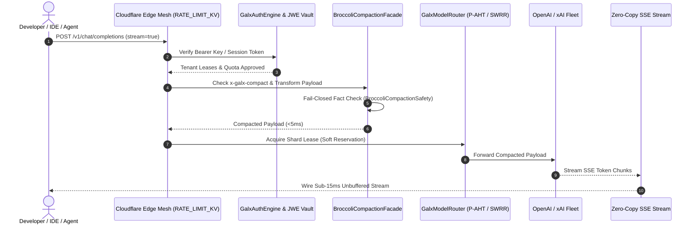
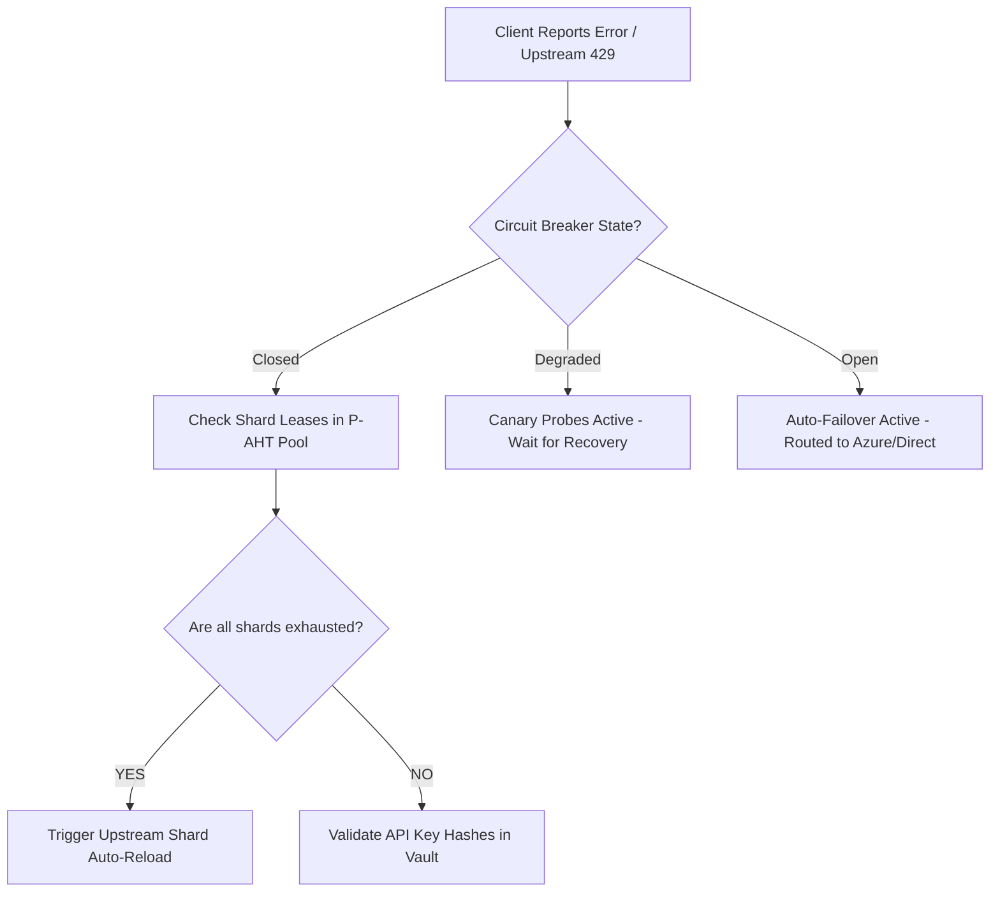

# 🛡️ GALXAI Maintainers Guide & Governance Manual

> **Authoritative Specification & Operational Manual for Repository Maintainers**  
> **Target Audience**: Core System Architects, Subsystem Maintainers, On-Call Operators, and Technical Reviewers.

---

## 📑 Table of Contents

1. [Maintainer Philosophy & Core Invariants](#1-maintainer-philosophy--core-invariants)
2. [Maintainer Hierarchy & Code Ownership](#2-maintainer-hierarchy--code-ownership)
3. [The Maintainer Onboarding Ramp (Day 1 → Month 1)](#3-the-maintainer-onboarding-ramp-day-1--month-1)
4. [Subsystem Architecture & Code Navigation Map](#4-subsystem-architecture--code-navigation-map)
5. [Maintainer Review Standards & PR Gate Rubric](#5-maintainer-review-standards--pr-gate-rubric)
6. [Debugging Runbooks & Decision Trees](#6-debugging-runbooks--decision-trees)
7. [Release Engineering & Emergency Hotfix Protocol](#7-release-engineering--emergency-hotfix-protocol)
8. [The 10 Invariant Commandments](#8-the-10-invariant-commandments)

---

## 1. Maintainer Philosophy & Core Invariants

As a maintainer of GALXAI, you are responsible for maintaining a **zero-downtime, sub-15ms AI compute clearinghouse, spend governance control plane, and representation transformation substrate**.

### The 4 Pillars of Maintainership:
1. **Paranoid Invariant Defense**: Code quality is not subjective. Every change must satisfy deterministic mechanical invariants (Zero Destructive DDL, Fail-Closed Factual Provenance, Zero-GC Critical Loops, Zero-Copy SSE Streams).
2. **Empirical Receipt Truth**: We do not guess or approximate token savings. All performance claims must be backed by reproducible provider-boundary usage and dollar receipts under Randomized Branch-Blinded evaluation (`npm run bench:inference-boundary`).
3. **Zero-Hesitation Ergonomics**: Developer experience is sacred. The gateway must resolve intents, aliases, shorthands, and missing parameters without throwing unhelpful 400 errors (`scripts/verify-zero-hesitation-ergonomics.ts`).
4. **Evidence-Gated Governance**: Spend interventions and model cascades must follow the verified operational sequence: $\text{Observe} \to \text{Attribute} \to \text{Explain} \to \text{Recommend} \to \text{Shadow} \to \text{Approve} \to \text{Canary} \to \text{Enforce} \to \text{Verify}$.

---

## 2. Maintainer Hierarchy & Code Ownership

```
┌─────────────────────────────────────────────────────────────────────────────────┐
│                           MAINTAINER ROLES & RESPONSIBILITIES                   │
├───────────────────┬──────────────────────────────────┬──────────────────────────┤
│ Role              │ Primary Scope                    │ Approval Authority       │
├───────────────────┼──────────────────────────────────┼──────────────────────────┤
│ **Core Architect**│ Substrate, Crypto Vault, ADRs    │ Final sign-off on ADRs,  │
│                   │ Global Topology, Financial Ledger│ Security & DB Migrations │
├───────────────────┼──────────────────────────────────┼──────────────────────────┤
│ **Subsystem Lead**│ BroccoliDB Compaction, Router,   │ Approves PRs in assigned │
│                   │ Cloudflare Edge, Auth Engine     │ subsystem directory      │
├───────────────────┼──────────────────────────────────┼──────────────────────────┤
│ **Triager / SRE** │ Issues, CI/CD, Benchmarks,       │ Reviews PRs, triages     │
│                   │ Playbook Drills, Live Telemetry  │ bugs, runs regressions   │
└───────────────────┴──────────────────────────────────┴──────────────────────────┘
```

See [`.github/CODEOWNERS`](.github/CODEOWNERS) for authoritative subsystem path mappings.

---

## 3. The Maintainer Onboarding Ramp (Day 1 → Month 1)

### 🗓️ Day 1: Zero-to-Hero Local Bootstrap
**Goal**: Clone, configure, compile, and achieve a 100% green verification pass in $< 15\text{ minutes}$.

1. **Prerequisites Verification**:
   ```bash
   node -v  # Must be >= 20.0.0 (Node 20 LTS recommended)
   npm -v   # Must be >= 10.0.0
   ```

2. **Clone & Install Dependencies**:
   ```bash
   git clone https://github.com/CardSorting/GALXAI.git
   cd GALXAI
   npm install
   ```

3. **Environment Setup**:
   ```bash
   cp .env.example .env.local
   # Ensure GALX_VAULT_MASTER_SECRET is set (generate 64-char hex if blank)
   ```

4. **Execute The Core Maintainer Verification Harness**:
   ```bash
   npm run onboard                   # 0. Fast 8-point maintainer workstation diagnostic (<5s)
   npm run hooks:install             # 1. Install pre-commit & commit-msg invariant hooks
   npm run bench:entropy             # 2. 7-Tier Progressive Institutional Entropy Benchmark
   npm run bench:inference-boundary  # 3. Empirical boundary benchmark (OpenAI models)
   npm run test:broccolidb:api        # 4. 19 Compaction mode API tests
   npm run test:broccolidb:hardening  # 5. Fail-closed safety regressions
   npm run test:router                # 6. 218 Router & Ingestion tests
   npx tsc --noEmit                   # 7. Strict TypeScript check (0 errors)
   ```

---


### 🗓️ Day 2: Codebase Anatomy & The Request Tracing Walkthrough
**Goal**: Trace a single streaming inference request through all 7 architectural layers.



#### Code Locations to Inspect:
1. **Ingress Route**: [`src/app/v1/chat/completions/route.ts`](file:///Users/bozoegg/Desktop/GALXAI/src/app/v1/chat/completions/route.ts)
2. **Auth Verification**: [`src/core/auth/GalxAuthEngine.ts`](file:///Users/bozoegg/Desktop/GALXAI/src/core/auth/GalxAuthEngine.ts)
3. **Representation Compaction**: [`src/core/broccolidb/BroccoliCompactionFacade.ts`](file:///Users/bozoegg/Desktop/GALXAI/src/core/broccolidb/BroccoliCompactionFacade.ts)
4. **Factual Grounding Safety**: [`src/core/broccolidb/BroccoliCompactionSafety.ts`](file:///Users/bozoegg/Desktop/GALXAI/src/core/broccolidb/BroccoliCompactionSafety.ts)
5. **Hydraulic Routing Engine**: [`src/core/pool/GalxCredentialPool.ts`](file:///Users/bozoegg/Desktop/GALXAI/src/core/pool/GalxCredentialPool.ts)
6. **Streaming Protocol Wrapper**: [`src/core/router/GalxModelRouter.ts`](file:///Users/bozoegg/Desktop/GALXAI/src/core/router/GalxModelRouter.ts)

---

### 🗓️ Day 3: Simulation & Emergency Drills
**Goal**: Run real-world fault simulations and verify recovery mechanisms.

1. **Simulate a Circuit Breaker Trip**:
   Run the router test suite and observe the 4-state state machine transition (`Closed` $\to$ `Degraded` $\to$ `Open` $\to$ `Half-Open`):
   ```bash
   npm run test:router
   ```

2. **Simulate an Ungrounded Compaction Attack**:
   Inspect how `BroccoliCompactionSafety` fails closed to raw text when a number or identifier is altered:
   ```bash
   npm run test:broccolidb:hardening
   ```

3. **Simulate a Randomized Branch-Blinded A/B Benchmark**:
   ```bash
   npm run bench:inference-boundary
   ```

---

### 🗓️ Week 2 → Month 1: Autonomous Maintenance Mastery
- Master all 8 Operational Lifecycle Playbooks in [`docs/playbooks/`](docs/playbooks/).
- Review and uphold all 65 Architecture Decision Records in [`docs/adr/`](docs/adr/).
- Conduct unframed behavioral developer observation sessions ([Stage 8 Playbook](docs/playbooks/08-unframed-developer-observation-protocol.md)).

---

## 4. Subsystem Architecture & Code Navigation Map

```text
src/
├── core/                               # PURE TYPESCRIPT SUBSTRATE (No React/DOM imports)
│   ├── auth/                           # Enterprise OAuth 2.1, RTR, JWE Enclave
│   ├── broccolidb/                     # Representation Compaction & Reactive Table Substrate
│   │   ├── eval/                       # Empirical Boundary Benchmarkers & Task Suites
│   │   ├── BroccoliCompactionFacade.ts # Unified 19-mode safe entry point
│   │   └── BroccoliCompactionSafety.ts # Fail-closed factual provenance gate
│   ├── circuit/                        # 4-State Circuit Breaker Finite State Machine
│   ├── pool/                           # P-AHT Hydraulic Headroom & Shard Allocation
│   ├── router/                         # Zero-Hesitation Model & Intent Resolution
│   └── vault/                          # AES-256-GCM Envelope Encryption with AAD
├── app/                                # Next.js 15 App Router & API Gateways
│   ├── api/audit/broccolidb/compact/   # Production Compaction REST Endpoint
│   ├── v1/chat/completions/            # OpenAI Streaming Inference Gateway
│   └── audit/                          # Spend Forensic Control Tower Dashboard
├── sdk/                                # Universal Developer SDK (@galxai/sdk)
│   └── ui/                             # Drop-in React 19 UI Primitives (<GalxChat />)
└── lib/                                # Shared Helpers & Storage Substrates
```

---

## 5. Maintainer Review Standards & PR Gate Rubric

Before merging ANY pull request into `main`, verify the **5-Gate PR Checklist**:

```
┌─────────────────────────────────────────────────────────────────────────────────┐
│                              THE 5-GATE PR CHECKLIST                            │
├──────┬──────────────────────┬───────────────────────────────────────────────────┤
│ Gate │ Area                 │ Requirement                                      │
├──────┼──────────────────────┼───────────────────────────────────────────────────┤
│ 1    │ **Type Safety**      │ `npx tsc --noEmit` must exit with 0 errors.       │
│ 2    │ **API Safety**       │ `npm run test:broccolidb:api` must pass 7/7.     │
│ 3    │ **Hardening Safety** │ `npm run test:broccolidb:hardening` must pass 100%│
│ 4    │ **Boundary Bench**   │ `npm run bench:inference-boundary` must pass.     │
│ 5    │ **ADR Required**     │ Any new architectural mode or contract requires   │
│      │                      │ a corresponding markdown ADR in `docs/adr/`.      │
└──────┴──────────────────────┴───────────────────────────────────────────────────┘
```

---

## 6. Debugging Runbooks & Decision Trees

### Decision Tree 1: Upstream Inference Failure (HTTP 429 / 5xx)



### Decision Tree 2: Compaction Fidelity Warning or Fallback
1. **Symptom**: Compaction returns `fallback: true` with `fidelity: 1.0`.
2. **Diagnosis**: `BroccoliCompactionSafety` detected an unsupported entity or discrepancy between input and output.
3. **Action**:
   - Inspect the regex or parser for that domain compactor.
   - Run `npx tsx scripts/dissect-payloads-and-causal-analysis.ts` to view exact byte deltas.
   - Verify that all numbers, dates, currencies, and identifiers are captured in the schema dictionary.

---

## 7. Release Engineering & Emergency Hotfix Protocol

### Standard Release Sequence:
1. **Pre-Flight Verification**:
   ```bash
   npm run deploy:check
   npm run vercel:verify
   ```
2. **Staging Smoke Test**:
   ```bash
   npm run vercel:smoke -- --url=https://staging.galx.ai
   ```
3. **Production Promotion**:
   ```bash
   git tag -a vX.Y.Z -m "Release vX.Y.Z"
   git push origin vX.Y.Z
   ```

### Emergency Hotfix Protocol (Sev-1):
1. Branch from `main`: `git checkout -b hotfix/sev1-description`
2. Apply minimal isolated patch.
3. Run targeted regression: `npm run test:broccolidb:hardening && npm run test:router`
4. Fast-track merge with 1 Core Architect approval.

---

## 8. The 10 Invariant Commandments

1. **Zero Destructive DDL without 3-Phase Expand/Contract Protocol**.
2. **Default-Deny Row Level Security (RLS) on 100% of Tables**.
3. **`SECURITY DEFINER` Search Path Sanitization (`SET search_path = public, pg_temp;`)**.
4. **Double-Entry Financial Immutability on all Wallet mutations**.
5. **Fail-Closed Anti-Hallucination Safety (`BroccoliCompactionSafety`) on all representation compactors**.
6. **Zero Dynamic Allocation in per-token streaming critical loops**.
7. **Zero-Copy Binary Buffer Passthrough for SSE inference streams**.
8. **Randomized Branch-Blinded A/B Benchmarking with post-hoc unblinding**.
9. **Zero-Hesitation Intent Aliasing for developer ergonomics**.
10. **Unframed Observation Priority**: When in doubt about product direction, observe real developers using the tool without correction.

---

*For operational playbooks, see [`docs/playbooks/`](docs/playbooks/). For architectural decisions, see [`docs/adr/`](docs/adr/).* 🥦🛡️🚀
