# BroccoliDB backend engineering handoff

**Repository:** `/Users/bozoegg/Desktop/GALXAI`  
**Primary code:** `src/core/broccolidb/`  
**Last audited:** 2026-08-28  
**Readiness:** hardened local/in-process database substrate; not yet a production distributed database

## Executive summary

BroccoliDB combines an in-memory table layer with a filesystem checkpoint, a checksummed redo WAL, and a content-addressable blob store. `BroccoliDatabaseKernel` also exposes 21 adjunct engines for coordination, indexing, caching, query execution, workflow orchestration, and analytics.

This audit removed the previous claim that the subsystem was “enterprise-grade,” “formally verified,” or a complete distributed database. Those descriptions were not supported by the implementation. The repository now has materially stronger local correctness and crash-recovery behavior, plus an adversarial invariant suite, but several components remain in-process protocol models without durable state or network transports.

The most important repaired failure was the persistence boundary. The prior checkpoint format serialized record values but not their map keys; recovery invented random IDs for keyless records. Startup also restored tables through normal mutation hooks, which generated new WAL entries while replaying the WAL. The v2 format now persists explicit `{ id, record }` entries and the exact WAL frame included by the checkpoint, restores silently, verifies a snapshot hash, and replays only later frames.

## Supported architecture

```mermaid
flowchart TD
    Client[SDK / application] --> Kernel[BroccoliDatabaseKernel]
    Kernel --> Tables[In-memory reactive tables]
    Tables --> WAL[Redo WAL: SHA-256 chain + fsync]
    Kernel --> Checkpoint[Atomic v2 checkpoint + history]
    Kernel --> CAS[Sharded SHA-256 CAS]

    Kernel --> Coordination[Coordination engines]
    Kernel --> Storage[Local storage and cache engines]
    Kernel --> Query[Query and index engines]
    Kernel --> Analytics[CDC and analytics engines]

    Coordination --> Pool[Connection leases]
    Coordination --> Locks[Shared/exclusive locks]
    Coordination --> Deadlocks[Wait-for graph]
    Coordination --> MVCC[MVCC]
    Coordination --> TwoPC[2PC coordinator]
    Coordination --> Saga[Saga orchestrator]
    Coordination --> Raft[Raft state machine]
    Coordination --> Ring[Consistent hash ring]

    Storage --> Buffer[LRU-K buffer pool]
    Storage --> LSM[In-memory LSM model]
    Storage --> Cache[Single-flight tiered cache]

    Query --> Optimizer[Heuristic query planner]
    Query --> Plans[Adaptive plan cache]
    Query --> BTree[B-tree]
    Query --> Sparse[Sparse block index]
    Query --> Text[BM25 inverted index]
    Query --> Vectorized[Columnar execution]
    Query --> Nearest[Exact vector search]

    Analytics --> CDC[Bounded CDC stream]
    Analytics --> Views[Incremental materialized views]
    Analytics --> Rollups[Time-series rollups]
```



The “21 engines” count refers only to the adjunct engines exposed as kernel properties. WAL, CAS, tables, checkpointing, and the mutex are foundational components and are not part of that count. The prior diagram numbered WAL and CAS as additional engines while still claiming a total of 21.

## Persistence and recovery contract

### On-disk layout

```text
.broccolidb/
├── checkpoint.db             # v2 current-state checkpoint
├── wal.log                   # newline-delimited redo frames
├── checkpoints/              # immutable named checkpoint history
└── cas/
    ├── blobs/<shard>/<hash>  # raw or Brotli CAS payloads
    └── corrupt/              # quarantined blobs and manifest
```

### Checkpoint v2

A checkpoint stores:

- `formatVersion: 2`;
- `includedWalFrameId`, the exact redo cut represented by the snapshot;
- `snapshotHash`, a SHA-256 digest of the serialized table image;
- explicit table entries shaped as `{ id, record }`.

The file is written to a same-directory exclusive temporary file, fsynced, atomically renamed, and followed by a directory fsync. Recovery verifies the snapshot hash and fails closed on malformed or corrupt data. The legacy format is readable only when every record has an explicit string `id`; unrecoverable keyless legacy records are rejected instead of receiving fabricated IDs.

Table mutation guards pause direct writes during checkpoint and rollback rotation. TTL expirations that fire inside that maintenance window are deferred and retried after it closes, preventing a post-cut WAL frame from being truncated.

### WAL

Every frame carries a monotonic frame ID, operation, table, record ID, payload, predecessor hash, and SHA-256 checksum. Replay now validates:

- schema and supported operation;
- strictly increasing frame IDs;
- checksum format and recomputation;
- predecessor-chain continuity;
- JSON-object payload shape.

Flushes use an append file handle followed by `fsync`. A failed flush restores the batch to the front of the in-memory buffer and surfaces the error through later `flush()` calls and `health()`. A torn or tampered log causes startup failure; automatic damaged-tail truncation is intentionally not performed.

Table mutations use micro-batched durability. A successful `put()` means the in-memory mutation completed; it does not by itself mean the frame is fsynced. Use `await kernel.flush()`, `await kernel.transaction(...)`, `await kernel.checkpoint()`, or `await kernel.stop()` at a durability boundary.

### Recovery and rollback

Startup performs the following ordered sequence:

1. validate and initialize CAS and WAL;
2. restore the checkpoint without table mutation hooks;
3. replay only WAL frames newer than `includedWalFrameId` into detached snapshots;
4. install the recovered snapshots without generating new WAL frames;
5. load the named-checkpoint catalog.

Rollback now restores all tables, clears tables created after the target checkpoint, persists the restored image as the new base checkpoint, rotates the WAL, and writes a synchronous rollback marker. The rollback result therefore survives another process restart.

`kernel.transaction()` snapshots all kernel tables, serializes transaction callers with the kernel mutex, flushes on success, and on failure restores the image plus appends a canonical compensating redo image. Direct writes through previously acquired table handles do not acquire the kernel transaction mutex; callers must not mix such writes concurrently with a kernel transaction if they require isolation.

### CAS

CAS paths accept lowercase 64-character SHA-256 hashes only, preventing traversal through hash-shaped APIs. Existing blobs are verified before reuse after process start. Corrupt blobs are quarantined with a manifest entry and can be recreated when the original content is stored again. Statistics now calculate raw sizes by decoding stored payloads rather than reporting stored bytes as raw bytes.

## Adjunct engine accuracy matrix

| Engine | Verified behavior | Explicit boundary |
|---|---|---|
| `BroccoliConnectionPool` | Positive bounded capacities, FIFO admission, queued-writer fairness, lease expiry, idempotent release, drain | Manages in-process logical leases, not network/database connections |
| `BroccoliLockAuthority` | Multiple compatible shared owners, exclusive conflicts, TTL cleanup, ordered batch acquisition, rollback of only newly acquired handles | In-process and non-durable; TTL cleanup is opportunistic |
| `BroccoliDeadlockDetector` | Wait-for graph cycle detection and victim selection | Detection is not automatically wired to lock acquisition or transaction abort |
| `BroccoliMvccEngine` | Snapshot commit sequence, read-committed visibility, own writes, rollback, first-committer-wins conflicts, snapshot-safe vacuum | Standalone engine; not the storage model used by `BroccoliDbTable` |
| `BroccoliTwoPhaseCommitCoordinator` | Participant validation, prepare/commit/rollback, duplicate transaction rejection, explicit `HEURISTIC` outcome | Volatile coordinator with no durable decision log, timeout policy, recovery worker, or RPC transport |
| `BroccoliSagaOrchestrator` | Reverse compensation, duplicate-step rejection, in-flight/idempotent saga IDs, reported compensation failures | Volatile history; no durable outbox/inbox or retry scheduler |
| `BroccoliRaftConsensusEngine` | Vote rules, log matching, contiguous AppendEntries validation, conflict truncation, single-node election/commit | Protocol state model only; no timers, RPC fan-out, persistence, snapshots, quorum replication, or linearizable read barrier |
| `BroccoliConsistentHashRing` | Weighted virtual nodes, replacement-safe membership updates, clockwise routing, distinct replicas | Membership is local and token collisions are not externally coordinated |
| `BroccoliBufferPoolManager` | LRU-K selection, pinning, concurrent-load coalescing, dirty tracking, explicit flush | Dirty pages are never silently evicted; no default disk/CAS writer is attached |
| `BroccoliLsmStore` | Memtable overlay, sorted immutable arrays, Bloom/min-max reads, compaction ordering, safe tombstone retention | Entirely in memory; the memtable is a `Map`, not a skiplist, and SSTables are not files |
| `BroccoliTieredKvCache` | L1 plus JSON-backed L2, TTL, XFetch trigger, per-key single-flight miss/refresh coalescing | Both tiers are in-process memory; there is no L3 storage tier |
| `BroccoliQueryOptimizer` | Deterministic rule selection for primary key, matching secondary index, range, or full scan | Heuristic planner, not a statistics-driven cost-based optimizer |
| `BroccoliAdaptivePlanCache` | Bounded LRU storage, execution telemetry, cardinality-drift invalidation | Not automatically integrated with table schema/statistics changes |
| `BroccoliBTreeIndexEngine` | Type-consistent ordered keys, split/search/range correctness | Conservative delete rebuilds the tree in `O(N log N)` to preserve invariants |
| `BroccoliSparseIndexEngine` | Block summaries and safe Bloom/min-max pruning | Unindexed predicates always scan; this prevents false-negative pruning |
| `BroccoliInvertedIndexEngine` | Unicode tokenization, BM25 scoring, repeated-token phrase positions, replacement/removal | In-memory index without stemming, analyzers, persistence, or segment merging |
| `BroccoliVectorEngine` | Typed numeric columns, null masks, validated selection vectors, filter/aggregate loops | JavaScript typed-array execution; no demonstrated hardware SIMD contract |
| `BroccoliVectorAnnEngine` | Defensive vector copies, fixed namespace dimensions, cosine/Euclidean/dot-product top-k | Exact brute-force `O(V × D)` search despite the legacy `Ann` class name; not ANN |
| `BroccoliCdcStream` | Monotonic LSNs, bounded replay, filters, defensive event copies, explicit retention-gap error | In-memory only; subscriber failures are isolated and not retried |
| `BroccoliMaterializedViewEngine` | Manual incremental COUNT/SUM/AVG/MIN/MAX, extremum repair on delete/update, direct group lookup | Mutations must be applied explicitly; table CDC is not automatically wired |
| `BroccoliTimeSeriesRollupEngine` | Ordered retention, finite-value validation, windowing, nearest-rank P50/P90/P99 | Bounded in-memory points; no tag query, durable series, or approximate quantile sketch |

## Repaired failure ledger

| Severity | Exposed failure | Repair | Regression evidence |
|---|---|---|---|
| P0 | Checkpoints lost external record IDs | v2 `{id, record}` format | keyless checkpoint/restart test |
| P0 | Restore/replay generated new WAL mutations | silent snapshot recovery | restart test and stable recovery |
| P0 | Checkpoint could replay WAL frames already represented by the snapshot | persisted exact WAL cut | checkpoint plus trailing-frame test |
| P0 | WAL verified individual checksums but not predecessor linkage | explicit chain-continuity validation | recomputed-but-detached frame test |
| P0 | Failed WAL append dropped the detached batch | restore-on-failure buffer handling | code-path and health propagation |
| P0 | Rollback was memory-only and disappeared after restart | persist restored image and rotate WAL | double-restart rollback test |
| P0 | LSM compaction could purge a tombstone above an older remaining value | retain tombstone while any uncompacted table contains the key | non-resurrection test |
| P0 | Sparse Bloom logic used unrelated columns and could prune real matches | only indexed columns may prove absence | unindexed-predicate match test |
| P1 | B-tree internal deletion broke child/key invariants | conservative rebuild deletion | repeated internal deletion and full lookup test |
| P1 | Materialized MIN/MAX stayed stale after deleting an extremum | counted value multiset and extremum recomputation | minimum-delete test |
| P1 | Cache XFetch launched duplicate origin refreshes | per-key single-flight map | 20-concurrent-request test |
| P1 | MVCC visibility used transaction IDs as commit time and allowed lost updates | commit sequence snapshots and write-conflict abort | competing-writer test |
| P1 | Shared locks behaved as exclusive locks | per-resource compatible handle sets | two-reader/one-writer test |
| P1 | New readers could bypass a queued writer | strict FIFO queue head processing | resolution-order test |
| P1 | 2PC silently omitted unknown participants and mislabeled partial commit failure as abort | fail-closed registration and `HEURISTIC` state | missing/failed-commit tests |
| P1 | Saga compensation exceptions were swallowed while reporting success | `FAILED` plus `compensationErrors` | compensation-failure test |
| P1 | CAS accepted arbitrary hash paths | strict SHA-256 validation | traversal input test |
| P2 | Vector input aliased caller-owned typed arrays | unconditional defensive copy | post-insert mutation test |
| P2 | CDC silently returned incomplete history after retention loss | `CdcHistoryGapError` | retention-gap test |
| P2 | Out-of-order time-series insertion evicted insertion order rather than oldest time | timestamp-ordered insertion | invariant implementation |

## Validation evidence

These commands passed in this workspace on 2026-08-28:

| Command | Result |
|---|---|
| `npx tsc --noEmit --pretty false` | 0 TypeScript errors |
| `npm run test:broccolidb:backend-invariants` | adversarial backend invariant suite passed |
| `node --import tsx scripts/test-broccolidb-advanced-backend.ts` | all 21 adjunct engine suites passed |
| `npm run test:broccolidb:hardening` | production-hardening regression suite passed |
| `npm run test:router` | 218/218 repository forensic tests passed |

The tests are regression evidence, not formal verification or a proof of distributed safety.

## Operating guide

```typescript
import { BroccoliDatabaseKernel } from "@/core/broccolidb";

const kernel = new BroccoliDatabaseKernel({
  workspaceRoot: process.cwd(),
  walDebounceMs: 20,
  nodeId: "local-node-1",
});

await kernel.start();

const jobs = kernel.getTable<{ status: string; attempts: number }>("jobs");
jobs.put("job-42", { status: "queued", attempts: 0 });

await kernel.transaction(async () => {
  jobs.put("job-42", { status: "running", attempts: 1 });
});

const checkpoint = await kernel.checkpoint("before-migration");
// await kernel.rollback(checkpoint.checkpointId);

await kernel.stop();
```

Operational rules:

1. Use one kernel process per `workspaceRoot`. There is no cross-process WAL writer lock.
2. Always call `start()` before relying on recovery and `stop()` during graceful shutdown.
3. Treat `flush()`, transaction completion, checkpoint completion, and stop completion as durability barriers.
4. Keep persistent records JSON-serializable. Buffers, Dates, class instances, functions, cyclic objects, and `undefined` fields do not have lossless JSON round trips.
5. Alert when `health().pillars.walJournal.healthy` is false or startup throws an integrity error.
6. Back up `checkpoint.db`, `checkpoints/`, `wal.log`, and referenced CAS blobs as one consistency set.
7. Flush dirty buffer-pool pages with an explicit writer before expecting eviction.
8. Handle `HEURISTIC` 2PC and failed saga compensation as manual-reconciliation incidents.

## Production promotion backlog

The following work is required before describing BroccoliDB as a distributed or world-class production database:

### P0: durability and process ownership

- add an OS-level single-writer lock or a dedicated storage daemon;
- add length-delimited WAL records, damaged-tail inspection tooling, failpoint tests, disk-full tests, and power-loss recovery tests;
- define backup/restore, WAL retention, checkpoint retention, and disaster-recovery procedures;
- add filesystem permission hardening and encryption-at-rest requirements;
- make transaction isolation impossible to bypass through direct table handles.

### P0: distributed protocol completion

- give Raft durable term/vote/log state, randomized election timers, RPC transport, quorum replication, `nextIndex`/`matchIndex`, snapshots, membership changes, and read-index or lease validation;
- give 2PC a durable coordinator decision log, participant recovery protocol, idempotency contract, timeouts, and operator reconciliation;
- give sagas a durable state machine, outbox/inbox deduplication, retry policy, deadlines, and poison-message handling.

### P1: engine integration

- choose one authoritative transaction model and integrate MVCC with table writes and WAL commit records;
- publish table mutations into CDC automatically and feed materialized views from committed events;
- attach the buffer pool to a real page store and turn the LSM model into durable SSTables with manifests and checksums;
- replace exact vector scan with a real HNSW/IVF implementation only if measured workloads justify ANN;
- replace rule-based query selection with maintained cardinality statistics and measured cost calibration.

### P1: operations and performance

- add OpenTelemetry metrics for WAL latency, checkpoint duration, recovery frames, cache coalescing, lock waits, and compaction debt;
- establish reproducible benchmarks with dataset sizes, hardware, warmup, percentiles, and regression thresholds;
- add fuzz/property tests for WAL parsing, B-tree operations, MVCC histories, compaction, and checkpoint crash points;
- publish SLOs only after soak, concurrency, and fault-injection results exist.

Until those items are complete, the accurate positioning is: **a hardened, dependency-light local TypeScript storage kernel with reusable database algorithm components and explicit distributed-protocol prototypes**.
