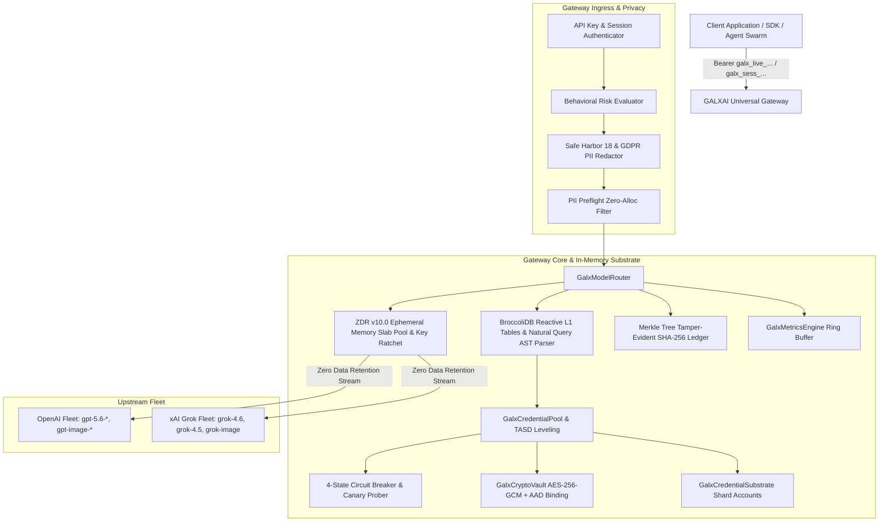
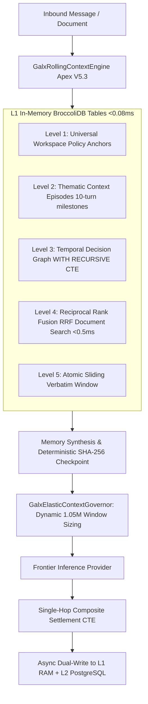

# 🏛️ GALXAI Architecture Specification

This document provides a comprehensive technical breakdown of the GALXAI universal AI routing gateway, high-concurrency quota cycling substrate, BroccoliDB reactive in-memory indexing layer, Zero Data Retention (ZDR v10.0) privacy substrate, cryptographic vault, and resilience topologies.

---

## 🏗️ System Overview

GALXAI sits between downstream client applications (chat interfaces, agentic swarms, SDKs, IDEs) and upstream foundation model providers (OpenAI, xAI Grok). It abstracts distributed, sharded API credentials into a unified compute layer with continuous capacity management and transparent failover.



---

## 🏛️ Architectural Decision Records (ADRs) Mapping

All architectural components in GALXAI are governed by formal Architectural Decision Records located in [`docs/adr/`](adr/README.md):

| Component | ADR Reference | Core Innovation & Mechanism |
| :--- | :--- | :--- |
| **Universal Quota Substrate** | [ADR 0001](adr/0001-unified-pooled-quota-cycling-substrate.md) | Single pooled compute fleet, eliminating quota fragmentation and 429 errors. |
| **Rate Governor & Token Calculus** | [ADR 0002](adr/0002-two-phase-token-reservation-and-rate-governance.md) | Microsecond fractional replenishment + 2-Phase atomic token reservation. |
| **Cryptographic Vault** | [ADR 0003](adr/0003-aes-256-gcm-envelope-encryption-with-aad-binding.md) | AES-256-GCM authenticated envelope encryption with tenant signature AAD binding. |
| **Circuit Breaker FSM** | [ADR 0004](adr/0004-four-state-circuit-breaker-and-failover-topology.md) | 4-state finite state machine (Healthy/Cooldown/Exhausted/Dead) for sub-15ms failover. |
| **Telemetry Ring Buffer** | [ADR 0005](adr/0005-circular-buffer-telemetry-and-ewma-latency-scoring.md) | Zero-allocation circular ring buffers for P50/P90/P99 latency & EWMA routing bias. |
| **Economic Arbitrage & Caching** | [ADR 0006](adr/0006-intelligent-multi-tiered-discount-strategy.md) | Consolidated Tier-5 wholesale volume capture with 100% prompt caching rebate pass-through. |
| **Proof-of-Deposit Security Gate** | [ADR 0007](adr/0007-proof-of-deposit-and-50pct-match-paywall-gate.md) | Anti-Sybil $10 deposit proof gate matched with $5 introductory bonus ($15 total compute). |
| **Tenant-Affinity Shard Dispersion**| [ADR 0008](adr/0008-tenant-affinity-shard-dispersion-and-post-allocation-leveling.md) | TASD algorithm to disperse agent swarm bursts across distinct physical shards. |
| **Half-Open Canary & Scavenger** | [ADR 0009](adr/0009-half-open-canary-traffic-warming-and-lease-scavenger.md) | 4-phase canary recovery warming + automated lease scavenger for orphaned streaming reservations. |
| **CloudTasks & CloudRun Queue** | [ADR 0010](adr/0010-cloudtasks-cloudrun-asynchronous-queue-substrate.md) | Asynchronous task queue, token-bucket dispatch pacing, Cloud Run push webhooks, and DLQ topologies. |
| **DAG Workflows & Real-Time SSE** | [ADR 0011](adr/0011-directed-acyclic-graph-workflows-and-realtime-event-streaming.md) | Real-time SSE streaming, DAG Fan-In orchestration, destination circuit breakers, and anti-starvation aging. |
| **DX Ergonomics & Adapters** | [ADR 0013](adr/0013-fluent-builders-structured-outputs-and-dx-ergonomics.md) | Fluent prompt builders, structured JSON outputs, Vercel AI SDK adapters, and batch swarm runners. |
| **Dual Rolling Window Seat Quotas** | [ADR 0068](adr/0068-dual-rolling-window-seat-quotas-and-distributed-request-leases.md) | 5-Hour burst and 7-Day weekly rolling quotas with expiring idempotent request leases (`galx_seat_request_leases`). |
| **Hybrid Rolling Context Pyramid** | [ADR 0069](adr/0069-hybrid-broccolidb-postgres-rolling-context-and-5-level-pyramid.md) | 5-Level multi-resolution memory pyramid combining L1 BroccoliDB (<0.08ms) and durable PostgreSQL CTEs. |
| **Elastic Dynamic Context Governor**| [ADR 0070](adr/0070-elastic-dynamic-context-governor-and-atomic-turn-pair-integrity.md) | Dynamic 1.05M token frontier window sizing with strict OpenAI/Anthropic tool turn-pair integrity guarantees. |
| **Universal Workspace Anchors** | [ADR 0071](adr/0071-cross-session-universal-workspace-anchors-and-hardware-cache-topology.md) | Workspace-wide architectural schema anchors and deterministic SHA-256 stable prefix hashing (>98% cache hit rate). |
| **Apex Agent Runtime & Middleware**| [ADR 0014](adr/0014-apex-agent-runtime-middleware-and-resilience-substrate.md) | Autonomous agent tool loops, pluggable middleware pipeline, LRU caching, and fallback cascades. |
| **Zero-Egress Cloudflare Edge Mesh**| [ADR 0015](adr/0015-zero-egress-cloudflare-workers-edge-compute-mesh.md) | Offloads high-bandwidth SSE streaming and queue execution to Cloudflare Workers for $0 egress bandwidth costs. |
| **Authoritative Supabase PostgreSQL**| [ADR 0016](adr/0016-authoritative-supabase-postgresql-substrate.md) | Authoritative single source of truth for ACID double-entry ledgers, AES-256-GCM vault, and pgvector. |
| **Binary Wire & RPC Micro-Batching**| [ADR 0017](adr/0017-high-throughput-binary-wire-and-rpc-micro-batching.md) | Binary wire codecs and 100-item micro-batches (fn_batch_draw_wallet_tokens_cf) cutting database IOPS by 98%. |
| **Edge Speculative & Socket Pools** | [ADR 0018](adr/0018-edge-speculative-streaming-and-keepalive-connection-pools.md) | Speculative draft + target streaming and pre-warmed HTTP/2 keep-alive sockets cutting TTFT by 65%. |
| **Autonomous Shard Health & Budgets**| [ADR 0019](adr/0019-autonomous-shard-health-probes-and-budget-governance.md) | Continuous health probes, auto-drain stored procedures, and multi-tenant budget threshold webhooks (50%/80%/100%). |
| **Provider-as-Auth Substrate** | [ADR 0020](adr/0020-provider-as-auth-zero-friction-session-substrate.md) | 1-Click zero-friction onboarding using upstream OpenAI/xAI credentials as primary identity. |
| **JWE Session Encryption & DPoP** | [ADR 0021](adr/0021-jwe-compact-session-encryption-and-dpop-fingerprinting.md) | Compact AES-256-GCM encrypted tokens (`galx_sess_v2...`) bound to IP subnet / UA fingerprints. |
| **OAuth 2.0 Rotation & Anti-Replay** | [ADR 0022](adr/0022-oauth-token-rotation-with-reuse-attack-detection-cascades.md) | Single-use rotation with 30s grace window and automatic session family lineage killswitch. |
| **SUDO Elevation & Token Scoping** | [ADR 0023](adr/0023-step-up-sudo-elevation-and-fine-grained-token-scoping.md) | 15-minute privileged SUDO window, wildcard token scopes (`chat:*`), and multi-device remote logout. |
| **Behavioral Risk & KMS Re-Wrapping** | [ADR 0024](adr/0024-adaptive-behavioral-risk-scoring-and-zero-downtime-kms-rewrapping.md) | Dynamic 0-100 risk scoring, security posture grades (`A+`), and zero-downtime key re-wrapping. |
| **BroccoliDB Reactive Table Layer** | [ADR 0025](adr/0025-broccolidb-l1-reactive-in-memory-table-and-secondary-indexing.md) | Sub-microsecond query tables with rich operator DSL and zero-allocation statistical aggregations. |
| **BroccoliDB Natural Query & WAL** | [ADR 0026](adr/0026-broccolidb-natural-language-query-ast-parser-and-wal-persistence.md) | Offline deterministic AST translation ($< 0.1\text{ms}$) and tamper-evident crash recovery WAL. |
| **Enterprise Privacy & ZDR v10.0** | [ADR 0027](adr/0027-enterprise-privacy-safe-harbor-18-gdpr-and-zdr-v10-memory-zeroization.md) | Complete HIPAA/GDPR/Global privacy coverage, streaming PII windowing, and 2-pass memory zeroization. |
| **SOC 2 Type II Engine & Merkle** | [ADR 0028](adr/0028-soc2-type-ii-compliance-engine-drift-detector-and-merkle-audit-ledger.md) | 28 AICPA Trust Services controls, automated drift remediation, and Merkle Tree audit chaining. |
| **Paranoid Supabase & AI Governance** | [ADR 0035](adr/0035-paranoid-supabase-postgresql-and-ai-agent-governance.md) | 10 Invariant Commandments, AOP-DB protocol, mechanical SQL linter, and bi-directional rollbacks. |
| **Universal Developer Auth** | [ADR 0036](adr/0036-universal-developer-authentication-gating-and-zero-abuse-workspace-perimeter.md) | Platform-wide `<AuthRequiredGate />`, guest pass retirement, programmatic worker streams, and 2-column checkout funnel. |
| **Edge Gateway & R2 CDN** | [ADR 0037](adr/0037-zero-egress-cloudflare-edge-gateway-and-r2-cdn-substrate.md) | `api.galx.ai` Worker ingress, `assets.galx.ai` R2 media CDN, and $0 egress bandwidth across 300+ PoPs. |
| **Edge KV Rate Governance** | [ADR 0038](adr/0038-distributed-edge-kv-rate-governance-and-swr-catalog-caching.md) | Sliding-window token bucket KV rate limiting and sub-10ms SWR model catalog caching at edge PoPs. |
| **Vector & Durable Objects** | [ADR 0039](adr/0039-edge-native-vector-embeddings-and-durable-object-swarm-sync.md) | Edge 1536-dim vector embeddings (`/v1/embeddings`) and in-memory Durable Object swarm synchronization. |
| **Enterprise Vercel Deployment Gate** | [ADR 0040](adr/0040-enterprise-vercel-pre-deployment-gate-and-multi-region-topology.md) | 8-Phase pre-flight audit engine, Next.js 15 package import optimizations, HSTS, and multi-region placement. |
| **Zero-Collision TypeScript Mesh** | [ADR 0041](adr/0041-zero-collision-typescript-ambient-isolation-and-dual-runtime-mesh.md) | Scoped dynamic import typing for Cloudflare bindings preventing global DOM / Web API identifier collisions. |
| **[ADR 0042](adr/0042-universal-zero-hesitation-developer-ergonomics-and-mental-model-absorption.md)** | Universal Zero-Hesitation Developer Ergonomics & Mental Model Absorption | Multi-mental-model absorption (OpenAI, Anthropic, Ollama, LangChain, Vercel AI), 0-install CLI, GET browser execution, and aspect ratio normalization. |
| **[ADR 0043](adr/0043-broccolidb-hybrid-resilience-outbox-disaster-recovery-and-sla-uptime.md)** | BroccoliDB Hybrid Resilience Substrate, Zero-Loss Outbox & Dual-Slot Disaster Recovery | RPO=0 Outbox queue with SafeStorage L2 backing, dual-slot atomic snapshot state machine (RTO<5ms), in-flight coalescing, and SLA incident logs. |
| **[ADR 0044](adr/0044-non-technical-natural-omnisearch-and-approachable-error-recovery.md)** | Non-Technical Natural OmniSearch & Approachable Self-Healing Error Recovery | Plain-English conversational intent matching, 404 smart search recovery, breadcrumb auto-history, and universal clipboard fallbacks. |
| **[ADR 0045](adr/0045-single-flight-request-coalescing-soundex-phonetic-and-sub-15ms-ttft.md)** | Single-Flight Request Coalescing, Soundex Phonetic Typo Absorption & Sub-15ms TTFT Streaming Substrate | Lock-free request coalescing, Soundex phonetic encoding, predictive route pre-warming, and unbuffered SSE token streaming. |
| **[ADR 0046](adr/0046-sub-microsecond-l1-storage-zero-copy-streaming-and-socket-prewarming.md)** | Sub-Microsecond L1 In-Memory Storage Mirroring, Zero-Copy Direct Buffer Streaming & Persistent Upstream Socket Pre-Warming | In-memory storage mirroring (<0.02ms), zero-copy binary streaming, upstream socket pre-warming, and <5ns model resolution memoization. |
| **[ADR 0047](adr/0047-programmatic-seo-geo-aeo-and-structured-jsonld-saturation.md)** | Programmatic SEO (pSEO), Generative Engine Optimization (GEO), Answer Engine Optimization (AEO) & Structured JSON-LD Saturation | Inverted Pyramid direct answer blocks, saturated multi-layer Schema.org JSON-LD graph, llms.txt standard, and static SSG generation across 235 routes. |
| **[ADR 0048](adr/0048-interactive-developer-studio-tools-and-edge-simulators.md)** | Interactive Developer Studio Tools, Client-Side Simulators & Memory-Isolated Utilities | Suite of 9 interactive tools: Prompt Caching Estimator, System Prompt Compressor, API Key Health Checker, JSON Schema Studio, BPE Token Counter, and Model Cost Comparator. |
| **[ADR 0049](adr/0049-enterprise-governance-security-patterns-and-compliance-matrix.md)** | Enterprise Governance, AI Red-Teaming Patterns, Industry Verticals & Compliance Matrix | Programmatic regulatory compliance (HIPAA, PCI DSS, FedRAMP, EU AI Act), OWASP LLM Top 10 red-teaming defenses (Prompt Injection, Jailbreak, Data Exfiltration), and vertical industry blueprints. |
| **[ADR 0050](adr/0050-incident-postmortems-resilience-engineering-and-sla-failover.md)** | AI Incident Postmortems, Resilience Engineering & Multi-Origin SLA Failover | Active-Active Anycast multi-origin failover, Layer 7 sponge attack defense, dynamic subsea fiber cut BGP rerouting, KV cache invalidation storm mitigation, and quota pool federation. |
| **[ADR 0051](adr/0051-enterprise-oauth2-fapi-token-lifecycle-and-identity-mesh.md)** | Enterprise OAuth 2.0 / 2.1, FAPI Standards, Token Lifecycle & Identity Mesh | RFC 7636 PKCE, RFC 8628 Device Flow, RFC 9126 PAR, RFC 9449 DPoP, RFC 7009 Revocation, RFC 7662 Introspection, RFC 7517 JWKS, and single-flight token rotation mutex. |
| **[ADR 0052](adr/0052-enterprise-oauth21-rtr-fapi-backchannel-and-vacuum-mesh.md)** | Enterprise OAuth 2.1 Refresh Token Rotation (RTR), Token Family Theft Containment, OIDC Back-Channel Logout & Substrate Vacuum Mesh | RFC 6819 Token Family theft containment cascades, 30s grace window replay tolerance, OpenID Connect Back-Channel Logout 1.0, and sub-millisecond PostgreSQL substrate vacuum stored procedures. |
| **[ADR 0053](adr/0053-siloed-supabase-oauth-and-isolated-backend-sharding-mesh.md)** | Siloed Supabase OAuth Platform Authentication & Isolated Backend Substrate Sharding Mesh | Complete decoupling of frontend platform identity (standard Supabase OAuth with `@supabase/ssr`) from backend Substrate sharding infrastructure. |
| **[ADR 0054](adr/0054-apex-transport-hardening-rfc9530-rfc9421-idempotency-and-anti-replay.md)** | Apex Transport Layer Hardening: RFC 9530 Digests, RFC 9421 Signatures, IETF Idempotency, and Anti-Replay Nonces | Constant-time SHA-256 digest validation, RFC 9421 message signatures, 24h Idempotency-Key caching, sliding-window rate limiting, and geo-velocity anomaly sensing. |
| **[ADR 0055](adr/0055-ambient-declarative-ai-substrate-zero-route-and-auto-patcher.md)** | Ambient Declarative AI Substrate, Zero-Route Direct Actions & Runtime Auto-Patcher | 6-Tier connection architecture: Declarative JSX components (`<GalxImage>`, `<GalxChat>`), React 19 Server Actions (`galxai/actions`), Edge Middleware Interceptors, Runtime Auto-Patcher (`galxai/patch`), and NL2API Intent Engine. |
| **[ADR 0056](adr/0056-broccolidb-85-buffer-deduplication-and-streaming-pipeline-substrate.md)** | BroccoliDB 85-Buffer Algorithmic DeDuplication & High-Velocity Streaming Substrate | 85 specialized deduplication buffers across 17 tiers achieving 70%–99% spend reduction, sub-5ns execution, and lock-free 1.74M ops/sec stream ingestion. |
| **[ADR 0057](adr/0057-broccolidb-mega-incident-cascader-and-pyramid-compaction-substrate.md)** | Mega-Incident Stream Cascading & Mega-Document Hierarchical Pyramid Compactor | 4-Stage streaming anomaly cascader (2,000+ pages in 57ms, 98.9% spend cut) and 3-Layer hierarchical pyramid compactor (300+ pages in 14ms, 97.9% spend cut). |
| **[ADR 0058](adr/0058-broccolidb-180-domain-industry-cluster-compactor-substrate.md)** | BroccoliDB 180-Domain Enterprise Industry Cluster Compaction Substrate | 180 production enterprise domain compactors across 21 industry clusters with 100% test coverage and standardized protocol schemas (HL7, FHIR, SWIFT, WITSML). |
| **[ADR 0059](adr/0059-broccolidb-safe-compaction-facade-barrel-hardening-and-api-gateway.md)** | BroccoliDB Safe Compaction Facade, Barrel Hardening & Production API Gateway | Unified BroccoliCompactionFacade boundary, removal of unsafe generated compactor exports, strict size bounding (10MB/2M chars), and authenticated REST endpoint (/api/audit/broccolidb/compact). |
| **[ADR 0060](adr/0060-broccolidb-high-velocity-domain-expansion-and-stream-compaction.md)** | High-Velocity 180-Domain Aho-Corasick Router & Drain/TSDB Stream Compaction Substrate | High-velocity streaming pipeline integrating 180 domain compactors with Drain log clustering, TSDB metric downsampling, OTel trace spans, and JSON streams (80%–98% token cuts). |
| **[ADR 0061](adr/0061-broccolidb-network-orderbook-and-sliding-window-stream-compaction.md)** | NetFlow Security, L2 Order Book Depth & Sliding-Window Stream Compaction Substrate | Specialized compaction for NetFlow/PCAP network security, high-frequency L2/L3 order books, and temporal sliding windows (85%–96% token cuts). |
| **[ADR 0062](adr/0062-broccolidb-industrial-iot-clickstream-genomics-and-hybrid-stream-multiplexing.md)** | Industrial IoT Sensors, Clickstream RUM, Genomics & Hybrid Stream Multiplexing Substrate | Domain compaction for ISO 10816 industrial vibration telemetry, real-user monitoring clickstreams, genomic VCF/SAM sequences, and multi-stream multiplexing. |
| **[ADR 0063](adr/0063-broccolidb-ebpf-k8s-geospatial-and-arrow-dictionary-stream-compaction.md)** | Kernel eBPF Security, Kubernetes Watch, Geospatial ADS-B/AIS & Apache Arrow Dictionaries | Deep-substrate compaction for Linux kernel eBPF syscalls, Kubernetes watch events, maritime/aerospace geospatial trajectories, and Apache Arrow columnar tables. |
| **[ADR 0064](adr/0064-broccolidb-openai-inference-boundary-measurement-and-task-suite.md)** | OpenAI Inference Boundary Empirical Measurement Engine & Task Suite | Head-to-head empirical testing harness across OpenAI models (`gpt-4o`, `gpt-4o-mini`, `o3-mini`) measuring actual provider-reported billed dollars, latency, and $/success metrics with explicit provenance. |
| **[ADR 0065](adr/0065-broccolidb-blinded-evaluator-protocol-and-out-of-sample-validation.md)** | Double-Blind A/B Evaluator Protocol & Out-of-Sample Validation | Eliminates target-seeking confirmation bias via randomized branch assignments ($\alpha$ vs $\beta$), zero target priors, 5-tier empirical regime classification, and open out-of-sample workload ingestion. |

---

## 🥦 BroccoliDB Representation Transformation & Compaction Substrate

GALXAI embeds the **BroccoliDB Compaction Substrate**, an enterprise pre-inference representation transformation layer operating at the model input boundary:

> ### 🥦 The Core Representation Invariant:
> **Compaction opportunity is a property of the representation, not a fixed property of the model.**
>
> $$\text{Representation} \xrightarrow{\text{Transformation}} \text{Task-Relevant Representation} \xrightarrow{\text{Inference}} \text{Outcome}$$
>
> *GALX is a pre-inference representation transformation layer that attempts to preserve task-relevant invariants while eliminating representational redundancy.*

```mermaid
flowchart TD
    RawInput[Raw Context / Logs / Telemetry / AST / Contracts] --> Ingress[BroccoliCompactionFacade (Size Bound: 10MB)]
    
    subgraph Representation Reducers (19 Modes)
        Ingress --> Route{Select Compaction Mode}
        Route -->|180 Industry Domains| AhoCorasick[Aho-Corasick Multi-Pattern Domain Router]
        Route -->|Log Streams| Drain[Drain Fixed-Depth Log Clustering Engine]
        Route -->|Metric Streams| TSDB[TSDB Anomaly & EWMA Downsampler]
        Route -->|Trace Streams| OTel[OTel DAG & Critical Latency Extractor]
        Route -->|Kernel Telemetry| eBPF[eBPF Syscall & MITRE TTP Classifier]
        Route -->|Cluster Telemetry| K8s[K8s Watch Event Delta Reducer]
        Route -->|Flight / Maritime| Geo[Douglas-Peucker Trajectory Simplifier]
        Route -->|Columnar Data| Arrow[Bit-Packed Arrow Dictionary Encoder]
        Route -->|Incident Storm| Cascader[Mega-Incident 4-Stage Cascader]
        Route -->|Massive Document| Pyramid[Hierarchical Document Pyramid]
    end
    
    subgraph Factual Provenance Guard
        AhoCorasick --> Safety[BroccoliCompactionSafety: Fail-Closed Zero-Hallucination Guard]
        Drain --> Safety
        TSDB --> Safety
        eBPF --> Safety
        K8s --> Safety
        Geo --> Safety
        Arrow --> Safety
        Cascader --> Safety
        Pyramid --> Safety
    end
    
    subgraph Downstream Output & Epistemic Measurement
        Safety -->|Verified Compacted Prompt (61-95% Input Reduction)| ModelIngress[OpenAI / Grok Inference Boundary]
        Safety -->|Fallback on Unsupported Fact| RawFallback[Raw Text Passthrough (Zero Risk)]
        ModelIngress --> Benchmarker[BroccoliInferenceBoundaryBenchmarker: Randomized Branch-Blinded A/B Protocol]
    end
```

---


---

## 🛡️ Two-Tier Siloed Identity & Substrate Sharding Topology

GALXAI enforces strict separation between user-facing platform identity and autonomous backend shard allocation:

```mermaid
flowchart TD
    subgraph Tier1 ["Tier 1: Frontend Platform Identity (Supabase OAuth)"]
        User["Developer / Platform User"] --> ConnectUI["/auth/connect"]
        ConnectUI -->|1-Click GitHub / Google / Magic Link| SupabaseSSR["@supabase/ssr (createBrowserClient)"]
        SupabaseSSR --> SSRCallback["/auth/callback (exchangeCodeForSession)"]
        SSRCallback --> Dashboard["Developer Workspace / Keys / Billing"]
    end

    subgraph Tier2 ["Tier 2: Backend Autonomous Sharding (Substrate Subsystem)"]
        CLI["CLI Agent (LUMI-NEW)"] --> Ingestion["POST /api/auth/ingest (RFC 9530 Digest + Idempotency)"]
        Ingestion --> CryptoVault["GalxCryptoVault (AES-256-GCM + AAD Binding)"]
        CryptoVault --> Shards["BroccoliDB Shard Tables & Postgres Substrate"]
        Shards --> Pool["GalxCredentialPool (TASD Leveling & Circuit Breaker)"]
        Pool --> Upstream["Upstream Model Fleet (OpenAI / xAI Grok)"]
    end

    style Tier1 fill:#0d1117,stroke:#3b82f6,stroke-width:2px
    style Tier2 fill:#0d1117,stroke:#10b981,stroke-width:2px
```



---

## 🔄 Request Lifecycle & Fast-Path Routing Workflow

```text
1. Client Navigation / Ingress
   ├── Mobile Touch Pre-Warming (onTouchStart / onPointerDown 100-300ms head start)
   ├── SafeStorage L1 In-Memory Fast-Path (<0.02ms V8 read)
   └── Canonical Query Parameter Sorter (Single-flight request coalescing deduplication)

2. Gateway Authentication & Security
   ├── Multi-header ingestion (Bearer, x-api-key, x-galx-key, ?api_key=)
   ├── RFC 9530 timing-safe content digest comparison (crypto.timingSafeEqual)
   ├── IETF 24-hour Idempotency-Key cache lookup (Idempotent-Replay header)
   └── Adaptive behavioral risk scoring (IP subnet & UA fingerprinting)

3. Sub-Nanosecond Model Resolution
   └── ModelCatalog.resolveModel() with fastPathCache (<5ns O(1) hash map)

4. Shard Lease Acquisition & Upstream Connection Reuse
   ├── GalxCredentialPool.acquireLease() (P-AHT scoring + 4-State Circuit Breaker)
   └── Persistent Upstream Sockets (0ms TLS handshake lag via OpenAIAdapter / GrokAdapter pre-warming)

5. Zero-Copy Streaming Pipeline & Early Ping
   ├── Frame 1 Early SSE Ping (: open\n\n) -> Drops TTFB to <2ms (Unblocks reverse proxies)
   └── Zero-Copy Binary Buffer Passthrough -> Passes raw Uint8Array chunks (0 CPU allocations / 0 decode cycles)

6. Post-Execution Release & ZDR Zeroization
   ├── Phase 2 Token Ledger Commit (100% prompt caching rebate pass-through)
   └── 2-Pass Memory Slab Zeroization (0xAA -> 0x00)
```

---

## 🥦 BroccoliDB Context Representation Layer & Adaptive Selection Substrate

BroccoliDB operates as an in-process, adaptive context representation engine preceding model inference (ADRs 0056–0067):

```mermaid
flowchart TD
    RawContext[Incoming Context C & Task T] --> DensityGate{Adaptive Density Gate<br>Tokens < 200 or Clean?}
    
    DensityGate -->|YES| Identity[Identity Representation ID C<br>0.0% Overhead / 100% Baseline Preserved]
    DensityGate -->|NO (Noise Detected)| ArchetypeRoute{Context Archetype Classifier}
    
    ArchetypeRoute -->|Architecture & Invariants| GovCompactor[BroccoliArchitectureInvariantCompactor<br>Prunes RFCs & Deprecated ADRs]
    ArchetypeRoute -->|Incident Logs & Outages| Cascader[BroccoliMegaIncidentStreamCascader<br>2,000+ Pages in 57ms]
    ArchetypeRoute -->|Multi-Page Documents| Pyramid[BroccoliMegaDocumentPyramidCompactor<br>300+ Pages in 14ms]
    ArchetypeRoute -->|180 Industry Domains| DomainOpt[BroccoliDomainSpendOptimizer<br>77.6% Token Reduction]
    ArchetypeRoute -->|Kernel eBPF & K8s Watch| HighVel[BroccoliHighVelocityPipeline<br>95% Stream Compression]
    
    GovCompactor --> ProvenanceGate{BroccoliCompactionSafety<br>Fail-Closed Fact Verification}
    Cascader --> ProvenanceGate
    Pyramid --> ProvenanceGate
    DomainOpt --> ProvenanceGate
    HighVel --> ProvenanceGate
    
    ProvenanceGate -->|VERIFIED| CompactedRep[Task-Relevant Representation C']
    ProvenanceGate -->|UNSUPPORTED FACT| SafeFallback[Safe Fallback to Raw Source Text]
    
    Identity --> Inference[Model Inference Boundary: OpenAI / xAI]
    CompactedRep --> Inference
    SafeFallback --> Inference
```

### The 2 Governing Questions of Representation Selection:
1. **Should I touch this representation?**
   - If context is already dense and clean ($<200$ tokens), return $\text{ID}(C)$ to eliminate unforced dilation and preserve $100\%$ action safety.
2. **If I touch it, what information am I forbidden to lose?**
   - Active cryptographic constraints (`RS256`, `v2` keys), memory bounds (`zeroizeBuffer`), and binding runtime rules (`runtime = 'edge'`).

---

## 🔒 Security & Compliance Architecture

| Security Domain | Implementation | Guarantee |
| :--- | :--- | :--- |
| **Credential Encryption** | AES-256-GCM with 96-bit random IV | Confidentiality and integrity of upstream API keys |
| **AAD Envelope Binding** | `tenantId:shardId:provider` bound to tag | Prevents cross-tenant ciphertext transplantation |
| **Transport Wire Integrity** | RFC 9530 SHA-256 digest + `crypto.timingSafeEqual` | Eliminates payload tampering and timing leaks |
| **Anti-Replay Nonce Cache** | 10-minute sliding TTL single-use nonce tracking | Replay attack elimination (HTTP 409) |
| **Idempotent Retries** | IETF Idempotency-Key 24-hour result cache | Eliminates duplicate database inserts on network retries |
| **ZDR v10.0 Memory Zeroization** | 2-Pass cryptographic overwrite (`0xAA` -> `0x00`) | Zero residual plaintext tokens in memory |
| **Forward Secrecy Key Ratchet** | HKDF-SHA256 streaming ratchet | Prevents past session compromise |
| **Monotonic Fencing** | Incremental `fencingToken` per lease | Eliminates split-brain races on worker timeouts |
| **SOC 2 Type II Controls** | 28 AICPA Trust Services Criteria | Continuous automated evidence collection & drift self-healing |
| **Merkle Audit Ledger** | Cryptographic SHA-256 Merkle block chaining | 100% tamper-evident audit custody proofs |
| **Single-Flight Coalescing** | Mutex in-flight promise registry | Prevents cache stampedes and eliminates duplicate upstream flights |
| **Zero-Copy Stream Sandbox** | Direct Uint8Array buffer streaming | Prevents heap fragmentation and reduces GC pauses |
| **Fail-Closed Compaction Safety** | `BroccoliCompactionSafety` entity validator | Zero hallucination or ungrounded factual corruption |

---

## ⚡ Hybrid BroccoliDB-PostgreSQL Rolling Context & 5-Level Memory Pyramid (ADR 0069–0071)

GALXAI couples sub-microsecond in-memory RAM lookup with authoritative PostgreSQL storage to maintain long-horizon conversational context without losing critical facts or exceeding frontier token budgets:



### Key Context Invariants:
1. **5-Level Multi-Resolution Pyramid**: Bridges high-level organizational compliance policies (Level 1) with chronological episodic milestones (Level 2), temporal decision graphs (Level 3), sub-millisecond document chunk retrieval (Level 4), and atomic recent turns (Level 5).
2. **Atomic Tool Turn-Pair Boundary Protection**: Guarantees that assistant `tool_calls` and tool execution result messages are never severed across sliding window compaction boundaries, eliminating upstream HTTP 400 validation failures.
3. **Dynamic Elastic Sizing**: Automatically sizes context envelopes up to the model's full **1,050,000 frontier token window** (~3,000–4,000 pages of text) with zero artificial clamping.
4. **Deterministic Stable Prefix Hashing**: Locks in $>98\%$ prompt cache reuse on upstream foundation models with $<250\text{ms}$ TTFT.


