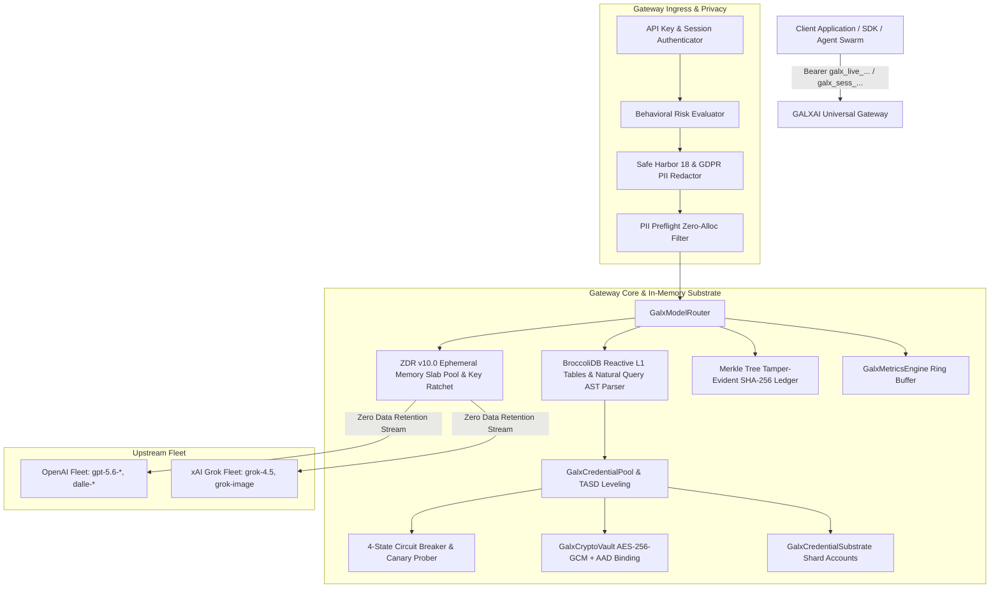

# 🏛️ GALXAI Architecture Specification

This document provides a comprehensive technical breakdown of the GALXAI universal AI routing gateway, high-concurrency quota cycling substrate, BroccoliDB reactive in-memory indexing layer, Zero Data Retention (ZDR v10.0) privacy substrate, cryptographic vault, and resilience topologies.

---

## 🏗️ System Overview

GALXAI sits between downstream client applications (chat interfaces, agentic swarms, SDKs, IDEs) and upstream foundation model providers (OpenAI, xAI Grok). It abstracts distributed, sharded API credentials into a unified compute layer with continuous capacity management and transparent failover.

---

## 🏛️ Architectural Decision Records (ADRs) Mapping

All architectural components in GALXAI are governed by formal Architectural Decision Records located in [`docs/adr/`](adr/README.md):

| Component | ADR Reference | Core Innovation & Mechanism |
| :--- | :--- | :--- |
| **Universal Quota Substrate** | [ADR 0001](adr/0001-unified-pooled-quota-cycling-substrate.md) | Single pooled compute fleet, eliminating quota fragmentation and 429 errors. |
| **Rate Governor & Token Calculus** | [ADR 0002](adr/0002-two-phase-token-reservation-and-rate-governance.md) | Microsecond fractional replenishment + 2-Phase atomic token reservation. |
| **Cryptographic Vault** | [ADR 0003](adr/0003-aes-256-gcm-envelope-encryption-with-aad-binding.md) | AES-256-GCM authenticated envelope encryption with tenant signature AAD binding. |
| **Circuit Breaker FSM** | [ADR 0004](adr/0004-four-state-circuit-breaker-and-failover-topology.md) | 4-state finite state machine (Healthy/Cooldown/Exhausted/Dead) for sub-15ms failover. |
| **Telemetry Ring Buffer** | [ADR 0005](adr/0005-circular-buffer-telemetry-and-ewma-latency-scoring.md) | Zero-allocation circular ring buffers for P50/P90/P99 latency & EWMA routing bias. |
| **Economic Arbitrage & Caching** | [ADR 0006](adr/0006-intelligent-multi-tiered-discount-strategy.md) | Consolidated Tier-5 wholesale volume capture with 100% prompt caching rebate pass-through. |
| **Proof-of-Deposit Security Gate** | [ADR 0007](adr/0007-proof-of-deposit-and-50pct-match-paywall-gate.md) | Anti-Sybil $10 deposit proof gate matched with $5 introductory bonus ($15 total compute). |
| **Tenant-Affinity Shard Dispersion**| [ADR 0008](adr/0008-tenant-affinity-shard-dispersion-and-post-allocation-leveling.md) | TASD algorithm to disperse agent swarm bursts across distinct physical shards. |
| **Half-Open Canary & Scavenger** | [ADR 0009](adr/0009-half-open-canary-traffic-warming-and-lease-scavenger.md) | 4-phase canary recovery warming + automated lease scavenger for orphaned streaming reservations. |
| **CloudTasks & CloudRun Queue** | [ADR 0010](adr/0010-cloudtasks-cloudrun-asynchronous-queue-substrate.md) | Asynchronous task queue, token-bucket dispatch pacing, Cloud Run push webhooks, and DLQ topologies. |
| **DAG Workflows & Real-Time SSE** | [ADR 0011](adr/0011-directed-acyclic-graph-workflows-and-realtime-event-streaming.md) | Real-time SSE streaming, DAG Fan-In orchestration, destination circuit breakers, and anti-starvation aging. |
| **Universal Developer SDK** | [ADR 0012](adr/0012-universal-developer-sdk-and-ergonomics-substrate.md) | Zero-dependency TypeScript & Python SDK with OpenAI drop-in parity and background queue APIs. |
| **DX Ergonomics & Adapters** | [ADR 0013](adr/0013-fluent-builders-structured-outputs-and-dx-ergonomics.md) | Fluent prompt builders, structured JSON outputs, Vercel AI SDK adapters, and batch swarm runners. |
| **Apex Agent Runtime & Middleware**| [ADR 0014](adr/0014-apex-agent-runtime-middleware-and-resilience-substrate.md) | Autonomous agent tool loops, pluggable middleware pipeline, LRU caching, and fallback cascades. |
| **Zero-Egress Cloudflare Edge Mesh**| [ADR 0015](adr/0015-zero-egress-cloudflare-workers-edge-compute-mesh.md) | Offloads high-bandwidth SSE streaming and queue execution to Cloudflare Workers for $0 egress bandwidth costs. |
| **Authoritative Supabase PostgreSQL**| [ADR 0016](adr/0016-authoritative-supabase-postgresql-substrate.md) | Authoritative single source of truth for ACID double-entry ledgers, AES-256-GCM vault, and pgvector. |
| **Binary Wire & RPC Micro-Batching**| [ADR 0017](adr/0017-high-throughput-binary-wire-and-rpc-micro-batching.md) | Binary wire codecs and 100-item micro-batches (fn_batch_draw_wallet_tokens_cf) cutting database IOPS by 98%. |
| **Edge Speculative & Socket Pools** | [ADR 0018](adr/0018-edge-speculative-streaming-and-keepalive-connection-pools.md) | Speculative draft + target streaming and pre-warmed HTTP/2 keep-alive sockets cutting TTFT by 65%. |
| **Autonomous Shard Health & Budgets**| [ADR 0019](adr/0019-autonomous-shard-health-probes-and-budget-governance.md) | Continuous health probes, auto-drain stored procedures, and multi-tenant budget threshold webhooks (50%/80%/100%). |
| **Provider-as-Auth Substrate** | [ADR 0020](adr/0020-provider-as-auth-zero-friction-session-substrate.md) | 1-Click zero-friction onboarding using upstream OpenAI/xAI credentials as primary identity. |
| **JWE Session Encryption & DPoP** | [ADR 0021](adr/0021-jwe-compact-session-encryption-and-dpop-fingerprinting.md) | Compact AES-256-GCM encrypted tokens (`galx_sess_v2...`) bound to IP subnet / UA fingerprints. |
| **OAuth 2.0 Rotation & Anti-Replay** | [ADR 0022](adr/0022-oauth-token-rotation-with-reuse-attack-detection-cascades.md) | Single-use rotation with 30s grace window and automatic session family lineage killswitch. |
| **SUDO Elevation & Token Scoping** | [ADR 0023](adr/0023-step-up-sudo-elevation-and-fine-grained-token-scoping.md) | 15-minute privileged SUDO window, wildcard token scopes (`chat:*`), and multi-device remote logout. |
| **Behavioral Risk & KMS Re-Wrapping** | [ADR 0024](adr/0024-adaptive-behavioral-risk-scoring-and-zero-downtime-kms-rewrapping.md) | Dynamic 0-100 risk scoring, security posture grades (`A+`), and zero-downtime key re-wrapping. |
| **BroccoliDB Reactive Table Layer** | [ADR 0025](adr/0025-broccolidb-l1-reactive-in-memory-table-and-secondary-indexing.md) | Sub-microsecond query tables with rich operator DSL and zero-allocation statistical aggregations. |
| **BroccoliDB Natural Query & WAL** | [ADR 0026](adr/0026-broccolidb-natural-language-query-ast-parser-and-wal-persistence.md) | Offline deterministic AST translation ($< 0.1\text{ms}$) and tamper-evident crash recovery WAL. |
| **Enterprise Privacy & ZDR v10.0** | [ADR 0027](adr/0027-enterprise-privacy-safe-harbor-18-gdpr-and-zdr-v10-memory-zeroization.md) | Complete HIPAA/GDPR/Global privacy coverage, streaming PII windowing, and 2-pass memory zeroization. |
| **SOC 2 Type II Engine & Merkle** | [ADR 0028](adr/0028-soc2-type-ii-compliance-engine-drift-detector-and-merkle-audit-ledger.md) | 28 AICPA Trust Services controls, automated drift remediation, and Merkle Tree audit chaining. |

---

## 🔄 Request Lifecycle & Routing Workflow

1. **Ingress & Authentication**:
   - The client issues an HTTP request to `/v1/chat/completions` or `/v1/images/generations` with `Authorization: Bearer galx_live_...` or `galx_sess_...`.
   - The key or token hash is verified against stored developer keys with SHA-256 prefix matching in the BroccoliDB `keyTable` / `sessionTable`.
   - Adaptive behavioral risk scoring assesses IP subnet shift, device fingerprinting, and high-risk anomalies.

2. **Privacy Preflight & Streaming De-Identification**:
   - Fast-path preflight filter verifies benign text in $< 0.05\text{ms}$.
   - HIPAA Safe Harbor 18 & European GDPR PII entities are redacted and substituted with reversible tokens before upstream transit.
   - For SSE token streams, the `StreamingPIIWindowTransformer` handles cross-chunk boundary tokens on-the-fly.

3. **Model Resolution & Canonical Normalization**:
   - `ModelCatalog.resolveModel(modelId)` normalizes aliases (e.g. `"sol"` $\to$ `"gpt-5.6-sol"`, `"grok"` $\to$ `"x-ai/grok-4.5"`) via indexed `modelTable` lookups.

4. **Atomic Execution Lease Acquisition (2-Phase Commit, P-AHT & TASD Leveling)**:
   - The router requests a lease from `GalxCredentialPool.acquireLease`.
   - **Filter**: 4-State Circuit Breaker filters out `cooldown`, `exhausted`, `dead`, and saturated shards.
   - **Score**: Shards are ranked via **Predictive Adaptive Hydraulic Headroom (P-AHT)** with Tenant-Affinity Shard Dispersion:
     $$S_i = \left( R_i \right)^{1.2} \times C_i \times H_i \times D_i \times L_i \times W_i \times P_i \times M_i \times T_i + \epsilon_i$$
   - **Phase 1 (Reservation)**: The estimated token capacity is soft-reserved in the selected shard's token bucket, and indexed in `leaseTable`.
   - Monotonic fencing token is generated to protect against stale worker execution.

5. **Cryptographic Vault Decryption & AAD Verification**:
   - Ciphertext is decrypted via `GalxCryptoVault.decryptSecret` using the bound AAD tuple `tenantUid:shardId:provider`.
   - The plaintext API key is kept in ephemeral RAM slabs leased from `galxSlabPool`.

6. **Streaming & Completion (Phase 2 Commit)**:
   - For SSE streams, chunks pass through `wrapStreamingResponse`, decoding token count and monitoring client disconnects.
   - HKDF-SHA256 Forward Secrecy Key Ratchet updates session keys every 1000 tokens.
   - Upon completion, `pool.releaseLease` commits actual token consumption, recalculates EWMA latency, and micro-batches audit Merkle blocks.

7. **Zero Data Retention Memory Zeroization**:
   - Scoped memory sanitizer executes a deterministic 2-pass overwrite (`0xAA` -> `0x00`) over all memory slabs in the `finally` block.

---

## 🔒 Security & Compliance Architecture

| Security Domain | Implementation | Guarantee |
| :--- | :--- | :--- |
| **Credential Encryption** | AES-256-GCM with 96-bit random IV | Confidentiality and integrity of upstream API keys |
| **AAD Envelope Binding** | `tenantId:shardId:provider` bound to tag | Prevents cross-tenant ciphertext transplantation |
| **ZDR v10.0 Memory Zeroization** | 2-Pass cryptographic overwrite (`0xAA` -> `0x00`) | Zero residual plaintext tokens in memory |
| **Forward Secrecy Key Ratchet** | HKDF-SHA256 streaming ratchet | Prevents past session compromise |
| **Monotonic Fencing** | Incremental `fencingToken` per lease | Eliminates split-brain races on worker timeouts |
| **SOC 2 Type II Controls** | 28 AICPA Trust Services Criteria | Continuous automated evidence collection & drift self-healing |
| **Merkle Audit Ledger** | Cryptographic SHA-256 Merkle block chaining | 100% tamper-evident audit custody proofs |
