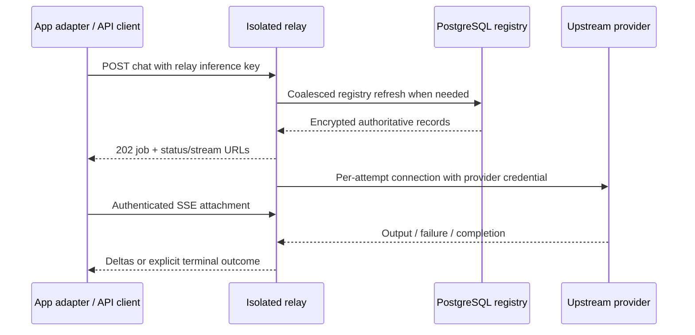

# GALXAI architecture

Reviewed 2026-09-07. This document describes component boundaries in the repository and identifies the relay deployment verified in this session. A module, ADR, or simulation is not proof that a feature is active in every environment.

## Product and component boundaries

The hosted product is an inference interface with model discovery and an API playground. It is not a hosted IDE or a promise to execute user-selected tools on the operator's device. Applications and agent clients can consume inference in their own execution environments.

| Component | Source | Responsibility |
| --- | --- | --- |
| Web/application routes | `src/app` | Product UI, authenticated API orchestration, tenant-facing behavior |
| SDK | `src/sdk` | Client requests and client-side abstractions; not the relay protocol itself |
| Model routing | `src/core/router` | Provider selection and application transport adaptation |
| Credential pool/repository | `src/core/pool`, `src/lib/supabase/repositories/ShardRepository.ts` | Platform registry/lease integration |
| Standalone relay | `src/relay` | Bounded provider transport, asynchronous chat jobs, SSE, image transport, operator telemetry |
| Execution authority | `src/core/execution` | Separate governed execution lifecycle; relay queues are not its authority |
| BroccoliDB | `src/core/broccolidb` | In-memory projections and representation/runtime utilities; not a replacement credential authority |
| PostgreSQL/Supabase | `supabase/migrations`, `src/lib/supabase` | Durable records and database-enforced policies; deployment state must be verified |
| Cloudflare integration | `src/workers/cloudflare`, worker configuration | Separately deployed edge/storage paths |
| Image storage | `GalxR2AssetAdapter`, `GalxUnifiedR2StorageManager` | Application-owned image persistence and lifecycle |
| Experiments | `simulations`, benchmark scripts | Harness evidence, not production capacity or service guarantees |

## Inference through the relay

Provider credentials are not app-to-relay credentials. `OpenAIAdapter` sends `VM_RELAY_API_KEY` (or its configured inference-key fallback), and the relay selects its own account from the registry projection. Upstream token expiry and rejection affect eligibility independently of relay API-key authentication.

The application adapter contains direct-provider fallbacks. The standalone relay's container boundary does not automatically contain those paths or external agent tools. Full end-to-end tool protocol compatibility is not established by forwarding inference output.

## Authority and state

PostgreSQL is the durable credential registry. The platform pool's database-backed lease decisions and the standalone relay's local scheduling are distinct. The relay currently uses per-process concurrency and retry state, not a PostgreSQL lease for every selected account. Multiple replicas therefore need further coordination before claiming global capacity or immediate upstream-rejection propagation.

Relay jobs and output live in memory. A checkpoint records selected job/shard state but not sockets or replay buffers. Provider tokens are omitted; unfinished request content can remain in checkpoint jobs. Restarted unfinished jobs fail rather than replaying automatically. The relay does not charge or refund wallets.

BroccoliDB representation selection, wallet/seat governance, PostgreSQL lease procedures, and execution-supervisor workflows have their own scopes and tests. They must not be inferred to run inside every relay request merely because their modules exist in the same repository.

## Security boundary

The deployed container is non-root with a read-only root filesystem, dropped capabilities, no privilege escalation, bounded resources, and only private checkpoint persistence. It has no personal credential, repository, home, or Docker socket mounts. The relay has no local model-tool dispatcher. Users' inference remains usable by their own applications; model output does not grant local filesystem authority.

Inference and administrator keys are separate. Job access is key-principal scoped. Dashboard data and metrics require administrator access; the HTML shell and aggregate health remain public. Browser origins and local Host headers are checked separately from keys. Network egress and ingress TLS are deployment concerns not solved by the read-only filesystem.

## Recovery and observability

Selection is least-in-flight with rotating ties and per-process shard slots. The default three-hour request window has no local cap. Provider quota feedback, local operator caps, credential expiry, and transport cooldowns are separate states.

A request has finite attempts, jittered backoff, shared retry credits, watchdogs, and an absolute deadline. Terminal requests stop; cancellation is checked after registry waits. In-memory replay is bounded. Mid-stream continuation is best effort, not exactly-once output. Process health does not prove upstream availability.

The operator UI reports eligibility, missing/expired credentials, cooldowns, request slots, bounded retries, and stale data. Telemetry separates acknowledgement from completed inference, chunks from tokenizer counts, and transport uncertainty from explicit provider errors.

## Verified deployment and remaining work

On 2026-09-07, `galxai-relay` was deployed on host loopback port 3001 after canary verification. Authentication, registry loading, chat/SSE, runtime isolation, Docker checks, and TypeScript passed. No local app server was running on port 3000; no remote app rollout or public tunnel verification was performed. Availability and account counts are observations, not standing guarantees.

Outstanding architecture concerns include cross-replica admission/revocation, stronger registry credential scoping, network egress policy, app-side fallback/execution boundaries, and complete tool-protocol coverage. Each needs implementation and deployment evidence before being documented as complete.

## Current references

- [ADR 0122: relay decision](adr/0122-isolated-authenticated-relay-and-bounded-recovery.md)
- [ADR 0115: registry authority](adr/0115-postgresql-authoritative-shard-registry-and-secret-free-projections.md)
- [ADR 0114: execution authority](adr/0114-uncertain-execution-authority-kernel-and-transactional-journal.md)
- [ADR 0121: image persistence](adr/0121-user-and-session-r2-partitioning-manifest-lifecycle-and-relay-image-synthesis.md)
- [Relay deployment](VM_RELAY_DEPLOYMENT_AND_WEBSOCKET_TIMEOUT_STRATEGY.md), [API](RELAY_API_REFERENCE.md), [security](relay-security.md)
- [ADR catalog](adr/README.md), [documentation catalog](README.md)
