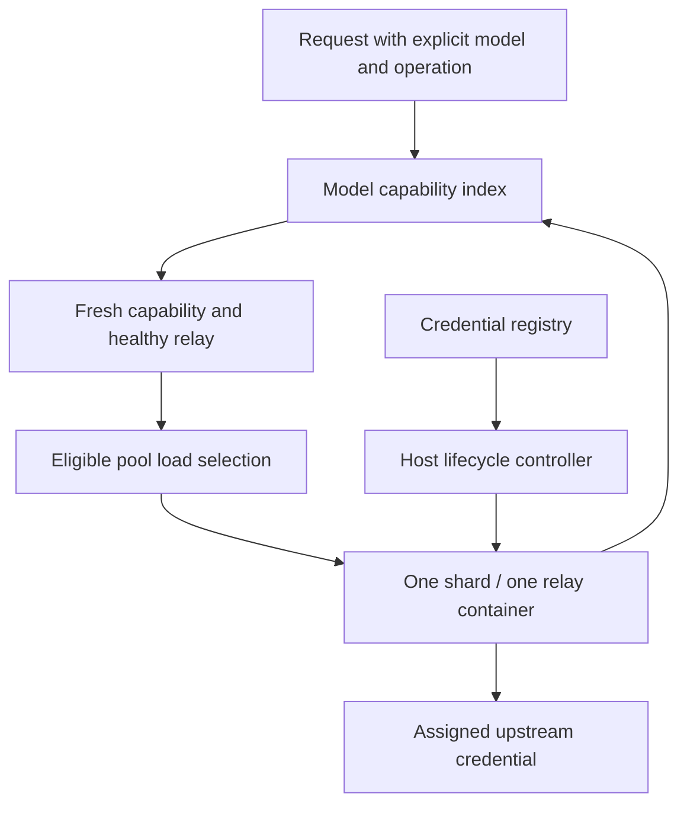

# Federation contract

<!-- docs-scope: current-guide -->
> **Reading scope:** Current guidance. The federation contract governs relay behavior; source and dated verification define implementation evidence. See the [current contract](FEDERATION_STRATEGY.md) and [complete catalog](CATALOG.md).

This is the current relay contract. Use the [runbook](RELAY_VNEXT_RUNBOOK.md) for commands and effective defaults, the [API reference](RELAY_API_REFERENCE.md) for transport behavior, and the [ADR catalog](adr/README.md) for decision history. A dated deployment observation is evidence at that time, not a live health check.

## Ownership and capability are separate

**One active shard owns one active relay container.** Shards need not expose the same models. A host controller reconciles encrypted registry credentials, Docker ownership, worker health, and capabilities. The controller is infrastructure, not a shared inference worker.

The application gateway at `https://galx.ai/v1`, federation at `https://relay.galx.ai`, and separately deployed Cloudflare Worker are distinct authentication and deployment boundaries. Browser clients use an application backend; server credentials stay on the server.

## Eligibility before load

1. Identify the explicit requested model and operation. Images use an internal `image:<model>` capability key; callers omit that prefix.
2. Look up that capability's shards in the reverse index.
3. Exclude unknown, expired, unavailable, degraded, draining, or otherwise ineligible workers. Apply credential cooldown and execution-model dependencies.
4. Select within that pool using recent errors, active streams, latency, queue depth, and remaining capacity.
5. Reserve capacity through admission and reconcile the reservation with fresh worker observations.

No eligible shard returns `503 model_temporarily_unavailable`. A saturated eligible pool returns `503 model_capacity_exhausted`. Unrelated idle relays cannot serve that request. There is no federation-wide waiting queue or implicit cross-model fallback. Application SDK cascades and races are explicit caller policies, potentially involving additional billable executions; they are not federation recovery.

## Dynamic evidence and lifecycle

Each shard record exposes ownership, relay generation, provider, capability states and evidence expiry, health, and load. Pair states are `UNKNOWN`, `AVAILABLE`, `TEMPORARILY_UNAVAILABLE`, `NOT_AUTHORIZED`, and `DEGRADED`; the initial routing policy admits only eligible `AVAILABLE` pairs.

Workers start in `STARTING`, discover authenticated inventory in `DISCOVERING_CAPABILITIES`, then become routable. Inventory refresh is periodic, bounded, and jittered. A malformed inventory does not replace valid evidence; retained evidence still expires. A global catalog entry or a matching credential alias is not proof of access.

Capability loss removes new-request eligibility without restarting the container or cancelling accepted streams. An empty inventory enters `CAPABILITY_EMPTY` and remains available for rediscovery; there is no automatic destruction after a 120-second grace period. Deleted, expired, revoked, or authoritatively invalid credentials remove mappings before drain and worker retirement. Invalid credentials remain suppressed until their credential revision changes.

Explicit model-denied provider responses can withdraw a pair. Generic `403`, `404`, `route`, `429`, timeouts, and `5xx` alone do not prove model permission loss. A bounded restoration hold dampens flapping. Successful fresh discovery restores access without worker replacement.

## Health authority and stale results

Capability versions, inventory epochs, credential revisions, worker generations, and monotonically increasing health revisions fence observations. An old success cannot erase a newer denial or cooldown. An equal-revision health replay cannot clear a locally observed failure. Container identity includes process start time: restarting the same Docker container does not preserve old health authority.

Database account cooldown recovery is a separate authority domain. Attributable failures and current lease authority govern account health; telemetry is observation-only. An expired explicit cooldown permits a serialized recovery probe, not unrestricted traffic. Local checkout saturation, caller cancellation, and unrelated query errors do not establish a database-wide outage. Ambiguous SQL outcomes do not justify automatic replay. See ADRs 0123–0125 in the [decision catalog](adr/README.md).

## Explicit Codex image-tool compatibility

`RELAY_CODEX_IMAGE_TOOL_ALIAS=true` enables exactly this OAuth compatibility route:

| Requested model | Execution model and tool | Image-model selection |
| --- | --- | --- |
| Public `openai-gpt-image-2`; relay `gpt-image-2` | `gpt-5.6-terra` with `image_generation` | Provider-managed |

This does **not** guarantee exact GPT-Image-2, exact output dimensions, or exact Image API quality controls. Native API-key execution retains its exact requested image model. Other image IDs are not remapped, and a failed request does not trigger substitution.

The alias requires both fresh execution-model inventory and a successful real image probe. Chat inventory alone cannot grant image access. Verified image evidence expires after one hour and successful image requests renew it. Enabled idle workers use spare capacity for startup verification and re-verification after 50 minutes; failures back off 10, 20, then 40 minutes. These probes consume upstream quota. Changing the flag requires worker replacement.

Responses expose `execution.requestedModel`, `execution.executionModel`, `execution.routingMode`, `execution.tool`, and `execution.imageModelSelection`, plus `X-Galx-Execution-Model` and `X-Galx-Routing-Mode`. Applications can make an informed compatibility choice from this metadata. Image availability remains independently inspectable from chat availability.

## Parent and subagent execution

Accept familiar SDK request shapes at documented application boundaries, then preserve explicit model, tenant, and execution authority. Resolve harmless input variation without making developers learn internal shard topology. Ambiguity about whether work executed requires reconciliation, not a guessed retry.

The parent assigns each logical operation an `Idempotency-Key`, a deadline, and a bounded concurrency budget. Child tasks retain their own keys and correlation IDs. `X-Galx-Task-Id` aids tracing; it grants no authority. A retry preserves the original key and payload. A new key represents intentionally new work.

On `202`, retain signed job URLs and use them for status, stream, and cancellation. A worker replacement never inherits an old job. On uncertain admission, inspect existing job or trace evidence. Honor execution state and retry headers instead of retrying every `5xx`. Completion receipts are retrievable even after model eligibility disappears.

Receipts are process-local and bounded, not durable exactly-once execution. Preserve `X-Galx-Idempotency-Scope` and send it as a retry precondition when available. A changed scope rejects the retry; a key alone cannot establish safe replay after restart or expiry. See the [request recovery table](RELAY_API_REFERENCE.md#request-recovery).

Control/status traffic has a separate worker rate bucket from inference. Reconciliation, Docker inspection, job polling, body buffering, and shutdown have explicit limits and deadlines. Fair polling and per-worker bounds prevent one busy or invalid shard from stalling unrelated healthy pools. More parallel I/O is useful only within those limits.

## Operational visibility

| Eligible shard count for a model | Redundancy state |
| --- | --- |
| 0 | `UNAVAILABLE` |
| 1 | `FRAGILE` |
| 2 or more | `HEALTHY` |

These states describe redundancy, not latency or an SLA. The administrator capability view shows model pools first, then shard/relay drill-down, evidence freshness, health, streams, and capacity. Stale snapshots must be labelled; liveness must not be presented as model readiness. Error messages should name the affected operation, execution state, and next safe action without exposing credentials or raw provider errors.

## Verification and deployment boundary

The required regression scenario uses A→{A,B}, B→{B,C}, C→{A,C}: withdraw B from shard A without restarting it, remove shard B and observe model B unavailable while other pools continue, then restore B on shard A without restarting it. Also cover stale health after restart, noisy failures, concurrent discovery/denial, accepted streams after capability loss, and uncertain admission.

[ADR 0127](adr/0127-codex-image-tool-alias-production-cutover.md) records the September 7, 2026 production cutover and successful DreamBees actual-client image verification. That observation found one usable shard, so all observed pools were fragile. Paid Hive remained disabled; successful image verification did not itself change billing or entitlement. Recheck live state before making a new operational claim.

The current controller is single-host. Docker unique names and ownership labels prevent duplicate workers on that engine; a multi-host fleet requires a shared ownership lease before deployment. Persistent signing secrets do not make receipt storage durable. Application billing, asset storage, and tool execution retain their own authority and recovery contracts.
