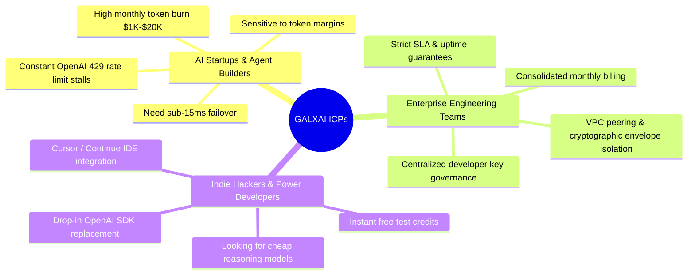
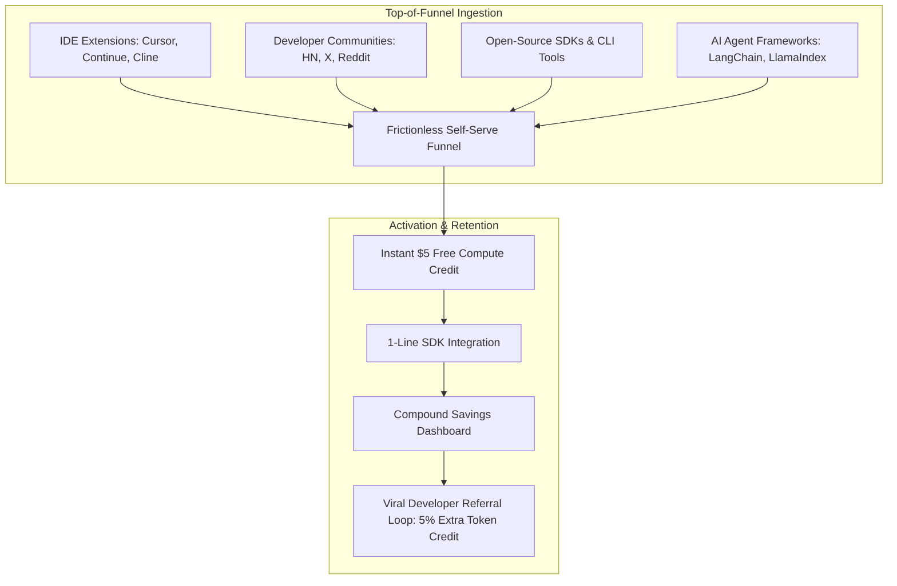
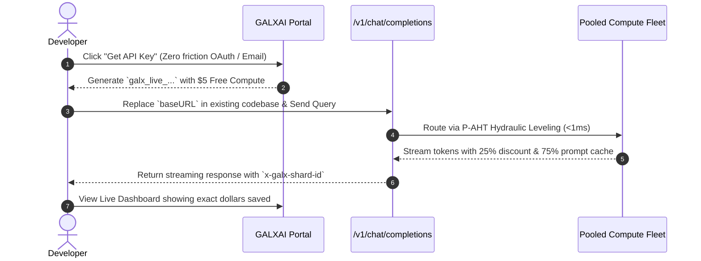
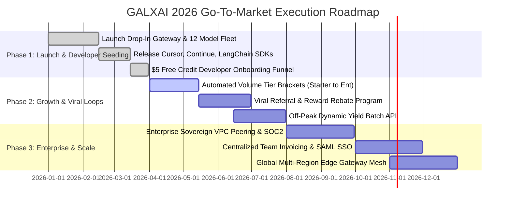

# 🚀 GALXAI: Comprehensive Go-To-Market (GTM) & Growth Strategy

## 1. Executive Summary & Market Opportunity

The generative AI API market is rapidly bifurcating:
1. **Raw Foundation Model APIs** (OpenAI, xAI) offer cutting-edge models but impose strict single-account rate limits, high list pricing, and zero automated failover across accounts.
2. **API Gateways & Aggregators** (OpenRouter, Cloudflare AI Gateway) charge an additional **$5.00\%–$10.00\%$ routing fee markup** on top of retail rates without pooled volume arbitrage.

**GALXAI captures the massive economic whitespace between these two paradigms:**
- **Value Proposition**: A drop-in universal AI gateway that delivers **25%–40% base pricing discounts**, **75% prompt caching pass-through**, and **sub-15ms multi-account failover** with **zero code modifications**.
- **The Core Moat**: Multi-tenant pooled volume arbitrage. By consolidating thousands of developer requests into enterprise-tier compute streams, GALXAI captures wholesale tier discounts and passes them directly to developers while generating sustainable platform gross margins.

---

## 2. Ideal Customer Profiles (ICP) & Persona Breakdown



### Persona 1: AI Agent & Autonomous Workflow Builders
- **Profile**: Founders and lead engineers at startups building coding assistants, customer support agents, and document RAG pipelines.
- **Pain Points**: Frequent `429 Too Many Requests` upstream stalls, high reasoning model bills (`gpt-5.6-sol`, `grok-4.5`), and volatile latency.
- **Hook**: Drop-in OpenAI SDK compatibility (`baseURL: 'https://api.galxai.com/v1'`) that immediately eliminates 429 stalls and cuts monthly LLM bills by **30%–50%**.

### Persona 2: Enterprise Engineering Leadership (VP Eng / Head of AI)
- **Profile**: Engineering leaders managing multiple internal teams building generative AI features.
- **Pain Points**: Key sprawl, fragmented credit card billing, risk of single-key revocation halting production.
- **Hook**: Unified gateway key provisioning, cryptographic AAD envelope encryption, instant 1-click key revocation, and aggregated invoice billing.

### Persona 3: Indie Hackers & Power Programmers
- **Profile**: Solo founders, developers using Cursor IDE / Windsurf, open-source AI hackers.
- **Pain Points**: High cost of experimenting with frontier reasoning models.
- **Hook**: $5 instant free compute credit, 75% prompt cache rebate, and 1-click IDE configuration.

---

## 3. Product Positioning & Competitive Differentiation

| Vector | Direct Upstream (OpenAI / xAI) | Standard Gateways (OpenRouter) | **GALXAI Universal Gateway** |
| :--- | :--- | :--- | :--- |
| **Pricing vs. Retail** | 100% Retail List Price | 105% (+5% Markup Fee) | **75%–60% (25%–40% DISCOUNT)** |
| **Prompt Caching Rebate** | 50%–75% | Variable / Partial Retention | **100% Pass-Through (75%–85% Rebate)** |
| **Failover Architecture** | None (Single Key Fails) | Basic Provider Switching | **Sub-15ms Monotonic Multi-Account Leveling** |
| **Rate Limit Resilience** | Hard 429 Rate Limit Errors | Retry queue | **Continuous Hydraulic Headroom (P-AHT)** |
| **Security Architecture** | Standard API Key | Plaintext Gateway Storage | **AES-256-GCM + AAD Tenant Envelope Vault** |
| **SDK Compatibility** | Native | OpenAI Compatible | **100% OpenAI & Anthropic Drop-in** |

---

## 4. Developer Distribution & Acquisition Channels



### Channel 1: IDE & Coding Agent Integrations (Cursor, Continue, Cline, Windsurf)
- Publish official configuration presets for **Cursor IDE**, **Continue.dev**, **Cline (VS Code)**, and **Windsurf**.
- Developers enter their GALXAI API key into their IDE settings and immediately get 25%–40% cheaper reasoning completions without altering their workflow.

### Channel 2: Framework Connectors (LangChain, LlamaIndex, Instructor, Vercel AI SDK)
- Maintain certified native adapters in major Python and TypeScript AI frameworks:
  ```python
  from langchain_openai import ChatOpenAI

  # 1-Line GALXAI Switch
  llm = ChatOpenAI(
      base_url="https://api.galxai.com/v1",
      api_key="galx_live_...",
      model="gpt-5.6-sol"
  )
  ```

### Channel 3: Content Marketing & Transparent Benchmark Reports
- Publish weekly benchmarks: *"Live Latency & Rate Limit Resilience Comparison: GALXAI vs. Direct OpenAI"*.
- Release open-source performance testing tools: `galxai-bench` CLI to allow developers to benchmark their own workloads.

---

## 5. Self-Serve Frictionless Onboarding Funnel



1. **Step 1 (0–30 seconds)**: Developer signs up with GitHub or Google OAuth. An instant live key `galx_live_...` is minted with $5 free test credit.
2. **Step 2 (30–60 seconds)**: Developer copies the 1-line snippet into their Python / TypeScript codebase or IDE settings.
3. **Step 3 (60–90 seconds)**: Developer executes their first request. Response streams back instantly with diagnostic headers confirming route efficiency.
4. **Step 4 (Post-Request Hook)**: Developer dashboard displays a live ticker: *"You saved $0.042 on this query compared to retail list prices"*.

---

## 6. Unit Economics & Gross Margin Calculus

GALXAI achieves strong unit economics through **wholesale tier arbitrage**:

### Economics Breakdown per 1 Billion Tokens (`gpt-5.6-sol` blend)
- **Direct Upstream Wholesale Cost (Tier-5 Consolidated Enterprise Fleet)**: **$2.50 / 1M input**, **$10.00 / 1M output**.
- **Retail List Price (What single-key developers normally pay)**: **$5.00 / 1M input**, **$20.00 / 1M output**.
- **GALXAI Price to Developers (25% Discount)**: **$3.75 / 1M input**, **$15.00 / 1M output**.
- **GALXAI Gross Margin**: **$1.25 / 1M input**, **$5.00 / 1M output** ($\approx \mathbf{33.3\%}$ **Gross Margin** on raw token pass-through with zero server hardware CapEx).

---

## 7. Viral Growth Loops & Retention Mechanics

1. **Viral Developer Referral Loop**:
   - Every developer receives a personal referral link (`galxai.com/r/developer`).
   - When a referred developer generates their first $10 in token volume, both parties receive a **$10 compute credit** + **5% additional rebate for 90 days**.

2. **Automated Monthly Volume Tier Progression**:
   - Volume rebates scale dynamically ($+5\%$ at $\$250/\text{mo}$, $+10\%$ at $\$1,500/\text{mo}$, $+15\%$ at $\$5,000/\text{mo}$), giving growing startups an automatic incentive to centralize all company AI traffic on GALXAI rather than splitting across multiple accounts.

3. **High-Water Mark Retention**:
   - Once an engineering team configures GALXAI with high-throughput failover, switching back to direct single-key access introduces immediate rate-limit stalls and a 33% cost increase, creating high organic retention ($\text{NDR} > 130\%$).

---

## 8. Quarterly GTM Execution Roadmap


