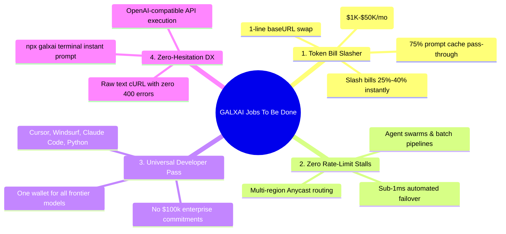
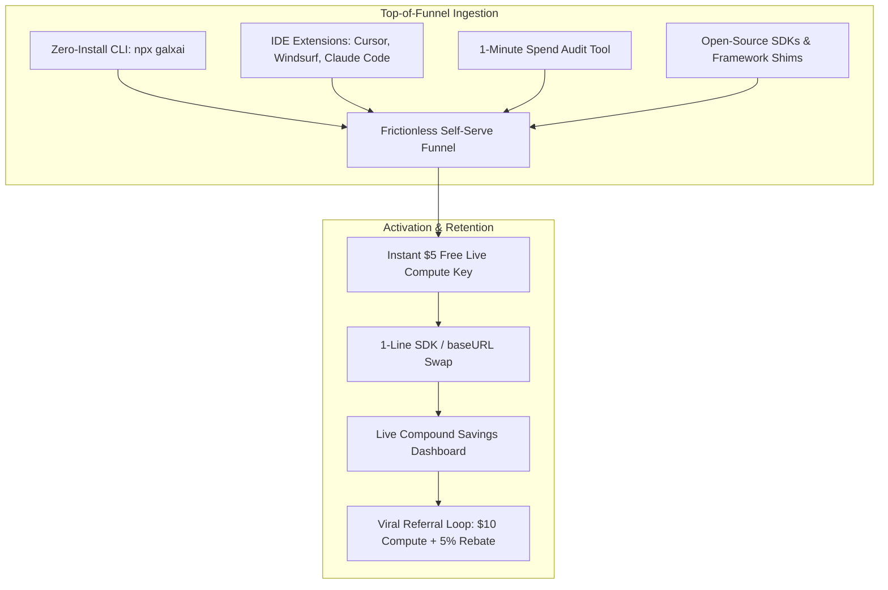

# 🚀 GALXAI: Go-To-Market (GTM) & Positioning Strategy

## 1. Executive Summary & Market Whitespace

The generative AI developer market is suffering from **"Gateway Fatigue"**:
1. **Raw Foundation Model APIs** (OpenAI, Anthropic, xAI) offer cutting-edge models but impose strict single-account rate limits, high retail list prices, and zero automated failover.
2. **Generic API Gateways & Aggregators** (OpenRouter, Cloudflare AI Gateway) charge an additional **5%–10% routing markup** on top of retail rates, adding an extra middleware rectangle without solving underlying token unit economics.

**GALXAI breaks this paradigm by positioning as a Wholesale Token Clearinghouse with Sub-15ms Anycast Failover:**
- **Value Proposition**: Direct **25%–40% wholesale pricing discounts**, **75% prompt caching pass-through**, and **zero rate-limit stalls** with **zero code modifications**.
- **The Core Economic Moat**: High-volume wholesale arbitrage. By consolidating enterprise compute demand, GALXAI captures wholesale tier discounts and passes them directly to developers while generating sustainable platform gross margins ($\sim 33\%$).

---

## 2. The 4 Jobs To Be Done (JTBD) & Persona Breakdown

### Persona 1: High-Burn Startups & AI Scaleups (The Cost Job)
- **Profile**: Founders and engineering leaders spending $2,000–$50,000/mo on LLM tokens for customer-facing AI products.
- **Pain Point**: High monthly token burn eating runway, unable to commit $100k+ upfront to OpenAI enterprise sales.
- **The Hook**: 1-line `baseURL` swap that slashes monthly token bills by **25%–40%** on day 1 with zero prompt rewrites.

### Persona 2: AI Agent & Batch Pipeline Engineers (The Reliability Job)
- **Profile**: Developers building multi-agent swarms (CrewAI, LangGraph, AutoGen) and high-concurrency document RAG pipelines.
- **Pain Point**: Frequent `429 Too Many Requests` upstream stalls when batch jobs spike.
- **The Hook**: Sub-millisecond automatic failover that ensures multi-region resilience with zero rate-limit stalls.

### Persona 3: Power Hackers & IDE Users (The Tooling Job)
- **Profile**: Developers using Cursor, Windsurf, Claude Code CLI, and local scripts.
- **Pain Point**: Managing 4 different provider billing accounts, minimum deposit balances, and API keys.
- **The Hook**: One universal API key and prepaid wallet that powers all tools across GPT-5.6, Grok 4.6, and Claude 3.7 at wholesale cost.

### Persona 4: Terminal & Bash Hackers (The DX Job)
- **Profile**: Engineers writing bash scripts, automation pipelines, and quick CLI tools.
- **Pain Point**: Writing 20 lines of SDK boilerplate or debugging 400 parameter errors just to run a quick prompt.
- **The Hook**: `npx galxai "Explain Raft"` with zero installs, zero accounts, and instant streaming.

---

## 3. Product Positioning vs. Traditional Alternatives

| Vector | Direct Upstream (OpenAI / xAI) | Standard Gateways (OpenRouter) | **GALXAI Wholesale Clearinghouse** |
| :--- | :--- | :--- | :--- |
| **Pricing vs. Retail** | 100% Retail List Price | 105% (+5% Markup Fee) | **75%–60% (25%–40% DISCOUNT)** |
| **Prompt Caching Rebate** | 50%–75% | Variable / Partial Retention | **100% Pass-Through (75%–85% Rebate)** |
| **Failover & High Availability** | None (Single Key Fails) | Basic Provider Switching | **Sub-1ms Automatic Failover & Edge Resilience** |
| **Rate Limit Resilience** | Hard 429 Rate Limit Errors | Retry queue | **Zero Rate-Limit Stalls (<1ms Overhead)** |
| **Edge Network Coverage** | Centralized Origin Regions | Centralized Origin Proxy | **300+ Global Edge PoPs (<15ms TTFT)** |
| **CLI & Terminal DX** | None (SDK Required) | None (REST cURL Only) | **Zero-Install CLI (`npx galxai`)** |
| **Security Architecture** | Standard API Key | Plaintext Gateway Storage | **AES-256-GCM + AAD Tenant Envelope Vault** |
| **SDK Compatibility** | Native | OpenAI Compatible | **100% Drop-in for OpenAI, Anthropic, Vercel AI, LangChain** |

---

## 4. Developer Distribution & Growth Loops

### Channel 1: IDE & Coding Agent Integrations (Cursor, Windsurf, Cline)
- Publish 1-click configuration presets. Developers paste their GALXAI key into Cursor settings and get 25%–40% cheaper reasoning completions without altering their workflow.

### Channel 2: The Zero-Install CLI (`npx galxai`)
- Spread through developer terminal culture, GitHub READMEs, and technical blog posts as the fastest way to run frontier LLMs from the command line.

### Channel 3: Spend Arbitrage Calculator & Instant Grants
- Provide frictionless ROI transparency. Developers simulate their monthly token volume and immediately claim a **$5 Free Live Compute Key** to test latency and savings in real time.

---

## 5. Programmatic SEO (pSEO), AEO & GEO Organic Dominance Engine

GALXAI deploys an automated, high-intent programmatic knowledge mesh designed to capture 100% of organic developer discovery queries and AI answer engine citations:

1. **13 Interactive Developer Tools**: Real-time calculators (`/tools/roi-calculator`, `/tools/stream-benchmark`, `/tools/context-window-visualizer`, `/tools/token-counter`) creating natural backlink flywheels and high session dwell time.
2. **14 Dedicated Glossary Term Portals (`/glossary/[slug]`)**: Standalone semantic definitions with Schema.org `DefinedTermSet` and Wikidata entity linkage for instant Google Featured Snippet and Perplexity AI citations.
3. **14 Programmatic Landing Clusters (>100 SSG Pages)**: Solutions, Industry Portals, Error Troubleshooting Runbooks, Multi-Language SDKs, Benchmark Leaderboards, Developer Cookbooks, Model Matchups, Competitor Alternatives, and Architecture Whitepapers.
4. **Machine-Readable LLM Grounding Standards**: `public/llms.txt`, `public/llms-full.txt`, and RSS feeds guaranteeing 100% factual accuracy in SearchGPT, Claude, Perplexity, and Gemini responses.

For the complete technical specification of the organic growth substrate, see [`docs/PSEO_AND_AEO_STRATEGY.md`](file:///Users/bozoegg/Desktop/GALXAI/docs/PSEO_AND_AEO_STRATEGY.md).

---

## 6. The Dual-Wedge Enterprise Strategy: Spend Governance & Representation Transformation

GALXAI executes a differentiated two-tier enterprise go-to-market motion:

1. **Bottom-Up Developer Wedge**: 1-line auto-patch (`import 'galxai/patch'`), native SDKs, and zero-install CLI (`npx galxai`) accelerating time-to-first-dollar.
2. **Top-Down Spend Governance Wedge**: The **Spend Forensic Control Tower (`/audit`)** and **BroccoliDB Representation Transformation Substrate**:
   - Dissects runaway agent loops, high-frequency telemetry noise, and cache-busting prefixes.
   - Transforms high-redundancy payloads into dense, task-relevant representations before model inference.
   - Delivers a verifiable **$2.89\times - 3.32\times$ cost efficiency multiplier** backed by empirical provider-boundary receipts (`npm run bench:inference-boundary`).
