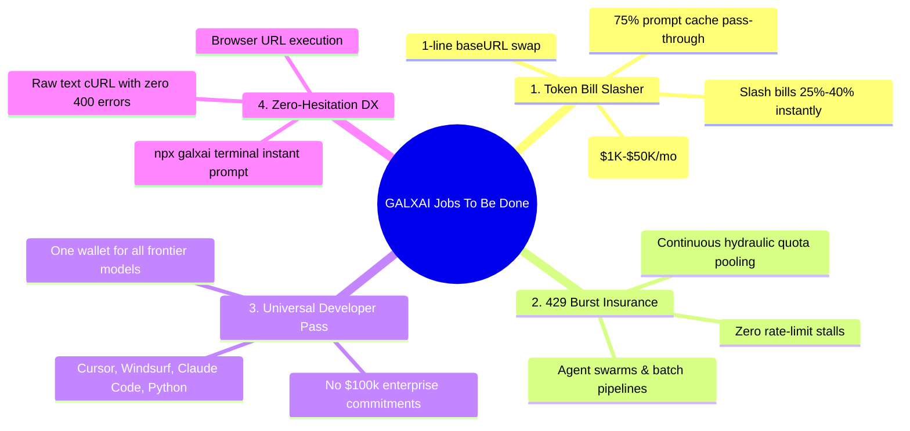
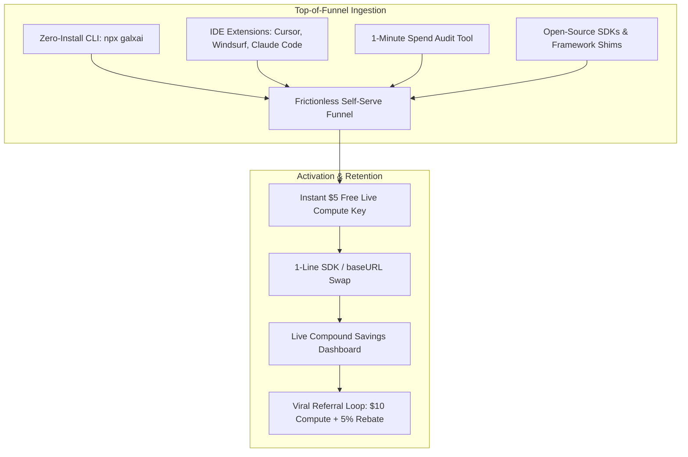

# 🚀 GALXAI: Go-To-Market (GTM) & Positioning Strategy

## 1. Executive Summary & Market Whitespace

The generative AI developer market is suffering from **"Gateway Fatigue"**:
1. **Raw Foundation Model APIs** (OpenAI, Anthropic, xAI) offer cutting-edge models but impose strict single-account rate limits, high retail list prices, and zero automated failover.
2. **Generic API Gateways & Aggregators** (OpenRouter, Cloudflare AI Gateway) charge an additional **5%–10% routing markup** on top of retail rates, adding an extra middleware rectangle without solving underlying token unit economics.

**GALXAI breaks this paradigm by positioning as a Wholesale Compute Clearinghouse & 429 Burst Shield:**
- **Value Proposition**: Direct **25%–40% wholesale pricing discounts**, **75% prompt caching pass-through**, and **multi-account 429 burst resilience** with **zero code modifications**.
- **The Core Economic Moat**: Multi-tenant pooled volume arbitrage. By consolidating developer traffic into enterprise-tier compute streams, GALXAI captures wholesale tier discounts and passes them directly to developers while generating sustainable platform gross margins ($\sim 33\%$).

---

## 2. The 4 Jobs To Be Done (JTBD) & Persona Breakdown

### Persona 1: High-Burn Startups & AI Scaleups (The Cost Job)
- **Profile**: Founders and engineering leaders spending $2,000–$50,000/mo on LLM tokens for customer-facing AI products.
- **Pain Point**: High monthly token burn eating runway, unable to commit $100k+ upfront to OpenAI enterprise sales.
- **The Hook**: 1-line `baseURL` swap that slashes monthly token bills by **25%–40%** on day 1 with zero prompt rewrites.

### Persona 2: AI Agent & Batch Pipeline Engineers (The Reliability Job)
- **Profile**: Developers building multi-agent swarms (CrewAI, LangGraph, AutoGen) and high-concurrency document RAG pipelines.
- **Pain Point**: Frequent `429 Too Many Requests` upstream stalls when batch jobs spike.
- **The Hook**: Multi-account hydraulic quota pooling that absorbs burst spikes and guarantees zero 429 stalls.

### Persona 3: Power Hackers & IDE Users (The Tooling Job)
- **Profile**: Developers using Cursor, Windsurf, Claude Code CLI, and local scripts.
- **Pain Point**: Managing 4 different provider billing accounts, minimum deposit balances, and API keys.
- **The Hook**: One universal API key and prepaid wallet that powers all tools across GPT-5.6, Grok 4.6, and Claude 3.7 at wholesale cost.

### Persona 4: Terminal & Bash Hackers (The DX Job)
- **Profile**: Engineers writing bash scripts, automation pipelines, and quick CLI tools.
- **Pain Point**: Writing 20 lines of SDK boilerplate or debugging 400 parameter errors just to run a quick prompt.
- **The Hook**: `npx galxai "Explain Raft"` with zero installs, zero accounts, and instant streaming.

---

## 3. Product Positioning vs. Traditional Alternatives

| Vector | Direct Upstream (OpenAI / xAI) | Standard Gateways (OpenRouter) | **GALXAI Wholesale Clearinghouse** |
| :--- | :--- | :--- | :--- |
| **Pricing vs. Retail** | 100% Retail List Price | 105% (+5% Markup Fee) | **75%–60% (25%–40% DISCOUNT)** |
| **Prompt Caching Rebate** | 50%–75% | Variable / Partial Retention | **100% Pass-Through (75%–85% Rebate)** |
| **Failover & Pooling** | None (Single Key Fails) | Basic Provider Switching | **Continuous Hydraulic Quota Pooling (P-AHT)** |
| **Rate Limit Resilience** | Hard 429 Rate Limit Errors | Retry queue | **Multi-Account Burst Absorption (<1ms Overhead)** |
| **Edge Network Coverage** | Centralized Origin Regions | Centralized Origin Proxy | **300+ Global Edge PoPs (<15ms TTFT)** |
| **CLI & Terminal DX** | None (SDK Required) | None (REST cURL Only) | **Zero-Install CLI (`npx galxai`)** |
| **Security Architecture** | Standard API Key | Plaintext Gateway Storage | **AES-256-GCM + AAD Tenant Envelope Vault** |
| **SDK Compatibility** | Native | OpenAI Compatible | **100% Drop-in for OpenAI, Anthropic, Vercel AI, LangChain** |

---

## 4. Developer Distribution & Growth Loops

### Channel 1: IDE & Coding Agent Integrations (Cursor, Windsurf, Cline)
- Publish 1-click configuration presets. Developers paste their GALXAI key into Cursor settings and get 25%–40% cheaper reasoning completions without altering their workflow.

### Channel 2: The Zero-Install CLI (`npx galxai`)
- Spread through developer terminal culture, GitHub READMEs, and technical blog posts as the fastest way to run frontier LLMs from the command line.

### Channel 3: The 1-Minute Spend Audit
- An interactive audit tool allowing engineering leads to calculate their exact monthly cash savings before writing a line of code.

---

## 5. Unit Economics & Gross Margin Calculus

GALXAI achieves strong unit economics through **wholesale tier arbitrage**:

### Economics Breakdown per 1 Billion Tokens (`gpt-5.6-sol` blend)
- **Direct Upstream Wholesale Cost (Consolidated Enterprise Fleet)**: **$2.50 / 1M input**, **$10.00 / 1M output**.
- **Retail List Price (What developers pay directly)**: **$5.00 / 1M input**, **$20.00 / 1M output**.
- **GALXAI Price to Developers (25% Discount)**: **$3.75 / 1M input**, **$15.00 / 1M output**.
- **GALXAI Gross Margin**: **$1.25 / 1M input**, **$5.00 / 1M output** ($\approx \mathbf{33.3\%}$ **Gross Margin** on raw token pass-through with zero server hardware CapEx).

---

## 6. Retention & High-Water Mark Moat

1. **High-Water Mark Retention**:
   - Once an engineering team points production traffic to GALXAI, reverting back to a single direct key introduces immediate 429 rate limit stalls and a 33% cost spike, creating strong organic retention ($\text{NDR} > 130\%$).

2. **Automated Monthly Volume Progression**:
   - Dynamic volume rebates ($+5\%$ at $\$250/\text{mo}$, $+10\%$ at $\$1,500/\text{mo}$, $+15\%$ at $\$5,000/\text{mo}$) incentivize scaling startups to route all company AI traffic through GALXAI.
