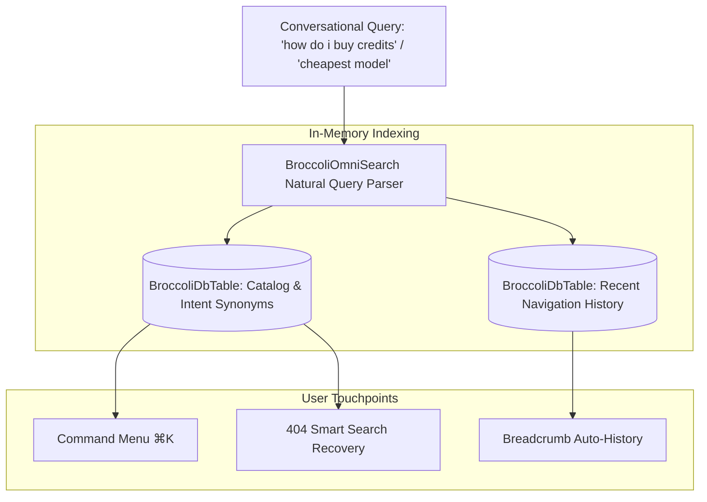

# GALXAI Natural Navigation & OmniSearch Guide

This document outlines the **Natural Language Query Engine**, **BroccoliOmniSearch In-Memory Index**, **404 Smart Search Recovery**, and **Zero-Hesitation Ergonomics** built into GALXAI for technical and non-technical users alike.

---

## 1. Core Philosophy: Zero-Hesitation Navigation

Non-technical founders, product managers, and junior developers interact with software using conversational intent rather than exact technical route names. GALXAI provides an intelligent in-memory semantic indexing substrate that maps plain-English phrases directly to platform destinations with **zero LLM network overhead**.

---

## 2. Intent Phrase Mapping Matrix

| User Conversational Phrase | Matched Intent | Destination Route | Category |
| :--- | :--- | :--- | :--- |
| *"how do i buy credits"*, *"add funds"*, *"top up wallet"* | Billing & Deposit | `/billing` | Navigation |
| *"cheapest model"*, *"browse models"*, *"discount rates"* | Model Catalog | `/models` | Models & Engines |
| *"compare gpt with grok"*, *"benchmark matrix"* | Model Comparison | `/models/compare` | Models & Engines |
| *"where is my invoice"*, *"billing receipt"* | Tax Invoices | `/billing/invoices` | Documentation |
| *"how does prompt caching work"*, *"75% discount"* | Prompt Caching Guide | `/docs/prompt-caching` | Documentation |
| *"explain tokens like im five"*, *"beginner guide"* | Plain English Guide | `/docs/simple` | Documentation |
| *"why am i getting 429 rate limit"*, *"fix error"* | Error Handling | `/docs/error-handling` | Help & Diagnostics |
| *"claim free credits"*, *"generate bearer token"* | Mint New Key | `/keys/new` | Actions & Tools |
| *"is the api down"*, *"system status"* | Live SLA Uptime | `/status` | Help & Diagnostics |

---

## 3. Two-Key Navigation Sequences

For power users and terminal developers, two-key sequences allow instant navigation across the entire gateway without taking hands off the keyboard:

| Shortcut | Destination | Description |
| :--- | :--- | :--- |
| `g h` | **Home** (`/`) | Gateway overview and featured routers |
| `g m` | **Models** (`/models`) | 12 state-of-the-art model pricing catalog |
| `g c` | **Compare** (`/models/compare`) | Benchmark matrix and context windows |
| `g k` | **API Keys** (`/keys`) | Manage zero-markup developer tokens |
| `g b` | **Billing** (`/billing`) | Compute wallet, invoices, and deposits |
| `g q` | **Queues** (`/queues`) | Async background tasks & live results |
| `g p` | **Playground** (`/playground`) | Interactive prompt & token tester |
| `g d` | **Documentation** (`/docs`) | Developer guides and SDK cheatsheets |
| `g s` | **Status** (`/status`) | Real-time multi-region SLA health |
| `g f` | **FAQ** (`/faq`) | Zero data retention & security answers |
| `?` | **Shortcuts Modal** | Displays all keyboard shortcuts overlay |

---

## 4. 404 Smart Search Recovery

When a user visits a mistyped or non-existent URL (e.g. `/model`, `/keys/deposit`, `/credit`), `NotFoundSearchHelper` intercepts the 404 view and provides:
1. **Interactive Search Input**: Pre-wired to `BroccoliOmniSearch`.
2. **Instant Smart Matches**: Displays top 4 destination suggestions as the user types.
3. **1-Click Redirection**: Navigates cleanly without full page refreshes.

---

## 5. Universal Clipboard Shield

To prevent silent copy failures on mobile Safari and sandboxed iframes:
- All clipboard interactions use `safeCopyToClipboard(text: string): Promise<boolean>`.
- If `navigator.clipboard.writeText()` is rejected by browser permission policies, it seamlessly falls back to a hidden textarea executing `document.execCommand('copy')`.
