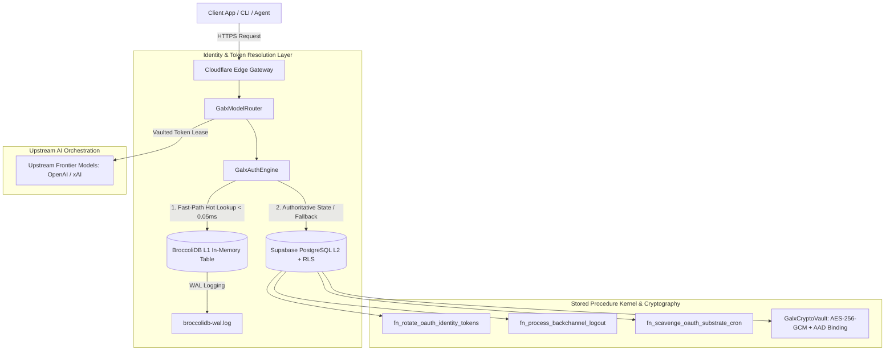
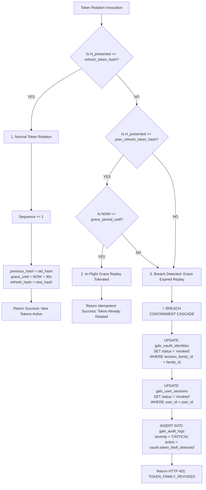

# GALXAI Enterprise OAuth 2.0 / 2.1, FAPI & Token Lifecycle Specification

## 1. Executive Summary & Architectural Overview

GALXAI operates as an enterprise-grade AI proxy gateway, cryptographic credential vault, and high-performance model orchestration mesh. To enable seamless multi-tenant developer access to upstream frontier model providers (OpenAI Codex, xAI Grok, Anthropic), the platform implements an authoritative, zero-trust **OAuth 2.0 / 2.1, OpenID Connect 1.0, and Financial-grade API (FAPI) Token Lifecycle Substrate**.

The system unifies a sub-millisecond **L1 In-Memory Reactive Table Layer (BroccoliDB)** with an authoritative, row-level secured **L2 Relational Persistence Engine (Supabase PostgreSQL)**.



---

## 2. Standards, RFCs & Technical Frameworks

| RFC / Standard | Official Specification Title | Role in GALXAI Architecture |
| :--- | :--- | :--- |
| **RFC 6749** | The OAuth 2.0 Authorization Framework | Authorization Code Grant with upstream provider identities. |
| **RFC 7636** | Proof Key for Code Exchange (PKCE) | High-entropy S256 code challenge generation and validation. |
| **RFC 6819 § 5.2.2.3** | OAuth 2.0 Threat Model: Token Family & Refresh Token Rotation (RTR) | Monotonic sequence counters, 30s grace replay window, and automated breach containment cascades. |
| **RFC 8628** | OAuth 2.0 Device Authorization Grant (Device Flow) | Headless CLI, remote container, and SSH-based workstation authentication. |
| **RFC 9126** | OAuth 2.0 Pushed Authorization Requests (PAR) | Eliminates URL query parameter exposure by pushing parameters directly via HTTPS POST. |
| **RFC 9449** | Demonstrating Proof-of-Possession at the Application Layer (DPoP) | Asymmetric client key binding preventing bearer token replay and exfiltration. |
| **RFC 7009** | OAuth 2.0 Token Revocation | Standard token invalidation endpoint with enumeration protection. |
| **RFC 7662** | OAuth 2.0 Token Introspection | Sub-millisecond offline token validation for microservices. |
| **RFC 7517** | JSON Web Key Set (JWKS) | Public cryptographic KMS key distribution for token signature verification. |
| **OIDC Back-Channel 1.0** | OpenID Connect Back-Channel Logout | Server-to-server asynchronous revocation propagation from upstream identity providers. |
| **OIDC Discovery 1.0** | OpenID Connect Discovery Specification | RFC 8414 compliant metadata and endpoint discovery. |

---

## 3. Storage Topology & Dual-Layer Cohesion

The token lifecycle engine operates across two synchronized memory and storage strata:

### 3.1 Layer 1: BroccoliDB Reactive In-Memory Substrate
- **Latency**: `< 0.05ms` per read, `< 0.1ms` per write.
- **Tables**:
  - `oauth_identities`: Active and cached provider identities with secondary indexing on `userId`, `provider`, and `sessionFamilyId`.
  - `oauth_authorization_requests`: Ephemeral PKCE state nonces and code verifiers (15m TTL).
  - `oauth_device_codes`: Active RFC 8628 device codes and Base32 user codes.
  - `pushed_authorization_requests`: RFC 9126 PAR request URIs (90s TTL).
  - `dpop_jti_registry`: Cryptographic anti-replay JTI cache (5m TTL).
  - `audit_ledger`: SHA-256 chained in-memory audit log.

### 3.2 Layer 2: Authoritative Supabase PostgreSQL Substrate
- **Latency**: `< 5ms` per stored procedure execution.
- **Security**: 100% `ENABLE ROW LEVEL SECURITY` & `FORCE ROW LEVEL SECURITY` across all public tables.
- **Tables**:
  - `galx_oauth_identities`: Master authoritative identity records with AES-256-GCM encrypted access/refresh tokens.
  - `galx_oauth_requests`: Durable PKCE state store.
  - `galx_oauth_device_codes`: Durable device code store with rate limit attempt counters.
  - `galx_oauth_pushed_requests`: Durable PAR store.
  - `galx_oauth_dpop_proofs`: Durable DPoP JTI proof ledger.
  - `galx_oauth_backchannel_logouts`: Immutable OIDC Back-Channel logout history.
  - `galx_user_sessions`: Active user sessions with client fingerprint validation.
  - `galx_audit_logs`: Append-only compliance and threat ledger.

---

## 4. Refresh Token Rotation (RTR) & Breach Containment

### 4.1 Token Family Data Model
Every OAuth identity maintains a cryptographically bound token lineage:
- `session_family_id`: Immutable UUIDv4 string linking all successive generations of a login session.
- `sequence_number`: Monotonically increasing 32-bit integer ($1, 2, 3, \dots, N$).
- `refresh_token_hash`: SHA-256 hex digest of the currently active refresh token.
- `previous_refresh_token_hash`: SHA-256 hex digest of the immediate predecessor refresh token.
- `grace_period_until`: ISO-8601 UTC timestamp ($\text{Rotation Timestamp} + 30\text{ seconds}$).

### 4.2 Tri-State Rotation Algorithm (`fn_rotate_oauth_identity_tokens`)

When a client or background worker submits an old refresh token hash $H_{\text{presented}}$ for rotation:



---

## 5. OpenID Connect Back-Channel Logout 1.0

### 5.1 Protocol Specification
When an account owner terminates their session or changes authentication settings at the upstream identity provider (e.g. `https://auth.openai.com`), the upstream provider issues an asynchronous HTTP POST request to GALXAI's back-channel logout endpoint:

```
POST /api/auth/oauth/backchannel-logout
Content-Type: application/x-www-form-urlencoded

logout_token=eyJhbGciOiJSUzI1NiIsImtpZCI6IjEyMzQ1...
```

### 5.2 Logout Token Claims Schema
```json
{
  "iss": "https://auth.openai.com",
  "sub": "user_openai_998124_alpha",
  "aud": "galxai_client_id_live",
  "iat": 1724457600,
  "jti": "bc_jti_44109281a",
  "events": {
    "http://schemas.openid.net/event/backchannel-logout": {}
  },
  "sid": "session_upstream_88123"
}
```

### 5.3 Stored Procedure Execution (`fn_process_backchannel_logout`)
1. Verifies issuer validity (`iss`) and ingests token record into `galx_oauth_backchannel_logouts`.
2. Locates linked user identity via `(provider, provider_account_id = sub)`.
3. Atomically revokes all linked identities for that provider and user in `galx_oauth_identities`.
4. Invalidates all active user sessions in `galx_user_sessions`.
5. Emits an immutable audit event to `galx_audit_logs`.
6. Flushes local L1 BroccoliDB hot memory tables.
7. Responds with `HTTP 200 OK` (Cache-Control: `no-store`).

---

## 6. Automated Substrate Vacuum & Kernel Scavenging

To maintain sub-millisecond query execution speeds over high-throughput token traffic, PostgreSQL executes scheduled substrate vacuuming via `fn_scavenge_oauth_substrate_cron()`:

```sql
-- Single-transaction sweep
SELECT public.fn_scavenge_oauth_substrate_cron();
```

### Vacuum Scope & Purge Targets
1. **RFC 9449 DPoP Proofs**: Purges all entries from `galx_oauth_dpop_proofs` where `expires_at < NOW()`.
2. **RFC 7636 PKCE States**: Purges expired authorization requests from `galx_oauth_requests` older than 1 hour past expiration.
3. **RFC 8628 Device Codes**: Purges pending, unapproved device codes from `galx_oauth_device_codes` older than 1 hour past expiration.
4. **RFC 9126 PAR URIs**: Purges unconsumed request URIs from `galx_oauth_pushed_requests` older than 1 hour past expiration.
5. **Expired Identities Reconciliation**: Updates `galx_oauth_identities` status to `'expired'` for active records where `expires_at < NOW()`.

---

## 7. API Reference & Endpoint Schemas

### 7.1 OpenID Connect Server Metadata
- **`GET /.well-known/openid-configuration`**
- **Response (200 OK)**:
  ```json
  {
    "issuer": "https://galx.ai",
    "authorization_endpoint": "https://galx.ai/api/auth/oauth/url",
    "token_endpoint": "https://galx.ai/api/auth/oauth/callback",
    "userinfo_endpoint": "https://galx.ai/api/auth/session",
    "jwks_uri": "https://galx.ai/api/auth/vault/jwks",
    "introspection_endpoint": "https://galx.ai/api/auth/oauth/introspect",
    "revocation_endpoint": "https://galx.ai/api/auth/oauth/revoke",
    "backchannel_logout_supported": true,
    "backchannel_logout_session_supported": true,
    "response_types_supported": ["code"],
    "code_challenge_methods_supported": ["S256"],
    "grant_types_supported": [
      "authorization_code",
      "refresh_token",
      "urn:ietf:params:oauth:grant-type:device_code"
    ],
    "dpop_signing_alg_values_supported": ["ES256", "RS256"]
  }
  ```

### 7.2 RFC 8628 Device Authorization Grant
- **`POST /api/auth/oauth/device/code`**
- **Request Body**:
  ```json
  {
    "provider": "openai",
    "scopes": ["openid", "profile", "model.request"]
  }
  ```
- **Response (200 OK)**:
  ```json
  {
    "device_code": "dev_code_88192a01bf923",
    "user_code": "WDJB-MJHT",
    "verification_uri": "https://galx.ai/device",
    "verification_uri_complete": "https://galx.ai/device?code=WDJB-MJHT",
    "expires_in": 900,
    "interval": 5
  }
  ```

- **`POST /api/auth/oauth/device/token`**
- **Request Body**:
  ```json
  {
    "device_code": "dev_code_88192a01bf923"
  }
  ```
- **Responses**:
  - `400 Bad Request`: `{"error": "authorization_pending", "interval": 5}`
  - `400 Bad Request`: `{"error": "slow_down", "interval": 10}`
  - `400 Bad Request`: `{"error": "expired_token"}`
  - `200 OK`:
    ```json
    {
      "access_token": "galx_sess_v2.091f8a2...3c",
      "token_type": "Bearer",
      "expires_in": 2592000,
      "user": {
        "id": "user_openai_12345",
        "email": "developer@enterprise.ai",
        "name": "Enterprise Developer"
      }
    }
    ```

### 7.3 RFC 9126 Pushed Authorization Requests (PAR)
- **`POST /api/auth/oauth/par`**
- **Request Headers**: `Content-Type: application/x-www-form-urlencoded`
- **Request Body**:
  ```
  client_id=galx_client_app
  &redirect_uri=https%3A%2F%2Fmyapp.com%2Fcallback
  &scope=openid%20profile
  &code_challenge=E9Melhoa2OwvFrGMTJguCH5...
  &code_challenge_method=S256
  ```
- **Response (201 Created)**:
  ```json
  {
    "request_uri": "urn:ietf:params:oauth:request_uri:req_par_771928014a",
    "expires_in": 90
  }
  ```

### 7.4 RFC 7009 Token Revocation
- **`POST /api/auth/oauth/revoke`**
- **Request Body**:
  ```json
  {
    "token": "galx_sess_v2...",
    "token_type_hint": "access_token"
  }
  ```
- **Response (200 OK)**:
  ```json
  {
    "revoked": true
  }
  ```

### 7.5 RFC 7662 Token Introspection
- **`POST /api/auth/oauth/introspect`**
- **Request Body**:
  ```json
  {
    "token": "galx_sess_v2..."
  }
  ```
- **Response (200 OK)**:
  ```json
  {
    "active": true,
    "sub": "user_openai_12345",
    "scope": "openid profile model.request",
    "provider": "openai",
    "exp": 1726937678,
    "iat": 1724345678,
    "token_type": "Bearer",
    "client_id": "galx_live_app"
  }
  ```

---

## 8. TypeScript SDK Developer Ergonomics

```typescript
import { GalxAI } from 'galxai';

const galx = new GalxAI({ apiKey: 'galx_live_key' });

// 1. Headless CLI / Remote Container Device Login
const session = await galx.auth.deviceLogin({
  provider: 'openai',
  onPrompt: ({ userCode, verificationUriComplete }) => {
    console.log(`\n🔑 Authorize in your browser: ${verificationUriComplete}`);
    console.log(`   Verification Code: ${userCode}\n`);
  }
});
console.log('✅ Logged in as:', session.user.email);

// 2. Interactive Local Callback (CLI Workstations)
const workstationSession = await galx.auth.interactiveLogin({
  provider: 'xai-grok',
  openBrowser: true
});

// 3. Pushed Authorization Requests (PAR)
const parResult = await galx.auth.pushAuthorization({
  clientId: 'enterprise_portal',
  redirectUri: 'https://portal.enterprise.ai/auth/callback',
  scope: 'openid profile email'
});
console.log('🔗 Redirect client to:', `https://galx.ai/api/auth/oauth/url?request_uri=${parResult.request_uri}`);

// 4. Token Introspection
const tokenMeta = await galx.auth.introspectToken('galx_sess_v2...');
if (tokenMeta.active) {
  console.log(`Token is active for provider: ${tokenMeta.provider}`);
}

// 5. Explicit Revocation
await galx.auth.revokeToken({ token: 'galx_sess_v2...' });
```

---

## 9. Security Guarantees & Cryptographic Invariants

1. **Zero Plaintext Token Exposure**: All access and refresh tokens are encrypted at rest using AES-256-GCM envelope encryption with Authenticated Associated Data (AAD) bound to the user and shard identity.
2. **Zero URL Credential Leakage**: Pushed Authorization Requests ensure state nonces, scopes, and client metadata are never transmitted via URL query parameters.
3. **Cryptographic Proof of Possession**: RFC 9449 DPoP headers bind access tokens to ephemeral client EC public keys, eliminating Bearer token replay threats.
4. **Deterministic Token Theft Containment**: Stale refresh token replay outside the 30-second grace period triggers an immediate cluster-wide revocation of all sibling tokens in the session family.
5. **Continuous Audit Merkle Chain**: Every authorization, rotation, revocation, and back-channel event is immutably appended to `galx_audit_logs` with SHA-256 cryptographic chaining.
