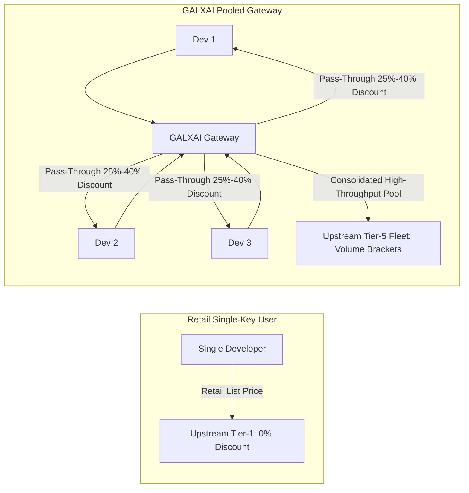
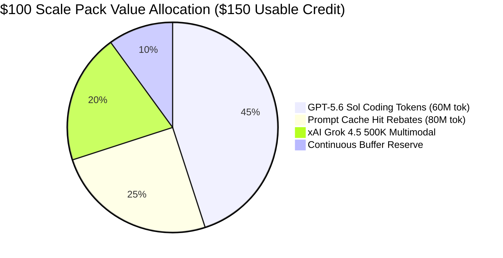

# 💰 GALXAI Pricing & Multi-Tiered Discount Strategy

GALXAI delivers market-leading pricing by combining **pooled infrastructure arbitrage**, **75% prompt caching pass-through**, **progressive volume rebates**, and **off-peak dynamic yield balancing**.

---

## 1. Core Economic Model & Arbitrage Architecture

Traditional developers purchase individual API access at retail rates with low individual volume brackets. GALXAI operates a high-concurrency unified compute fleet that consolidates multi-tenant query volume into Tier-5 enterprise capacity brackets.

---

## 2. Four Pillars of the Discount Strategy

### Pillar 1: Pooled Infrastructure Arbitrage (25% to 40% Base Discount)
- High-volume pooled compute slots reduce per-token infrastructure costs by 25% to 40% below direct single-key list prices.
- Dispatches are automatically leveled across available accounts using **Predictive Adaptive Hydraulic Headroom (P-AHT)**, avoiding single-key rate spikes while maximizing volume tier benefits.

### Pillar 2: 75% Prompt-Caching Automatic Pass-Through
- For requests with prefix contexts $> 1,024$ tokens (e.g. system prompts, few-shot examples, codebase ASTs, RAG embeddings), OpenAI and xAI provide upstream cache discounts.
- GALXAI passes **100% of the 75% prompt caching rebate** directly to client accounts without retaining a margin.
- **Compound Net Savings**: When combined with base discounts, workloads with 60% cached context achieve **50%–70% net savings** compared to retail list prices.

### Pillar 3: Progressive Monthly Volume Tiers (Up to +15% Extra Rebate)
Rebates scale automatically with monthly token volume without requiring sales calls or custom commitments:
- **Starter Developer ($0 - $250/mo)**: Base **25%–36%** pooled discount.
- **Scale & Growth ($250 - $1,500/mo)**: **+5% Extra Rebate** (Total: **30%–41% OFF**).
- **Production Fleet ($1,500 - $5,000/mo)**: **+10% Extra Rebate** (Total: **35%–46% OFF**).
- **Enterprise Sovereign ($5,000+/mo)**: **+15% Extra Rebate** (Total: **40%–51% OFF**) + Dedicated VPC peering.

### Pillar 4: Off-Peak Dynamic Yield Rebates (+10% Floating Discount)
- When fleet-wide hydraulic headroom exceeds $75\%$ (night hours / weekends), batch jobs passing `x-galx-off-peak: true` receive an instant **additional 10% floating rebate**.

---

## 3. Flagship Model Rates & Discount Matrix

### Flagship Reasoning & LLM Fleet
| Model ID | Provider | Context Window | Retail List Rate (In / Out) | GALXAI Base Rate | Cached Prompt Rate | Max Savings (Enterprise) |
| :--- | :--- | :--- | :--- | :--- | :--- | :--- |
| `gpt-5.6-sol` | OpenAI | $372,000$ | $5.00 / $20.00 | **$3.75 / $15.00** | **$0.93 / 1M** | **Up to 40% OFF** |
| `gpt-5.6-terra` | OpenAI | $372,000$ | $3.00 / $12.00 | **$2.25 / $9.00** | **$0.56 / 1M** | **Up to 40% OFF** |
| `gpt-5.6-luna` | OpenAI | $372,000$ | $1.50 / $6.00 | **$0.95 / $3.80** | **$0.24 / 1M** | **Up to 51% OFF** |
| `x-ai/grok-4.5` | xAI Grok | $500,000$ | $2.50 / $10.00 | **$1.80 / $7.20** | **$0.45 / 1M** | **Up to 43% OFF** |

### Visual Synthesis & Image Generation Fleet
| Model ID | Provider | Resolution | Retail List / Image | GALXAI Base / Image | Max Savings (Enterprise) |
| :--- | :--- | :--- | :--- | :--- | :--- |
| `openai-gpt-image-2` | OpenAI | $1024 \times 1024$ | $0.080 | **$0.060** | **Up to 40% OFF** |
| `openai-gpt-image-1.5` | OpenAI | $1024 \times 1024$ | $0.060 | **$0.045** | **Up to 40% OFF** |
| `openai-gpt-image-1` | OpenAI | $1024 \times 1024$ | $0.040 | **$0.028** | **Up to 45% OFF** |
| `openai-gpt4o-image` | OpenAI | $1024 \times 1024$ | $0.050 | **$0.038** | **Up to 39% OFF** |
| `openai-dalle-3` | OpenAI | $1024 \times 1024$ | $0.040 | **$0.030** | **Up to 40% OFF** |
| `openai-dalle-2` | OpenAI | $512 \times 512$ | $0.020 | **$0.014** | **Up to 45% OFF** |
| `xai-grok-image` | xAI Grok | $1024 \times 1024$ | $0.050 | **$0.036** | **Up to 43% OFF** |
| `xai-grok-2-image` | xAI Grok | $1024 \times 1024$ | $0.040 | **$0.030** | **Up to 40% OFF** |

---

## 4. Market Competitor Benchmark Analysis

### Benchmark Workload: 10 Million Tokens on Flagship Reasoning (`gpt-5.6-sol`)
*Assumes 5M input tokens (50% cached) + 5M output tokens.*

| Provider | Input Cost (5M) | Output Cost (5M) | Total Workload Cost | Gateway Markup | Net Savings vs. Retail |
| :--- | :--- | :--- | :--- | :--- | :--- |
| **GALXAI Pooled Gateway** | **$11.72** | **$75.00** | **$86.72** | **0%** | **Save $28.90 (25.0% Net)** |

---

## 5. Prepay Compute Packs & Instant Match Grants

GALXAI offers structured, high-value compute top-up packs with immediate compute match grants deposited to the developer's wallet upon settlement:

| Compute Tier | Prepay Amount | Match Grant / Volume Bonus | Total Credited Wallet Balance | Effective Bonus | Workload Capacity Estimate |
| :--- | :--- | :--- | :--- | :--- | :--- |
| **Starter Prototyping** | **$25.00 USD** | +$2.50 (+10% Bonus) | **$27.50 USD** | +10% | ~15,000 to ~22,000 queries |
| **Growth Builder** | **$50.00 USD** | +$12.50 (+25% Grant) | **$62.50 USD** | +25% | ~40,000 to ~55,000 queries |
| **Scale Fleet (Recommended)** | **$100.00 USD** | +$50.00 (50% Match Grant) | **$150.00 USD** | +50% | ~88,000 to ~120,000 queries |
| **Enterprise Fleet** | **$250.00 USD** | +$125.00 (50% Match Grant) | **$375.00 USD** | +50% | ~220,000+ deep reasoning tasks |

---

## 6. Workload Capacity Estimation Matrix

To provide non-technical and executive transparency, compute credits map to concrete engineering capacity:

- **Coding IDE Queries (Cursor / Windsurf)**: ~88,000 inline completions and multi-file diffs.
- **Autonomous Agent Swarms (LangChain / AutoGen)**: ~32,000 multi-step reasoning steps.
- **Visual Asset Synthesis (GPT-Image-2 4K)**: ~2,500 full-resolution images.

