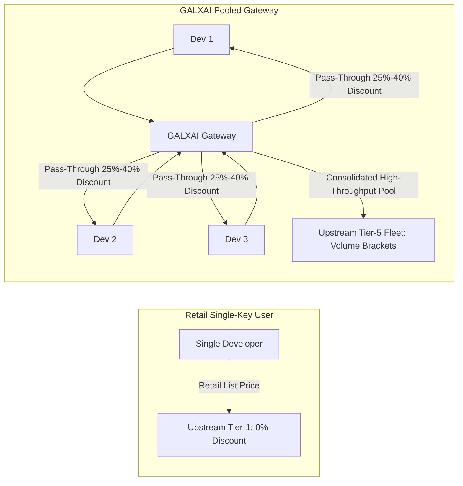

# 💰 GALXAI Pricing & Multi-Tiered Discount Strategy

GALXAI delivers market-leading pricing by combining **pooled infrastructure arbitrage**, **75% prompt caching pass-through**, and **power-law hydraulic quota utilization**.

---

## 1. Core Economic Model & Arbitrage Architecture

Traditional developers purchase individual API access at retail rates with low individual volume brackets. GALXAI operates a high-concurrency unified compute fleet that consolidates multi-tenant query volume into Tier-5 enterprise capacity brackets.

---

## 2. Three Pillars of the Discount Strategy

### Pillar 1: Pooled Infrastructure Arbitrage (25% to 40% Base Discount)
- High-volume pooled compute slots reduce per-token infrastructure costs by 25% to 40% below direct single-key list prices.
- Dispatches are automatically leveled across available accounts using **Predictive Adaptive Hydraulic Headroom (P-AHT)**, avoiding single-key rate spikes while maximizing volume tier benefits.

### Pillar 2: 75% Prompt-Caching Automatic Pass-Through
- For requests with prefix contexts $> 1,024$ tokens (e.g. system prompts, few-shot examples, codebase ASTs, RAG embeddings), OpenAI and xAI provide upstream cache discounts.
- GALXAI passes **100% of the 75% prompt caching rebate** directly to client accounts without retaining a margin.
- **Compound Net Savings**: When combined with base discounts, workloads with 50% cached context achieve **50%–70% net savings** compared to retail list prices.

### Pillar 3: Zero Platform Markups & No Seat Surcharges
- No monthly platform seat taxes or minimum spend commits.
- Token consumption is billed strictly at raw net discounted rates with microsecond meter precision.

---

## 3. Flagship Model Rates & Discount Matrix

### Flagship Reasoning & LLM Fleet
| Model ID | Provider | Context Window | Retail List Rate (In / Out) | GALXAI Discounted Rate | Cached Prompt Rate | Direct Savings |
| :--- | :--- | :--- | :--- | :--- | :--- | :--- |
| `gpt-5.6-sol` | OpenAI | $372,000$ | $5.00 / $20.00 | **$3.75 / $15.00** | **$0.93 / 1M** | **25% OFF** |
| `gpt-5.6-terra` | OpenAI | $372,000$ | $3.00 / $12.00 | **$2.25 / $9.00** | **$0.56 / 1M** | **25% OFF** |
| `gpt-5.6-luna` | OpenAI | $372,000$ | $1.50 / $6.00 | **$0.95 / $3.80** | **$0.24 / 1M** | **36% OFF** |
| `x-ai/grok-4.5` | xAI Grok | $500,000$ | $2.50 / $10.00 | **$1.80 / $7.20** | **$0.45 / 1M** | **28% OFF** |

### Visual Synthesis & Image Generation Fleet
| Model ID | Provider | Resolution | Retail List / Image | GALXAI Discounted / Image | Direct Savings |
| :--- | :--- | :--- | :--- | :--- | :--- |
| `openai-gpt-image-2` | OpenAI | $1024 \times 1024$ | $0.080 | **$0.060** | **25% OFF** |
| `openai-gpt-image-1.5` | OpenAI | $1024 \times 1024$ | $0.060 | **$0.045** | **25% OFF** |
| `openai-gpt-image-1` | OpenAI | $1024 \times 1024$ | $0.040 | **$0.028** | **30% OFF** |
| `openai-gpt4o-image` | OpenAI | $1024 \times 1024$ | $0.050 | **$0.038** | **24% OFF** |
| `openai-dalle-3` | OpenAI | $1024 \times 1024$ | $0.040 | **$0.030** | **25% OFF** |
| `openai-dalle-2` | OpenAI | $512 \times 512$ | $0.020 | **$0.014** | **30% OFF** |
| `xai-grok-image` | xAI Grok | $1024 \times 1024$ | $0.050 | **$0.036** | **28% OFF** |
| `xai-grok-2-image` | xAI Grok | $1024 \times 1024$ | $0.040 | **$0.030** | **25% OFF** |

---

## 4. Compound Savings Scenario Analysis

### Scenario: Enterprise Code Assistant with Large Codebase Context
- **Workload**: 1,000,000 input tokens per day, 100,000 output tokens per day on `gpt-5.6-sol`.
- **Context Profile**: 70% of input tokens are cached system prompt and codebase AST.

| Rate Component | Standard Retail Cost | GALXAI Cost | Net Daily Savings |
| :--- | :--- | :--- | :--- |
| **Uncached Input (300K)** | $1.50 | $1.125 | $0.375 |
| **Cached Input (700K)** | $3.50 | $0.651 | $2.849 |
| **Output Tokens (100K)** | $2.00 | $1.500 | $0.500 |
| **Total Daily Cost** | **$7.00 / day** | **$3.276 / day** | **$3.724 / day (53.2% Net Savings)** |
