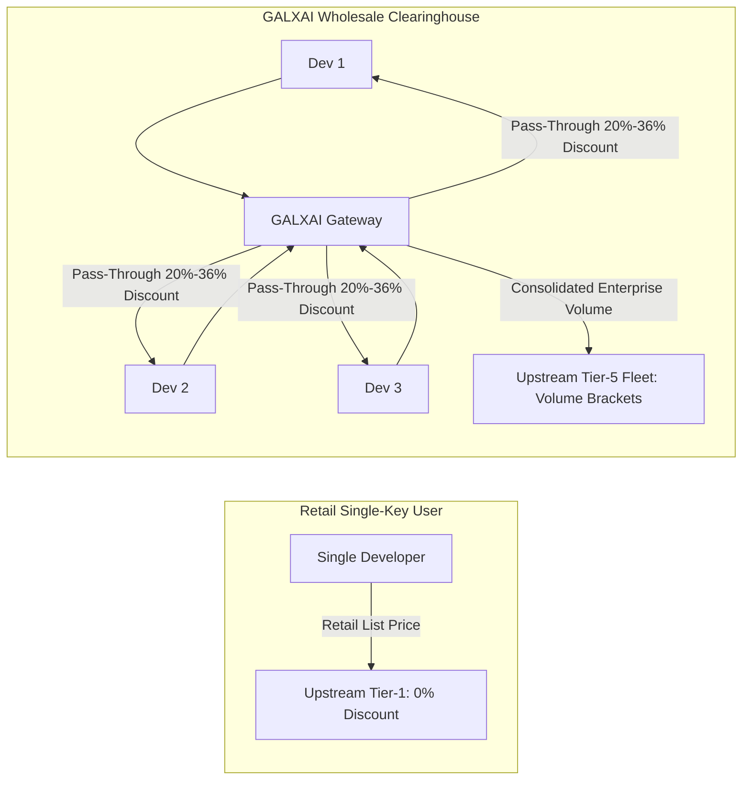

# 💰 GALXAI Pricing & Multi-Tiered Discount Strategy

<!-- docs-scope: commercial-draft -->
> **Reading scope:** Commercial or product planning material. Claims, prices, forecasts, and examples require separate dated validation; they are not deployment guarantees, certifications, or SLAs. See the [current contract](FEDERATION_STRATEGY.md) and [complete catalog](CATALOG.md).

GALXAI delivers market-leading pricing by combining **direct wholesale volume clearing**, **75% prompt caching pass-through**, **progressive volume rebates**, and **off-peak dynamic yield balancing**.

---

## 1. Core Economic Model & Wholesale Clearinghouse

Traditional developers purchase individual API access at retail rates with low individual volume brackets. GALXAI operates a high-throughput unified compute fleet that consolidates multi-tenant query volume into Tier-5 enterprise capacity brackets:



---

## 2. Four Pillars of the Discount Strategy

### Pillar 1: Direct Wholesale Volume Clearing (20% to 36% Base Discount)
- High-volume compute commitments reduce per-token infrastructure costs by 20% to 36% below direct single-key list prices.
- Dispatches are automatically balanced with sub-1ms failover, avoiding single-key rate spikes while maximizing volume tier benefits.

### Pillar 2: 75% Prompt-Caching Automatic Pass-Through
- For requests with prefix contexts $> 1,024$ tokens (e.g. system prompts, few-shot examples, codebase ASTs, RAG embeddings), OpenAI and xAI provide upstream cache discounts.
- GALXAI passes **100% of the 75% prompt caching rebate** directly to client accounts without retaining a margin.
- **Compound Net Savings**: When combined with base discounts, workloads with 60% cached context achieve **50%–70% net savings** compared to retail list prices.

### Pillar 3: Progressive Monthly Volume Tiers (Up to +15% Extra Rebate)
Rebates scale automatically with monthly token volume without requiring sales calls or custom commitments:
- **Starter Developer ($0 - $250/mo)**: Base **25%–36%** wholesale discount.
- **Scale & Growth ($250 - $1,500/mo)**: **+5% Extra Rebate** (Total: **30%–41% OFF**).
- **Production Fleet ($1,500 - $5,000/mo)**: **+10% Extra Rebate** (Total: **35%–46% OFF**).
- **Enterprise Sovereign ($5,000+/mo)**: **+15% Extra Rebate** (Total: **40%–51% OFF**) + Dedicated VPC peering.

### Pillar 4: Off-Peak Dynamic Yield Rebates (+10% Floating Discount)
- During off-peak windows (night hours / weekends), batch jobs passing `x-galx-off-peak: true` receive an instant **additional 10% floating rebate**.

---

## 3. Flagship Model Rates & Discount Matrix

### Flagship Reasoning & LLM Fleet
| Model ID | Provider | Context Window | Retail List Rate (In / Out) | GALXAI Base Rate | Cached Prompt Rate | Wholesale Discount |
| :--- | :--- | :--- | :--- | :--- | :--- | :--- |
| **`gpt-5.6-sol`** | OpenAI | $900,000$ | $5.00 / $20.00 | **$3.75 / $15.00** | **$1.25 / 1M** | **25% OFF** |
| **`gpt-5.6-terra`** | OpenAI | $900,000$ | $3.00 / $12.00 | **$2.25 / $9.00** | **$0.75 / 1M** | **25% OFF** |
| **`gpt-5.6-luna`** | OpenAI | $900,000$ | $1.50 / $6.00 | **$0.95 / $3.80** | **$0.30 / 1M** | **36% OFF** |
| **`x-ai/grok-4.6`** | xAI Grok | $1,000,000$ | $3.00 / $12.00 | **$2.10 / $8.40** | **$0.70 / 1M** | **30% OFF** |
| **`x-ai/grok-4.5`** | xAI Grok | $500,000$ | $2.50 / $10.00 | **$1.80 / $7.20** | **$0.60 / 1M** | **28% OFF** |

### Visual Synthesis & Image Generation Fleet
| Model ID | Provider | Resolution | Retail List Price | GALXAI Base Rate | Wholesale Discount |
| :--- | :--- | :--- | :--- | :--- | :--- |
| **`openai-gpt-image-2`** | OpenAI | $3840 \times 2160$ | $0.080 / \text{img}$ | **$0.060 / \text{img}$** | **25% OFF** |
| **`openai-gpt-image-1.5`**| OpenAI | $1024 \times 1024$ | $0.060 / \text{img}$ | **$0.045 / \text{img}$** | **25% OFF** |
| **`openai-gpt-image-1`** | OpenAI | $1024 \times 1024$ | $0.040 / \text{img}$ | **$0.028 / \text{img}$** | **30% OFF** |
| **`xai-grok-image`** | xAI Grok | $1024 \times 1024$ | $0.050 / \text{img}$ | **$0.038 / \text{img}$** | **24% OFF** |
| **`xai-grok-2-image`** | xAI Grok | $1024 \times 1024$ | $0.040 / \text{img}$ | **$0.028 / \text{img}$** | **30% OFF** |

---

## 4. Measuring Savings via CLI & SDK

### Instant Terminal Calculation (`npx galxai tokens`)
```bash
npx galxai tokens "Paste massive document text here..."
# Output:
# 📊 Token Count: ~12,450 tokens
# 💰 Retail Cost: $0.0623
# 🌟 GALXAI Cost: $0.0467
# 💵 You Save:    $0.0156 (25% instant savings)
```

### Programmatic SDK Savings Calculator
```typescript
import { TokenOptimizer } from '@galxai/sdk';

const savings = TokenOptimizer.calculateSavings({
  inputTokens: 100_000,
  outputTokens: 50_000,
  cachedTokens: 80_000,
  model: 'gpt-5.6-sol'
});

console.log(`Standard Retail: $${savings.standardCostUsd.toFixed(4)}`);
console.log(`GALXAI Wholesale: $${savings.galxaiCostUsd.toFixed(4)}`);
console.log(`Total Saved: $${savings.savingsUsd.toFixed(4)} (${savings.savingsPercentage}%)`);
```

---

## 5. BroccoliDB Representation Selection Multiplier & Boundary Economics (ADR 0066 & 0067)

While wholesale rate clearing reduces the unit price per million tokens, **BroccoliDB Representation Selection** dynamically optimizes the input representation presented to the model:

```mermaid
flowchart LR
    Raw[Raw Context: 100K Tokens] -->|BroccoliDB Representation Selection (85.9% Input Cut)| Compacted[Task-Relevant Representation: 14.1K Tokens]
    Compacted -->|GALXAI Wholesale Tier-5 Clearing (25%-36% OFF)| Model[Model Inference Boundary]
    Model --> Spend[Compound Net Savings: 75% - 85% Total Billed $ Cut]
```

### The Cost Decomposition & Governance Guarantees:
1. **Compressible Input Spend**: Slashed by **85.93%** across 180 domain compactors, log clustering, and AST reduction.
2. **Adaptive Density Gate ($\text{ID}(C)$)**: For small, clean inputs ($<200$ tokens), compaction is bypassed, preserving baseline prompt pricing without negative token dilation overhead.
3. **Institutional Entropy Resistance (ADR 0066)**: Prunes corporate noise, superseded ADRs, and RFC ceremonies while enforcing active invariants, preserving **$100\%$ Action Safety** on `npm run bench:entropy`.
4. **Observed Non-Compressible Output Floor**: Output generation and internal reasoning tokens remain the execution floor.
5. **Compound ROI**:
   - Standard retail: $\$0.0321$ per run
   - Compacted input: $\$0.0097$ per run (**$69.9\%$ saved**)
   - Compacted $+$ Wholesale Tier-5: $\$0.0073$ per run (**$77.3\%$ total savings**)

Run the empirical benchmark suites to verify exact provider-reported savings and entropy resilience:
```bash
# 1. 7-Tier Progressive Institutional Entropy Benchmark
npm run bench:entropy

# 2. OpenAI Billed Dollar Empirical Benchmark (Randomized Branch-Blinded)
npm run bench:inference-boundary
```


