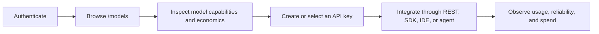

# GALXAI Product Surface Strategy

<!-- docs-scope: domain-reference -->
> **Reading scope:** Subsystem reference retained for its own domain; not re-certified by the federation documentation refactor. Older routing, deployment, compatibility, or performance descriptions do not override the current relay contract. See the [current contract](FEDERATION_STRATEGY.md) and [complete catalog](CATALOG.md).

## Product thesis

GALXAI is an inference platform and governance control plane. It helps developers discover models, obtain credentials, route API traffic, understand cost and reliability, and operate production inference. It is not a destination where an end user conducts conversations or creates an image library.

This distinction is behavioral, not cosmetic. Renaming a chat composer to a playground, assistant, agent, console, or studio does not make it platform infrastructure.

## Product layers

| Layer | GALXAI owns | GALXAI does not own |
| --- | --- | --- |
| Web control plane | Model catalog, model specifications, credentials, billing, usage, routing, telemetry, governance, documentation, and account settings | Conversation timelines, message composition, character/persona management, sharing, galleries, image history, and creative project state |
| Inference plane | OpenAI-compatible and ecosystem-compatible request handling, streaming, routing, metering, retries, context limits, and explicit durable-session contracts | The downstream product's presentation, collaboration model, content lifecycle, or end-user workflow |
| Integration plane | SDKs, protocol adapters, examples, request builders, and optional embeddable primitives | A GALXAI-branded destination chat or image-generation application |

## Primary authenticated journey

`/models` is the default post-auth destination. An explicit return destination may resume a protected workflow, but no authentication path should default to a composer or generated-content surface.

## Surface classification

### First-class hosted surfaces

GALXAI may host:

* model discovery, comparison, capability, pricing, and routing pages;
* API-key, provider-vault, team, billing, audit, queue, and telemetry controls;
* documentation, integration recipes, schema builders, calculators, and diagnostics;
* a bounded API request inspector that exposes request JSON, response envelopes, headers, latency, and generated SDK or cURL snippets.

### Diagnostic sandbox boundary

The legacy `/playground` route is classified as an API diagnostic surface, not a destination application. It must remain single-request oriented and should evolve toward the name **API Request Inspector**. It must not add:

* a conversation timeline or multi-turn composer;
* saved chats, chat search, titles, branches, sharing, or public links;
* characters, personas, assistants, or role-play affordances;
* image galleries, remix canvases, project libraries, or generation history;
* synthetic output presented as successful live inference.

Its purpose is to help a developer inspect the wire contract and copy an integration. The successful outcome is code running in the developer's environment, not continued use of the sandbox.

### Known alignment debt

The current `/playground` implementation still contains legacy **Model Playground**, **Visual Studio**, and simulated-response language. Those behaviors predate ADR 0119 and do not define the target product. The route is compliant only after it is reduced to honest request/response inspection with no synthetic-success fallback; if that narrow diagnostic cannot justify its maintenance cost, remove the route instead.

This debt must not be used as precedent for adding new composer features. Until it is resolved, navigation and onboarding should send authenticated users to `/models`, not `/playground`.

### Retired and prohibited hosted surfaces

The following are outside the GALXAI product boundary:

* hosted chat, agent-chat, or assistant destinations;
* hosted image-generation studios and creative canvases;
* shareable conversation pages;
* character and persona creation;
* client-generated content libraries or persistence tables whose only consumer is a retired hosted client.

The retired routes are `/chat`, `/share`, `/characters`, and `/studio`. Their removal does not deprecate compatible inference endpoints.

## Capability preservation

Product-surface retirement must not remove:

* `POST /v1/chat/completions`;
* `POST /v1/images/generations`;
* `GET /v1/models`;
* compatible `/v1/messages`, Ollama, SDK, CLI, IDE, or agent integrations;
* rolling context and owner-scoped persistence when a caller explicitly selects durable inference continuity.

Protocol terms such as `chat`, `messages`, `conversation`, and `image generation` describe compatibility or inference semantics. They do not imply that GALXAI owns the consuming application.

## Copy and navigation rules

Product copy should lead with **models**, **inference**, **routing**, **API access**, **reliability**, **usage**, and **spend governance**.

Use **chat** only when naming an API protocol, SDK namespace, test suite, or downstream use case. Use **studio**, **assistant**, and **workspace** only when their scope is unambiguous and not a hosted content destination. Prefer **API Request Inspector**, **request builder**, or **gateway diagnostic** over **AI playground**.

Navigation must make the operating sequence legible:

1. Models
2. API keys and integrations
3. Usage, queues, and telemetry
4. Billing and governance
5. Documentation and diagnostics

Do not place a chat or generation call to action above model discovery or credential setup.

## Roadmap decision test

Before accepting a web feature, answer:

1. Does it help a developer select, connect, route, meter, secure, or govern inference?
2. Is its value primarily visible through an API integration outside GALXAI?
3. Would conversation history, creative projects, sharing, or content-library state be required for the feature to feel complete?
4. Does it introduce client-only persistence or a new public database authority surface?
5. Could a user reasonably mistake GALXAI for the downstream application after seeing it?

Questions 1–2 should usually be **yes**. Questions 3–5 should be **no**. A proposal that fails this test requires a new ADR that explicitly revisits ADR 0119; it must not enter through incremental UI expansion.

## Success measures

Product activation should be measured by platform outcomes:

* model-detail views that progress to credential or integration setup;
* time from authentication to first valid API request;
* successful SDK, IDE, CLI, and REST integrations;
* production inference volume and retained API consumers;
* adoption of routing, observability, budget, and governance controls.

Conversation length, generated-image count, gallery engagement, and time spent in a hosted composer are not GALXAI product success metrics.

## Authority

[ADR 0119](adr/0119-inference-first-product-surface-and-client-retirement.md) is the architectural source of truth. This document translates that decision into product, copy, navigation, and roadmap rules.
