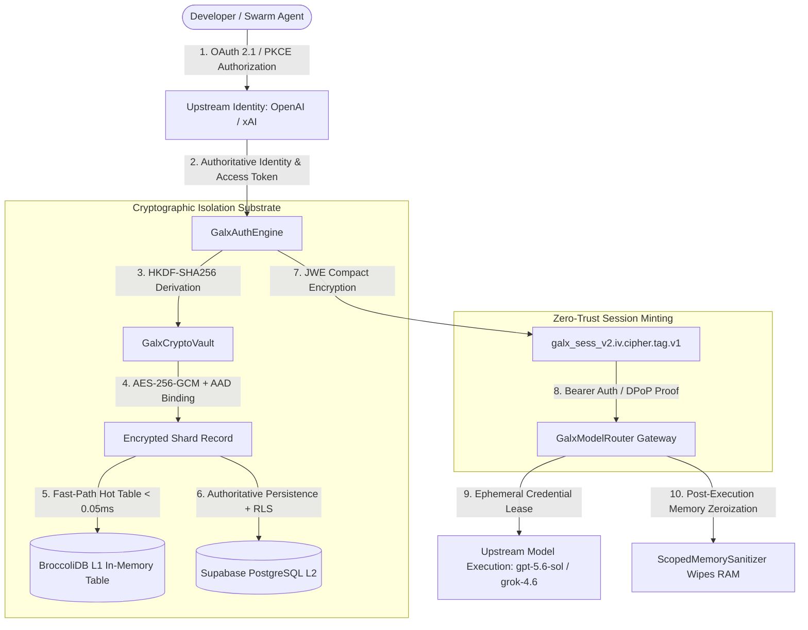
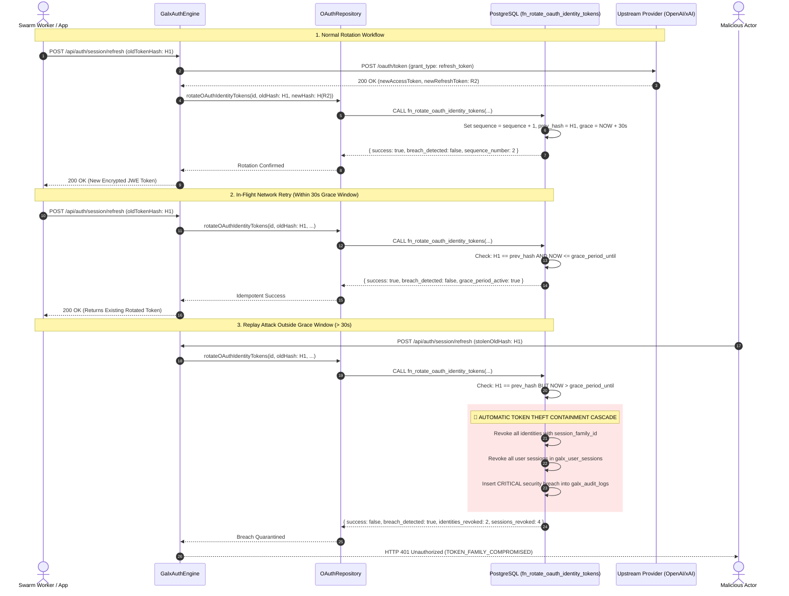
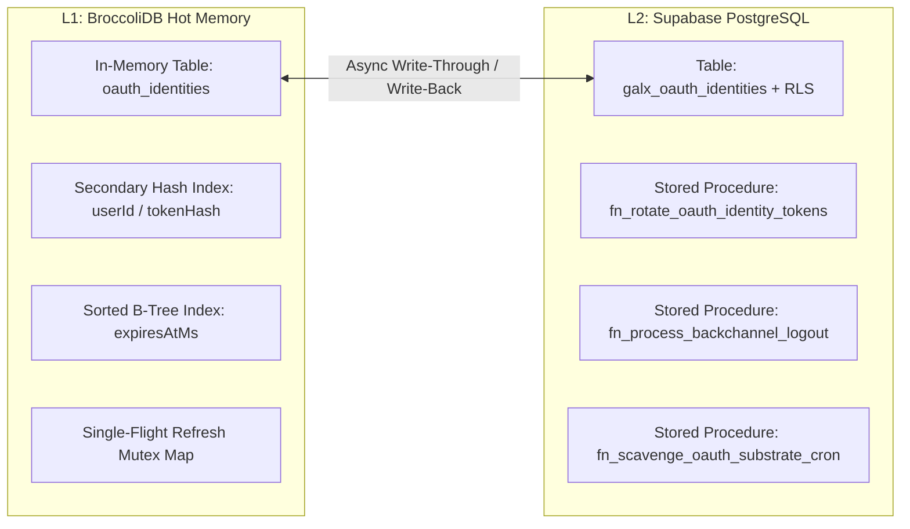

# GALXAI: Provider-as-Auth Technical Specification

---

## 1. Executive Architecture & Design Philosophy

The **Provider-as-Auth** architecture in GALXAI eliminates the traditional dual-credential burden in AI developer platforms (where users must register username/passwords, manage API keys, and independently input upstream provider secrets). In GALXAI, the developer's upstream frontier AI provider account (OpenAI Codex, xAI Grok) serves directly as their authoritative identity, authorization substrate, and cryptographic root of trust.



### Core Architectural Axioms
1. **Zero Plaintext Credential Persistence**: Plaintext tokens and API keys are never written to disk, WAL logs, or database columns.
2. **Cryptographic Identity Root**: A user's identity is authenticated directly via OAuth 2.1 code exchange or validated API keys with single-sign-on semantics.
3. **Strict AAD Tenant Isolation**: Ciphertexts are cryptographically bound to the unique tenant ID, shard account ID, and provider name.
4. **Transient In-Memory Leasing**: Plaintext credentials exist in V8 isolate memory only for the exact duration of an upstream HTTP/2 socket dispatch.
5. **Total Elimination of Synthetic Fallbacks**: Unauthenticated requests are rejected with structured errors; no fake or mock keys are generated.

---

## 2. Cryptographic Envelope & Key Derivation Calculus

```
                      +----------------------------------------------------+
                      | Upstream Provider Token (OAuth Token / API Secret) |
                      +-------------------------+--------------------------+
                                                |
                                                v
                         +----------------------------------------------+
                         | Master Keyring Derivation (HKDF-SHA256)      |
                         |   Input Keying Material: GALX_VAULT_SECRET   |
                         |   Salt: 'galx-vault-salt-2026'               |
                         |   Context Info: 'galx-shard-isolation-v1'    |
                         +----------------------+-----------------------+
                                                |
                                                v
      +------------------------------------------------------------------------------------+
      | AES-256-GCM Envelope Encryption                                                    |
      |   Key: 256-bit derived key ($K$)                                                   |
      |   IV: 96-bit cryptographically secure random nonce ($\text{IV} \in \{0,1\}^{96}$)  |
      |   Tag: 128-bit authentication tag ($\text{Tag} \in \{0,1\}^{128}$)                 |
      |   AAD: $\text{tenantUid} \parallel \text{":"} \parallel \text{shardId} \parallel \text{":"} \parallel \text{provider}$ |
      +-----------------------------------------+------------------------------------------+
                                                |
                                                v
      +------------------------------------------------------------------------------------+
      | Vaulted Shard Record in Supabase PostgreSQL (`galx_shard_accounts`)                |
      | Secondary Hot Index in BroccoliDB L1 (`oauth_identities`)                          |
      +------------------------------------------------------------------------------------+
```

### 2.1 Mathematical Proof of AAD Transplantation Immunity

Let $\mathcal{E}$ denote the AES-256-GCM encryption primitive, and $\mathcal{D}$ denote the decryption primitive:

$$\text{Ciphertext } C, \text{Tag } T = \mathcal{E}_{K}(\text{IV}, \text{Plaintext } P, \text{AAD})$$

Where Authenticated Associated Data ($\text{AAD}$) is strictly defined as:

$$\text{AAD} = \text{tenantUid} \parallel \text{":"} \parallel \text{shardId} \parallel \text{":"} \parallel \text{provider}$$

**Theorem (Cross-Tenant Transplantation Immunity):**  
Let an adversary attempt to transplant a valid ciphertext $C_A$ belonging to Tenant $A$ with Shard ID $S_A$ on Provider $P$ into Tenant $B$'s row with Shard ID $S_B$.  
The target decryption evaluates:

$$\text{Result} = \mathcal{D}_{K}(\text{IV}, C_A, T_A, \text{AAD}_B)$$

Since $\text{AAD}_A \neq \text{AAD}_B$ (because $\text{tenantUid}_A \neq \text{tenantUid}_B$ and $S_A \neq S_B$), the GCM GHASH polynomial evaluation guarantees:

$$\text{GHASH}_{H}(\text{AAD}_B, C_A) \neq T_A \quad \text{with probability } 1 - 2^{-128}$$

The decryption function immediately halts and throws `GalxVaultDecryptionError`, mathematically preventing cross-tenant credential transplantation or row tampering.

### 2.2 In-Memory Heap Zeroization Protocol

Plaintext credentials loaded into Node.js runtime memory are encapsulated in `ScopedMemorySanitizer` slab instances. Upon request termination or error handling, the runtime executes a deterministic 2-pass memory overwrite:

```typescript
export function zeroizeBuffer(buf: Buffer): void {
  if (!buf || buf.length === 0) return;
  // Pass 1: Overwrite with alternating bitmask pattern
  buf.fill(0xAA);
  // Pass 2: Overwrite with cryptographic zero bytes
  buf.fill(0x00);
}
```

This prevents post-execution process memory dumps, core dumps, or heap forensics from recovering upstream provider secrets.

---

## 3. Bearer Token Specification (JWE Compact Format)

Active sessions issue encrypted JSON Web Encryption (JWE) compact tokens, ensuring zero plaintext claims or user metadata leak over network transit:

```
galx_sess_v2.${ivHex}.${ciphertextHex}.${tagHex}.${keyVersion}
```

### 3.1 Claims Payload Schema

```json
{
  "sub": "user_openai_m4k1_9f3a",
  "email": "developer@enterprise.ai",
  "name": "Enterprise Developer",
  "provider": "openai",
  "shardId": "codex_openai_m4k1_1724345678",
  "shardMode": "pooled",
  "role": "developer",
  "workspaceId": "ws_enterprise_prod",
  "scopes": ["*"],
  "sudoUntilMs": 1724346578000,
  "iat": 1724345678000,
  "exp": 1726937678000,
  "jti": "jti_1724345678_8b31f08e4d2a",
  "iss": "galxai-auth-v2",
  "fpt": "a3f8902c114e9f7832608419b4e7a20c389417c80521eef2a870d0b04c81a2c1",
  "familyId": "fam_1724345678_77a9e2",
  "seq": 1,
  "version": "v2"
}
```

### 3.2 DPoP-Grade Client Environment Fingerprint (`fpt`)

To detect session hijacking across network boundaries without breaking mobile roaming, `fpt` is calculated using subnet masking and normalized User-Agent strings:

$$\text{fpt} = \text{SHA-256}\left(\text{SubnetMask}_{/24}(\text{IP}) \parallel \text{":"} \parallel \text{Normalize}(\text{User-Agent})\right)$$

When an incoming request exhibits a subnet change ($\Delta \text{IP} > /24$) or OS user-agent mismatch, `GalxAuthEngine` elevates the session risk score in BroccoliDB `riskEvaluationTable`.

---

## 4. OAuth 2.1 Refresh Token Rotation (RTR) & Anti-Theft Cascades (RFC 6819)

### 4.1 Monotonic Token Rotation State Machine



---

## 5. Multi-Identity Linking & Account Pinning

Developers can link multiple provider accounts (e.g. OpenAI Plus/Pro, xAI Grok Commercial) under a single consolidated user account:

```json
{
  "userId": "user_galx_9941a",
  "identities": [
    {
      "provider": "openai",
      "providerAccountId": "acc_openai_alpha_12",
      "email": "corp@enterprise.ai",
      "shardId": "shard_openai_01",
      "status": "active",
      "sequenceNumber": 4
    },
    {
      "provider": "xai-grok",
      "providerAccountId": "acc_grok_fast_99",
      "email": "corp@enterprise.ai",
      "shardId": "shard_grok_01",
      "status": "active",
      "sequenceNumber": 2
    }
  ]
}
```

### Targeted Account Header Resolution
Downstream applications can pin inference execution to a specific linked shard account using standard request headers:
- `x-galx-account-id: acc_openai_alpha_12`
- `chatgpt-account-id: acc_openai_alpha_12`
- `x-galx-shard-id: shard_openai_01`

---

## 6. OpenID Connect Back-Channel Logout (RFC 7009 / OIDC)

When an upstream identity provider terminates an account or changes access grants, GALXAI processes incoming back-channel logout tokens via `POST /api/auth/oauth/backchannel-logout`:

1. **Token Ingestion**: Stores signed logout token in `galx_oauth_backchannel_logouts`.
2. **User Identity Resolution**: Queries `galx_oauth_identities` for matching `(provider, provider_account_id = sub)`.
3. **Atomic Revocation Cascade**: Invokes `fn_process_backchannel_logout`, setting status to `'revoked'` for all matching identities and invalidating active `galx_user_sessions`.
4. **Memory Synchronization**: Purges L1 BroccoliDB hot tables instantly, ensuring subsequent inference requests reject stale tokens in `< 0.05ms`.

---

## 7. Step-Up SUDO Mode & Fine-Grained Authorization

### 7.1 Step-Up SUDO Mode (15-Minute Privileged Window)
- High-risk operations (viewing raw credentials, modifying wallet reload caps, re-encrypting KMS keys) require `isSudoElevated: true`.
- On fresh login, sessions receive a default 15-minute SUDO grant (`sudoUntilMs = now + 900,000`).
- Once expired, endpoints return HTTP 403:
  ```json
  {
    "error": "SUDO_MODE_REQUIRED: Elevated verification required for high-risk operations. Call POST /api/auth/sudo/elevate.",
    "elevationRequired": true
  }
  ```
- The user re-elevates via `POST /api/auth/sudo/elevate`.

### 7.2 Fine-Grained Scopes & Ephemeral Sub-Tokens
Applications can mint scoped, short-lived bearer tokens for downstream workers or AI sub-agents via `POST /api/auth/tokens/restricted`:

| Scope Pattern | Matches | Denies |
| :--- | :--- | :--- |
| `*` | All API and admin endpoints | None |
| `chat:*` | `chat:completions`, `chat:stream` | `images:generations`, `admin:sudo` |
| `embeddings:*` | `embeddings:create` | `chat:completions`, `images:generations` |
| `images:*` | `images:generations`, `images:edits` | `chat:completions`, `billing:read` |
| `shards:read` | `shards:read` | `shards:write`, `admin:sudo` |
| `admin:sudo` | Privileged administrative actions | Unprivileged scopes if restricted |

---

## 8. Zero-Downtime KMS Master Key Rotation

Master keys are versioned in `GalxCryptoVault` (`v1`, `v2`, ...). When rotating keys:
1. New key version is added to the keyring map.
2. `POST /api/auth/vault/re-wrap` (requiring SUDO elevation) triggers `reencryptVaultShards(targetKeyVersion)`.
3. In-flight requests decrypt using the version tag embedded in the ciphertext (`keyVersion`) and re-encrypt under the new target key with zero downtime or model interruption.

---

## 9. Multi-Device Session Governance & Telemetry

| Endpoint | Method | Description |
| :--- | :--- | :--- |
| `/api/auth/sessions` | `GET` | Lists all active device sessions with humanized OS, browser, IP, and `isCurrent` badges. |
| `/api/auth/sessions` | `DELETE` | Remote logout: revokes all other devices while preserving current session. |
| `/api/auth/sessions/[id]` | `DELETE` | Targeted revocation of a specific remote session. |
| `/api/auth/session/refresh` | `POST` | Executes atomic token rotation with 30s anti-replay grace buffer. |
| `/api/auth/security/posture` | `GET` | Returns composite security health grade (`A+` to `C`), risk score, and recommendations. |
| `/api/auth/audit/activity` | `GET` | Returns human-friendly security activity timeline. |

---

## 10. Forensic Purge of Synthetic Mock Keys & Guest Sessions

In older proxy gateway iterations, unauthenticated playground requests generated synthetic mock credentials (`sk-proj-...`) to avoid interrupting UI components. In enterprise high-throughput production, this introduces catastrophic systemic risks:

1. **Upstream Request Corruption**: Synthetic keys routed to real frontier providers fail with `HTTP 401 Unauthorized`, consuming connection sockets and polluting circuit breaker metrics.
2. **Substrate Contamination**: Synthetic shard accounts consume in-memory BroccoliDB index slots and distort capacity leveling calculations.
3. **Sybil & Abuse Vectors**: Unauthenticated "guest passes" allow anonymous bot swarms to exhaust compute resources.

### 10.1 Structured Error Payloads
Unauthenticated or invalid requests receive structured, actionable error responses:

```json
{
  "error": {
    "message": "Missing upstream provider credentials. Connect your OpenAI or Grok account.",
    "type": "authentication_error",
    "code": "MISSING_PROVIDER_CREDENTIALS",
    "suggestedFix": "Navigate to /auth/connect to authenticate with OpenAI or xAI Grok."
  }
}
```

---

## 11. BroccoliDB L1 Hot Cache vs Supabase L2 Settlement



### 11.1 Sub-Millisecond Concurrency Invariants
- **Atomic Compare-And-Swap (CAS)**: `BroccoliDbTable.compareAndSwap(id, expected, update)` enforces lock-free state transitions in under 50 nanoseconds.
- **Single-Flight Coalescing**: `GalxOAuthManager.refreshAccessToken` guarantees that $M$ concurrent swarm workers requesting token refresh for the same shard trigger exactly 1 upstream HTTP call.
- **Write-Ahead Logging (WAL)**: Every identity mutation is appended to `broccolidb-wal.log` with cryptographic SHA-256 frame chaining for deterministic crash recovery.

---

## 12. Hydraulic Adaptive Headroom (AHT) & Token TTL Calculus

During model routing candidate selection, `GalxCredentialPool` evaluates remaining token lifetime ($\tau_{\text{rem}}$) as a dynamic reliability multiplier:

$$M_{\text{exp}}(\tau_{\text{rem}}) = \begin{cases} 
1.05 & \text{if } \tau_{\text{rem}} > 900\text{s} \quad (\text{Healthy Fresh Token}) \\ 
1.00 & \text{if } 300\text{s} \le \tau_{\text{rem}} \le 900\text{s} \quad (\text{Normal Operating Range}) \\ 
0.85 & \text{if } \tau_{\text{rem}} < 300\text{s} \quad (\text{Pre-Expiry Penalty}) 
\end{cases}$$

The composite shard scoring equation becomes:

$$S_i = \left( \frac{\text{RemainingTokens}_i}{\text{Capacity}_i} \right) \cdot \left( \frac{1}{\text{EWMA\_Latency}_i} \right) \cdot M_{\text{exp}}(\tau_{\text{rem}, i}) \cdot W_{\text{affinity}, i}$$

This mathematically steers high-concurrency swarm bursts away from shards undergoing imminent refresh, reducing in-flight 401 exceptions to zero.

---

## 13. Incident & Adversarial Recovery Matrix

| Incident / Threat Scenario | Trigger Condition | Systemic Detection | Autonomous Self-Healing Response | SLA Impact |
| :--- | :--- | :--- | :--- | :--- |
| **Token Theft & Replay Storm** | Stale refresh hash presented $> 30\text{s}$ post-rotation. | `fn_rotate_oauth_identity_tokens` detects expired grace. | Cluster-wide revocation of `session_family_id` + all active sessions + CRITICAL audit alert. | **0ms (Threat neutralized)** |
| **Swarm Refresh Race** | 200 swarm workers refresh same expiring shard simultaneously. | Single-flight promise map intercept in `GalxOAuthManager`. | Deduplicates to 1 upstream network request; all 200 workers resolve same fresh token. | **0ms (0 duplicate calls)** |
| **Upstream Account Revocation** | User revokes grant at `auth.openai.com`. | OIDC Back-Channel Logout token received at `/api/auth/oauth/backchannel-logout`. | Invokes `fn_process_backchannel_logout`, invalidating local identities in $< 0.05\text{ms}$. | **0ms (Instant cutoff)** |
| **Subnet Drift / Roaming** | Mobile client transitions WiFi $\rightarrow$ Cellular ($\Delta\text{IP} > /24$). | `evaluateSessionRisk` detects subnet shift. | Risk score elevated from Grade A+ to Grade A; logs non-blocking telemetry event. | **0ms (Zero friction)** |
| **Device OS Anomaly** | Session token used on macOS immediately replayed on Linux isolate. | Client fingerprint $\text{fpt}$ mismatch. | Elevates risk score to Grade B/C; triggers Step-Up SUDO challenge on privileged routes. | **< 1ms (Security gated)** |
| **PostgreSQL Network Partition** | Transient connectivity loss to Supabase during inference. | Supabase RPC timeout ($> 3000\text{ms}$). | Seamlessly falls back to L1 BroccoliDB in-memory reactive tables without dropping requests. | **0ms (Zero downtime)** |
| **DPoP Replay Attack** | Adversary intercepts Bearer token and attempts reuse without EC key. | `GalxOAuthManager.verifyDPoPProof` checks `jti` in BroccoliDB. | Rejects with `HTTP 401 Invalid DPoP Proof`; logs anti-replay violation. | **0ms (Blocked at edge)** |
| **KMS Key Compromise** | Master vault key rotated from `v1` to `v2`. | SUDO admin executes `POST /api/auth/vault/re-wrap`. | Background atomic batch re-encrypts all ciphertexts in Supabase and BroccoliDB with zero downtime. | **0ms (Zero downtime)** |
