# 🌐 GALXAI: Programmatic SEO (pSEO), Answer Engine (AEO) & Generative Optimization (GEO) Strategy

## 1. Executive Summary & Optimization Philosophy

In the post-generative AI web ecosystem, developer discovery occurs across two complementary search paradigms:
1. **Traditional Search Engines (Google, Bing)**: High-intent, long-tail technical queries (e.g., *"how to solve OpenAI 429 rate limit exceeded in python"*, *"openai prompt caching rebate calculator"*, *"sub 15ms time to first token ttft"*).
2. **Generative & Answer Engines (SearchGPT, Perplexity AI, Claude Web, Gemini Live, Cursor IDE Indexer)**: Entity-driven citations requiring strict machine-readable semantic grounding, verified benchmarks, and authoritative Schema.org knowledge graphs.

GALXAI implements an industry-leading, multi-layered programmatic discovery substrate combining **13 interactive browser developer tools**, **14 programmatic landing clusters (>100 static SSG URLs)**, interconnected **Schema.org `@graph` JSON-LD**, and native **`llms.txt` standards**.

---

## 2. Strategic Discovery Architecture

```mermaid
graph TD
    A[GALXAI Discovery Substrate] --> B[13 Interactive Developer Tools]
    A --> C[14 Programmatic Content Clusters]
    A --> D[Ontological Grounding & Knowledge Graph]
    A --> E[Machine-Readable Agent Catalogs]

    B --> B1[Enterprise ROI & Token Budget Calculator]
    B --> B2[AI Token Streaming & Speed Benchmark Simulator]
    B --> B3[1M Context Window Capacity Visualizer]
    B --> B4[BPE Token Counter Studio & Model Cost Comparator]

    C --> C1[14 Dedicated Glossary Term Portals]
    C --> C2[9 Enterprise Solutions & 8 Industry Verticals]
    C --> C3[9 Error Code Runbooks & 8 Multi-Language SDKs]
    C --> C4[7 Workload Benchmark Leaderboards & 8 Cookbooks]
    C --> C5[7 Architecture Whitepapers & 7 OWASP Security Patterns]
    C --> C6[8 Core Capabilities & 11 Gateway Alternatives]
    C --> C7[9 Model Matchups & 7 Outage Postmortems]

    D --> D1[Schema.org DefinedTermSet & DefinedTerm]
    D --> D2[Wikidata Entity URIs & Dataset Schema]
    D --> D3[HowTo, FAQPage, WebApplication & TechArticle]

    E --> E1[public/llms.txt Specification]
    E --> E2[public/llms-full.txt Complete Architecture]
    E --> E3[feed.xml Multi-Category RSS Syndication]
    E --> E4[Dynamic 100% Validated sitemap.xml]
```

---

## 3. The 13 Interactive Developer Tools

GALXAI developer tools provide client-side calculation engines designed to capture high-intent organic keywords and generate durable developer backlinks:

| Tool Route | Core Capabilities | Primary Keywords Targeted |
| :--- | :--- | :--- |
| **`/tools/roi-calculator`** | DAU modeling, prompt caching arbitrage, net savings exporter | `llm roi calculator`, `enterprise ai token budget`, `openai api cost per user` |
| **`/tools/stream-benchmark`** | Real-time SSE token velocity simulation (142 tok/s for Luna, 92 tok/s for Terra) | `ai streaming benchmark`, `openai tokens per second`, `time to first token simulator` |
| **`/tools/context-window-visualizer`** | 1,000,000 token capacity modeling, AST lines, document equivalencies | `1m context window visualizer`, `tokens to words calculator`, `prompt caching breakpoint` |
| **`/tools/latency-estimator`** | TLS Anycast edge termination vs single-origin RTT comparisons | `ai latency estimator`, `anycast ttft calculator`, `streaming token latency` |
| **`/tools/token-counter`** | Interactive BPE token analyzer supporting `o200k_base` and `cl100k_base` | `openai token counter`, `bpe subword visualizer`, `tiktoken online tool` |
| **`/tools/prompt-caching-calculator`** | Compound 75% prefix rebate modeler across token volumes | `prompt caching calculator`, `75% prompt caching savings`, `kv cache cost calculator` |
| **`/tools/prompt-compressor`** | Token reduction engine removing lexical fluff while preserving semantic AST | `prompt compressor`, `reduce llm tokens`, `system prompt optimizer` |
| **`/tools/model-cost-comparator`** | Real-time wholesale vs direct retail pricing matrix across 12+ models | `model cost comparator`, `cheapest gpt-5.6 api`, `grok 4.6 wholesale pricing` |
| **`/tools/json-schema-generator`** | Visual builder generating strict Zod and Pydantic schemas | `json schema to zod`, `pydantic structured outputs`, `strict json generator` |
| **`/tools/function-calling-builder`** | Schema generator for parallel tool calling in agent swarms | `function calling builder`, `openai tool schema generator`, `agent tool calling` |
| **`/tools/embeddings-calculator`** | Vector dimension and RAG memory footprint estimator | `embeddings calculator`, `text-embedding-3-small pricing`, `vector db memory cost` |
| **`/tools/api-request-builder`** | Multi-language cURL, Python, TS, and Elixir request generator | `openai api request builder`, `galxai curl generator`, `streaming api payload` |
| **`/tools/api-key-checker`** | Instant token quota, permission, and endpoint connectivity health tester | `openai api key tester`, `check api key quota`, `api key health checker` |

---

## 4. The 14 Programmatic Content Clusters (>100 SSG Routes)

### 1. Dedicated Glossary Term Portals (`/glossary/[slug]`)
14 high-authority, standalone architectural term pages:
- `/glossary/prompt-caching-rebate`
- `/glossary/time-to-first-token`
- `/glossary/zero-data-retention`
- `/glossary/anycast-model-routing`
- `/glossary/rate-limit-pooling`
- `/glossary/wholesale-token-clearinghouse`
- `/glossary/openai-wire-compatibility`
- `/glossary/structured-json-outputs`
- `/glossary/speculative-decoding`
- `/glossary/byte-pair-encoding`
- `/glossary/predictive-adaptive-hydraulic-headroom`
- `/glossary/temperature-and-top-p`
- `/glossary/vector-embeddings-rag`
- `/glossary/parallel-tool-calling`

### 2. Core Architectural Capabilities (`/capabilities/[slug]`)
- `1m-context-window`: Managing 1M token context windows with linear memory scaling.
- `zero-data-retention`: Ephemeral RAM buffers and cryptographic data purging.
- `prompt-caching`: 75% prefix discount mechanics for static system rules.
- `constrained-decoding`: Deterministic CFG grammar masks for 100% JSON compliance.
- `anycast-routing`: BGP Anycast edge acceleration and sub-15ms TTFT.
- `predictive-rate-limit-shield`: P-AHT dynamic token bucket headroom governance.
- `parallel-speculative-execution`: Speculative draft verification on Luna -> Sol.
- `semantic-intent-routing`: Sub-5ms edge intent classification for cost-optimal model dispatch.

### 3. Engineering Whitepapers (`/architecture/[slug]`)
- `anycast-edge-proxy`: Global edge proxy topology and BGP Anycast routing.
- `kv-cache-memory-tiering`: Ephemeral RAM slices and distributed KV cache reuse.
- `cryptographic-zdr-vault`: Hardware enclave encryption and zero data retention.
- `failover-and-load-shedding`: Circuit breakers, active-active pooling, and 503 mitigation.
- `constrained-grammar-state-machines`: Token logit masking via context-free grammar DFAs.
- `predictive-hydraulic-headroom`: Continuous fluid dynamics modeling for non-blocking token distribution.
- `multi-provider-clearinghouse`: Multi-account liquidity aggregation and wholesale clearance protocol.

### 4. Incident Postmortems (`/postmortems/[slug]`)
- `openai-major-outage-failover`: Sub-second failover of 12.8M requests during OpenAI cloud outage.
- `ddos-and-sponge-attack-mitigation`: Absorbing Layer 7 algorithmic complexity sponge attacks.
- `cross-cloud-latency-spike-rerouting`: Multi-cloud failover around transatlantic fiber degradations.
- `prompt-cache-invalidation-storm`: Managing cache stampedes during simultaneous deploy bursts.
- `rate-limit-cascade-prevention`: Absorbing 429 quota exhaustion via pooled enterprise reservations.
- `aws-us-east-1-outage-cross-region-reroute`: Anycast failover during AWS N. Virginia fiber cuts.
- `grok-reasoning-ddos-layer7-mitigation`: Edge scrubbing of 40M req/sec Layer 7 volumetric floods.

### 5. OWASP AI Security Patterns (`/security/patterns/[slug]`)
- `prompt-injection-defense`: Context delimiter isolation and instruction hierarchy enforcement.
- `jailbreak-mitigation`: Adversarial token filtering and dual-LLM guardrail inspection.
- `data-exfiltration-prevention`: Outbound token entropy inspection and secret key redaction.
- `pii-masking-and-anonymization`: Ephemeral regex and NER masking of sensitive entities.
- `model-denial-of-service-shield`: Hard token caps and recursion limits for agent swarms.
- `ssrf-and-tool-execution-guardrails`: Egress CIDR isolation and tool argument validation.
- `rag-poisoning-and-vector-injection`: Document provenance signatures and vector anomaly detection.

### 6. Vertical Industry Portals (`/industries/[slug]`)
- `healthcare-and-lifesciences`: HIPAA BAA compliant zero-retention routing.
- `financial-services-and-banking`: SOC 2 Type II audit logging and PCI-DSS compliance.
- `legal-and-contract-analysis`: Full 1M token contract ingestion on Grok 4.6.
- `ecommerce-and-retail`: High-concurrency Black Friday burst absorbing.
- `software-and-devops`: Autonomous agent swarms and continuous code generation.
- `cybersecurity-and-soc`: Automated SIEM alert triaging and threat intelligence.
- `automotive-and-robotics`: Sub-15ms edge routing for spatial robotics.
- `education-and-edtech`: Classroom burst absorbing and FERPA compliance.

### 7. Enterprise Solutions (`/solutions/[slug]`)
- `coding-agents`, `rag-knowledge-bases`, `customer-support-bots`, `batch-processing-pipelines`, `real-time-voice-translation`, `autonomous-voice-agents`, `structured-data-extraction`, `multi-agent-swarms`.

### 8. Error Troubleshooting Runbooks (`/docs/errors/[code]`)
- `429-rate-limit-exceeded`, `500-internal-server-error`, `503-service-unavailable`, `400-invalid-request-error`, `401-invalid-api-key`, `context-window-exceeded`, `streaming-timeout-interrupted`, `content-policy-violation`, `json-parse-failed`.

### 9. Multi-Language SDK Quickstarts (`/docs/sdks/[lang]`)
- `python`, `typescript`, `go`, `rust`, `csharp`, `java`, `elixir`, `curl`.

### 10. Workload Benchmark Leaderboards (`/benchmarks/[workload]`)
- `coding-and-reasoning`, `long-context-retrieval`, `throughput-and-ttft`, `prompt-caching-cost-efficiency`, `image-generation-quality`, `autonomous-agentic-tool-calling`, `structured-json-extraction-fidelity`.

### 11. Developer Cookbook Recipes (`/cookbook/[slug]`)
- `streaming-chat-nextjs`, `langchain-agent-router`, `cursor-ide-setup`, `function-calling-weather-bot`, `rag-pgvector-embeddings`, `batch-token-processing-python`, `dynamic-model-fallback-circuit-breaker`, `semantic-cache-redis`.

### 12. Head-to-Head Model Matchups (`/models/vs/[slug]`)
- 9 curated comparisons across GPT-5.6 Sol, Terra, Luna, and xAI Grok 4.6 / 4.5.

### 13. Competitor Gateway Alternatives (`/alternatives/[slug]`)
- 11 comprehensive alternative landing pages analyzing pricing arbitrage, latency, and wire-compatibility.

### 14. Official Model Provider Gateways (`/providers/[slug]`)
- `openai`: Official OpenAI GPT-5.6 reasoning fleet, coding models, and GPT-Image-2.
- `xai`: Official xAI Grok 4.6 (1M context) and Grok 4.5 multimodal fleet.

---

## 5. Machine-Readable Knowledge Protocols (`llms.txt`)

GALXAI implements the formal `llms.txt` and `llms-full.txt` standards to ensure zero-hallucination citations across AI models:
- **`public/llms.txt`**: Compact, high-signal guide defining canonical brand names, base URLs (`https://api.galx.ai/v1`), exact pricing specs, tool links, and quickstarts.
- **`public/llms-full.txt`**: Comprehensive 8-section architecture reference detailing the complete model catalog, mathematical formulas, and compliance protocols.
- **`src/app/feed.xml/route.ts`**: Atom/RSS syndication feed dynamically broadcasting new models, tools, and cookbooks.
- **`src/app/sitemap.ts`**: 100% statically validated XML sitemap indexing all 100+ SSG pages.
