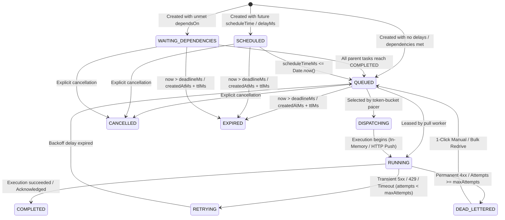

# ⚡ GALXAI Asynchronous Queue Substrate: Technical Specification & Reference

**Specification Version**: `3.0.0`  
**Standard Compliance**: Google Cloud Tasks v2, Google Cloud Run Invocation, AWS EventBridge / SQS FIFO  
**Status**: Implemented, Forensically Hardened & Production Verified  

---

## 📑 Table of Contents
1. [Architectural Overview](#1-architectural-overview)
2. [Task Finite State Machine (FSM)](#2-task-finite-state-machine-fsm)
3. [Token-Bucket Dispatch Pacing & Concurrency Semaphores](#3-token-bucket-dispatch-pacing--concurrency-semaphores)
4. [Strict FIFO Partition Grouping (`groupId`)](#4-strict-fifo-partition-grouping-groupid)
5. [Directed Acyclic Graph (DAG) Dependencies (`dependsOn`)](#5-directed-acyclic-graph-dag-dependencies-dependson)
6. [Real-Time Server-Sent Events (SSE) Event Bus](#6-real-time-server-sent-events-sse-event-bus)
7. [Destination Circuit Breakers & Webhook Security](#7-destination-circuit-breakers--webhook-security)
8. [Dynamic Priority Anti-Starvation Aging](#8-dynamic-priority-anti-starvation-aging)
9. [Content-Based Deduplication & Sliding Windows](#9-content-based-deduplication--sliding-windows)
10. [Distributed Pull Worker Leasing Protocol](#10-distributed-pull-worker-leasing-protocol)
11. [Dead-Letter Queue (DLQ) & 1-Click Redrive](#11-dead-letter-queue-dlq--1-click-redrive)
12. [REST API & Client SDK Reference](#12-rest-api--client-sdk-reference)

---

## 1. Architectural Overview

The GALXAI Queue Substrate (`GalxTaskQueueEngine`) is a high-concurrency, sub-millisecond asynchronous execution framework designed to decouple computationally intensive AI workloads (agentic swarms, deep reasoning, image generation, multi-stage pipelines) from client HTTP connection lifecycles.

```mermaid
flowchart TD
    Client[Client App / Agent Swarm / SDK] -->|POST /v1/chat/completions (X-Galx-Async: true)| Ingress[Universal Ingress Gateway]
    Client -->|POST /api/queues/:queue/tasks| DirectIngress[Direct Task Ingress API]
    Client -->|GET /api/queues/:queue/tasks/:taskId/stream| SSEStream[Real-Time SSE Event Stream]
    
    Ingress --> Engine[GalxTaskQueueEngine]
    DirectIngress --> Engine
    
    subgraph Core Engine Substrate
        Dedup[Content SHA-256 / 24h Deduplication Window] --> DAGEngine[DAG Dependency Resolver (dependsOn)]
        DAGEngine --> FIFOLock[Strict FIFO Group Partitioning (groupId)]
        FIFOLock --> PriorityAging[Anti-Starvation Priority Aging Engine]
        PriorityAging --> CronEngine[Cron & Recurring Schedule Engine]
        CronEngine --> TokenPacer[Continuous Token-Bucket Pacer]
        TokenPacer --> ConcurrencySemaphore[Active Concurrency Semaphore Ceiling]
        ConcurrencySemaphore --> FSM[Task FSM Lifecycle]
    end
    
    subgraph Execution Topologies
        FSM -->|In-Memory Lease Direct| Router[GalxModelRouter Internal Execution]
        FSM -->|Destination CB + HMAC-SHA256| CloudRun[Serverless Cloud Run Push Webhooks]
        FSM -->|Atomic Lease + Fencing Token| PullWorkers[Distributed Pull Worker Fleets]
    end
    
    subgraph Reactive Real-Time Event Bus
        FSM -.->|Sub-ms Event Push| EventBus[GalxQueueEventBus]
        EventBus -.-> SSEStream
    end
    
    FSM -->|Exhausted Attempts / Wall-Clock SLA Expired| DLQ[Dead-Letter Queue (DLQ)]
    DLQ -->|1-Click Bulk Redrive /api/queues/:q/redrive| Engine
```

---

## 2. Task Finite State Machine (FSM)

Each task progresses deterministically through an 8-state FSM:



---

## 3. Token-Bucket Dispatch Pacing & Concurrency Semaphores

To protect upstream AI model providers from rate limit spikes (HTTP 429), each queue maintains continuous fractional token replenishment:

$$\text{Tokens}_{\text{new}} = \min\left(\text{MaxBurstSize}, \text{Tokens}_{\text{curr}} + \Delta t \times \text{MaxDispatchesPerSecond}\right)$$

In addition, active dispatches are bounded by a dual concurrency semaphore:
1. **Global Queue Concurrency**: $\text{ActiveInFlight}_{\text{queue}} \le \text{MaxConcurrentDispatches}$
2. **Tenant Fair-Share Cap**: $\text{ActiveInFlight}_{\text{tenant}} \le \text{DefaultTenantMaxConcurrency}$

---

## 4. Strict FIFO Partition Grouping (`groupId`)

When `groupId` is specified on tasks:
- **Sequential Invariant**: Only one task per `groupId` is permitted in `DISPATCHING` or `RUNNING` status simultaneously.
- **Dependency Ordering**: Newer tasks in the same group wait until all older tasks with smaller `createdAtMs` reach `COMPLETED` or `DEAD_LETTERED`.
- **Cross-Group Parallelism**: Tasks in distinct `groupId` partitions run completely in parallel at full token bucket speed.

---

## 5. Directed Acyclic Graph (DAG) Dependencies (`dependsOn`)

For multi-agent workflows with Fan-Out / Fan-In patterns:
- Tasks specify parent task IDs via `dependsOn: ['task_A', 'task_B']`.
- Child tasks remain in `WAITING_DEPENDENCIES` state.
- When all parent tasks reach `COMPLETED`, the engine automatically aggregates parent results:
  ```json
  "parentTaskResults": {
    "task_A": { "outline": "Section 1..." },
    "task_B": { "imageUrl": "https://..." }
  }
  ```
- The child task is unblocked and transitions immediately to `QUEUED`.

---

## 6. Real-Time Server-Sent Events (SSE) Event Bus

The substrate eliminates client polling through `GalxQueueEventBus`:
- **Task Stream**: `GET /api/queues/:queueId/tasks/:taskId/stream`
  Pushes real-time SSE events (`snapshot`, `TASK_RUNNING`, `TASK_PROGRESS`, `TASK_COMPLETED`, `done`).
- **Queue Stream**: `GET /api/queues/:queueId/stream`
  Pushes queue-wide telemetry, dispatches, and health statistics.

---

## 7. Destination Circuit Breakers & Webhook Security

### Webhook Signature Verification (HMAC-SHA256)
Outgoing HTTP push webhooks transmit signed headers:
- `X-Galx-Signature: t=<timestamp>,v1=<hmac>`
- Signature Formula:
  $$\text{HMAC-SHA256}\left(\text{Secret}, \text{Timestamp} + \text{"."} + \text{RawBody}\right)$$

### Destination Host Circuit Breaker
If an external webhook endpoint encounters $\ge 3$ consecutive 5xx or connection failures, the target host is placed in `OPEN` state with exponential cooldown backoff:
$$\text{CooldownMs} = \min\left(300000, 10000 \times 2^{\text{Failures}-3}\right)$$

---

## 8. Dynamic Priority Anti-Starvation Aging

Prevents low-priority batch workloads (priority 10–30) from being starved by high-priority traffic (priority 80–100):
$$\text{EffectivePriority} = \text{BasePriority} + \min\left(50, \left\lfloor \frac{t_{\text{now}} - t_{\text{created}}}{\text{AgingIntervalMs}} \right\rfloor \times 5\right)$$

---

## 9. Content-Based Deduplication & Sliding Windows

- When `contentBasedDeduplication: true` is configured without an explicit `idempotencyKey`, the engine generates:
  $$\text{DedupKey} = \text{SHA256}(\text{CanonicalJSON}(\text{TaskTarget}))$$
- Submissions within `deduplicationWindowMs` (default 24 hours) return the existing task instance with `{ deduplicated: true }`.

---

## 10. Distributed Pull Worker Leasing Protocol

External worker fleets lease tasks atomically using monotonic fencing tokens:

1. **Acquire Lease**: `POST /api/queues/:queueId/lease`
   - Returns tasks with `activeFencingToken` and `leaseExpiresAtMs`.
2. **Heartbeat Extension**: `POST /api/queues/:queueId/tasks/:taskId/lease` (extends lease TTL).
3. **Acknowledge Task**: `POST /api/queues/:queueId/tasks/:taskId/acknowledge` (finalizes task).
4. **Report Failure (NACK)**: `POST /api/queues/:queueId/tasks/:taskId/fail` (triggers backoff or DLQ).

---

## 11. Dead-Letter Queue (DLQ) & 1-Click Redrive

When attempts exceed `maxAttempts` or encounter non-retryable 4xx errors:
- Task enters `DEAD_LETTERED` status with full diagnostic error traces.
- **1-Click Bulk Redrive**: `POST /api/queues/:queueId/redrive` re-queues up to 100 failed tasks in bulk with reset attempt counters for a fresh lifecycle.

---

## 12. REST API & Client SDK Reference

### Summary of REST Endpoints

| Endpoint | Method | Function |
| :--- | :--- | :--- |
| `/api/queues` | `GET`, `POST` | List queues with live telemetry or create/update queue configuration |
| `/api/queues/:queueId` | `GET`, `PATCH`, `DELETE` | Inspect queue, tune rate limits, pause, resume, or delete |
| `/api/queues/:queueId/purge` | `POST` | Purge pending tasks |
| `/api/queues/:queueId/redrive` | `POST` | Bulk redrive dead-lettered tasks |
| `/api/queues/:queueId/stream` | `GET` | Queue-wide real-time SSE stream |
| `/api/queues/:queueId/tasks` | `GET`, `POST` | Query tasks or enqueue a new task (`202 Accepted`) |
| `/api/queues/:queueId/tasks/batch` | `POST` | Ingest up to 1,000 tasks atomically |
| `/api/queues/:queueId/tasks/bulk-cancel` | `POST` | Bulk cancel tasks by tag, userId, or groupId |
| `/api/queues/:queueId/tasks/:taskId` | `GET`, `DELETE` | Inspect task result, timing history, progress or cancel |
| `/api/queues/:queueId/tasks/:taskId/stream` | `GET` | Real-time SSE stream for specific task |
| `/api/queues/:queueId/tasks/:taskId/progress` | `POST` | Report worker execution progress % and logs |
| `/api/queues/:queueId/tasks/:taskId/retry` | `POST` | Force immediate retry / DLQ redrive |
| `/api/queues/:queueId/lease` | `POST` | Acquire atomic worker leases |
| `/api/queues/:queueId/tasks/:taskId/acknowledge` | `POST` | Worker ACK task completion |
| `/api/queues/:queueId/tasks/:taskId/fail` | `POST` | Worker NACK task failure |

---

---

## 13. Developer Programmatic Stream & Async Worker Task Inspector (`/queues`)

To optimize for infrastructure resilience and prevent upstream quota bleed from unauthenticated browser chatbots, the `/queues` portal has been architected strictly as a **Developer Programmatic Stream & Async Worker Task Inspector**:
- **Elimination of Public Chat Textarea**: Public exploratory chat textareas and anonymous omnibars are deprecated in favor of structured SDK / REST dispatch.
- **Interactive Multi-Language SDK Snippets**: Provides drop-in asynchronous dispatch templates for Python SDK (`galx.jobs.submit`), TypeScript SDK (`galx.jobs.submit`), and native cURL requests with `X-Galx-Async: true` header.
- **Worker Execution Stream**: Real-time inspection of active worker leases, monotonic fencing tokens, attempt counters, latency percentiles, and DAG step progression.

---

## 14. Workspace Authentication & Queue Isolation (`<AuthRequiredGate />`)

All queue streams and task inspection views require authenticated developer sessions:
- **Private Task Streams**: Tasks submitted under tenant API keys are cryptographically partitioned by `tenantUid`.
- **Authentication Gate**: Unauthenticated visitors are presented with the Developer Authentication Gate, preventing unauthorized monitoring of private background jobs.

---

---

## 15. Cloudflare Edge Cron Queue Workers (ADR 0015 & 0037)

Background task queues can be continuously drained and executed via Cloudflare Edge Worker cron triggers (`* * * * *`):
- **Serverless Worker Fleet**: `GalxEdgeQueueWorker` polls pending tasks and processes batch chunks (`processBatch('default', 25)`) directly from V8 edge isolates.
- **Zero Idle Compute Cost**: Workers scale to zero between minutes and spin up instantly upon cron invocation.
- **Fencing Token Safety**: Atomic pull worker leasing with CAS monotonic fencing tokens prevents split-brain duplicate task execution.

---

## 16. In-Queue BroccoliDB Representation Selection (ADR 0066 & 0067)

When enqueuing large context payloads (multi-file AST audits, 50-page credit agreements, log storms) into async queues:
- **Adaptive Ingress Representation Selection**: Passing `x-galx-compact: true` or `taskType: 'architecture_invariants'` invokes `BroccoliCompactionFacade.selectRepresentation()`.
- **Adaptive Density Gate ($\text{ID}(C)$)**: If task payload is $<200$ tokens, it bypasses transformation with $0.0\%$ storage dilation.
- **Storage & WAL Optimization**: Slashes queue storage memory, WAL footprint, and worker payload deserialization overhead by up to $85.9\%$.
- **Action Safety Guarantee**: Disarms contradictory corporate records and superseded historical ADRs before queue dispatch (`npm run bench:entropy`).
- **Worker Acceleration**: Workers lease pre-compacted context, drastically cutting LLM time-to-first-token and billed token expenditure.

---

## 🧪 Forensic Test Verification Matrix

All capabilities are continuously validated against the comprehensive automated test harness:
```bash
# 1. Maintainer Workstation 8-Point Onboarding Diagnostic (<5s)
npm run onboard

# 2. Adversarial Institutional Entropy & Action Safety Benchmark (7-Tier Gradient)
npm run bench:entropy

# 3. Forensic Router & Queue Suite (177 tests)
npm run test:router

# 4. Cloudflare Edge Mesh Verification Suite (46 tests)
npm run worker:test

# 5. BroccoliDB Compaction Facade & Inference Boundary Suite
npm run test:broccolidb:api && npm run bench:inference-boundary
```
- **Tests 1–31**: Vault Cryptography, Rate Governor, Circuit Breakers, Shard Pooling, TASD Leveling, Model Catalog.
- **Tests 32–39**: Phase 1 Queue Pacing, Idempotency, Scheduled Delay, Worker Leases, Retry Calculus, DLQ.
- **Tests 40–44**: Phase 2 FIFO Partition Grouping, Cron Scheduling, Progress Streaming, Bulk Redrive, SDK Helper.
- **Tests 45–50**: Phase 3 DAG Dependencies, SSE EventBus, Content Deduplication, Dynamic Priority Aging, Deadlines, Draining Mode.
- **Tests 51–177**: SOC 2 Compliance, ZDR v10.0 Memory Zeroization, BroccoliDB AST & L1 Tables, Multi-Index Range Scans, and Developer SDK Ergonomics.
- **Edge Tests 1–46**: Edge Gateway, SSE Streaming, Failover, KV Cache, R2 CDN, Durable Objects, and Queue Worker Cron Fleet.


