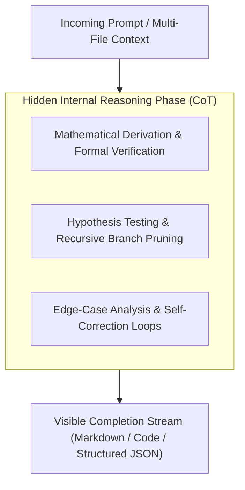

# 🧠 Frontier Reasoning Models Developer Guide

A comprehensive technical guide for developing with GALXAI's flagship reasoning engines: `gpt-5.6-sol`, `gpt-5.6-terra`, and `x-ai/grok-4.6`.

---

## 1. Understanding Reasoning Engines & Hidden Chains of Thought (CoT)

Unlike traditional autoregressive chat models that generate output tokens immediately, reasoning engines employ internal multi-step **Chain of Thought (CoT)** reasoning before producing visible response tokens:



---

## 2. Zero-Hesitation Intent Aliasing

Developers can invoke reasoning engines using intuitive intent names without remembering specific model versions:

| Developer Intent / Alias | Automatically Resolved Model | Reasoning Specialization |
| :--- | :--- | :--- |
| `sol`, `flagship`, `sota`, `coding`, `gpt-5`, `claude-3-7-sonnet` | **`gpt-5.6-sol`** | Apex reasoning, formal proofs, complex compilers, multi-file architecture |
| `terra`, `balanced`, `reasoning`, `reasoner`, `thinking`, `o1`, `o3-mini`, `deepseek-r1` | **`gpt-5.6-terra`** | High-velocity balanced reasoning, agent planning, security auditing |
| `grok`, `grok-4.6`, `grok-1m`, `1m`, `realtime` | **`x-ai/grok-4.6`** | 1,000,000 token context reasoning, real-time data analysis |

---

## 3. Parameter Tuning & Best Practices

### A. Temperature & Top-P Recommendations
- **Recommended**: Keep `temperature` at **`1.0`** (or omit).
- **Rationale**: Lowering temperature can constrain internal branch exploration during the hidden reasoning phase.

### B. Output Token Allocation (`max_completion_tokens` vs `max_tokens`)
- GALXAI accepts either `max_tokens` or `max_completion_tokens` interchangeably.
- Set output limits sufficiently high ($\ge 4096$) so internal reasoning tokens do not truncate visible code output.

---

## 4. Multi-Language Implementation Recipes

### A. Terminal CLI (Zero Installation)
```bash
npx galxai run "Audit distributed raft consensus algorithm" --model terra
```

### B. TypeScript 1-Line Helper (`@galxai/sdk`)
```typescript
import { run, thread } from '@galxai/sdk';

// 1. Direct 1-liner with reasoning alias
const audit = await run("Verify AES-256-GCM envelope encryption implementation", {
  model: 'terra'
});
console.log(audit);

// 2. Multi-turn reasoning thread
const conv = thread({ model: 'gpt-5.6-sol', system: 'You are a cryptographic security auditor.' });
const reply = await conv.reply("Analyze nonce reuse vulnerabilities in GCM mode.");
console.log(reply);
```

### C. Python (OpenAI SDK Drop-In)
```python
import os
from openai import OpenAI

client = OpenAI(
    base_url="https://galx.ai/v1",
    api_key=os.environ.get("GALXAI_API_KEY", "galx_live_your_key_here")
)

stream = client.chat.completions.create(
    model="gpt-5.6-sol",
    messages=[
        {"role": "user", "content": "Schedule 6 microservices across 3 Kubernetes nodes with anti-affinity."}
    ],
    stream=True
)

for chunk in stream:
    if chunk.choices and chunk.choices[0].delta.content:
        print(chunk.choices[0].delta.content, end="", flush=True)
```

---

## 5. Fleet Comparison & Wholesale Economics

| Model ID | Provider | Context Window | Max Output | Input / 1M | Output / 1M | Cached Input / 1M | Wholesale Discount |
| :--- | :--- | :--- | :--- | :--- | :--- | :--- | :--- |
| **`gpt-5.6-sol`** | OpenAI | $900,000$ | $128,000$ | **$3.75** | **$15.00** | **$1.25** | **25% OFF** |
| **`gpt-5.6-terra`** | OpenAI | $900,000$ | $64,000$ | **$2.25** | **$9.00** | **$0.75** | **25% OFF** |
| **`x-ai/grok-4.6`** | xAI Grok | $1,000,000$ | $128,000$ | **$2.10** | **$8.40** | **$0.70** | **30% OFF** |

---

## 6. Reasoning Models & BroccoliDB Input Compaction Economics

When reasoning models (`gpt-5.6-terra`, `o3-mini`, `o1`) process large multi-file codebases, log storms, or technical specifications, **excess input boilerplate pollutes the hidden reasoning window** and inflates latency.

### The Input Compaction Advantage for Reasoning
- **85.93% Input Prompt Spend Reduction**: BroccoliDB strips non-essential syntax, noisy telemetry loops, and repetitive AST nodes before the prompt reaches the model.
- **Latency Acceleration**: In empirical testing (`npm run bench:inference-boundary`), compacting the input prompt cut `o3-mini` response latency from **$1404\text{ms} \to 472\text{ms}$ (a $932\text{ms}$ / $66\%$ speedup)**.
- **Cost Decomposition**: Hidden reasoning tokens and visible completion tokens represent the model's observed non-compressible floor ($0.0040 USD per run). Compacting the input reduces total billed expenditure by **$65.45\%$** on reasoning models without compromising factual verification accuracy.
- **Forensic Dissection**: See [FORENSIC_PAYLOAD_DISSECTION_AND_CAUSAL_ANALYSIS.md](FORENSIC_PAYLOAD_DISSECTION_AND_CAUSAL_ANALYSIS.md) for the exact before/after payload transformations across reasoning workloads.


