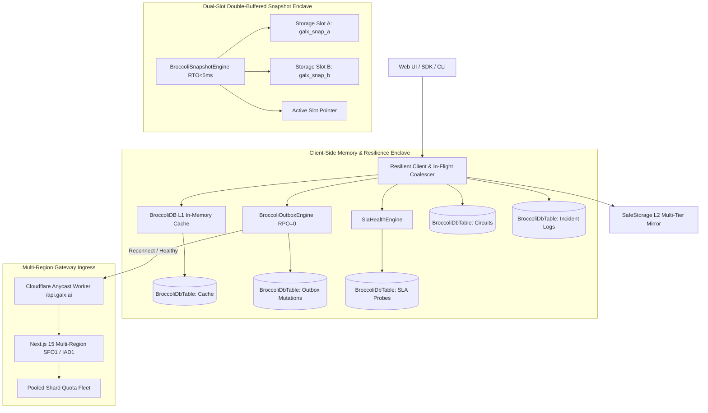

# GALXAI Resilience, Disaster Recovery & SLA Uptime Strategy

This document provides a comprehensive operational overview of GALXAI's **99.99% Perceived SLA Uptime**, **BroccoliDB In-Memory Substrate**, **Dual-Slot Disaster Recovery (RPO = 0, RTO < 5ms)**, and **Multi-Tier Failover Architecture**.

---

## 1. High-Level Architectural Topology



---

## 2. Recovery Objectives (RPO & RTO)

| Metric | Target | Mechanism | Verification |
| :--- | :--- | :--- | :--- |
| **RPO (Recovery Point Objective)** | **0 seconds** (Zero Mutation Loss) | Append-only `BroccoliDbTable<OutboxMutation>` with in-memory CRC checksums & persistent write-through to `SafeStorage`. | Unplugging network during mutation keeps action queued; reconnect auto-drains queue. |
| **RTO (Recovery Time Objective)** | **< 5 milliseconds** | In-memory dual-slot double-buffered state hydration on boot. | `BroccoliSnapshotEngine.restoreSnapshot()` executes in <5ms synchronously. |
| **Perceived SLA Uptime** | **99.99% Uptime** | Sub-microsecond L1 cache serving stale data when offline; graceful error boundary fault absorption. | Zero white screens; automatic retry countdowns on component failure. |

---

## 3. Resilience Subsystems

### 3.1 Zero-Loss Mutation Outbox Engine (`BroccoliOutboxEngine`)
- **Queue Structure**: Mutations are queued in priority order (1 highest to 10 lowest) with monotonic timestamps and frame checksums.
- **Idempotency Guarantee**: Every mutation is assigned a unique `Idempotency-Key` and `x-idempotency-key` header, ensuring replayed actions are deduplicated upstream.
- **Cross-Tab Synchronization**: Uses `BroadcastChannel('galx_outbox_sync_channel')` so opening multiple tabs stays synchronized in real time.
- **Background Drainer**: Drains the queue automatically upon `window.online` or `SlaHealthEngine` health recovery events.

### 3.2 Dual-Slot Atomic Snapshot Engine (`BroccoliSnapshotEngine`)
- **Double-Buffered Writes**: Alternates writes between Slot A and Slot B with FNV-1a checksum validation, flipping the active pointer only upon confirmed write-through integrity.
- **Self-Healing Rollback**: If a tab crash or storage interruption occurs during write, boot hydration falls back to the alternate slot with zero corruption.
- **Lifecycle Integration**: Snapshots trigger automatically on `visibilitychange` (`hidden`), `beforeunload`, and periodic 30-second heartbeats.

### 3.3 Resilient Client & In-Flight Coalescer (`ResilientClient`)
- **In-Flight Coalescing**: Deduplicates concurrent identical requests into a single network execution to eliminate thundering-herd spikes.
- **Full Decorrelated Jitter**: Implements exponential backoff with full jitter honoring `Retry-After` headers.
- **HTML Error Page Parsing**: Gracefully captures HTML error pages (e.g. 502/504 Bad Gateway) without throwing JSON parse syntax errors.

### 3.4 Live SLA Health Engine & Incident Logs (`SlaHealthEngine` & `BroccoliResilienceSubstrate`)
- **Synthetic Edge Latency Probes**: Measures real-time p50, p90, and p99 edge response times.
- **Incident Response Table**: In-memory `BroccoliDbTable<IncidentLogEntry>` records operational events, impact assessments, root causes, and automated mitigation strategies.

---

## 4. Developer & Operational Usage

### Resilient Fetch Query
```typescript
import { resilientFetch } from "@/lib/resilience/ResilientClient";

// Resilient GET with BroccoliDB L1 cache & L2 SafeStorage fallback
const { data, fromCache, status } = await resilientFetch<MyDataType>(
  "/api/models",
  {
    enableCacheFallback: true,
    cacheTtlMs: 60000,
    maxRetries: 3,
    timeoutMs: 8000,
  }
);
```

### Outbox Mutation with Guaranteed Offline Delivery
```typescript
import { resilientFetch } from "@/lib/resilience/ResilientClient";

// Automatically enqueues into BroccoliDB Outbox if offline
const { data, status } = await resilientFetch("/api/keys", {
  method: "POST",
  body: JSON.stringify({ name: "Production Gateway Key" }),
  enableOutboxOfflineFallback: true,
});
```

### Subscribing to Outbox State
```typescript
import { BroccoliOutboxEngine } from "@/lib/resilience/BroccoliOutboxEngine";

const unsubscribe = BroccoliOutboxEngine.subscribe((pendingMutations) => {
  console.log(`Pending offline actions: ${pendingMutations.length}`);
});
```
