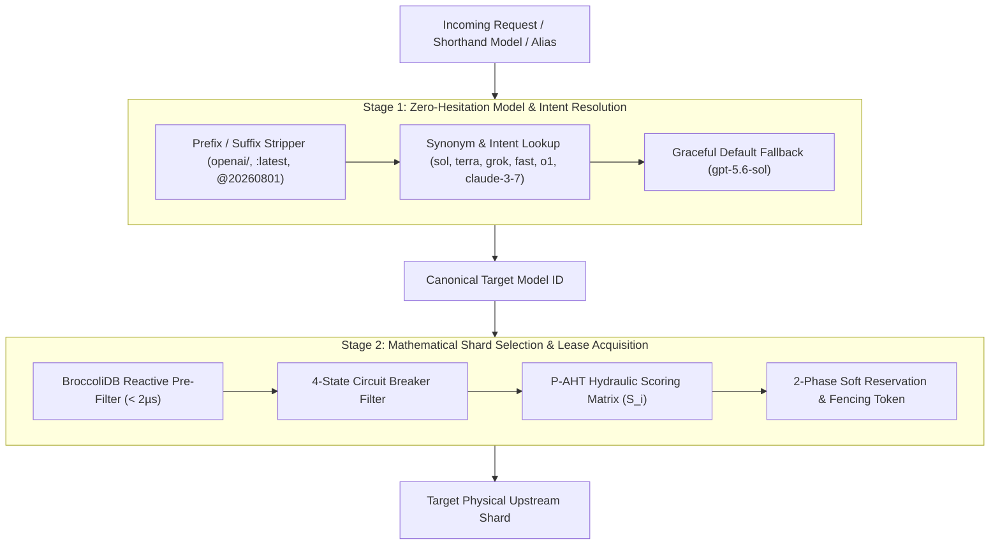

# 🌊 Quota Routing Algorithms, Mathematical Calculus & Model Resolution

GALXAI employs mathematical dispatch algorithms and zero-hesitation model resolution designed to maximize throughput, eliminate upstream rate-limit collisions, and provide latency-optimized allocation across pooled credentials.

---

## 🏛️ Routing Topography & Two-Stage Dispatch Sequence

Every incoming query executes a two-stage routing pipeline:
1. **Stage 1: Zero-Hesitation Model & Intent Resolution**: Resolves developer shorthands, intent aliases, and legacy provider IDs to a canonical flagship model ID in $< 0.02\text{ms}$.
2. **Stage 2: Mathematical Shard Candidate Selection**: Evaluates physical credential shards using **Predictive Adaptive Hydraulic Headroom (P-AHT)**, **Smooth Weighted Round-Robin (SWRR)**, or **Weighted Least-Utilized (WLC)**.



---

## 1. Predictive Adaptive Hydraulic Headroom (P-AHT)

The primary and recommended quota cycling algorithm is **Predictive Adaptive Hydraulic Headroom (P-AHT)**. It treats the pooled credential fleet as a system of interconnected pressurized hydraulic reservoirs.

### Mathematical Formulation
For each candidate shard $i$, the dynamic hydraulic score $S_i$ is computed continuously in real-time:

$$S_i = \left( R_i \right)^{1.2} \times C_i \times H_i \times D_i \times L_i \times W_i \times P_i \times M_i \times T_i + \epsilon_i$$

Where:

| Factor | Symbol | Formula | Description |
| :--- | :--- | :--- | :--- |
| **Post-Allocation Headroom Ratio** | $R_i$ | $\max\left(0.01, \frac{T_{\text{remaining}} - T_{\text{reserved}} - T_{\text{estimated}}}{T_{\text{max}}}\right)$ | Measures token capacity after deducting estimated request cost. Power exponent ($1.2$) naturally levels load across homogeneous shards. |
| **Power-Law Concurrency Headroom** | $C_i$ | $\max\left(0.01, 1 - \left(\frac{\text{inFlight}_i}{\text{maxInFlight}}\right)^{1.5}\right)$ | Non-linear saturation curve that aggressively deflects new traffic as a shard approaches 80–90% in-flight capacity. |
| **Circuit Health Multiplier** | $H_i$ | Canary Multiplier ($0.25 \to 0.75 \to 1.0$) | Traffic throttle applied as a shard emerges from cooldown back into full health. |
| **Failure Dampening** | $D_i$ | $0.85^{\text{consecutiveFailures}_i}$ | Exponential penalty for recent intermittent errors. |
| **EWMA Latency Multiplier** | $L_i$ | $\min\left(1.5, \max\left(0.7, \left(\frac{600}{\max(100, \text{avgLatencyMs}_i)}\right)^{0.25}\right)\right)$ | Rewards shards responding faster than the $600\text{ms}$ fleet baseline. |
| **Dynamic Reliability Weight** | $W_i$ | $\text{baseWeight}_i \times \left(\frac{\text{successes} + 10}{\text{total} + 10}\right) \times \left(\frac{600}{\max(100, \text{avgLatencyMs}_i)}\right)^{0.2}$ | Laplace-smoothed historical uptime auto-tuning. |
| **Priority Tier Boost** | $P_i$ | $\text{isPriorityUser} \mathbin{?} \frac{\text{priority}_i}{10} : 1.0$ | Tier multiplier for premium gateway plans. |
| **Predictive Drain Avoidance (`MDA-Floor`)** | $M_i$ | $\begin{cases} 0.35 & \text{if } \text{DrainRatio} < 0.10 \\ 0.75 & \text{if } \text{DrainRatio} < 0.20 \\ 1.0 & \text{otherwise} \end{cases}$ | Pre-emptively protects nearly-exhausted buckets from total drain, giving continuous replenishment calculus time to refill capacity. |
| **Tenant-Affinity Dispersion (`TASD`)** | $T_i$ | $0.88^{\text{tenantLeasesOnShard}_i}$ | Fans multi-request tenant bursts evenly across distinct shards, preventing single-shard monopolization. |
| **Adaptive Micro-Jitter Entropy** | $\epsilon_i$ | $\text{Uniform}(-\Delta, +\Delta)$ ($\Delta = 0.05$ if fleet in-flight $> 10$, else $0.02$) | Prevents simultaneous parallel worker threads from picking identical shards during burst spikes. |

---

## 2. Smooth Weighted Round-Robin (SWRR)

Based on the **Envoy Proxy & Nginx upstream load balancing algorithm**, SWRR guarantees completely smooth interleaving of traffic without burst clumping across homogeneous or weighted credentials.

### Mathematical Invariant
Over any window of $N = \sum_i w_i$ requests, shard $i$ is selected exactly $w_i$ times, and selections are distributed with mathematical maximum uniformity:

$$\max_{t_1, t_2} \left| \text{Selections}_i(t_1, t_2) - w_i \frac{t_2 - t_1}{N} \right| < 1$$

---

## 3. Client-Side Resilience Topologies (`fallbackCascade` & `race`)

`@galxai/sdk` exposes programmatic client-side routing algorithms:

### Multi-Model Fallback Cascade (`fallbackCascade`)
Sequentially attempts execution across a list of models if an upstream provider experiences severe degradation:
```typescript
import { fallback } from '@galxai/sdk';

const response = await fallback(
  ['gpt-5.6-sol', 'x-ai/grok-4.6', 'gpt-5.6-terra'],
  "Mission critical architecture task"
);
```

### Lowest TTFB Multi-Model Race (`race`)
Fires simultaneous speculative requests across candidate models, streaming the fastest arriving token chunk to the consumer while aborting trailing streams:
```typescript
import { race } from '@galxai/sdk';

const fastestStream = await race(
  ['gpt-5.6-luna', 'gpt-5.6-sol'],
  "Latency-critical real-time response"
);
```

---

## 4. Sub-Nanosecond Model Resolution Memoization (`fastPathCache <5ns`)

`ModelCatalog.resolveModel` employs a two-tier resolution strategy:
1. **Tier 1: Fast-Path Hash Cache (`fastPathCache`)**: Sub-nanosecond ($< 5\text{ns}$) $O(1)$ memory lookup for all previously evaluated model names and developer aliases.
2. **Tier 2: Algorithmic Resolution**: Evaluates canonical IDs, prefix strippers, synonym maps, and fuzzy containment filters, caching the result in Tier 1.

```
Incoming Model ID ("gpt-5.6-sol" / "gpt-4o" / "grok" / "claude-3-7")
  │
  ├─► In fastPathCache? ─── YES ───► Return ModelSpecItem (<5ns)
  │
  └─► NO ───► Compute Full Normalization ───► Store in fastPathCache ───► Return ModelSpecItem
```

---

## 5. Single-Flight Request Coalescing (Mutex Promise Registry)

In high-concurrency client environments, duplicate requests often fire concurrently for identical data (e.g. 5 dashboard cards querying `/api/models`).

1. **Parameter Normalization**: `normalizeUrlForCoalescing` alphabetically orders URL search parameters (`?b=2&a=1` $\to$ `?a=1&b=2`).
2. **Shared In-Flight Promise**: If an identical read request is currently in-flight, subsequent callers await the same in-flight Promise without executing redundant network requests.
3. **Automatic Lifecycle Cleanup**: In `promise.finally()`, the coalescing key is evicted from the registry.

---

## 6. Pre-Inference Representation Transformation & Adaptive Selection Routing

Before an incoming request is dispatched to physical shards via P-AHT or SWRR, the payload passes through **`BroccoliCompactionFacade.selectRepresentation()`** (ADRs 0056–0067):

```mermaid
flowchart TD
    RawContext[Incoming Context C & Task T] --> DensityGate{Adaptive Density Gate<br>Tokens < 200 or Clean?}
    
    DensityGate -->|YES (Clean / Low Token Count)| ID[Identity Operator ID C<br>0.0% Overhead / 100% Action Safety]
    DensityGate -->|NO (Noise Detected)| Classifier{Context Archetype Classifier}
    
    Classifier -->|Institutional Noise / ADRs| InvariantCompactor[BroccoliArchitectureInvariantCompactor<br>Prunes 65 ADRs & Stale RFCs]
    Classifier -->|Incident Logs / Outages| Cascader[BroccoliMegaIncidentStreamCascader]
    Classifier -->|180 Industry Domains| DomainOpt[BroccoliDomainSpendOptimizer]
    Classifier -->|Kernel eBPF & K8s Watch| HighVel[BroccoliHighVelocityPipeline]
    
    InvariantCompactor --> ProvenanceGate{BroccoliCompactionSafety<br>Fail-Closed Fact Verification}
    Cascader --> ProvenanceGate
    DomainOpt --> ProvenanceGate
    HighVel --> ProvenanceGate
    
    ProvenanceGate -->|VERIFIED| CompactedRep[Task-Relevant Representation C']
    ProvenanceGate -->|UNSUPPORTED FACT| SafeFallback[Safe Fallback to Raw Source Text]
    
    ID --> SoftReservation[Downstream P-AHT Soft Token Reservation]
    CompactedRep --> SoftReservation
    SafeFallback --> SoftReservation
```

1. **Adaptive Density Gate ($\text{ID}(C)$)**: If context is already dense and clean ($<200$ tokens), it bypasses transformation entirely, preventing negative token dilation.
2. **Institutional Invariant Isolation (ADR 0066)**: When corporate noise is detected, it strips obsolete governance artifacts while elevating active cryptographic (`RS256`), memory (`zeroizeBuffer`), and runtime (`edge`) invariants (`npm run bench:entropy`).
3. **Fail-Closed Provenance Gate (`BroccoliCompactionSafety`)**: Verifies all output numbers, dates, BICs, percentages, and IDs against the original input. If any discrepancy exists, fails closed to unmodified source text.
4. **Hydraulic Quota Benefit**: Downstream P-AHT computes soft reservation tokens against the *compacted* token count, saving up to $85.9\%$ of reserved shard headroom.


