# ⚡ GALXAI Universal Developer SDK: Specification & Architecture Reference

**Package**: `@galxai/sdk` (TypeScript / JavaScript) & `galxai` (Python)  
**Version**: `1.0.0`  
**Compliance Standards**: OpenAI API 1.x, Vercel AI SDK 3.x, Anthropic SDK, Google Cloud Tasks v2  
**Status**: Implemented, Verified & Hardened across 66 Forensic Verification Test Suites  

---

## 📑 Table of Contents
1. [SDK Architectural Topography](#1-sdk-architectural-topography)
2. [Initialization & Configuration](#2-initialization--configuration)
3. [Chat Completions API (`galx.chat`)](#3-chat-completions-api-galxchat)
4. [Autonomous Agent Runtime (`galx.agent`)](#4-autonomous-agent-runtime-galxagent)
5. [Structured Outputs & Schema Validation (`galx.chat.structured`)](#5-structured-outputs--schema-validation-galxchatstructured)
6. [Pluggable Middleware & Interceptors (`galx.use`)](#6-pluggable-middleware--interceptors-galxuse)
7. [Multi-Model Resilience Topologies (`fallbackCascade` & `race`)](#7-multi-model-resilience-topologies-fallbackcascade--race)
8. [Vercel AI SDK & Web Stream Adapters (`galx.adapters`)](#8-vercel-ai-sdk--web-stream-adapters-galxadapters)
9. [Multi-Modal Vision Ingestion (`galx.multimodal`)](#9-multi-modal-vision-ingestion-galxmultimodal)
10. [Batch Swarm Concurrency Evaluator (`galx.batch`)](#10-batch-swarm-concurrency-evaluator-galxbatch)
11. [Context Window & Token Optimizer (`galx.tokens`)](#11-context-window--token-optimizer-galxtokens)
12. [Asynchronous Task Queues & Pull Leasing (`galx.queues`)](#12-asynchronous-task-queues--pull-leasing-galxqueues)
13. [DAG Workflows & Pipeline Builder (`galx.workflows`)](#13-dag-workflows--pipeline-builder-galxworkflows)
14. [Webhooks & Cryptographic Security (`galx.webhooks`)](#14-webhooks--cryptographic-security-galxwebhooks)
15. [Typed Error Hierarchy](#15-typed-error-hierarchy)
16. [Interactive Developer CLI (`npx galxai`)](#16-interactive-developer-cli-npx-galxai)
17. [BroccoliDB In-Memory Natural Querying (`galx.models`, `galx.queues`, `galx.privacy`, `galx.db`)](#17-broccolidb-in-memory-natural-querying-galxmodels-galxqueues-galxprivacy-galxdb)
18. [Privacy Shield Plugin & Zero Data Retention Middleware (`createPrivacyShieldPlugin`)](#18-privacy-shield-plugin--zero-data-retention-middleware-createprivacyshieldplugin)
19. [SOC 2 Type II Compliance & GRC Auditor SDK (`galx.compliance`)](#19-soc-2-type-ii-compliance--grc-auditor-sdk-galxcompliance)
20. [Hybrid Rolling Context & Seat Governance SDK (`galx.chat.rolling`, `galx.seat`)](#20-hybrid-rolling-context--seat-governance-sdk-galxchatrolling-galxseat)

---

## 1. SDK Architectural Topography

```mermaid
flowchart TD
    App[Developer Application / Agent Swarm / CLI] --> GalxClient[GalxAI Universal Client Core]
    
    subgraph Autonomous Agent Runtime
        GalxClient --> Agent[galx.agent Multi-Step Function Calling Loop]
        Agent --> ToolRegistry[Type-Safe Tool Parameter Definitions]
        ToolRegistry --> ToolExecution[Automatic Function Execution & Output Loop]
    end
    
    subgraph Developer Ergonomics Layer
        GalxClient --> FluentBuilder[galx.chat.builder Method Chaining]
        GalxClient --> StructuredOutputs[galx.chat.structured JSON Schema Validation]
        GalxClient --> Adapters[galx.adapters Vercel AI SDK Protocols]
        GalxClient --> MultiModal[galx.multimodal Vision Helpers]
        GalxClient --> BatchSwarm[galx.batch.mapConcurrent Swarm Runner]
        GalxClient --> TokenOptimizer[galx.tokens BPE Estimator & History Pruning]
    end
    
    subgraph Extensible Middleware Substrate
        GalxClient --> Middleware[galx.use Interceptor Pipeline]
        Middleware --> CostPlugin[Real-Time Token & Dollar Budget Tracker]
        Middleware --> LRUPlugin[Client-Side LRU Response Cache]
    end
    
    subgraph Multi-Model Resilience Topologies
        GalxClient --> FallbackCascade[galx.chat.fallbackCascade Multi-Model Failover]
        GalxClient --> StreamRace[galx.chat.race Lowest TTFB Stream Race]
    end
    
    subgraph Core Transport & Execution
        GalxClient --> Transport[GalxAIClientCore Zero-Dependency Transport]
        Transport --> Retries[Exponential Backoff + Jitter]
        Transport --> ErrorHierarchy[Typed Exceptions: 401, 403, 404, 429, 504]
        Transport --> Gateway[Universal Ingress Gateway /v1 & /api/queues]
    end
```



---

## 2. Ultra-Flat Zero-Config Ergonomics & Tagged Templates

GALXAI offers the industry's most frictionless developer interface, allowing zero-boilerplate invocation, tagged template literal prompts, direct async token streaming, and schema extraction without initializing a class.

### Tagged Template Literal Invocation
```typescript
import galx from 'galxai';

const topic = 'superconductors';
const summary = await galx`Summarize key principles of ${topic} in 3 bullet points`;
console.log(summary);
```

### Direct 1-Line Execution (`run` & `generateImage`)
```typescript
import { run, generateImage } from 'galxai';

// Direct 1-line execution
const answer = await run('Explain quantum entanglement in 10 words');

// Background execution handle
const job = await run('Long-running benchmark', { background: true });
const result = await job.result();

// 1-line image generation
const image = await generateImage('Futuristic skyline at dusk');

// 1-line vector embeddings
const vector = await embed('Zero-egress agentic computing');
console.log(vector.data[0].embedding.length); // 1536
```

### Zero-Buffer Token Streaming (`stream`)
```typescript
import { stream } from 'galxai';

for await (const chunk of stream('Write a poem about space')) {
  process.stdout.write(chunk);
}
```

### Schema Extraction & Tool Definitions (`extract` & `tool`)
```typescript
import { extract, tool } from 'galxai';

// 1-line structured JSON extraction
const user = await extract('Jane Doe is a 29 year old ML engineer in SF', {
  name: 'string',
  age: 'number',
  role: 'string',
  city: 'string'
});

// Autonomous agent tool definition
const searchTool = tool('searchDocs', 'Searches technical documentation', async (args) => {
  return { docs: ['API Guide', 'Architecture Spec'] };
}, { query: { type: 'string' } });
```

---

## 3. Standard Initialization & Configuration

For multi-tenant applications or custom configuration:

```typescript
import { GalxAI } from 'galxai';

const client = new GalxAI({
  apiKey: process.env.GALX_API_KEY,      // Defaults to process.env.GALX_API_KEY
  baseURL: 'https://api.galx.ai',         // Defaults to Cloudflare Edge Gateway (https://api.galx.ai)
  timeoutMs: 60000,                       // Request timeout (default: 60s)
  maxRetries: 3,                          // Automatic transient retries (default: 2)
  defaultHeaders: { 'X-App-Id': 'agents' }
});
```

---

## 4. Vector Embeddings API (`galx.embeddings`)

High-velocity 1536-dimensional or 3072-dimensional vector embedding generation directly computed at the nearest Cloudflare Edge PoP (<15ms latency).

```typescript
// Single or batch embedding generation
const embeddings = await galx.embeddings.create({
  model: 'text-embedding-3-small',
  input: ['Autonomous edge routing', 'Distributed agent swarms']
});

console.log(embeddings.data[0].embedding); // Float array of 1536 dimensions
```

---

## 5. Chat Completions API (`galx.chat`)

### Synchronous Inference & SSE Token Streaming
```typescript
// Synchronous JSON response
const response = await galx.chat.completions.create({
  model: 'gpt-5.6-sol',
  messages: [{ role: 'user', content: 'Explain Raft consensus' }]
});
console.log(response.choices[0].message.content);

// Streaming SSE token chunks
const stream = await galx.chat.completions.create({
  model: 'gpt-5.6-sol',
  messages: [{ role: 'user', content: 'Explain Raft consensus' }],
  stream: true
});

for await (const chunk of stream) {
  process.stdout.write(chunk.choices[0]?.delta?.content || '');
}
```

### Background Asynchronous Tasks (`createAsync`)
```typescript
const task = await galx.chat.completions.createAsync({
  model: 'gpt-5.6-sol',
  messages: [{ role: 'user', content: 'Mass dataset evaluation' }],
  queue: 'llm-batch',
  groupId: 'session_conv_123' // Strict FIFO ordering
});

// Stream real-time progress and logs via SSE
for await (const progress of task.streamProgress()) {
  console.log(`[Progress ${progress.percentage}%]: ${progress.message}`);
}

// Await completion result
const result = await task.result({ timeoutMs: 120000 });
```

### Fluent Method-Chaining Builder (`galx.chat.builder`)
```typescript
const response = await galx.chat
  .builder('gpt-5.6-sol')
  .system('You are an expert system architect.')
  .user('Design a distributed cache with Raft.')
  .temperature(0.2)
  .maxTokens(4000)
  .async({ queue: 'llm-batch', groupId: 'conv_1' })
  .execute();
```

---

## 4. Autonomous Agent Runtime (`galx.agent`)

Eliminates manual tool calling loops by automatically formatting functions, parsing tool call requests, executing local functions, and re-prompting the model until final answer synthesis:

```typescript
const agent = galx.agent({
  model: 'gpt-5.6-sol',
  systemPrompt: 'You are an autonomous research analyst.',
  tools: {
    getStockQuote: {
      description: 'Get real-time stock quote for a ticker symbol',
      parameters: {
        type: 'object',
        properties: { ticker: { type: 'string', description: 'Stock ticker (e.g. NVDA, AAPL)' } },
        required: ['ticker']
      },
      execute: async ({ ticker }) => {
        // Execute internal DB query or external API call
        return { ticker, price: 135.50, change: '+2.4%' };
      }
    }
  },
  maxSteps: 10
});

const result = await agent.run('What is Nvidia stock price and what is its trend?');
console.log(result.text);                // Final synthesized answer
console.log(result.toolCallsExecuted);   // Array of executed tool invocations and results
console.log(result.stepsCount);          // Number of round-trip execution steps
```

---

## 5. Structured Outputs & Schema Validation (`galx.chat.structured`)

Guarantees type-safe JSON extraction matching JSON Schema specifications:

```typescript
interface InvoiceData {
  invoiceId: string;
  amount: number;
  currency: string;
  lineItems: string[];
}

const invoice = await galx.chat.structured<InvoiceData>({
  model: 'gpt-5.6-sol',
  messages: [{ role: 'user', content: 'Invoice INV-2026 for $450.50 with items: Widget A, Widget B' }],
  schema: {
    type: 'object',
    properties: {
      invoiceId: { type: 'string' },
      amount: { type: 'number' },
      currency: { type: 'string' },
      lineItems: { type: 'array', items: { type: 'string' } }
    },
    required: ['invoiceId', 'amount', 'currency', 'lineItems']
  },
  validator: (data): data is InvoiceData => typeof data.invoiceId === 'string' && typeof data.amount === 'number'
});

console.log(invoice.invoiceId, invoice.amount);
```

---

## 6. Pluggable Middleware & Interceptors (`galx.use`)

```typescript
import { createCostTrackerPlugin, createLRUCachePlugin } from '@/sdk';

// 1. Client-Side LRU Response Cache (Saves 100% tokens on identical queries)
galx.use(createLRUCachePlugin({ maxEntries: 500, ttlMs: 60000 }));

// 2. Real-Time Token & Dollar Budget Tracker
galx.use(createCostTrackerPlugin({
  maxBudgetUsd: 25.00,
  onBudgetExceeded: (usd) => console.warn(`Budget ceiling of $${usd} reached!`),
  onUsageUpdate: (stats) => console.log(`Usage: ${stats.totalTokens} tokens ($${stats.totalCostUsd})`)
}));

// 3. Custom Logging & Diagnostic Interceptor
galx.use({
  onRequest: (ctx) => console.log(`[REQ] ${ctx.method} ${ctx.path}`),
  onResponse: (ctx) => console.log(`[RES ${ctx.statusCode}] ${ctx.durationMs}ms`),
  onError: (ctx) => console.error(`[ERR] ${ctx.error.message}`)
});
```

---

## 7. Multi-Model Resilience Topologies (`fallbackCascade` & `race`)

### Fallback Cascades (Zero-Downtime Provider Outage Failover)
```typescript
const response = await galx.chat.fallbackCascade(
  ['gpt-5.6-sol', 'x-ai/grok-4.5', 'gpt-5.6-luna'],
  { messages: [{ role: 'user', content: 'Mission critical code generation' }] }
);
console.log(`Executed on: ${response.successfulModel} (Attempts: ${response.attemptsMade})`);
```

### TTFB Stream Racing
```typescript
const fastStream = await galx.chat.race(
  ['gpt-5.6-sol', 'gpt-5.6-terra'],
  { messages: [{ role: 'user', content: 'Fast response required' }] }
);
console.log(`Fastest model: ${fastStream.winningModel}`);
for await (const chunk of fastStream) {
  process.stdout.write(chunk.choices[0]?.delta?.content || '');
}
```

---

## 8. Vercel AI SDK & Web Stream Adapters (`galx.adapters`)

```typescript
// app/api/chat/route.ts in Next.js App Router
export async function POST(req: Request) {
  const { messages } = await req.json();

  const stream = await galx.chat.completions.create({
    model: 'gpt-5.6-sol',
    messages,
    stream: true
  });

  // Returns Response with x-vercel-ai-data-stream: v1 for useChat()
  return galx.adapters.toDataStreamResponse(stream);
}
```

---

## 9. Multi-Modal Vision Ingestion (`galx.multimodal`)

```typescript
const userMsg = galx.multimodal.createUserMessage('Compare these diagrams:', [
  'https://images.galx.ai/diagram-a.png',
  imageBuffer,
  'data:image/jpeg;base64,...'
]);

const analysis = await galx.chat.completions.create({
  model: 'gpt-5.6-terra',
  messages: [userMsg]
});
```

---

## 10. Batch Swarm Concurrency Evaluator (`galx.batch`)

```typescript
const results = await galx.batch.mapConcurrent(prompts, async (prompt) => {
  return galx.chat.completions.create({
    model: 'gpt-5.6-sol',
    messages: [{ role: 'user', content: prompt }]
  });
}, {
  concurrency: 25,
  onProgress: (done, total) => console.log(`Progress: ${done}/${total}`)
});
```

---

## 11. Context Window & Token Optimizer (`galx.tokens`)

```typescript
// Estimate tokens
const tokenCount = galx.tokens.estimateMessagesTokens(messages);

// Smart conversation pruning (preserves system prompts and recent context)
const fitMessages = galx.tokens.truncateToFit(messages, 8000, 'preserve_system_and_recent');
```

---

## 12. Asynchronous Task Queues & Pull Leasing (`galx.queues`)

```typescript
// Lease tasks for distributed worker fleets
const leases = await galx.queues.leaseTasks('default', {
  workerId: 'worker-us-west-1',
  maxTasks: 10
});

for (const task of leases.tasks) {
  try {
    const output = await processTask(task);
    await galx.queues.acknowledgeTask('default', task.id, 'worker-us-west-1', output);
  } catch (err: any) {
    await galx.queues.failTask('default', task.id, 'worker-us-west-1', err.message);
  }
}
```

---

## 13. DAG Workflows & Pipeline Builder (`galx.workflows`)

```typescript
const workflow = await galx.workflows.create({
  steps: [
    { name: 'outline', model: 'gpt-5.6-sol', prompt: 'Create article outline' },
    { name: 'visual', tool: 'image_generation', prompt: 'Hero image illustration' },
    { name: 'notify', tool: 'webhook', url: 'https://my-app.run.app/hook' }
  ]
});
```

---

## 14. Webhooks & Cryptographic Security (`galx.webhooks`)

```typescript
const isValid = galx.webhooks.verifySignature(rawBody, req.headers.get('x-galx-signature'), webhookSecret);
```

---

## 15. BroccoliDB Data Compaction & Ingestion Substrate (`galx.compaction`)

The `galx.compaction` resource provides safe, size-bounded data compaction, streaming deduplication, mega-incident cascading, and document pyramid summarization with fail-closed provenance validation:

```typescript
// 1. Safe Domain Compaction
const domainResult = galx.compaction.domain(interrogatoryText, 'Interrogatory');
console.log(domainResult.compactedPrompt, `Saved ${domainResult.tokensSaved} tokens`);

// 2. High-Velocity Batch Frame Ingestion
const batchResult = galx.compaction.batch([
  { text: swiftPayload, domain: 'SWIFT_MT103' },
  { text: hl7Payload, domain: 'HL7_Observation' },
]);
console.log(`Processed ${batchResult.totalProcessed} frames at ${batchResult.throughputOpsPerSec} ops/sec`);

// 3. Mega-Incident Stream Cascader (2,000+ page log storm)
const incidentResult = galx.compaction.incident({
  rawStreamText: logStormText,
  targetTokenBudget: 4096,
  incidentTitle: 'Core Cluster Outage',
});
console.log(incidentResult.compactedIncidentPrompt);

// 4. Mega-Document Hierarchical Pyramid (300+ page contract)
const docResult = galx.compaction.document({
  rawText: masterAgreementText,
  title: 'Master Service Agreement',
});
console.log(docResult.compactedPyramidPrompt);

// 5. Remote Gateway API Call (/api/audit/broccolidb/compact)
const remoteResult = await galx.compaction.compactRemote({
  mode: 'domain',
  text: rawPayload,
  domainHint: 'SWIFT_MT103',
});
```

---

## 16. Typed Error Hierarchy

```typescript
try {
  await galx.chat.completions.create({ ... });
} catch (err) {
  if (err instanceof RateLimitError) {
    console.warn(`Rate limited. Retry after: ${err.retryAfterSeconds}s`);
  } else if (err instanceof AuthenticationError) {
    console.error('Invalid API Key');
  } else if (err instanceof APITimeoutError) {
    console.error(`Request timed out after ${err.timeoutMs}ms`);
  } else if (err instanceof APIConnectionError) {
    console.error('Network failure connecting to gateway');
  }
}
```

---

## 16. Interactive Developer CLI (`npx galxai`)

```bash
# Full health, latency, queue, and webhook diagnostics
npx galxai doctor

# Terminal real-time streaming REPL with tokens/sec velocity
npx galxai chat gpt-5.6-sol "Explain distributed state machines concisely."

# Model catalog and context windows
npx galxai models

# Fast ping
npx galxai ping
```

---

## 17. BroccoliDB In-Memory Natural Querying (`galx.models`, `galx.queues`, `galx.privacy`, `galx.db`)

Perform zero-dependency, offline deterministic natural language queries with $< 0.1\text{ms}$ latency:

```typescript
// 1. Natural Language Model Querying
const models = galx.models.queryNatural(
  'where provider = "openai" and supportsVision = true and inputPricePer1M <= 1.0 sort by price asc'
);

// 2. Natural Language Task Queue Inspection
const pendingJobs = galx.queues.queryNatural(
  'where state = "pending" and priority > 5 sort by createdAt desc limit 10'
);

// 3. Natural Language Shard Compliance Search
const euShards = galx.privacy.queryShardsNatural(
  'where hipaaCompliant = true and dataResidency = "eu"'
);

// 4. Single-Pass Statistical Aggregations
const priceStats = galx.db.aggregate({
  table: 'models',
  groupBy: ['provider'],
  metrics: {
    avgPrice: { metric: 'avg', field: 'inputPricePer1M' },
    minPrice: { metric: 'min', field: 'inputPricePer1M' },
    count: { metric: 'count' }
  }
});
```

---

## 18. Privacy Shield Plugin & Zero Data Retention Middleware (`createPrivacyShieldPlugin`)

Automatically de-identify sensitive PHI/PII entities before upstream transit and rehydrate them upon completion:

```typescript
import { GalxAI, createPrivacyShieldPlugin, PrivacyProfiles } from '@/sdk';

const galx = new GalxAI({ apiKey: process.env.GALX_API_KEY });

// Install Privacy Shield Middleware
galx.use(createPrivacyShieldPlugin({
  profile: PrivacyProfiles.MAXIMUM_PRIVACY,
  hipaaEnabled: true,
  gdprEnabled: true,
  zdrEnabled: true,
  onPIIDetected: (detectedTypes) => {
    console.log(`[PrivacyShield] Redacted sensitive entities: ${detectedTypes.join(', ')}`);
  }
}));

// Prompts with SSNs, MRNs, Credit Cards are seamlessly redacted upstream and rehydrated locally
const response = await galx.chat.completions.create({
  model: 'gpt-5.6-sol',
  messages: [{ role: 'user', content: 'Patient John Doe (SSN: 000-12-3456) diagnosed with hypertension.' }]
});
console.log(response.choices[0].message.content);
```

---

## 19. SOC 2 Type II Compliance & GRC Auditor SDK (`galx.compliance`)

Retrieve real-time posture reports, evaluate configuration drifts, and generate signed evidence packages for auditors:

```typescript
// 1. Retrieve 5-Pillar Real-Time Posture Grade
const posture = galx.compliance.getPostureReport();
console.log(`Compliance Score: ${posture.overallPostureScore}% (${posture.grade})`);

// 2. Generate Cryptographically Signed Evidence Dossier
const dossier = galx.compliance.getEvidenceDossier();
console.log(`Auditor Attestation: ${dossier.attestationSummary.status}`);
console.log(`Signature: ${dossier.cryptographicSignatureSha256}`);

// 3. Inspect 28 SOC 2 / HIPAA Technical Control Mappings
const controls = galx.compliance.getControls();
console.log(`Active Controls: ${controls.length}/28`);
```

---

## 20. 1:1 Framework-Native Drop-In Compatibility Shims

GALXAI exports dedicated drop-in modules for every major developer ecosystem:

```typescript
// 1. OpenAI Node/TypeScript Drop-In
import OpenAI from '@galxai/sdk/openai';
const openai = new OpenAI();

// 2. Anthropic SDK & Claude Code Drop-In
import Anthropic from '@galxai/sdk/anthropic';
const anthropic = new Anthropic();

// 3. Vercel AI SDK Core/UI Provider
import { createGalxAI, galxai } from '@galxai/sdk/ai';
const model = galxai('gpt-5.6-sol');

// 4. LangChain Runnable Chat Model
import { ChatGalxAI } from '@galxai/sdk/langchain';
const langModel = new ChatGalxAI({ model: 'gpt-5.6-sol' });

// 5. LlamaIndex RAG LLM
import { GalxLLM } from '@galxai/sdk/llamaindex';
const llamaModel = new GalxLLM({ model: 'gpt-5.6-sol' });
```

---

## 21. Stateful Conversation Threads (`galx.thread`)

Manage multi-turn context without manual history array manipulation:

```typescript
import { thread } from '@galxai/sdk';

const conv = thread({
  model: 'gpt-5.6-sol',
  system: 'You are a principal database architect.'
});

// Synchronous turn
const reply1 = await conv.reply('Explain WAL flush coalescing.');

// Streaming turn
for await (const chunk of conv.streamReply('How does it prevent write stalls?')) {
  process.stdout.write(chunk);
}

// Retrieve full history
const history = conv.getHistory();
```

---

## 22. Ambient Declarative Substrate & Zero-Boilerplate Architecture

The SDK provides an ambient connection layer requiring **zero route files**, **zero client-side API keys**, and **zero legacy code refactoring**:

### A. Declarative React UI Primitives (`@galxai/sdk/ui`)
```tsx
import { GalxImage, GalxChat } from '@galxai/sdk/ui';

// 1. Self-hydrating, interactive visual synthesis:
export function Hero() {
  return (
    <GalxImage
      prompt="Cyberpunk metropolis at midnight"
      aspectRatio="16:9"
      interactive
      className="w-full h-96 rounded-2xl"
    />
  );
}

// 2. Turnkey streaming chat widget:
export function SupportDrawer() {
  return <GalxChat model="gpt-5.6-sol" placeholder="How can we assist?" />;
}
```

### B. Direct React 19 / Next.js Server Actions (`@galxai/sdk/actions`)
```tsx
'use client';
import { generateImageAction } from '@galxai/sdk/actions';

export function Button() {
  return (
    <button onClick={async () => {
      const res = await generateImageAction('Neon avatar', { aspectRatio: '1:1' });
      console.log(res.data[0].url);
    }}>
      Synthesize
    </button>
  );
}
```

### C. Zero-File Next.js Edge Middleware Interceptor (`@galxai/sdk/middleware`)
```ts
// middleware.ts in project root
import { galxaiMiddleware } from '@galxai/sdk/middleware';
export default galxaiMiddleware();
export const config = { matcher: ['/api/galxai/:path*', '/api/generate', '/api/chat', '/api/models'] };
```

### D. Zero-Migration Runtime Auto-Patcher (`import '@galxai/sdk/patch'`)
```ts
// In index.ts / layout.tsx / server.ts
import '@galxai/sdk/patch';

// Existing OpenAI code is transparently rerouted to GALXAI Wholesale Gateway:
import OpenAI from 'openai';
const openai = new OpenAI();
```

### E. Natural Language Intent Ingestion Engine (`@galxai/sdk/intent`)
```ts
import { executeIntent } from '@galxai/sdk/intent';

// Inferred as image synthesis in 16:9 HD:
const image = await executeIntent('wide cinematic photo of an ancient temple in 4k');
```

---

## 20. BroccoliDB Dynamic Context Representation Layer (`galx.representation` & `galx.compact`)

The SDK embeds the **BroccoliDB Representation-Selection Substrate** (ADRs 0056–0067), allowing applications to evaluate incoming context $C \to \{ \text{ID}(C), T(C) \}$:

### A. Adaptive Representation Selection & Density Bypass (ADR 0067)
```typescript
import { selectRepresentation } from '@galxai/sdk';

// Automatically passes small/clean contexts (<200 tokens) through verbatim (0% dilation overhead)
// Automatically prunes institutional noise (superseded ADRs, meeting minutes, RFC forms) on complex code
const selection = selectRepresentation({
  text: rawContextText,
  taskType: 'architecture_invariants',
  tokenBudget: 1024,
});

console.log(selection.decision);               // 'BYPASS_IDENTITY' | 'COMPACT_GOVERNANCE' | 'COMPACT_INCIDENT'
console.log(selection.selectedRepresentation); // Task-relevant actionable representation
console.log(selection.reductionPercentage);    // e.g. 92.1% noise reduction
```

### B. In-Process Context Compaction (19 Modes)
```typescript
import { compact } from '@galxai/sdk';

// 1. Compact massive log storms with fail-closed provenance validation
const result = await compact({
  mode: 'log_stream',
  logs: rawLogLines,
});
console.log(`Saved ${result.tokensSaved} tokens (${result.savingsPercentage}% spend cut)`);

// 2. Compact Linux kernel eBPF security telemetry
const ebpfResult = await compact({
  mode: 'ebpf_stream',
  events: syscallEvents,
});
console.log(`Compacted eBPF Context:`, ebpfResult.compactedPrompt);
```

### C. Head-to-Head Inference Boundary & Institutional Entropy Evaluation
```typescript
import { evaluateInferenceBoundary, evaluateInstitutionalEntropy } from '@galxai/sdk/eval';

// 1. OpenAI empirical billed dollar benchmark
const report = await evaluateInferenceBoundary({
  modelId: 'gpt-4o',
});
console.log(`Dollars Saved: $${report.totalDollarsSavedUSD} (${report.overallBilledCostReductionPercentage}%)`);

// 2. 7-Tier progressive institutional entropy gradient
const entropyReport = await evaluateInstitutionalEntropy();
console.log(`Action Safety: ${entropyReport.actionSafetyPercentage}% (${entropyReport.disarmedTrapsCount}/7 Traps Disarmed)`);
```

---

## 20. Hybrid Rolling Context & Seat Governance SDK (`galx.chat.rolling`, `galx.seat`)

### A. Dynamic 1M Context Governor & Rolling Memory
```typescript
import { galx } from '@galxai/sdk';

// Streaming turn with 5-level multi-resolution context pyramid in L1 BroccoliDB RAM
const stream = await galx.chat.stream({
  model: 'gpt-5.6-sol',
  messages: longSessionTurns,
  rollingMemory: {
    enabled: true,
    recentBufferCount: 8,
    workspaceId: 'ws_enterprise_001',
  },
  // Automatically scaled up to 1,050,000 frontier tokens without artificial clamps
  elasticContext: true,
});

for await (const chunk of stream) {
  process.stdout.write(chunk.content || '');
}

// Inspect stable prompt cache hash and seat telemetry from stream metadata
console.log('Stable Cache Hash:', stream.headers['x-galx-stable-cache-hash']);
console.log('5-Hour Quota Remaining:', stream.headers['x-galx-seat-5h-limit-remaining']);
console.log('Weekly Quota Remaining:', stream.headers['x-galx-seat-weekly-limit-remaining']);
```

### B. Dual Rolling Window Seat Telemetry
```typescript
import { galx } from '@galxai/sdk';

const telemetry = await galx.seat.getTelemetry({
  userId: 'usr_architect_123',
  orgId: 'org_acme_corp',
});

console.log(`5-Hour Limit: ${telemetry.fiveHourRemainingPct}% (resets in ${telemetry.fiveHourRefreshText})`);
console.log(`Weekly Limit: ${telemetry.weeklyRemainingPct}% (resets in ${telemetry.weeklyRefreshText})`);
console.log(`Active Concurrent Streams: ${telemetry.activeConcurrentStreams} / ${telemetry.concurrencyLimit}`);
```


