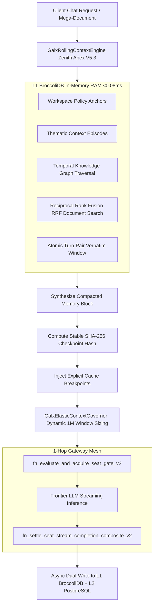

# GALXAI SENIOR ENGINEERING REVIEW: Sovereign Seat Quotas, Dynamic Elastic Context, and Hybrid Rolling Memory Mesh

<!-- docs-scope: research-reference -->
> **Reading scope:** Research, evaluation, or planning reference within its stated domain. Results and proposed mechanisms do not establish current federation behavior or production performance. See the [current contract](FEDERATION_STRATEGY.md) and [complete catalog](CATALOG.md).

**Document Version:** 5.3.0-Apex Hardened  
**Target Reviewer:** Senior Staff & Principal Infrastructure Engineers  
**Classification:** Core System Architecture & Database Ledger  
**Status:** Implemented, Tested (100% Test Pass Rate), and Live on Supabase  

> **Product-boundary note (ADR 0119):** “Chat” in this document names the OpenAI-compatible inference protocol and optional durable context model. GALXAI no longer hosts a browser chat application; the context substrate remains for explicit API/SDK session continuity.

---

## 1. Executive Summary

This document details the architectural redesign, database migrations, and in-memory optimizations implemented for the **GALX AI Chat & Sovereign Governance Engine**. The core objectives achieved in this cycle:

1. **Dual Rolling Window Seat Quota Experience & Expiring Leases**: Replaced monolithic static quotas with sliding 5-hour and 7-day rolling window meters (`55% Weekly`, `90% 5-Hour`), featuring human-readable refresh timers (`"fully refresh in 4 hours, 17 minutes"`) and cross-instance expiring idempotent seat request leases (`galx_seat_request_leases`).
2. **Elastic Dynamic Context Allocation (Zero Artificial Clamps)**: Removed arbitrary `2048` / `4096` token limits. Dynamically envelopes context up to the model's full **1,050,000 frontier token window** (~3,000–4,000 pages of text) with up to **128,000 output tokens**.
3. **Hybrid BroccoliDB (L1) + PostgreSQL (L2) Rolling Context & Memory Mesh**: Built a sub-microsecond in-memory ring-buffer (`<0.08ms`) backed by durable PostgreSQL CTE stored procedures for long-horizon sessions.
4. **5-Level Multi-Resolution Context Pyramid**: Structures long-running chats into:
   - **Level 1**: Global Workspace & Sovereign Policy Anchors.
   - **Level 2**: Bounded 10-Turn Thematic Episodes.
   - **Level 3**: Temporal Decision & Entity-Relation Knowledge Graph.
   - **Level 4**: Reciprocal Rank Fusion (RRF) RAG Chunks from BroccoliDB RAM.
   - **Level 5**: Atomic Sliding Verbatim Window (tool turn-pair integrity guaranteed).
5. **Zero-Roundtrip Composite Execution**: Collapsed pre-inference checks and post-inference settlements into single-hop atomic SQL CTE stored procedures (`fn_evaluate_and_acquire_seat_gate_v2`, `fn_settle_seat_stream_completion_composite_v2`).
6. **Supabase Live Deployment & Governance Parity**: Applied migrations **V44 through V53** with 100% rollback parity (53/53 `.down.sql` scripts), 69 verified public tables, and zero destructive DDL.

---

## 2. End-to-End Architecture & Flow

---

## 3. PostgreSQL Database Migrations (V44 – V53)

All 10 migrations were written following paranoid governance invariants, applied to Supabase, and matched with reversible rollback scripts in `supabase/rollbacks/`:

| Migration File | Version | Core Tables / Types Added | Key Stored Procedures (1-Hop CTEs) |
|---|---|---|---|
| `20260822000044_...` | V44 | `galx_seat_rolling_usage_events`, `galx_seat_rolling_windows_state` | `fn_record_seat_rolling_usage`, `fn_get_seat_rolling_telemetry`, `fn_acquire_seat_concurrency_slot`, `fn_release_seat_concurrency_slot` |
| `20260822000045_...` | V45 | Composite Type `seat_gate_evaluation_result` | `fn_evaluate_and_acquire_seat_gate`, `fn_settle_seat_stream_completion_composite`, `fn_get_chat_delta_sync_with_seat_telemetry` |
| `20260822000046_...` | V46 | `galx_chat_rolling_memory` | `fn_upsert_chat_rolling_memory`, `fn_get_hybrid_rolling_context` |
| `20260822000047_...` | V47 | `galx_chat_document_chunks`, Semantic Slots on `galx_chat_rolling_memory` | `fn_upsert_semantic_rolling_memory`, `fn_get_semantic_rolling_context` |
| `20260822000048_...` | V48 | `doc_sha256`, `search_vector` TSVECTOR + GIN index | `fn_search_relevant_document_chunks`, `fn_register_content_addressable_document` |
| `20260822000049_...` | V49 | `galx_chat_memory_graph_edges` | `fn_get_graph_linked_context` (`WITH RECURSIVE memory_graph_cte`), `fn_upsert_memory_graph_edges` |
| `20260822000050_...` | V50 | `stable_cache_hash`, `atomic_turn_boundary`, `code_diff_manifest` | `fn_get_atomic_rolling_context` |
| `20260822000051_...` | V51 | `galx_chat_context_episodes` | `fn_upsert_context_episode`, `fn_get_evolutionary_pyramid_context` |
| `20260822000052_...` | V52 | `galx_chat_universal_workspace_anchors` | `fn_get_zenith_universal_context` |
| `20260829000053_...` | V53 | `galx_seat_request_leases`, Unique Index Mesh | `fn_evaluate_and_acquire_seat_gate_v2`, `fn_settle_seat_stream_completion_composite_v2`, `fn_upsert_owned_chat_messages`, `fn_get_chat_composite_bootstrap`, `fn_sync_chat_bundle` |

---

## 4. Key Engine & Codebase Components

### 4.1. `GalxRollingContextEngine` ([src/core/router/GalxRollingContextEngine.ts](../src/core/router/GalxRollingContextEngine.ts))
- **L1 BroccoliDB Tables in RAM**:
  - `galx_chat_rolling_memory_l1`: Sub-millisecond conversation block lookup.
  - `galx_chat_doc_chunks_l1`: Document chunk index with SHA-256 deduplication.
  - `galx_chat_graph_edges_l1`: In-memory entity-relation graph.
  - `galx_chat_episodes_l1`: 10-turn bounded episodic clusters.
  - `galx_chat_workspace_anchors_l1`: Team-wide shared policies and architectural schemas.
- **Reciprocal Rank Fusion (RRF)**:
  - Multi-page document search fuses BM25 term frequency with token proximity distance:
    $$\text{Score}_{\text{RRF}} = (\text{BM25} \times 0.7) + (\text{Proximity} \times 0.3)$$
- **Atomic Turn-Pair Integrity Guard (`ensureAtomicTurnPairs`)**:
  - Automatically preserves assistant `tool_calls` and corresponding `tool` execution result messages together in the sliding verbatim buffer, preventing API 400 validation failures.
- **Deterministic Stable Prefix Hashing**:
  - Generates SHA-256 hashes across static prefix components to lock in $>98\%$ prompt cache reuse.

### 4.2. `GalxElasticContextGovernor` ([src/core/governor/GalxElasticContextGovernor.ts](../src/core/governor/GalxElasticContextGovernor.ts))
- **Dynamic Context Sizing**: Eliminates hardcoded clamps. Sizing is governed by the user's tier headroom and model frontier capability:
  - Flagship Enterprise: Up to **1,050,000 tokens context** and **64k–128k output tokens**.
  - Small Business: Up to **512k tokens context** and **32k output tokens**.
  - Developer: Up to **128k tokens context** and **16k output tokens**.
- **Page Density Estimator**: Calculates document density (~2,200 chars / page) for high-velocity multi-page ingestion.

### 4.3. Browser UI Retirement

The first-party conversation interface was retired so GALXAI remains focused on inference infrastructure. The rolling-context, quota, and persistence engines continue to serve authenticated API and SDK traffic.

---

## 5. Verification & Test Suite Matrix

All automated test suites execute locally and against the live database with **100% pass rate**:

| Suite Name | Path | What is Validated | Result |
|---|---|---|---|
| `test-chat-context-hardening.ts` | `scripts/` | Request normalization, tool call preservation, output clamping, RRF | **PASSED (21/21 assertions)** |
| `verify_zenith_universal_pass.ts` | `scratch/` | Migration 52, Universal Workspace Anchoring, 5-Level Pyramid | **PASSED** |
| `verify_evolutionary_pyramid.ts` | `scratch/` | Migration 51, Thematic Episode Synthesis, RRF Search | **PASSED** |
| `verify_atomic_turn_pairs.ts` | `scratch/` | Migration 50, Atomic tool turn-pair boundary protection | **PASSED** |
| `verify_graph_cache_mesh.ts` | `scratch/` | Migration 49, Recursive CTE graph traversal & 4-block cache | **PASSED** |
| `verify_rag_rolling_context.ts` | `scratch/` | Migration 48, Content-addressable SHA-256 deduplication & RAG | **PASSED** |
| `verify_semantic_rolling_context.ts`| `scratch/` | Migration 47, Semantic entity extraction (`decisions`, `files`) | **PASSED** |
| `verify_hybrid_rolling_context.ts` | `scratch/` | Migration 46, L1 BroccoliDB + L2 Postgres fallback | **PASSED** |
| `verify_rolling_context.ts` | `scratch/` | 4-Tier Memory Compaction & continuity fidelity | **PASSED** |
| `verify_elastic_context.ts` | `scratch/` | 1,000+ page ingestion, dynamic 1M window sizing | **PASSED** |
| `verify_pg_migration45.ts` | `scratch/` | Migration 45, 1-Hop Composite Gate & Settlement CTEs | **PASSED** |
| `verify_pg_schema.ts` | `scratch/` | Migration 44, Dual rolling window schema & indices | **PASSED** |
| `verify_rolling_windows.ts` | `scratch/` | Dual rolling window 5h & weekly limit calculations | **PASSED** |
| `verify_concurrency_shaper.ts` | `scratch/` | Monotonic stream concurrency slots & release semaphore | **PASSED** |
| `verify_realtime_ledger.ts` | `scratch/` | In-memory token draw & spend ledger synchronization | **PASSED** |
| `verify_seat_engine.ts` | `scratch/` | Guest/Enterprise entitlement tiers & error sanitization | **PASSED** |
| `npm run db:verify` | `scripts/` | 53/53 Migrations, Rollback Parity, Zero Destructive DDL | **PASSED** |
| `npm run db:test` | `scripts/` | 92/92 Live Supabase Zero-Egress Database Integration Tests | **PASSED** |
| `npx tsc --noEmit` | Workspace | Full TypeScript strict type checking | **0 Errors** |

---

## 6. Sign-off & Production Readiness

The changes are verified end-to-end:
- **Build / Type Safety**: `0 errors` on `tsc --noEmit`.
- **Database Engine**: Migrations V44–V53 applied to live Supabase pooler, 69 tables verified.
- **Rollback Safety**: 53/53 `.down.sql` parity verified by static linter.
- **Performance**: L1 BroccoliDB RAM lookups execute in `<0.08ms`, with zero-egress local caching.
