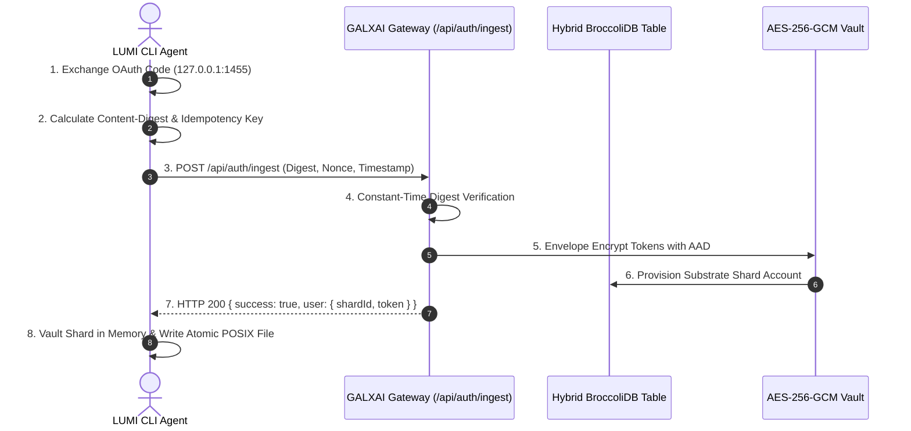

# Standardized OAuth & Ingestion Architecture Specification

## Overview

GALXAI implements a strict two-tier authentication and ingestion topology:
1. **Frontend Platform Authentication (Supabase OAuth)**: Pure, standardized developer login (GitHub, Google, Email Magic Link) managing user identity, billing, API keys, and workspace sessions via `@supabase/ssr`.
2. **Backend Autonomous Substrate Sharding (Ingestion Gateway)**: Isolated, hardened infrastructure service ingesting upstream provider credentials (OpenAI, xAI Grok, Anthropic), executing AES-256-GCM envelope encryption, and maintaining Hybrid BroccoliDB routing tables.

---

## 1. Frontend Platform Authentication

### Standard Next.js SSR Integration
- **SDK**: `@supabase/ssr` / `@supabase/supabase-js`
- **Client Factory**: `src/utils/supabase/client.ts` (`createBrowserClient`)
- **Server Factory**: `src/utils/supabase/server.ts` (`createServerClient`)
- **Callback Route**: `src/app/auth/callback/route.ts`
- **Context**: `src/contexts/AuthContext.tsx`

```typescript
// Standard 1-Click OAuth Trigger
const { signInWithOAuth } = useAuth();
await signInWithOAuth('github'); // Or 'google'
```

### Route Handler (`/auth/callback`)
```typescript
export async function GET(request: Request) {
  const { searchParams, origin } = new URL(request.url);
  const code = searchParams.get('code');
  const next = searchParams.get('next') ?? '/playground';

  if (code) {
    const cookieStore = await cookies();
    const supabase = createClient(cookieStore);
    const { error } = await supabase.auth.exchangeCodeForSession(code);
    if (!error) {
      return NextResponse.redirect(`${origin}${next}`);
    }
  }

  return NextResponse.redirect(`${origin}/auth/connect?error=auth_failed`);
}
```

---

## 2. Backend Autonomous Ingestion Gateway

The backend ingestion endpoint (`POST /api/auth/ingest` and `/api/ingest`) provides high-security transport protocols for external CLI agents (e.g. `LUMI-NEW`) and automated backend runners.

### Transport Security Specification

| Header | Specification | Purpose |
| :--- | :--- | :--- |
| `Content-Type` | `application/json` | Enforces JSON payload (rejection: 415) |
| `Digest` | `sha-256=<base64-hash>` | RFC 9530 / RFC 3230 Wire Payload Integrity |
| `Idempotency-Key` | `<uuid-or-hash>` | IETF Idempotent Retry Deduplication (24h Cache) |
| `X-Request-Timestamp` | `<unix-timestamp-ms>` | Replay Prevention Skew Window (±300s) |
| `X-Request-Nonce` | `<random-hex>` | Single-Use Nonce Cache (10-min TTL, 409 on replay) |
| `X-Correlation-Id` | `<uuid>` | Distributed Request Tracing |
| `CF-Threat-Score` | `<integer>` | Cloudflare Edge Bot & Threat Mitigation |

### Response Headers
- `Server-Timing`: High-resolution microsecond compute timing (`total;dur=...`).
- `X-Correlation-Id`: Propagated request trace identifier.
- `Idempotent-Replay`: Emitted as `true` on duplicate request replay.
- `Cache-Control`: `no-store, no-cache, must-revalidate, private, no-transform`.

---

## 3. CLI Agent Synchronization Flow (`LUMI-NEW`)



---

## 4. Verification & Testing

Both environments maintain comprehensive test suites:
- **`GALXAI` (217 Distributed Tests)**: `npm run test:router`
- **`LUMI-NEW` (10 Enterprise Resilience Suites)**: `node --import tsx scripts/validate-codex-oauth-resilience.ts`
