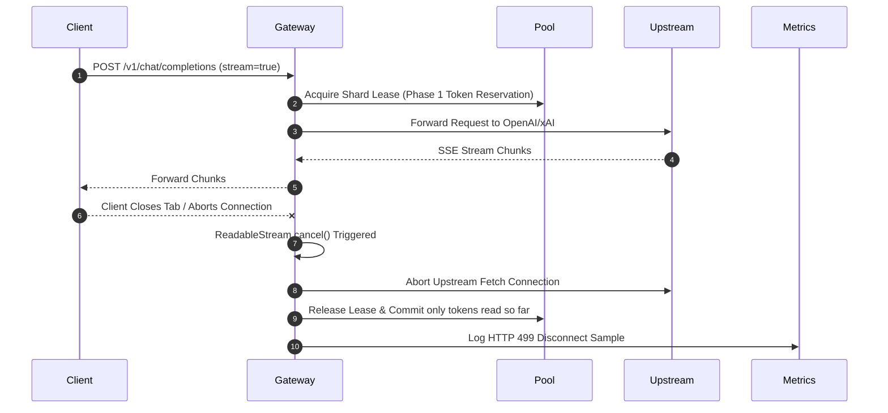

# ⚡ Universal Streaming & SSE Protocols

GALXAI implements high-performance, zero-allocation Server-Sent Events (SSE) streaming compliant with OpenAI, Anthropic, Ollama, and Vercel AI SDK standards (RFC 8895).

---

## 1. Protocol Specifications

### A. OpenAI Standard SSE Stream (`/v1/chat/completions`)
```http
POST /v1/chat/completions HTTP/1.1
Host: galx.ai
Authorization: Bearer galx_live_...
Content-Type: application/json

{
  "model": "gpt-5.6-sol",
  "messages": [{"role": "user", "content": "Hello"}],
  "stream": true
}
```

```http
HTTP/1.1 200 OK
Content-Type: text/event-stream; charset=utf-8
Cache-Control: no-cache, no-transform
Connection: keep-alive
X-Accel-Buffering: no

data: {"id":"chatcmpl-01","object":"chat.completion.chunk","created":1700000000,"model":"gpt-5.6-sol","choices":[{"index":0,"delta":{"content":"Hello"},"finish_reason":null}]}

data: {"id":"chatcmpl-01","object":"chat.completion.chunk","created":1700000000,"model":"gpt-5.6-sol","choices":[{"index":0,"delta":{"content":" world!"},"finish_reason":null}]}

data: {"id":"chatcmpl-01","object":"chat.completion.chunk","created":1700000000,"model":"gpt-5.6-sol","choices":[{"index":0,"delta":{},"finish_reason":"stop"}]}

data: [DONE]
```

### B. Browser Address Bar Direct Stream (`GET /v1/chat/completions`)
```text
https://galx.ai/v1/chat/completions?prompt=Explain+gravity&model=sol&stream=true&api_key=galx_live_...
```

### C. Ollama Streaming NDJSON Protocol (`/api/generate` & `/api/chat`)
```http
POST /api/generate HTTP/1.1
Host: galx.ai
Authorization: Bearer galx_live_...
Content-Type: application/json

{
  "model": "sol",
  "prompt": "Hello from Ollama CLI",
  "stream": true
}
```

```json
{"model":"gpt-5.6-sol","created_at":"2026-08-23T06:00:00Z","response":"Hello","done":false}
{"model":"gpt-5.6-sol","created_at":"2026-08-23T06:00:00Z","response":" world!","done":false}
{"model":"gpt-5.6-sol","created_at":"2026-08-23T06:00:00Z","response":"","done":true,"total_duration":120000000,"load_duration":5000000,"prompt_eval_count":12,"eval_count":42}
```

---

## 2. Client Abort & Stream Cancellation Safety

When a client closes the network connection or calls `abortController.abort()`:



### Key Guarantees:
1. **Zero Leaked Concurrency Slots**: The shard lease is freed immediately upon client disconnect without waiting for upstream generation to finish.
2. **Zero Leaked Token Quota**: The 2-Phase Token Reservation releases unconsumed tokens back into the shard's bucket.
3. **Instant Upstream Cancellation**: Aborts the active fetch stream, preventing upstream token billing for abandoned generations.

---

## 3. Web Stream Protocol Adapters (`@galxai/sdk`)

```typescript
import { 
  toTextStream, 
  toTextStreamResponse, 
  toDataStreamResponse, 
  toSSEResponse 
} from '@galxai/sdk';

// 1. Text Stream (Web standard ReadableStream)
const readable = toTextStream(asyncChunkGenerator);

// 2. Plain Text HTTP Response (text/plain; charset=utf-8)
const textResponse = toTextStreamResponse(asyncChunkGenerator);

// 3. Vercel AI SDK Data Stream (text/plain; x-vercel-ai-data-stream: v1)
const dataStreamResponse = toDataStreamResponse(asyncChunkGenerator);

// 4. Server-Sent Events SSE Response (text/event-stream)
const sseResponse = toSSEResponse(asyncChunkGenerator);
```

---

## 4. Stateful Conversation Thread Streaming

```typescript
import { thread } from '@galxai/sdk';

const conv = thread({ model: 'gpt-5.6-sol', system: 'You are a staff engineer.' });

// Stream response chunk by chunk to stdout
for await (const chunk of conv.streamReply('Explain Raft consensus Leader Election.')) {
  process.stdout.write(chunk);
}
```
