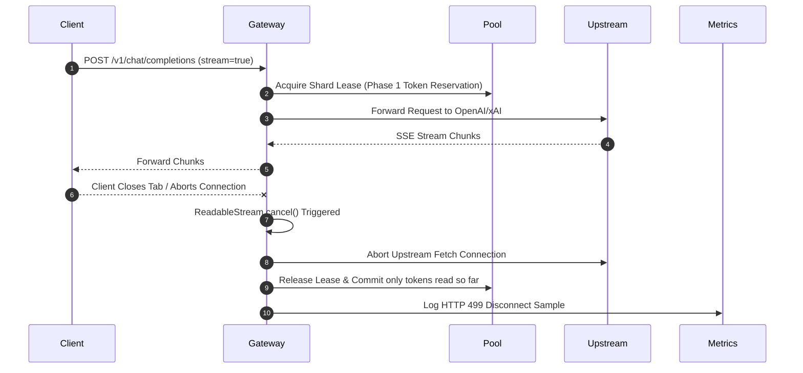

# ⚡ Server-Sent Events (SSE) Streaming Protocol

GALXAI implements high-performance, zero-allocation Server-Sent Events (SSE) streaming compliant with the OpenAI API protocol and RFC 8895.

---

## 1. Protocol Specification

### HTTP Ingress Request
```http
POST /v1/chat/completions HTTP/1.1
Host: api.galx.ai
Authorization: Bearer galx_live_...
Content-Type: application/json

{
  "model": "gpt-5.6-sol",
  "messages": [{"role": "user", "content": "Hello"}],
  "stream": true
}
```

### HTTP Egress Response Headers
```http
HTTP/1.1 200 OK
Content-Type: text/event-stream; charset=utf-8
Cache-Control: no-cache, no-transform
Connection: keep-alive
X-Accel-Buffering: no
```

### Event Stream Frame Format
```text
data: {"id":"chatcmpl-01","object":"chat.completion.chunk","created":1700000000,"model":"gpt-5.6-sol","choices":[{"index":0,"delta":{"role":"assistant","content":""},"finish_reason":null}]}

data: {"id":"chatcmpl-01","object":"chat.completion.chunk","created":1700000000,"model":"gpt-5.6-sol","choices":[{"index":0,"delta":{"content":"Hello"},"finish_reason":null}]}

data: {"id":"chatcmpl-01","object":"chat.completion.chunk","created":1700000000,"model":"gpt-5.6-sol","choices":[{"index":0,"delta":{"content":" world!"},"finish_reason":null}]}

data: {"id":"chatcmpl-01","object":"chat.completion.chunk","created":1700000000,"model":"gpt-5.6-sol","choices":[{"index":0,"delta":{},"finish_reason":"stop"}]}

data: [DONE]

```

---

## 2. Client Abort & Stream Cancellation Safety

When a client closes the network connection or calls `abortController.abort()`:



### Key Guarantees
1. **Zero Leaked Concurrency Slots**: The shard lease is freed immediately upon client disconnect without waiting for upstream generation to finish.
2. **Zero Leaked Token Quota**: The 2-Phase Token Reservation releases unconsumed tokens back into the shard's bucket.
3. **Instant Upstream Cancellation**: Aborts the active fetch stream, preventing upstream token billing for abandoned generations.

---

## 4. Vercel AI SDK & Next.js App Router Integration

`@galxai/sdk` includes zero-boilerplate stream adapters for the Vercel AI SDK Data Stream protocol:

```typescript
// app/api/chat/route.ts in Next.js
import { GalxAI } from '@/sdk';

const galx = new GalxAI();

export async function POST(req: Request) {
  const { messages } = await req.json();

  const stream = await galx.chat.completions.create({
    model: 'gpt-5.6-sol',
    messages,
    stream: true
  });

  // Emits 0:"token"\n with x-vercel-ai-data-stream: v1 headers
  return galx.adapters.toDataStreamResponse(stream);
}
```

---

## 5. Asynchronous Queue SSE Lifecycle Stream

In addition to token streaming, GALXAI exposes native SSE event streams for asynchronous tasks:

```http
GET /api/queues/llm-batch/tasks/task_123/stream HTTP/1.1
Accept: text/event-stream
```

### Event Payload Frames
```text
data: {"type":"snapshot","data":{"id":"task_123","status":"RUNNING","progress":{"percentage":50,"message":"Evaluating dataset batch 2/4"}}}

data: {"type":"TASK_PROGRESS","data":{"percentage":75,"message":"Evaluating dataset batch 3/4"}}

data: {"type":"TASK_COMPLETED","data":{"result":{"modelUsed":"gpt-5.6-sol","tokens":1450}}}

data: {"type":"done"}
```

