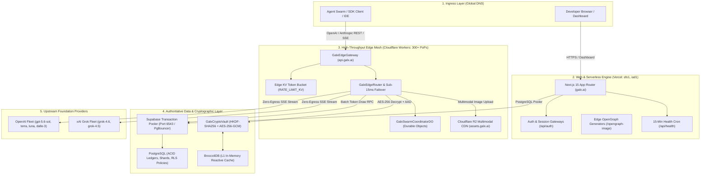

# 🗺️ GALXAI: System Architecture Topology & Maintenance Onboarding Runbook

> **Target Audience**: Incoming Distributed Systems Engineers, Cloud Operators, Security Maintainers, and Autonomous AI Database Operators onboarding onto the GALXAI platform.

---

## 📑 Table of Contents
1. [System Topology: The Dual-Engine Edge Architecture](#1-system-topology-the-dual-engine-edge-architecture)
2. [Traffic Routing & DNS Domain Segregation](#2-traffic-routing--dns-domain-segregation)
3. [Core Subsystems & Codebase Map](#3-core-subsystems--codebase-map)
4. [Cryptographic Enclave & Zero-Data-Retention (ZDR) Model](#4-cryptographic-enclave--zero-data-retention-zdr-model)
5. [Database Layer & Paranoid PostgreSQL Protocol](#5-database-layer--paranoid-postgresql-protocol)
6. [Daily Operational Runbooks & Command Fleet](#6-daily-operational-runbooks--command-fleet)
7. [Incident Response & Emergency Failover Playbooks](#7-incident-response--emergency-failover-playbooks)
8. [New Maintainer Onboarding Checklist](#8-new-maintainer-onboarding-checklist)

---

## 1. System Topology: The Dual-Engine Edge Architecture

GALXAI is architected as a **Dual-Engine Edge Platform** that decouples frontend user interactions and transactional APIs from high-throughput token streaming and multimodal storage:



---

## 2. Traffic Routing & DNS Domain Segregation

| Domain / Ingress | Target Infrastructure | Primary Responsibilities |
| :--- | :--- | :--- |
| **`galx.ai`** (and `www.galx.ai`) | **Vercel** (Next.js 15 App Router) | Marketing landing page, developer dashboard, `/keys` management, `/billing` checkout funnels, `/vault` credential deposits, and serverless health probes. |
| **`api.galx.ai`** | **Cloudflare Workers** (300+ Edge PoPs) | High-speed API ingress (`/v1/chat/completions`, `/v1/messages`, `/v1/embeddings`, `/api/queues`), SSE token streaming, rate limit KV, and in-flight failover. |
| **`assets.galx.ai`** | **Cloudflare R2** (Global Anycast CDN) | Multimodal visual outputs (`openai-gpt-image-2`, `dall-e-3`) and audio buffers served with **$0 egress fees**. |
| **`aws-0-us-east-1.pooler.supabase.com:6543`** | **Supabase** (PostgreSQL Transaction Pooler) | Authoritative database connection pool for micro-batch token draws, API key authentication, and audit trails. |

---

## 3. Core Subsystems & Codebase Map

```text
GALXAI/
├── src/
│   ├── app/                              # Next.js 15 App Router Frontend & Serverless
│   │   ├── api/                          # Serverless routes: /api/health, /api/auth, /api/queues, /api/run
│   │   ├── v1/                           # Public API routes: /v1/chat/completions, /v1/messages, /v1/embeddings
│   │   ├── keys/                         # Gateway Key minting & tier management
│   │   ├── vault/                        # BYOQ Credential Shard deposit & simulator
│   │   ├── billing/                      # Prepaid wallet top-ups & invoice records
│   │   └── queues/                       # Real-time task canvas & 1-click agent context
│   ├── core/                             # Pure TypeScript Gateway Engine (Universal)
│   │   ├── circuit/                      # 4-State Circuit Breaker (Healthy/Cooldown/Exhausted/Dead)
│   │   ├── governor/                     # Continuous calculus fractional token bucket
│   │   ├── pool/                         # Adaptive Hydraulic Headroom (P-AHT) & TASD leveling
│   │   ├── queue/                        # CloudTasks-inspired asynchronous task queue engine
│   │   ├── router/                       # Model catalog & execution adapters (OpenAI, Grok, Anthropic)
│   │   ├── telemetry/                    # Zero-allocation circular ring buffer latency tracker
│   │   └── vault/                        # HKDF-SHA256 derivation & AES-256-GCM cipher enclave
│   ├── workers/cloudflare/               # Cloudflare Workers Edge Mesh Substrate
│   │   ├── GalxEdgeGateway.ts            # Edge ingress, API authentication, and SSE transform
│   │   ├── GalxEdgeRouter.ts             # In-flight multi-provider failover router
│   │   ├── GalxEdgeCache.ts              # Stale-While-Revalidate (SWR) catalog cache
│   │   ├── GalxR2AssetAdapter.ts         # Multimodal R2 storage adapter ($0 egress)
│   │   ├── GalxSwarmCoordinatorDO.ts     # Durable Object for swarm context synchronization
│   │   └── GalxEdgeBatchBuffer.ts        # Micro-batching buffer for token draws
│   ├── lib/
│   │   ├── env.ts                        # Centralized type-safe environment specification
│   │   ├── storage/                      # BroccoliDB in-memory reactive tables & AST parser
│   │   └── supabase/                     # Authoritative Supabase PostgreSQL repositories
│   └── utils/supabase/                   # SSR, Middleware, and Server cookie client factories
├── scripts/                              # Verification, Deployment & Tooling Suite
│   ├── verify-vercel-readiness.ts        # 8-Phase Pre-Flight Audit Engine
│   ├── sync-vercel-env.ts                # Automated Vercel Environment Secret Synchronizer
│   ├── verify-deployment-smoke.ts        # Post-Deployment Live Smoke Tester
│   ├── populate-vault-secrets.ts         # Cryptographic Vault Key Generator
│   ├── test-cloudflare-workers.ts        # 46-Point Edge Mesh Test Suite
│   └── validate-galxai-router.ts         # 50-Suite Forensic Router Test Runner
├── docs/                                 # Complete Technical Specifications & Runbooks
│   ├── adr/                              # Architecture Decision Records (ADR 0001–0041)
│   ├── VERCEL_DEPLOYMENT.md              # Vercel Deployment & Pre-Flight Gate Guide
│   ├── CLOUDFLARE_STRATEGY.md            # Cloudflare Edge Mesh Runbook
│   └── SUPABASE_PARANOID_ARCHITECTURE_SPEC.md # Paranoid PostgreSQL Specification
└── worker-configuration.d.ts             # Scoped Cloudflare Worker dynamic import bindings
```

---

## 4. Cryptographic Enclave & Zero-Data-Retention (ZDR) Model

### Master Key Derivation & Enclave Isolation
All BYOQ (Bring Your Own Quota) credentials and provider API keys are encrypted at rest using **AES-256-GCM Envelope Encryption** with Additional Authenticated Data (AAD):

```
                        MASTER SECRET (GALX_VAULT_MASTER_SECRET)
                                           │
                                           ▼
             [ HKDF-SHA256 ] ── Salt: "galx-vault-salt-2026"
                                 Info: "galx-shard-isolation-v1"
                                           │
                                           ▼
                             [ 32-Byte Derived Enclave Key ]
                                           │
                      ┌────────────────────┴────────────────────┐
                      ▼                                         ▼
            [ AES-256-GCM Encrypt ]                   [ AES-256-GCM Decrypt ]
            • 96-Bit Random IV                        • Verify 128-Bit Auth Tag
            • AAD: `${tenantUid}:${shardId}:${prov}`   • AAD Verification Match
```

### Zero Data Retention (ZDR v10.0) Protocol
1. **Ephemeral Memory Slabs**: Decrypted secrets and prompt buffers are leased from a fixed-size memory slab pool.
2. **2-Pass Cryptographic Memory Zeroization**: In the `finally` execution block, memory slabs are overwritten with `0xAA` followed by `0x00` before memory is released to the garbage collector.
3. **Zero Persistent Prompt Logging**: Prompts and streaming chunks are never written to disk, database tables, or logging aggregators.

---

## 5. Database Layer & Paranoid PostgreSQL Protocol

GALXAI operates under the **AI Agent Database Operating Protocol (AOP-DB)** ([ADR 0035](adr/0035-paranoid-supabase-postgresql-and-ai-agent-governance.md)):

```
   [ Business Intent ] ──► [ AOP-DB Protocol ] ──► [ Mechanical SQL Linter ]
                                                           │
              ┌────────────────────────────────────────────┴────────────────────────────────────────────┐
              ▼                            ▼                             ▼                              ▼
     [ Expand/Contract DDL ]     [ 100% RLS Coverage ]        [ Zero-Lock Indexes ]          [ Double-Entry Ledger ]
     • No DROP/ALTER destructive • Deny-by-default on all     • CREATE INDEX CONCURRENTLY    • Strict append-only
     • 3-phase grace migrations  • Tenant isolation checks    • Foreign key lock prevention  • Check balance >= 0
              │                            │                             │                              │
              └────────────────────────────┬─────────────────────────────┴──────────────────────────────┘
                                           ▼
                           [ Transaction-Wrapped Execution ]
```

### Connection Rules:
- **Port 6543 (Transaction Pooler)**: ALL serverless and edge functions MUST connect via port 6543 (`?pgbouncer=true`). Direct connections to port 5432 are reserved strictly for migration scripts.

---

## 6. Daily Operational Runbooks & Command Fleet

### Tier 1: Pre-Deployment & Integrity Gates
```bash
# 1. Run the unified pre-deployment audit & production build
npm run deploy:check

# 2. Run the 8-Phase Pre-Flight Audit Engine directly
npm run vercel:verify

# 3. Test TypeScript static typing across the entire workspace
npx tsc --noEmit

# 4. Run the 46-point Cloudflare Edge verification test runner
npm run worker:test

# 5. Run the 50-suite forensic router verification runner (177 tests)
npm run test:router
```

### Tier 2: Secret Management & Vercel Sync
```bash
# Generate / rotate cryptographic vault secrets & test HKDF roundtrip
npm run vault:populate

# Generate a fresh 256-bit secret key
npm run vault:populate -- --fresh

# Inspect / generate formatted Vercel CLI sync commands
npm run vercel:env:print
```

### Tier 3: Deployment & Live Smoke Testing
```bash
# Deploy to Vercel production
npx vercel --prod

# Deploy to Cloudflare Workers staging
npm run worker:deploy:staging

# Deploy to Cloudflare Workers production
npm run worker:deploy

# Run live post-deployment smoke test suite
npm run vercel:smoke -- --url=https://galx.ai
```

### Tier 4: Database Migrations
```bash
# Check migration status
npm run db:status

# Dry-run pending migrations against database
npm run db:dry-run

# Apply pending migrations transactionally
npm run db:migrate

# Verify database RLS policies and table integrity
npm run db:verify
```

---

## 7. Incident Response & Emergency Failover Playbooks

### Playbook A: Upstream 429 Wave / Outage
1. **Symptom**: Spikes in `all_shards_cooldown` (HTTP 503) or elevated upstream latency.
2. **Automated Action**: GALXAI's 4-State Circuit Breaker automatically transitions failing shards into `cooldown`, activating backoff with jitter and routing traffic to healthy secondary shards.
3. **Manual Override**:
   - Check shard health in the dashboard at `/vault`.
   - Deposit emergency fallback credentials via `/vault/deposit`.
   - Enable provider fallback via `x-galx-allow-fallback: true`.

### Playbook B: Database Pooler Connection Exhaustion
1. **Symptom**: Serverless function timeouts (`ETIMEDOUT` / `504 Gateway Timeout`) or `remaining connection slots are reserved`.
2. **Remedy**:
   - Verify `DATABASE_URL` uses port `6543` (Transaction Pooler) rather than `5432` (Direct Session).
   - Check that `SUPABASE_POOL_SIZE` is capped at `20` in Vercel environment variables.

### Playbook C: Cryptographic Key Desynchronization
1. **Symptom**: `GalxVaultDecryptionError: Failed to authenticate ciphertext with provided AAD`.
2. **Remedy**:
   - Run `npm run vault:populate` to test key derivation.
   - Verify that `GALX_VAULT_MASTER_SECRET` matches the active key in Vercel and Cloudflare Worker secrets.

---

## 8. New Maintainer Onboarding Checklist

Complete this 5-step checklist when onboarding to a new development workstation:

- [ ] **Step 1: Environment Setup**: Ensure Node.js `20.18.0` LTS is active (`nvm use` or `fnm use`).
- [ ] **Step 2: Install Dependencies**: Run `npm install` to install all Next.js and Cloudflare packages.
- [ ] **Step 3: Provision Local Secrets**: Ensure `.env.local` is populated with Supabase credentials and run `npm run vault:populate` to test cryptography.
- [ ] **Step 4: Execute Full Verification Gate**: Run `npm run deploy:check` and `npm run worker:test` — verify **0 errors**.
- [ ] **Step 5: Launch Local Development Server**: Run `npm run dev` and open `http://localhost:3000` to verify the interactive dashboard, playground, and API routes.
