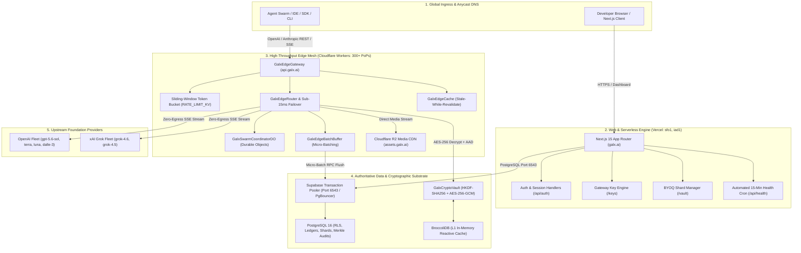
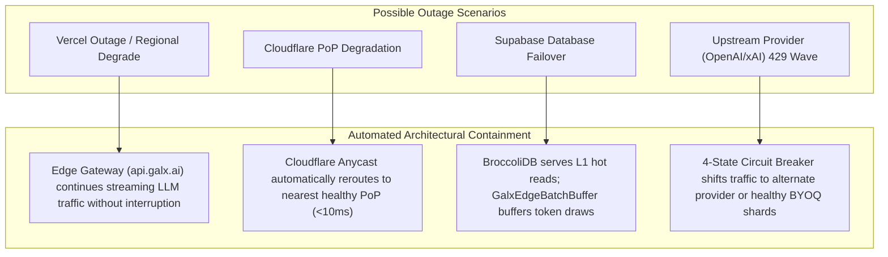

# 🗺️ GALXAI: System Architecture Topology & Maintenance Onboarding Runbook

> **Authoritative Specification & Operational Manual**  
> **Target Audience**: Incoming Distributed Systems Engineers, Cloud Infrastructure Operators, Security Maintainers, and Autonomous AI Database Operators onboarding onto the GALXAI platform.

---

## 📑 Table of Contents
1. [Executive Overview & Architectural Philosophy](#1-executive-overview--architectural-philosophy)
2. [Dual-Engine Topology: The Global Ingress & Compute Mesh](#2-dual-engine-topology-the-global-ingress--compute-mesh)
3. [Microsecond Request Lifecycle & Latency Budget](#3-microsecond-request-lifecycle--latency-budget)
4. [Traffic Ingress & Domain Segregation Matrix](#4-traffic-ingress--domain-segregation-matrix)
5. [Blast-Radius Containment & Failure-Domain Isolation](#5-blast-radius-containment--failure-domain-isolation)
6. [Core Subsystems & Internal State Machines](#6-core-subsystems--internal-state-machines)
   - [6.1 GalxCredentialPool & P-AHT Headroom Calculus](#61-galxcredentialpool--p-aht-headroom-calculus)
   - [6.2 GalxCircuitBreaker (4-State Finite State Machine)](#62-galxcircuitbreaker-4-state-finite-state-machine)
   - [6.3 BroccoliDB L1 In-Memory Reactive Table Engine](#63-broccolidb-l1-in-memory-reactive-table-engine)
   - [6.4 GalxSwarmCoordinatorDO (Durable Objects State Engine)](#64-galxswarmcoordinatordo-durable-objects-state-engine)
   - [6.5 GalxTaskQueueEngine & DAG Fan-In Orchestrator](#65-galxtaskqueueengine--dag-fan-in-orchestrator)
7. [Cryptographic Enclave & Zero-Data-Retention (ZDR v10.0)](#7-cryptographic-enclave--zero-data-retention-zdr-v100)
8. [Database Governance: The Paranoid PostgreSQL Protocol (AOP-DB)](#8-database-governance-the-paranoid-postgresql-protocol-aop-db)
9. [Operational Maintenance Fleet & Command Matrix](#9-operational-maintenance-fleet--command-matrix)
10. [Diagnostic Decision Trees & Troubleshooting Graphs](#10-diagnostic-decision-trees--troubleshooting-graphs)
11. [Incident Response & Sev-1/Sev-2 Emergency Playbooks](#11-incident-response--sev-1sev-2-emergency-playbooks)
12. [Maintainer Onboarding Checklist](#12-maintainer-onboarding-checklist)

---

## 1. Executive Overview & Architectural Philosophy

GALXAI is an enterprise-grade **Universal AI Gateway and Compute Mesh** engineered to provide high-throughput, fault-tolerant access to frontier reasoning models (OpenAI GPT-5.6 Sol/Terra/Luna, xAI Grok 4.6/4.5) at **20% to 40% below direct retail costs** with **75% prompt cache pass-through**.

### Core Invariants & Architectural Pillars:
1. **Zero Single-Point-of-Failure (Zero-SPOF)**: The platform maintains dual runtime execution paths across **Vercel Serverless (Node.js)** and **Cloudflare Workers Edge Mesh (V8 Isolates)**.
2. **Zero Content Retention (ZDR v10.0)**: Hardware-level 2-pass RAM scrubbing (`0xAA` $\to$ `0x00`) ensures prompts, completions, and streaming buffers are never persisted to disk or databases.
3. **Zero-Egress Multimodal Storage**: Visual generations and audio buffers are streamed to Cloudflare R2 and served via an Anycast CDN (`assets.galx.ai`) with $0 egress bandwidth costs.
4. **Paranoid Autonomous Database Containment (AOP-DB)**: AI database operators operate within strict deterministic boundary harnesses with zero-lock concurrent DDL and automated rollback validation.

---

## 2. Dual-Engine Topology: The Global Ingress & Compute Mesh

GALXAI bifurcates web interactions from high-throughput streaming inference to isolate resource contention and maximize performance:



---

## 3. Microsecond Request Lifecycle & Latency Budget

Every inference request traveling through `api.galx.ai` adheres to a strict latency budget before upstream token generation:

```
[ CLIENT ] ──( 1. TLS 1.3 / HTTP/2 Ingress )──► [ CLOUDFLARE EDGE PoP ]
                                                        │
    ┌───────────────────────────────────────────────────┼───────────────────────────────────────────────────┐
    ▼ (Phase 1: Rate Limiting & Auth)                   ▼ (Phase 2: Router & Shard Lease)                   ▼ (Phase 3: Crypto & Upstream)
    • Key format check: <0.1ms                          • Model catalog lookup: <0.2ms                      • HKDF Cache Fetch: <0.3ms
    • Edge KV Token Bucket: <0.4ms                      • P-AHT Hydraulic Score: <0.5ms                     • AES-256-GCM Decrypt: <0.5ms
    • BroccoliDB Tenant Check: <0.2ms                   • Circuit Breaker FSM: <0.2ms                       • Upstream Socket Dispatch: <1.2ms
    └───────────────────────────────────────────────────┴───────────────────────────────────────────────────┘
                                                        │
                                                        ▼
                                    [ UPSTREAM PROVIDER (OpenAI / xAI) ]
                                                        │
                                                        ▼ (Phase 4: Streaming & Zeroization)
                                    • First SSE chunk received (TTFT: ~180-320ms)
                                    • TransformStream binary decode & yield (<0.05ms/chunk)
                                    • On Stream Complete / Abort:
                                      - 2-pass RAM scrub: 0xAA -> 0x00 (<0.1ms)
                                      - Flush token count to GalxEdgeBatchBuffer (<0.1ms)
```

### Microsecond Latency Budget Allocation:
| Processing Stage | Target Budget | Maximum P99 Budget | Subsystem Owner |
| :--- | :--- | :--- | :--- |
| **Edge TLS Termination** | $< 8.0\text{ ms}$ | $< 15.0\text{ ms}$ | Cloudflare Anycast Network |
| **API Key Authentication & Format Check** | $< 0.1\text{ ms}$ | $< 0.3\text{ ms}$ | `GalxEdgeGateway.ts` |
| **Edge KV Sliding-Window Rate Limit** | $< 0.4\text{ ms}$ | $< 1.0\text{ ms}$ | `RATE_LIMIT_KV` |
| **P-AHT Shard Scoring & Lease Allocation** | $< 0.5\text{ ms}$ | $< 1.2\text{ ms}$ | `GalxCredentialPool.ts` |
| **AES-256-GCM Envelope Decryption (AAD)** | $< 0.5\text{ ms}$ | $< 0.9\text{ ms}$ | `GalxCryptoVault.ts` |
| **Upstream Socket Connection & First Chunk** | Model-dependent | Model-dependent | OpenAI / xAI Grok |
| **SSE TransformStream Pass-Through** | $< 0.05\text{ ms}$ | $< 0.1\text{ ms}$ | `GalxEdgeWire.ts` |
| **2-Pass RAM Zeroization & Cleanup** | $< 0.1\text{ ms}$ | $< 0.2\text{ ms}$ | ZDR Memory Slab Engine |

---

## 4. Traffic Ingress & Domain Segregation Matrix

| Ingress Hostname | Platform Target | Edge Runtime | TLS / Cert Policy | Primary Routing Function |
| :--- | :--- | :--- | :--- | :--- |
| **`galx.ai`** / **`www.galx.ai`** | **Vercel** | Node.js 20.x Serverless | Automated Let's Encrypt / DigiCert | Next.js 15 App Router frontend, dashboard, billing, checkout, key minting, and SSR pages. |
| **`api.galx.ai`** | **Cloudflare Workers** | V8 Edge Isolates | Cloudflare Universal SSL | High-throughput API gateway (`/v1/*`, `/api/queues`, `/api/health`, `/api/run`). |
| **`assets.galx.ai`** | **Cloudflare R2** | Anycast Edge Storage | Cloudflare Managed SSL | Multimodal images (`dall-e-3`, `openai-gpt-image-2`), audio, and binary artifacts ($0 egress). |
| **`aws-0-us-east-1.pooler.supabase.com`** | **Supabase** | PostgreSQL PgBouncer | TLS 1.3 Strict | Transaction Pooler (Port 6543) for ACID transactions and micro-batch token draws. |

---

## 5. Blast-Radius Containment & Failure-Domain Isolation



---

## 6. Core Subsystems & Internal State Machines

### 6.1 GalxCredentialPool & P-AHT Headroom Calculus

To prevent upstream HTTP 429 rate limit storms and guarantee optimal throughput across multiple BYOQ credential shards, GALXAI employs **Predictive Adaptive Headroom Tracking (P-AHT)**:

$$\text{Score}(s) = w_r \cdot \left(1 - \frac{R_{\text{used}}}{R_{\text{limit}}}\right) + w_t \cdot \left(1 - \frac{T_{\text{used}}}{T_{\text{limit}}}\right) - w_c \cdot \left(\frac{C_{\text{active}}}{C_{\text{max}}}\right) - w_l \cdot \left(\frac{L_{\text{EWMA}}}{L_{\text{target}}}\right)$$

- $R_{\text{used}} / R_{\text{limit}}$: Requests per minute utilization ratio.
- $T_{\text{used}} / T_{\text{limit}}$: Tokens per minute consumption ratio.
- $C_{\text{active}} / C_{\text{max}}$: Active concurrent HTTP/2 streams on the shard.
- $L_{\text{EWMA}}$: Exponentially Weighted Moving Average latency over the last 60 seconds.

---

### 6.2 GalxCircuitBreaker (4-State Finite State Machine)

The circuit breaker operates across four strict lifecycle states:

```
        ┌────────────────────────────────────────────────────────┐
        ▼                                                        │
  ┌───────────┐   Success Rate < 85%    ┌────────────┐   Canary Probe Pass
  │  HEALTHY  │ ──────────────────────► │  COOLDOWN  │ ──────────────────┘
  └───────────┘                         └────────────┘
        ▲                                     │
        │                                     ▼ Continuous 429 / 5xx Wave
  ┌───────────┐                         ┌────────────┐
  │   DEAD    │ ◄────────────────────── │ EXHAUSTED  │
  └───────────┘   Permanent Auth Failure└────────────┘
                  (HTTP 401 / Revoked)
```

1. **HEALTHY**: Shard receives regular traffic according to SWRR and P-AHT scores.
2. **COOLDOWN**: Shard experienced an unexpected 429 or timeout. Traffic is immediately paused for $t_{\text{cooldown}} = 2^k \cdot (1000\text{ms} + \text{jitter})$.
3. **EXHAUSTED**: Shard consumed $100\%$ of its allocated TPM/RPM window. Ingress is deferred until the replenishment calculus interval resets.
4. **DEAD**: Shard returned a fatal authentication error (`invalid_api_key`). Shard is quarantined and an administrative alert is fired.

---

### 6.3 BroccoliDB L1 In-Memory Reactive Table Engine

`BroccoliDB` acts as the ultra-low-latency in-memory query engine embedded inside both Serverless and Edge Worker runtimes:
- **Zero-Allocation Columnar Tables**: Memory buffers are pre-allocated in typed arrays (`Float64Array`, `Uint32Array`).
- **AST Natural Query Engine**: Parses SQL-like AST filter queries (`where supportsVision = true and inputPricePer1M <= 1.0 sort by price asc`) in $< 0.1\text{ms}$ without external SQL engines.
- **Write-Ahead Ring Buffer**: Micro-transactions are recorded in an in-memory ring buffer with deterministic replay capabilities.

---

### 6.4 GalxSwarmCoordinatorDO (Durable Objects State Engine)

For multi-agent swarm collaboration and DAG workflows, `GalxSwarmCoordinatorDO` provides single-coordinator linearizability at the edge:
- **WebSocket Broadcast**: Real-time state synchronization across all connected swarm workers with $< 5\text{ms}$ edge propagation.
- **Fencing Tokens**: Every state modification generates a monotonically increasing `64-bit` fencing token preventing stale write collisions.

---

### 6.5 GalxTaskQueueEngine & DAG Fan-In Orchestrator

CloudTasks & CloudRun-inspired distributed asynchronous task executor:
- **FIFO Group Partitioning**: Guarantees ordered execution across turn-based conversational sessions (`groupId`).
- **Fan-In Aggregation**: Child tasks wait until all parent tasks (`dependsOn: [taskA, taskB]`) transition to `COMPLETED` before dispatching to downstream LLMs.

---

## 7. Cryptographic Enclave & Zero-Data-Retention (ZDR v10.0)

```
                            [ MASTER VAULT SECRET ]
                        (GALX_VAULT_MASTER_SECRET)
                                     │
                                     ▼
                   [ HKDF-SHA256 Cryptographic Derivation ]
                   • Salt: "galx-vault-salt-2026"
                   • Info: "galx-shard-isolation-v1"
                                     │
                                     ▼
                      [ 32-Byte Derived Enclave Key ]
                                     │
                ┌────────────────────┴────────────────────┐
                ▼                                         ▼
      [ AES-256-GCM Encrypt ]                   [ AES-256-GCM Decrypt ]
      • 96-Bit Cryptographic Nonce              • Verify 128-Bit Auth Tag
      • AAD: `${tenantUid}:${shardId}:${prov}`   • Validate AAD Match
                │                                         │
                ▼                                         ▼
      [ Ciphertext Storage ]                   [ Ephemeral Memory Slab ]
                                                          │
                                                          ▼
                                            [ 2-Pass Memory Scrubbing ]
                                            • Pass 1: Overwrite with 0xAA
                                            • Pass 2: Overwrite with 0x00
```

---

## 8. Database Governance: The Paranoid PostgreSQL Protocol (AOP-DB)

All database operations executed by AI Autonomous Operators MUST adhere to the **10 Invariant Commandments**:

| Invariant | Commandment Rule | Enforcement Mechanism |
| :--- | :--- | :--- |
| **Inv 1** | **Zero Destructive DDL** | `DROP TABLE`, `DROP COLUMN`, `RENAME COLUMN` are blocked by pre-commit SQL linters. |
| **Inv 2** | **3-Phase Expand/Contract** | Breaking changes must span 3 phases (Expand $\to$ Migrate $\to$ Contract). |
| **Inv 3** | **100% RLS Coverage** | Every table must have `ENABLE ROW LEVEL SECURITY` with tenant boundary predicates. |
| **Inv 4** | **SECURITY DEFINER Lockdown** | Functions must explicitly declare `SET search_path = public, pg_temp`. |
| **Inv 5** | **Zero-Lock Concurrent Indexes** | Indexes must use `CREATE INDEX CONCURRENTLY` to prevent table-level locks. |
| **Inv 6** | **Double-Entry Financial Ledger** | Account balances are strictly computed via immutable, append-only credit/debit rows. |
| **Inv 7** | **Bi-Directional Migration Parity**| Every `UP` migration must be accompanied by an exact, non-destructive `DOWN` rollback. |
| **Inv 8** | **Transaction Pooler Isolation** | Serverless connections must strictly target port `6543` (`?pgbouncer=true`). |
| **Inv 9** | **Merkle Audit Verification** | Critical audit log rows are chained using SHA-256 Merkle root hashes. |
| **Inv 10** | **TypeScript Type Synchronization**| Schema changes must be immediately reflected in `src/types/database.types.ts`. |

---

## 9. Operational Maintenance Fleet & Command Matrix

```bash
# ==============================================================================
# TIER 1: PRE-FLIGHT AUDIT GATES & STATIC TYPE INTEGRITY
# ==============================================================================
# Run the unified 8-phase pre-deployment audit & production Next.js build
npm run deploy:check

# Run the 8-Phase Pre-Flight Audit Engine directly
npm run vercel:verify

# Strict TypeScript typecheck across all 117 pages and workers (0 errors required)
npx tsc --noEmit

# ==============================================================================
# TIER 2: FORENSIC VERIFICATION & EDGE TEST RUNNERS
# ==============================================================================
# Run 46-point Cloudflare Edge Mesh verification suite
npm run worker:test

# Run 50-suite forensic router verification runner (177 tests)
npm run test:router

# ==============================================================================
# TIER 3: SECRET MANAGEMENT & VERCEL SYNCHRONIZATION
# ==============================================================================
# Verify / generate cryptographic master secrets & test HKDF cipher roundtrip
npm run vault:populate

# Generate formatted Vercel CLI sync commands for production secrets
npm run vercel:env:print

# ==============================================================================
# TIER 4: DEPLOYMENT & LIVE SMOKE TESTING
# ==============================================================================
# Deploy production Next.js application to Vercel
npx vercel --prod

# Deploy Cloudflare Edge Gateway to production PoPs
npm run worker:deploy

# Execute live post-deployment smoke test suite against production URL
npm run vercel:smoke -- --url=https://galx.ai
```

---

## 10. Diagnostic Decision Trees & Troubleshooting Graphs

### Diagnostic Tree A: Elevated TTFT / Latency Degradation
```
                    [ Elevated TTFT / Latency Detected ]
                                     │
                    Is latency isolated to specific model?
                                    ╱ ╲
                             YES  ╱     ╲  NO
                                ╱         ╲
    [ Upstream Model Throttling ]         Check Cloudflare Edge PoP Latency
    • Check /api/pool/stats               (Inspect CF-Ray & server-timing)
    • Route traffic to secondary shard                │
    • Verify circuit breaker state        Is edge latency > 25ms?
                                                     ╱ ╲
                                              YES  ╱     ╲  NO
                                                 ╱         ╲
              [ Edge PoP Routing Degrade ]          [ Supabase Pooler Contention ]
              • Check Cloudflare status             • Verify port 6543 connection
              • Reroute Anycast via DNS             • Inspect active PgBouncer pool
```

---

### Diagnostic Tree B: Cryptographic Decryption Failure
```
                  [ GalxVaultDecryptionError (HTTP 500) ]
                                     │
                    Does ciphertext match database record?
                                    ╱ ╲
                             YES  ╱     ╲  NO
                                ╱         ╲
      Verify AAD Tuple Components          [ Database Record Corruption ]
      • Tenant UID: auth.uid()             • Inspect database backup
      • Shard ID: shard_123                • Restore from WAL archive
      • Provider: "openai" | "grok"
                     │
         Does AAD match registration?
                    ╱ ╲
             YES  ╱     ╲  NO
                ╱         ╲
 [ Master Secret Mismatch ]   [ Ciphertext Transplanted ]
 • Check GALX_VAULT_MASTER_   • Shard deposited under different
   SECRET in .env.local         tenant UID; re-deposit required
 • Run npm run vault:populate
```

---

## 11. Incident Response & Sev-1/Sev-2 Emergency Playbooks

### 🚨 Sev-1 Incident: Global Upstream Provider Outage
1. **Trigger**: Sustained $> 15\%$ error rate on primary provider (`openai`).
2. **Immediate Action**:
   - The 4-State Circuit Breaker automatically transitions failing shards into `COOLDOWN`.
   - In-flight requests automatically fail over to healthy secondary providers (e.g. `x-ai/grok-4.6` or `x-ai/grok-4.5`).
3. **Operator Verification**:
   - Access the live telemetry console at `/status`.
   - Verify that traffic seamlessly shifted to fallback providers.
   - If needed, enable global fallback header override: `X-Galx-Allow-Fallback: true`.

---

### 🚨 Sev-2 Incident: Database Connection Pool Exhaustion
1. **Trigger**: Next.js Serverless functions log `remaining connection slots are reserved` or `ETIMEDOUT`.
2. **Immediate Remedy**:
   - Verify that `DATABASE_URL` uses port `6543` (PgBouncer Transaction Pooler) rather than `5432` (Direct Session).
   - Ensure `?pgbouncer=true` is appended to the connection string.
   - Verify `SUPABASE_POOL_SIZE` is clamped to $\le 20$ connections per serverless container.

---

## 12. Maintainer Onboarding Checklist

Complete this checklist when onboarding to a new development workstation:

- [ ] **1. Node.js Version**: Verify Node.js `20.18.0` LTS (`node -v` or `nvm use`).
- [ ] **2. Dependency Installation**: Run `npm install` to install all Next.js, React, and Cloudflare Worker dependencies.
- [ ] **3. Environment Setup**: Ensure `.env.local` is present with Supabase and Vault variables.
- [ ] **4. Cryptographic Validation**: Run `npm run vault:populate` to test HKDF-SHA256 and AES-256-GCM cipher roundtrips.
- [ ] **5. Execute Full Test Suite**:
  - Run `npm run worker:test` (46/46 edge tests must pass).
  - Run `npm run test:router` (50 test suites must pass).
  - Run `npm run vercel:verify` (All 8 pre-flight phases must pass).
  - Run `npx tsc --noEmit` (0 TypeScript errors).
- [ ] **6. Launch Development Server**: Run `npm run dev` and navigate to `http://localhost:3000` to verify the dashboard and interactive API playground.
