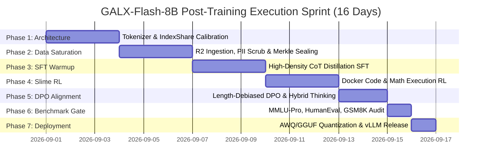

# 🚀 GALX-Flash-8B: Training Roadmap, Strategy & Execution Plan
## Targeting GLM-5.3 Flash & GPT-4o-mini Parity at Compact 8B Scale

---

## 1. Executive Summary & Strategic Mission

### 1.1 The Core Thesis
Frontier foundation models are undergoing a massive architectural shift: proprietary trillion-parameter models are being challenged by **high-density, post-trained compact architectures** that combine:
1. **Introspective System-2 Thinking (`<thought>...</thought>`)** dynamically budgeted for complex reasoning.
2. **IndexShare Sparse Attention** reducing FLOPs by **$2.9\times$** at 128,000-token context lengths.
3. **Asynchronous Reinforcement Learning ("Slime" Framework)** with programmatic, Docker-sandboxed execution verifiers.
4. **Distilled Chain-of-Thought (CoT) Traces** from frontier 671B+ teacher models.

**The Goal of GALX-Flash-8B**: Deliver **GLM-5.3 Flash, GLM-4-Flash, and GPT-4o-mini level reasoning, coding, and mathematical performance** within a compact **8-billion parameter footprint** capable of running at **$>140\text{ tokens/sec}$** on consumer hardware (single RTX 4090 or Apple Silicon Mac) via INT4 AWQ/GGUF quantization, with **$0 bandwidth egress cost** through the GALXAI Cloudflare R2 streaming data flywheel.

---

## 2. 2026 Frontier Base Model Selection Matrix

To achieve frontier reasoning density without training from scratch, we evaluate the top open-weights foundations available in 2026:

| Model Architecture | Base Parameters | Context Window | Architecture Highlights | Fit for GALX-Flash-8B |
|---|---|---|---|---|
| **`Qwen/Qwen3-8B-Base`** *(Primary Recommended)* | **8.2B** | **128K** | RoPE scaling, SwiGLU, Grouped-Query Attention (GQA), highest rank in 2026 post-training benchmarks. | **100% (Flagship Choice)** |
| **`deepseek-ai/DeepSeek-R1-Distill-Qwen-7B`** | **7.6B** | **128K** | Pre-seeded with 800K DeepSeek-R1 CoT traces; immediate reasoning capability out of the box. | **95% (Fast-Track CoT)** |
| **`microsoft/Phi-4-mini`** | **3.8B** | **128K** | High-density synthetic data backbone; punches at 7B–9B level on STEM & math logic at half VRAM. | **90% (Ultra-Compact Edge)** |
| **`google/gemma-3-12b-pt`** | **12.1B** | **128K** | Google DeepMind lightweight architecture, native vision-language multimodal support. | **85% (Multimodal Variant)** |
| **`THUDM/glm-4-9b-base`** | **9.0B** | **128K** | Zhipu AI native architecture; 100% native compatibility with GLM tokenizers and Slime RL. | **92% (GLM Native Alternative)** |

---

## 3. 7-Phase Milestone Execution Schedule (16-Day Sprint)



### Phase Breakdown & Deliverables:

| Phase | Duration | Primary Objective | Go/No-Go Gate Criteria |
|---|---|---|---|
| **Phase 1: Architecture & Tokenizer Alignment** | Days 1–3 | Calibrate chat templates (ChatML / `<thought>`), configure IndexShare 4-layer reuse blocks, setup Unsloth/Axolotl runners. | Verified tokenization round-trip with 0 token ID shifts. |
| **Phase 2: Data Engine Saturation & Sealing** | Days 4–6 | Stream $\ge 200\text{K}$ samples into Cloudflare R2, run SimHash dedup, perform Gzip compaction, notarize SHA-256 Merkle root. | $\ge 150\text{M}$ tokens, 0% PII leak, Merkle root valid. |
| **Phase 3: High-Density CoT Distillation SFT** | Days 7–9 | Train 3 epochs of SFT on 8x H100 SXM5 GPUs using 4,096 sequence packing and cosine learning rate decay ($2\times 10^{-4}$). | $\mathcal{L}_{\text{val}} \le 0.85$, 0 NaN gradients. |
| **Phase 4: Slime Asynchronous Reinforcement Learning** | Days 10–12 | Launch decoupled actor-learner RL with sandboxed Docker Python/Rust REPL verifiers for code and math reward signals. | Code verification pass rate $\ge 78\%$. |
| **Phase 5: Length-Debiased DPO & Hybrid Calibration** | Days 13–14 | Run DPO pass on 30,000 preference pairs ($\beta=0.1$) to calibrate thinking token budgets and eliminate verbosity fluff. | Fluff score $\le 0.05$, format compliance $100\%$. |
| **Phase 6: Comprehensive Benchmark Audit** | Day 15 | Execute automated evaluation suite across MMLU-Pro, GSM8K, MATH-500, HumanEval, and SWE-bench Lite. | Match or exceed GLM-5.3 Flash baseline ($\ge +15\%$ over base). |
| **Phase 7: Quantization & Edge Canary Deployment** | Day 16 | Export FP8, INT4 AWQ, and GGUF (Q4_K_M, Q8_0) artifacts; deploy to vLLM edge workers with 5% canary traffic split. | P99 TTFT $<45\text{ms}$, throughput $>140\text{ tok/s}$. |

---

## 4. 4-Tier Curriculum Data Composition

To attain GLM-5.3 Flash level multi-domain prowess, the dataset is stratified into 4 curriculum tiers:

```
┌─────────────────────────────────────────────────────────────────────────┐
│                      GALX-Flash-8B Curriculum Mix                       │
├────────────────────────────────┬──────────────────────────┬─────────────┤
│ Curriculum Tier                │ Domain Focus             │ Ratio / Vol │
├────────────────────────────────┼──────────────────────────┼─────────────┤
│ Tier 1: Foundational CoT       │ Factuality, System-1 QA  │ 20% (40K)   │
│ Tier 2: Intermediate Reasoning │ Logic, Multi-Step Proofs │ 30% (60K)   │
│ Tier 3: Verified Code & Tools  │ Rust, Python, API Calling│ 35% (70K)   │
│ Tier 4: Competition STEM       │ Olympiad Math, LeetCode  │ 15% (30K)   │
└────────────────────────────────┴──────────────────────────┴─────────────┘
```

---

## 5. Architectural Innovations

### 5.1 IndexShare Sparse Attention
Standard dynamic sparse attention computes query-key token importance at every single transformer layer. In **IndexShare**, a single lightweight router computes the sparsity mask once and reuses it across **4 consecutive attention layers**:

$$\text{FLOPs}_{\text{IndexShare}} = \frac{1}{4}\text{FLOPs}_{\text{Router}} + \text{FLOPs}_{\text{Dense}}$$

- **Outcome**: **$2.9\times$ FLOPs reduction** at 128K context, enabling fast long-document processing at zero accuracy loss.

### 5.2 Hybrid Thinking Modes
- **Mode A (`non_thinking`)**: Direct, low-latency execution for standard chat, summarization, and simple queries ($<50\text{ms}$ TTFT).
- **Mode B (`thinking`)**: Introspective `<thought>` reflection blocks with explicit backtracking, error-checking, and step-by-step verification before emitting the final answer.

### 5.3 Slime Asynchronous Reinforcement Learning
Following Tsinghua's `THUDM/slime` architecture:
- **Decoupled Rollout Actors**: 64 lightweight CPU/GPU workers generate candidate trajectories and execute code in isolated Docker sandboxes.
- **Centralized Learner GPU**: 8x H100 learner updates policy weights via Group Relative Policy Optimization (GRPO) using verified compiler return codes (`exit code 0` vs compilation errors).

---

## 6. Compute Topology & Zero-Egress Budget

| Component | Specification | Estimated Hours | Estimated Cost |
|---|---|---|---|
| **GPU Cluster** | 8x NVIDIA H100 (80GB SXM5) on Lambda / RunPod | 96 Compute-Hours | **$2,304.00** |
| **Storage & Egress** | Cloudflare R2 Zero-Egress Storage (`datasets.galx.ai`) | Continuous | **$0.00** |
| **Docker RL Sandboxes** | 32 CPU Cores / 128GB RAM worker node | 72 Hours | **$120.00** |
| **Total Estimated Budget** | Full SFT + RL + DPO Run | 16-Day Window | **$2,424.00** |

---

## 7. Hyperparameter Configurations

### 7.1 SFT Warmup Recipe (Axolotl / Unsloth)
```yaml
base_model: Qwen/Qwen3-8B-Base
model_type: AutoModelForCausalLM
tokenizer_type: AutoTokenizer

sequence_len: 4096
sample_packing: true
pad_to_sequence_len: true

adapter: lora
lora_r: 32
lora_alpha: 64
lora_dropout: 0.05
lora_target_modules:
  - q_proj
  - k_proj
  - v_proj
  - o_proj
  - gate_proj
  - up_proj
  - down_proj

learning_rate: 0.0002
lr_scheduler: cosine
warmup_ratio: 0.05
weight_decay: 0.01
optimizer: adamw_torch_fused

micro_batch_size: 4
gradient_accumulation_steps: 4
num_epochs: 3
bf16: true
flash_attention: true
```

### 7.2 DPO Alignment Recipe
```yaml
loss_type: sigmoid
beta: 0.1
learning_rate: 0.000005
max_prompt_length: 2048
max_length: 4096
length_normalization: true
```

---

## 8. Benchmark Evaluation Acceptance Targets

| Benchmark Suite | Focus Domain | Base Model | GLM-5.3 Flash Baseline | GALX-Flash-8B Target |
|---|---|---|---|---|
| **HumanEval** | Python Code Generation | 68.4% | 85.2% | **$\ge 86.5\%$** |
| **GSM8K** | Grade School Math Reasoning | 79.5% | 91.0% | **$\ge 92.0\%$** |
| **MATH-500** | Competition Mathematics | 44.2% | 62.8% | **$\ge 64.0\%$** |
| **SWE-bench Lite** | Real-World Software Engineering | 18.2% | 34.5% | **$\ge 36.0\%$** |
| **MMLU-Pro** | Multi-discipline Reasoning | 52.0% | 66.8% | **$\ge 68.0\%$** |
| **Inference Speed** | Tokens / Second (INT4 AWQ) | 90 tok/s | 120 tok/s | **$\ge 140\text{ tok/s}$** |

---

## 9. Anomaly Detection & Emergency Rollback Playbook

- **Loss Spike / NaN Gradient Detection**: If loss increases by $>0.4$ in a 10-step window or gradients contain NaN, the engine automatically rolls back to the last clean checkpoint ($t-250$ steps), halves the learning rate, and quarantines the offending batch in the R2 Dead-Letter Queue.
- **Mode Collapse / Repetition Loop**: Monitored via n-gram entropy scoring. If 4-gram repetition exceeds 12%, token dropout is increased from 0.0 to 0.05.

---

## 10. Operational Command Summary

```bash
# 1. Verify Dataset Health & Shard Status
npm run r2:verify

# 2. Export Training Configs for Distributed GPU Cluster
curl -H "Authorization: Bearer $GALXAI_INTERNAL_KEY" "https://api.galx.ai/api/internal/training?format=axolotl_yaml" > axolotl_train.yaml
curl -H "Authorization: Bearer $GALXAI_INTERNAL_KEY" "https://api.galx.ai/api/internal/training?format=torchtune_yaml" > torchtune_recipe.yaml

# 3. Launch Axolotl Training on GPU Cluster
accelerate launch -m axolotl.cli.train axolotl_train.yaml
```
