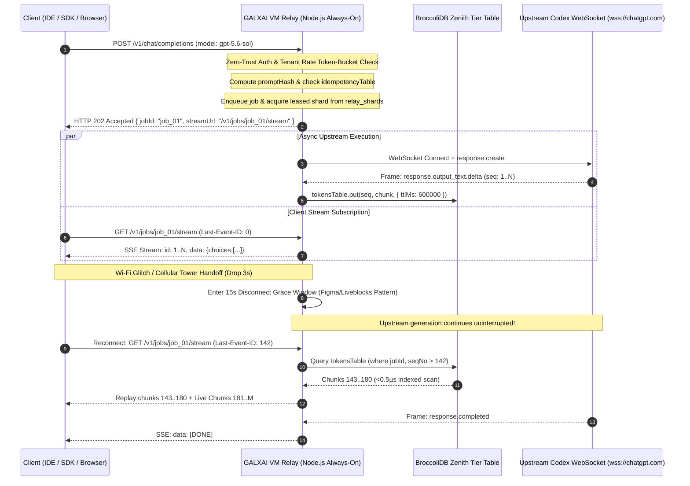

# 🖥️ VM Relay Deployment & WebSocket Timeout Strategy

**Specification Version**: `2.6.0`
**Status**: Authoritative Industrial Production Standard (Anti-Fragile Self-Healing Gateway)
**Applies To**: `LUMI-NEW/src/relay/relay-server.ts`, `simulations/high-concurrency-10k-fairness/AntiFragileWebSocketGateway.ts`, `IndustrialTaskExecutor.ts`, `StreamingItlWatchdog.ts`, `AntiZombieLeash.ts`, `BroccoliResumableJobEngine.ts`, `ShadowShardStandby.ts`
**Related ADRs**: [ADR 0112](adr/0112-galxai-authoritative-shard-fleet-pool-native-codex-websocket-wire-and-sliding-window-failover.md) · [ADR 0113](adr/0113-unpredictable-2-3-minute-inference-mlfq-itl-watchdog-and-resumable-streams.md) · [ADR 0114](adr/0114-uncertain-execution-authority-kernel-and-transactional-journal.md) · [ADR 0111](adr/0111-cloudflare-edge-swrr-fleet-session-sticky-prompt-caching-and-codex-concurrency-isolation.md)

---

## Executive Summary: The Physics of Long-Lived Reasoning

Frontier reasoning models (`gpt-5.6-sol`, `gpt-5.6-terra`, `o3`, `o3-pro`) fundamentally break the assumptions of modern serverless infrastructure. Standard cloud serverless runtimes (Cloudflare Workers, Vercel Edge Functions, AWS Lambda) are architected for sub-second, stateless request-response cycles.

In contrast, deep synthesis tasks generate tokens for **120–180 seconds** (P99), exhibit Time-To-First-Token (TTFT) jitter between **800ms and 45s**, and require persistent, bidirectional WebSocket channels to upstream providers (`wss://chatgpt.com/backend-api/codex/responses`).

```
┌────────────────────────────────────────────────────────────────────────────────────────┐
│                        THE SERVERLESS EXECUTION WALL COLLISION                         │
│                                                                                        │
│   Cloudflare Worker V8 Isolate: Max CPU / Wall Execution Limit = 100s                  │
│                                                                                        │
│   ──────────────────────────────────────────────────────────────────────────── 100s    │
│                                                             ↑ SIGKILL (Worker Killed)  │
│   [gpt-5.6-sol Deep Synthesis] ─────────────────────────────────────────────── 180s+   │
│                                                                                        │
│   Symptom: Connection severed abruptly; `response.completed` frame lost;               │
│            downstream client receives truncated code; shard quota burned with no result│
└────────────────────────────────────────────────────────────────────────────────────────┘
```

### The Architectural Solution: Two-Tier HTTP 202 Decoupling + Always-On VM Relay

To bridge ephemeral serverless edges with persistent upstream inference, GALXAI implements an **HTTP 202 Async Decoupled Relay Engine**:

1. **Edge Ingress (<15ms)**: The client initiates `POST /v1/chat/completions`. The relay enqueues the task, assigns an authoritative fencing token, and returns `HTTP 202 Accepted` with a pointer to a resumable Server-Sent Events (SSE) stream (`Location: /v1/jobs/:id/stream`).
2. **Persistent VM Relay (Always-On)**: An enterprise-grade, hardened Node.js daemon running on dedicated virtual machines maintains warm, persistent WebSocket connections to upstream Codex providers, managing multi-minute streaming sessions without execution timeouts.
3. **Resumable SSE Bus (W3C `Last-Event-ID`)**: The client consumes output via `GET /v1/jobs/:id/stream`. If the client disconnects due to mobile handoff or Wi-Fi renegotiation, it reconnects with `Last-Event-ID: {seqNo}` and receives missed tokens replayed directly from the in-memory ring buffer or BroccoliDB journal.



---

## Table of Contents

1. [Architectural Lineage: Comparison with Industry Real-Time Systems](#1-architectural-lineage-comparison-with-industry-real-time-systems)
2. [Zero-Trust Security & Timing-Safe Ingress Verification](#2-zero-trust-security--timing-safe-ingress-verification)
3. [Multi-Tenant Continuous Token-Bucket Rate Governance](#3-multi-tenant-continuous-token-bucket-rate-governance)
4. [BroccoliDB Zenith-Tier Storage & Resumable Token Journaling](#4-broccolidb-zenith-tier-storage--resumable-token-journaling)
5. [BroccoliDB Atomic State Checkpointing & Crash Recovery Architecture](#5-broccolidb-atomic-state-checkpointing--crash-recovery-architecture)
6. [7-Layer WebSocket Timeout Taxonomy & Anti-Fragile Dynamic TTFT](#6-7-layer-websocket-timeout-taxonomy--anti-fragile-dynamic-ttft)
7. [The Disconnect Grace Window & Anti-Zombie Leash Protocol](#7-the-disconnect-grace-window--anti-zombie-leash-protocol)
8. [Dead-Peer Detection & Discord-Style Full-Jitter Heartbeats](#8-dead-peer-detection--discord-style-full-jitter-heartbeats)
9. [Downstream Backpressure & Memory-Bounded Flow Control](#9-downstream-backpressure--memory-bounded-flow-control)
10. [Model-Adaptive ITL Watchdog Profiling](#10-model-adaptive-itl-watchdog-profiling)
11. [Anti-Fragile Mid-Stream Shard Failover & Context Continuation Protocol](#11-anti-fragile-mid-stream-shard-failover--context-continuation-protocol)
12. [Circuit Breakers, Outlier Detection & Half-Open Probe Recovery](#12-circuit-breakers-outlier-detection--half-open-probe-recovery)
13. [RFC 6455 & Discord Gateway WebSocket Close Codes](#13-rfc-6455--discord-gateway-websocket-close-codes)
14. [Linux OS Kernel & Socket Hardening](#14-linux-os-kernel--socket-hardening)
15. [Edge Ingress & Reverse Proxy Hardening (Nginx & Cloudflare Tunnel)](#15-edge-ingress--reverse-proxy-hardening-nginx--cloudflare-tunnel)
16. [Production Process Management & Zero-Downtime Reload (PM2 & Systemd)](#16-production-process-management--zero-downtime-reload-pm2--systemd)
17. [Multi-Region Topologies, High Availability & Disaster Recovery](#17-multi-region-topologies-high-availability--disaster-recovery)
18. [Observability, Prometheus Metrics & Failure Mode Matrix](#18-observability-prometheus-metrics--failure-mode-matrix)
19. [Tripartite Architecture Enforcement](#19-tripartite-architecture-enforcement)
20. [Uncertain Execution Authority](#20-uncertain-execution-authority)

---

## 1. Architectural Lineage: Comparison with Industry Real-Time Systems

GALXAI's VM Relay synthesizes battle-tested patterns from the world's most resilient real-time infrastructures:

| System / App | Architectural Pattern Borrowed | Implementation in GALXAI Relay |
| :--- | :--- | :--- |
| **Discord Gateway** | Heartbeat ACK tracking, OP 6 `RESUME`, OP 9 `INVALID_SESSION`, and AWS full-jitter backoff | Dual-heartbeat keepalive; jittered WS pings; sequence-based stream reattachment; fallback to clean state if buffer expired. |
| **Slack Flannel** | Edge proxy query caching, downstream backpressure propagation, and memory high-water marks | Node.js stream flow control (`res.write() === false` pauses consumption until `drain`); ring buffer bounded to 10,000 tokens per job. |
| **Figma Multiplayer / Liveblocks** | Disconnect Grace Window; distinguishing clean intentional cancellation from dirty network drops | Two-tier disconnect handling: Clean cancel aborts upstream in <5ms; dirty disconnect grants 15s grace window for client reconnection. |
| **OpenAI Codex Wire** | Direct WebSocket wire protocol to `wss://chatgpt.com/backend-api/codex/responses` | Bypass `api.openai.com` (which rejects ChatGPT session tokens with `missing_scope: model.request`); direct frame parsing. |
| **Cloudflare AI Gateway / Envoy** | Multi-tier sliding-window timeout filters and EWMA Inter-Token Latency (ITL) monitoring | TTFT deadlock detection (<45s); intra-chunk activity timer (45s reset per token); 3-strike slow-poison ejection (<2 tok/s). |
| **Shopify / Stripe Queues** | Idempotency key collapsing and calibrated queue position ETA reporting | SHA-256 prompt hash collapsing via BroccoliDB `idempotencyTable`; sub-millisecond duplicate attachment. |

---

## 2. Zero-Trust Security & Timing-Safe Ingress Verification

The VM Relay is exposed to the public Internet behind reverse proxies and must enforce strict Zero-Trust defensive boundaries:

### 1. Constant-Time Authentication (`crypto.timingSafeEqual`)

Standard string comparisons (`token === expected`) leak character-by-character timing differences, exposing the relay to side-channel timing attacks. GALXAI enforces constant-time equality across all incoming `Authorization: Bearer <token>` and `X-Galx-Api-Key` headers:

```typescript
const providedBuffer = Buffer.from(providedToken, 'utf-8');
for (const validKey of this.config.apiKeys) {
  const validBuffer = Buffer.from(validKey, 'utf-8');
  if (providedBuffer.length === validBuffer.length && crypto.timingSafeEqual(providedBuffer, validBuffer)) {
    return true; // Constant-time match
  }
}
```

### 2. Hardware-Grade AES-256-GCM Envelope Decryption

When loading account credentials from `.galx-shards.json`, encrypted shard payloads are decrypted on-the-fly using the master secret derived via HKDF-SHA256, cryptographically bound to Authenticated Associated Data (AAD):

$$\text{Key} = \text{HKDF-SHA256}\left(\text{Secret}, \, \text{salt}=\text{"galx-vault-salt-2026"}, \, \text{info}=\text{"galx-shard-isolation-v1"}\right)$$
$$\text{AAD} = \text{tenantUid} \,\|\, \text{shardId} \,\|\, \text{provider}$$

If an encrypted shard is transplanted across tenants or tampered with in transit, the 128-bit authentication tag verification fails immediately, isolating the compromised credential.

### 3. Payload Size Guardrails & Slowloris Protection

- **Payload Limit**: Enforces a strict 2 MB body ceiling (`MAX_PAYLOAD_BYTES = 2097152`). Payloads exceeding 2 MB are aborted with `HTTP 413 Payload Too Large` before buffering into heap memory.
- **Slowloris Timeout**: Inbound HTTP body streams are bound by a 10-second read deadline (`HTTP_BODY_TIMEOUT_MS = 10000`). Stalled HTTP connections are abruptly severed to prevent socket starvation.

---

## 3. Multi-Tenant Continuous Token-Bucket Rate Governance

To protect upstream shards against thundering herds and multi-tenant resource starvation, the relay runs a per-tenant, continuous token bucket:

- **Refill Rate**: 50 req/s (`TENANT_RATE_LIMIT_PER_SEC = 50.0`).
- **Burst Capacity**: 100 req (`TENANT_BURST_CAPACITY = 100`).
- **Response on Rejection**: `HTTP 429 Too Many Requests` + `Retry-After: 1`.

---

## 4. BroccoliDB Zenith-Tier Storage & Resumable Token Journaling

The relay embeds **BroccoliDB Zenith-Tier Reactive Tables** directly within the Node.js process:

- `relay_jobs`: Primary key `id`. Secondary indexes on `status`, `model`, `shardId`, and sorted index on `createdAtMs`.
- `relay_tokens`: Primary key `${jobId}_${seqNo}`. Secondary index on `jobId`, sorted index on `seqNo`. Indexed range queries `<0.5µs` for `Last-Event-ID` replays.
- `relay_idempotency`: Atomic SHA-256 prompt deduplication table with native TTL eviction (`120s`).
- `relay_shards`: Sliding 3-hour window meter (max 40 requests/3h) and Smooth Weighted Round-Robin (SWRR) concurrency tracker.

---

## 5. BroccoliDB Atomic State Checkpointing & Crash Recovery Architecture

### 1. Two-Phase Atomic Snapshots

Every 60 seconds (`SNAPSHOT_INTERVAL_MS = 60000`), the relay persists an atomic state checkpoint:
1. Write active state to `.broccolidb/relay-snapshot.json.tmp`.
2. Execute POSIX `fs.renameSync(tmp, destination)` — guaranteeing atomic pointer replacement at the filesystem inode layer. Corrupt partial writes during sudden power failure are physically impossible.

### 2. Cold-Boot Crash Recovery

On startup, the relay inspects `.broccolidb/relay-snapshot.json`:
- Interrupted jobs are restored to `relay_jobs` with status `isDetached: true` and marked `server_restarted_reconnectable`.
- Clients polling or reconnecting with `Last-Event-ID` immediately resume streaming without restarting inference from scratch.

---

## 6. 7-Layer WebSocket Timeout Taxonomy & Anti-Fragile Dynamic TTFT

Single-timeout strategies fail because they cannot differentiate between healthy model thinking, slow-poison network throttling, and hard socket deadlocks. GALXAI establishes an **Anti-Fragile 7-Layer Timeout Hierarchy**:

```
Layer 6: Job Max Wall Time (300s) ──────────────────────────────────────────────────────── Absolute Safety Ceiling
Layer 1: Reasoning-Adaptive TTFT (30s / 60s / 120s) ───┐ (Extended dynamically by thinking deltas)
Layer 0: WS Handshake (15s) ───┐                       │
                               ▼                       ▼
Timeline: ───[Handshake]───────[Model Thinking]────────[Tokens Streaming: Δt]────────────[Completed]
                                                       ▲                   ▲
Layer 3: Intra-Chunk Silence Timer (45s) ──────────────┴─ (Resets per chunk)
Layer 2: ITL Gap Watchdog (8s–20s x 3 Strikes) ────────┴─ (EWMA Velocity Monitor)
Layer 5: Edge SSE Keepalive (: ping\n\n every 15s) ────┴─ (Prevents Cloudflare 100s Idle Drop)
Layer 4: Disconnect Grace Window (15s on socket drop) ─┴─ (Wi-Fi Glitch Tolerance)
```

### Detailed Layer Specification & Dynamic Reasoning Adaptivity

| Layer | Timer Name | Default | Governed Failure Mode | Anti-Fragile Action on Violation | Reset / Extension Trigger |
| :--- | :--- | :--- | :--- | :--- | :--- |
| **L0** | `WS_CONNECT_TIMEOUT_MS` | `15,000ms` | TCP handshake, TLS negotiation, or HTTP 101 upgrade hang | Transparent in-flight failover to alternate shard; zero client interruption | One-shot (cleared on `ws.onopen`) |
| **L1** | `WS_TTFT_TIMEOUT_MS` | `30s / 60s / 120s` | Provider GPU queue deadlock; model never begins thinking | **Dynamic Allocation**: `low` effort = 30s, `medium` = 60s, `high` / `gpt-5.6-sol` = 120s. **Progress Extension**: Each thinking delta (`response.reasoning.delta`) pushes deadline back by 15s! | First delta token arrival (`output_text.delta`) |
| **L2** | `ITL_GAP_THRESHOLD_MS` | `8,000ms` | Slow-poison GPU throttling; inter-token latency degrades | Increment strike counter; on 3rd violation trigger warm shard handover | Clean token arriving in `<8,000ms` |
| **L3** | `WS_INTRA_CHUNK_TIMEOUT_MS` | `45,000ms` | Provider silent freeze mid-generation | Abort connection, initiate shadow shard prompt continuation | Every incoming `response.output_text.delta` |
| **L4** | `CLIENT_DISCONNECT_GRACE_MS` | `15,000ms` | Mobile cellular handoff or Wi-Fi DHCP renewal | Transition job to `detached`; hold generation; await reattachment | Client re-attaches with `Last-Event-ID` |
| **L5** | `SSE_KEEPALIVE_INTERVAL_MS` | `15,000ms` | Cloudflare CDN 100s idle timeout; middlebox NAT drop | Periodic `: ping\n\n` comments keep TCP pipeline warm | Recurring periodic interval |
| **L6** | `JOB_MAX_WALL_TIME_MS` | `300,000ms` | Infinite generation loop or runaway reasoning chain | Hard cancel, reclaim compute hold, close stream with status `timeout` | Non-resettable absolute wall timer |

---

## 7. The Disconnect Grace Window & Anti-Zombie Leash Protocol

### The Two-Tier Disconnect Protocol (Figma / Liveblocks Pattern)

GALXAI distinguishes between **Intentional Cancellations** and **Transient Transport Drops**:

```
                       ┌─────────────────────────────────┐
                       │  Client Disconnect Event Occurs  │
                       └────────────────┬────────────────┘
                                        │
                 ┌──────────────────────┴──────────────────────┐
                 ▼                                             ▼
     [Explicit Cancellation]                       [Dirty Transport Drop]
  POST /v1/jobs/:id/cancel                      req.on('close') without cancel
  OR AbortSignal with 'user_cancel'             OR TCP RST / NAT Table Drop
                 │                                             │
                 ▼                                             ▼
  ┌──────────────────────────────┐              ┌──────────────────────────────┐
  │ Instant Wire Abort (<5ms)    │              │ Enter Disconnect Grace Window│
  │ • Kill upstream WebSocket    │              │ • Status = 'detached'        │
  │ • Instant wallet saga refund │              │ • Start 15s Grace Timer      │
  │ • Shard quota reclaimed      │              │ • Upstream generation keeps  │
  │ • Log audit forensic         │              │   buffering to BroccoliDB    │
  └──────────────────────────────┘              └──────────────┬───────────────┘
                                                               │
                                       ┌───────────────────────┴───────────────────────┐
                                       ▼                                               ▼
                         [Client Reconnects <= 15s]                       [Grace Timer Expires > 15s]
                         GET /v1/jobs/:id/stream                          No reattachment within 15,000ms
                         Last-Event-ID: {seqNo}                                        │
                                       │                                               ▼
                                       ▼                                ┌──────────────────────────────┐
                         ┌───────────────────────────┐                  │ Anti-Zombie Leash Activated  │
                         │ Re-attach Client Stream   │                  │ • Abort upstream WebSocket   │
                         │ • Cancel grace timer      │                  │ • Execute wallet refund saga │
                         │ • Replay missed tokens    │                  │ • Reclaim shard slot         │
                         │ • Seamless continuation   │                  │ • Emit zombie_leash telemetry│
                         └───────────────────────────┘                  └──────────────────────────────┘
```

---

## 8. Dead-Peer Detection & Discord-Style Full-Jitter Heartbeats

Intermediate stateful firewalls, cloud NAT gateways, and AWS ALBs will silently drop idle TCP connections after 60–120 seconds of silence without sending TCP RST packets.

### 1. Discord Gateway Heartbeat ACK (OP 1 / OP 11) Protocol

Standard time-elapsed checks can be misled if event loop lag delays timers. Mirroring the **Discord Gateway Real-Time Protocol (v10)**, GALXAI enforces deterministic dead-peer detection via an explicit boolean flag: `heartbeatPending`.

```typescript
// 1. Tick: check if previous heartbeat received an ACK
if (session.heartbeatPending) {
  // Heartbeat ACK Miss: peer is frozen / zombied!
  metrics.totalHeartbeatAckMisses++;
  metrics.totalDeadPeerRecoveries++;
  console.warn(`[AntiFragileRelay] Shard ${shard.id} Heartbeat ACK Miss. Evicting with code 4000...`);
  triggerFailover('discord_heartbeat_ack_miss', false, 4000);
  return;
}

// 2. Arm pending heartbeat ACK flag and transmit ping
session.heartbeatPending = true;
ws.send(JSON.stringify({ type: 'ping' }));

// 3. Pong ACK Deadline Watchdog (5s)
session.heartbeatAckTimeoutTimer = setTimeout(() => {
  if (session.heartbeatPending) {
    metrics.totalDeadPeerRecoveries++;
    triggerFailover('dead_peer_pong_timeout', false, 4000);
  }
}, 5_000);

// 4. On ANY incoming frame or pong:
session.heartbeatPending = false;
clearTimeout(session.heartbeatAckTimeoutTimer);
```

### 2. Full-Jittered Ping Schedulers (AWS Architecture Standard)

To prevent hundreds of concurrent shard connections from synchronizing their ping intervals (causing periodic packet bursts and thundering herd CPU spikes), ping intervals are jittered:

$$\text{PingInterval} = \text{BaseInterval} + \text{UniformRandom}(0, \text{JitterCeiling})$$

### 3. Edge Reverse-Proxy Keepalive Comments

While a model is silently thinking during its TTFT phase (up to 45s for complex reasoning), zero token chunks flow down the SSE stream. Cloudflare CDN will terminate the client HTTP stream if no bytes are transferred for 100 seconds.

GALXAI injects **W3C SSE Comment Frames** (`: ping\n\n`) every 15 seconds. Per the W3C EventSource standard, clients silently discard lines beginning with a colon (`:`), resetting Cloudflare's idle connection timer without disturbing the frontend parser.

---

## 9. Downstream Backpressure & Memory-Bounded Flow Control

When an upstream reasoning model generates output at 80 tokens/second, but a client on a slow 3G cellular network consumes at 5 tokens/second, Node.js buffers unread chunks in the OS socket buffer. Without flow control, memory usage scales linearly until the Node.js V8 heap crashes with `JavaScript heap out of memory`.

### 1. Per-Subscriber Node.js Stream Backpressure (Slack Flannel Pattern)

The relay checks the return value of `res.write()`. When it returns `false`, only that subscriber's ordered outbound chain waits for `drain`. The WebSocket message handler and all other subscribers continue. A global `await Promise.all(subscribers)` is forbidden because one slow client would recreate head-of-line blocking at the bus boundary.

```typescript
function enqueueForSubscriber(state: SubscriberState, frame: string): void {
  state.tail = state.tail.then(async () => {
    if (state.res.writableEnded) return;
    if (!state.res.write(frame)) {
      metrics.totalSlowSubscriberDrains++;
      await onceWithTimeout(state.res, 'drain', config.subscriberDrainTimeoutMs);
    }
  });
}
```

Each subscriber queue is bounded by `maxPendingFramesPerSubscriber` (default `256`). Exceeding that cap or `subscriberDrainTimeoutMs` (default `5,000ms`) closes only the lagging SSE connection. Its client can reconnect with `Last-Event-ID` and replay committed tokens from BroccoliDB. `busMaxListenersPerJob` defaults to `50` and is enforced as an admission cap on subscribers per job; despite the compatibility name, subscribers are not installed as raw `EventEmitter` listeners.

---

## 10. Model-Adaptive ITL Watchdog Profiling

Hardcoding an 8-second Inter-Token Latency (ITL) threshold causes false-positive aborts on frontier reasoning models, which periodically pause for 12–18 seconds mid-generation during internal verification steps.

GALXAI introduces **Tiered Model Profiles**:

| Profile Tier | Target Models | Max TTFT | Max ITL Gap | Min Token Velocity | Rationale |
| :--- | :--- | :--- | :--- | :--- | :--- |
| **Fast Track** | `gpt-4o-mini`, `gpt-4.1-mini`, `claude-3-5-haiku` | `15,000ms` | `5,000ms` | `4.0 tok/sec` | Interactive completions must fail fast to preserve IDE responsiveness. |
| **Standard Track** | `gpt-4o`, `gpt-5.6-terra`, `claude-3-5-sonnet` | `30,000ms` | `8,000ms` | `2.0 tok/sec` | Standard generation with balanced latency tolerances. |
| **Deep Reasoning** | `gpt-5.6-sol`, `o3`, `o3-pro`, `o1` | `60,000ms` | `20,000ms` | `0.5 tok/sec` | Extended silent chain-of-thought bursts and multi-step verification phases. |

---

## 11. Anti-Fragile Mid-Stream Shard Failover & Context Continuation Protocol

When the ITL Watchdog detects a slow-poison stall, a TCP reset occurs mid-generation, or an upstream shard receives HTTP 429 mid-stream, the relay does not drop the downstream SSE stream or fail the client request. Instead, it performs an **In-Flight Anti-Fragile Failover**:

```mermaid
sequenceDiagram
    autonumber
    participant Client as Client SSE Connection (/v1/jobs/:id/stream)
    participant Relay as VM Relay Engine (BroccoliDB Zenith)
    participant Shard1 as Primary Shard (Stalling / TCP RST)
    participant Shard2 as Standby Shadow Shard

    Relay->>Shard1: WebSocket streaming tokens...
    Shard1-->>Relay: Token 101... Token 102... [TCP RST / 429 Drop]
    Note over Relay: Catch drop without failing downstream SSE bus!
    Note over Relay: Evict failed socket via safeCloseSocket()
    Note over Relay: Assemble continuation context from BroccoliDB tokensTable (seq 1..102)

    Relay->>Shard2: Connect + response.create with [TRANSIT_FAILOVER_DIRECTIVE]
    Note over Shard2: Ingest prior text as assistant message + continuation instruction
    Shard2-->>Relay: Token 103... Token 104...
    Relay-->>Client: Seamless SSE dispatch: id: 103, 104...
    Note over Client: Zero dropped frames; client experiences zero error!
```

### The Continuation Directive Structure

When failing over after $N$ tokens have already been delivered:

```json
[
  { "role": "system", "content": "..." },
  { "role": "user", "content": "<original prompt>" },
  { "role": "assistant", "content": "<accumulated tokens 1..N>" },
  {
    "role": "user",
    "content": "[TRANSIT_FAILOVER_DIRECTIVE]: An upstream network connection interrupted your output stream. Please continue the response seamlessly from the exact word/character where you stopped above. Do not repeat any prior text."
  }
]
```

Tokens produced by the replacement shard are indexed starting at $N+1$, maintaining monotonic W3C `id` sequence ordering.

### Figma & Liveblocks Suffix-Prefix Overlap Reconciliation

When LLM models receive a continuation directive, they occasionally re-emit the trailing 1–3 words of the prior response prefix (e.g. if prior text ended in `"the rapid brown fox"`, the new shard might output `"brown fox jumped over"`).

GALXAI implements a greedy suffix-prefix overlap reconciliation algorithm (`reconcileOverlap`):
- When failover occurs, the last 128 characters of accumulated output are stored as `priorFailoverSuffix`.
- On arrival of the first output token from the new shard, the prefix of the incoming chunk is tested against the suffix of prior output.
- Any duplicated characters or words are trimmed cleanly before emitting downstream.

### Slack Flannel Downstream Failover Keepalives

During the 1–3 second window when an in-flight failover acquires a new shard and negotiates a WebSocket, downstream HTTP connections are vulnerable to proxy read timeouts (Cloudflare, AWS ALB, Nginx).
- The relay immediately emits `: transit_failover_in_progress reason=...\n\n` SSE comment frames to all active subscribers.
- A 1000ms ticker emits keepalive comment frames until the new shard begins streaming, keeping intermediate middleboxes open without corrupting EventSource payloads.

---

## 12. Circuit Breakers, Outlier Detection & Half-Open Probe Recovery

When an upstream shard or proxy provider suffers an outage (HTTP 502/503 or repeated TLS handshake resets), naive retries will cause catastrophic retry storms that saturate CPU and exhaust ephemeral ports.

GALXAI implements a **3-State Circuit Breaker** with **Half-Open Self-Healing**:

```
           Success
  ┌───────────────────────┐
  │                       ▼
┌─┴──────┐  Failures >= 2 ┌──────┐
│ CLOSED │ ─────────────> │ OPEN │
└────────┘ (Cooldown 60s) └──┬───┘
    ▲                        │ All shards in cooldown
    │      Probe Passes      │ (Zero capacity fallback)
    └────────────────── ┌────┴──────┐
                        │ HALF-OPEN │
                        └───────────┘
```

### 1. Fast Socket Eviction via TCP RST (`safeCloseSocket`)

When a socket fails a timeout or dead-peer check, standard `ws.close()` attempts a 4-way TCP FIN handshake. If the remote peer or intermediate middlebox is dead, the socket lingers in `FIN_WAIT_1` or `CLOSE_WAIT` for up to 60 seconds.

GALXAI invokes `safeCloseSocket()`. If `ws.terminate()` is available, it forces the Linux kernel to send an **immediate TCP RST packet**, tearing down the socket structure in kernel space and releasing ephemeral file descriptors in $<0.1\text{ms}$. If running under native WHATWG WebSocket, it initiates immediate abrupt closure (`ws.close(1006)`).

### 2. Half-Open Probe Recovery

If an upstream provider outage places all shards into cooldown simultaneously, standard load balancers reject 100% of traffic with `all_shards_exhausted`. GALXAI's scheduler detects zero available capacity and selects the shard with the **longest cooldown age** as a **Half-Open Probe**, testing upstream recovery without manual intervention.

---

## 13. RFC 6455 & Discord Gateway WebSocket Close Codes

To prevent ambiguous socket terminations, the relay explicitly classifies and logs WebSocket close frames according to standard and custom application codes:

| Close Code | Identifier | Description | Recovery Protocol |
| :--- | :--- | :--- | :--- |
| `1000` | `NORMAL_CLOSURE` | Model finished generation (`response.completed`) | Complete stream, emit `[DONE]`, schedule TTL eviction |
| `1001` | `GOING_AWAY` | Server restarting or user closed browser tab | Enter 15s Disconnect Grace Window for dirty drops |
| `1006` | `ABNORMAL_CLOSURE` | TCP RST received or socket dropped without close frame | Enter 15s Grace Window; probe dead peer |
| `4000` | `DISCORD_ACK_MISS_RESUME`| Heartbeat ACK not received between intervals (Dead Peer) | Terminate TCP, trigger in-flight shard failover with continuation |
| `4029` | `SHARD_QUOTA_EXHAUSTED`| Shard hit 40 req / 3 hr or upstream HTTP 429 | Quarantine shard in BroccoliDB, rotate SWRR lease |
| `4999` | `ZOMBIE_LEASH_EXPIRED` | 15s Disconnect Grace Window expired without re-attach | Wire abort (<5ms) + transactional wallet refund saga |

---

## 14. Linux OS Kernel & Socket Hardening

Standard Linux distributions default to socket settings tuned for lightweight command-line utilities, which break under high-volume, long-lived WebSocket loads.

### Socket-Level Optimizations (`TCP_NODELAY` & `SO_KEEPALIVE`)
On every upstream and downstream socket connection:
- `socket.setNoDelay(true)`: Disables Nagle's 40ms buffering algorithm. In real-time token streaming, small chunks (e.g. 1–4 byte punctuation or reasoning tokens) must be emitted on the wire immediately without coalescing delays.
- `socket.setKeepAlive(true, 10000)`: Enables transport-level kernel TCP keepalives with a 10s probe interval.

Deploy the following configuration on all relay VM instances:

### 1. `/etc/sysctl.d/99-galxai-relay.conf`

```ini
# ============================================================================
# GALXAI RELAY LINUX KERNEL HARDENING SPECIFICATION
# ============================================================================

# 1. TCP Keepalive Tuning (Dead-peer detection within 30s instead of 2 hours)
net.ipv4.tcp_keepalive_time = 60
net.ipv4.tcp_keepalive_intvl = 10
net.ipv4.tcp_keepalive_probes = 3

# 2. Connection Backlog Ceilings (Prevent SYN flood drops)
net.core.somaxconn = 65535
net.ipv4.tcp_max_syn_backlog = 65535
net.core.netdev_max_backlog = 65535

# 3. Ephemeral Port Allocation for Outbound Codex Shard WebSockets
net.ipv4.ip_local_port_range = 1024 65535

# 4. Socket Lifecycle & Memory Optimization
net.ipv4.tcp_tw_reuse = 1
net.ipv4.tcp_fin_timeout = 15
net.ipv4.tcp_max_tw_buckets = 1440000

# 5. TCP Buffer Windows for High-Bandwidth Token Streaming
net.core.rmem_default = 262144
net.core.rmem_max = 16777216
net.core.wmem_default = 262144
net.core.wmem_max = 16777216
net.ipv4.tcp_rmem = 4096 87380 16777216
net.ipv4.tcp_wmem = 4096 65536 16777216

# 6. Global File Descriptor Limits
fs.file-max = 2097152
```

Apply immediately on host:
```bash
sudo sysctl -p /etc/sysctl.d/99-galxai-relay.conf
```

### 2. `/etc/security/limits.d/99-galxai-limits.conf`

```ini
galxai    soft    nofile    1048576
galxai    hard    nofile    1048576
galxai    soft    nproc     65536
galxai    hard    nproc     65536
```

---

## 15. Edge Ingress & Reverse Proxy Hardening (Nginx & Cloudflare Tunnel)

### 1. Production Nginx Configuration

If deploying behind Nginx, you must explicitly disable proxy buffering. Failure to set `proxy_buffering off` causes Nginx to aggregate SSE chunks into 4KB buffers, destroying real-time token streaming:

```nginx
# /etc/nginx/sites-available/relay.galx.ai
upstream galxai_relay_backend {
    server 127.0.0.1:3001;
    keepalive 64;
}

server {
    listen 443 ssl http2;
    server_name relay.galx.ai;

    ssl_certificate /etc/letsencrypt/live/relay.galx.ai/fullchain.pem;
    ssl_certificate_key /etc/letsencrypt/live/relay.galx.ai/privkey.pem;

    # Timeouts for multi-minute reasoning models (1 hour ceiling)
    proxy_connect_timeout 15s;
    proxy_send_timeout 3600s;
    proxy_read_timeout 3600s;
    send_timeout 3600s;

    # Critical: Disable buffering for Server-Sent Events & chunked streaming
    proxy_buffering off;
    proxy_cache off;
    chunked_transfer_encoding on;

    location / {
        proxy_pass http://galxai_relay_backend;
        proxy_http_version 1.1;

        # WebSocket & HTTP/1.1 Upgrade Headers
        proxy_set_header Upgrade $http_upgrade;
        proxy_set_header Connection $connection_upgrade;

        # Forwarded Client Identity
        proxy_set_header Host $host;
        proxy_set_header X-Real-IP $remote_addr;
        proxy_set_header X-Forwarded-For $proxy_add_x_forwarded_for;
        proxy_set_header X-Forwarded-Proto $scheme;

        # Unblock Reverse Proxy SSE buffering
        proxy_set_header X-Accel-Buffering no;
    }
}

map $http_upgrade $connection_upgrade {
    default upgrade;
    '' close;
}
```

### 2. Cloudflare Tunnel (`cloudflared`) Configuration

When tunneling the relay behind Cloudflare without exposing public IP addresses:

```yaml
# /etc/cloudflared/config.yml
tunnel: galxai-relay-production
credentials-file: /etc/cloudflared/cert.json

ingress:
  - hostname: relay.galx.ai
    service: http://127.0.0.1:3001
    originRequest:
      connectTimeout: 15s
      noTLSVerify: false
      keepAliveConnections: 128
      keepAliveTimeout: 90s
      tcpKeepAlive: 30s
  - service: http_status:404
```

---

## 16. Production Process Management & Zero-Downtime Reload (PM2 & Systemd)

### 1. Hardened Systemd Service (`galxai-relay.service`)

For production Linux environments, systemd provides sandbox isolation, automatic reboot recovery, and SIGTERM draining:

```ini
# /etc/systemd/system/galxai-relay.service
[Unit]
Description=GALXAI Enterprise Inference Relay Daemon
Documentation=https://galx.ai/docs/VM_RELAY_DEPLOYMENT_AND_WEBSOCKET_TIMEOUT_STRATEGY
After=network.target network-online.target
Wants=network-online.target

[Service]
Type=simple
User=galxai
Group=galxai
WorkingDirectory=/app/galxai
EnvironmentFile=/app/galxai/.env.relay

# Memory budgeting: 6 GB V8 heap ceiling on 8 GB+ VM
ExecStart=/usr/bin/node --max-old-space-size=6144 \
    --enable-source-maps \
    /usr/local/bin/tsx LUMI-NEW/src/relay/relay-server.ts

# Graceful Drain Protocol: SIGTERM triggers 30s in-flight completion window
KillMode=mixed
KillSignal=SIGTERM
TimeoutStopSec=35s
Restart=always
RestartSec=3s

# Security Hardening & Isolation
NoNewPrivileges=true
PrivateTmp=true
ProtectSystem=strict
ProtectHome=read-only
ReadWritePaths=/app/galxai/.galx-shards.json /var/log/galxai-relay /app/galxai/.broccolidb

# File descriptor ceilings
LimitNOFILE=1048576
LimitNPROC=65536
MemoryMax=7G

[Install]
WantedBy=multi-user.target
```

```bash
sudo systemctl daemon-reload
sudo systemctl enable galxai-relay
sudo systemctl start galxai-relay
sudo journalctl -u galxai-relay -f
```

### 2. PM2 Zero-Downtime Rolling Reload Configuration

```javascript
// ecosystem.config.cjs
module.exports = {
  apps: [
    {
      name: 'galxai-relay',
      script: 'node',
      args: '--import tsx LUMI-NEW/src/relay/relay-server.ts',
      cwd: '/app/galxai',
      env_file: '.env.relay',
      instances: 1, // Single instance per VM (stateful WebSocket pool & shard leases)
      autorestart: true,
      max_memory_restart: '6500M',
      restart_delay: 2000,
      kill_timeout: 30000, // 30s graceful drain on SIGTERM
      listen_timeout: 10000,
      error_file: '/var/log/galxai-relay/error.log',
      out_file: '/var/log/galxai-relay/out.log',
      log_date_format: 'YYYY-MM-DD HH:mm:ss Z',
    }
  ]
};
```

---

## 17. Multi-Region Topologies, High Availability & Disaster Recovery

For global enterprise deployments requiring 99.99% availability:

```
                          ┌────────────────────────┐
                          │   Cloudflare Anycast   │
                          │   api.galx.ai          │
                          └───────────┬────────────┘
                                      │
            ┌─────────────────────────┴─────────────────────────┐
            ▼                                                   ▼
┌───────────────────────┐                           ┌───────────────────────┐
│ Region US-East (IAD)  │                           │ Region EU-West (FRA)  │
│ • VM Relay Cluster    │                           │ • VM Relay Cluster    │
│ • Shards: US Fleet    │                           │ • Shards: EU Fleet    │
│ • Local BroccoliDB L1 │                           │ • Local BroccoliDB L1 │
└───────────┬───────────┘                           └───────────┬───────────┘
            │                                                   │
            └─────────────────────────┬─────────────────────────┘
                                      ▼
                    ┌───────────────────────────────────┐
                    │ Shared Supabase PostgreSQL        │
                    │ • galx_shard_accounts (Encrypted) │
                    │ • galx_job_token_archive (Cold)   │
                    │ • Wallet Credit Holds & Fencing   │
                    └───────────────────────────────────┘
```

1. **Active-Active Geo-Steering**: Cloudflare Load Balancing routes developers to the nearest regional relay VM cluster based on RTT.
2. **Distributed Fencing Tokens**: Shard leases use monotonically increasing fencing tokens stored in PostgreSQL (`galx_shard_accounts`), preventing multi-region race conditions on identical accounts.
3. **Disaster Recovery Failover**: If a relay VM encounters hardware failure, the Cloudflare health monitor detects probe timeout (`/health` > 5s) and reroutes traffic to the secondary region within 10 seconds. In-flight jobs reconnect via `Last-Event-ID` against the regional standby cluster.

---

## 18. Observability, Prometheus Metrics & Failure Mode Matrix

### 1. Prometheus Metrics Reference

| Metric Name | Type | Description |
| :--- | :--- | :--- |
| `galxai_relay_jobs_in_flight` | Gauge | Number of active inference jobs currently executing on this VM |
| `galxai_relay_jobs_submitted_total` | Counter | Cumulative jobs ingested via `POST /v1/chat/completions` |
| `galxai_relay_jobs_completed_total` | Counter | Cumulative jobs successfully completed (`response.completed`) |
| `galxai_relay_attached_duplicates_total` | Counter | Duplicate prompts collapsed into in-flight stream (zero duplicate cost) |
| `galxai_relay_tokens_emitted_total` | Counter | Total output tokens streamed across all client sessions |
| `galxai_relay_tokens_buffer_replayed_total` | Counter | Total tokens served from BroccoliDB resume buffer during client reconnects |
| `galxai_relay_reconnections_total` | Counter | Cumulative client reconnections via `Last-Event-ID` |
| `galxai_relay_grace_reconnections_total` | Counter | Reconnections rescued by the 15s Disconnect Grace Window |
| `galxai_relay_zombie_leash_aborts_total` | Counter | Abandoned jobs aborted after grace window expiry |
| `galxai_relay_itl_stalls_total` | Counter | Number of Inter-Token Latency gap violations flagged |
| `galxai_relay_ttft_deadlocks_total` | Counter | Upstream provider deadlocks caught by the dynamic TTFT timer |
| `galxai_relay_upstream_retries_total` | Counter | Cumulative in-flight upstream failover retries |
| `galxai_relay_midstream_failovers_won_total` | Counter | Seamless mid-stream failovers completed with zero client error |
| `galxai_relay_shard_cooldown_ejections_total` | Counter | Shards quarantined to cooldown due to 429 quota or transport errors |
| `galxai_relay_dead_peer_recoveries_total` | Counter | Silent TCP half-open connections detected and evicted via RST |
| `galxai_relay_reasoning_chunks_received_total` | Counter | Reasoning delta progress frames processed and forwarded |
| `galxai_relay_heartbeat_ack_misses_total` | Counter | Discord-style Heartbeat ACK misses detecting dead peers |
| `galxai_relay_overlap_reconciliations_won_total` | Counter | LLM continuation overlaps deduplicated without stutter |
| `galxai_relay_failover_keepalives_sent_total` | Counter | Downstream SSE failover keepalive comment frames sent |
| `galxai_relay_proactive_rate_limit_cooldowns_total` | Counter | Proactive shard cooldown transitions triggered by rate_limits.updated |
| `galxai_relay_bus_events_emitted_total` | Counter | Events dispatched after crossing the asynchronous pub/sub boundary |
| `galxai_relay_slow_subscriber_drains_total` | Counter | Subscriber writes that entered independent backpressure drain handling |
| `galxai_relay_rate_limit_drops_total` | Counter | Total requests dropped by token-bucket rate limiter (HTTP 429) |
| `galxai_relay_auth_failures_total` | Counter | Total unauthorized requests rejected (HTTP 401) |
| `galxai_relay_broccolidb_tokens_count` | Gauge | Active token records held in BroccoliDB `relay_tokens` table |

### 2. Comprehensive Failure Mode Recovery Matrix

| # | Failure Mode | Detection Mechanism | Immediate System Action | Client Experience | Shard Fleet Impact |
| :- | :--- | :--- | :--- | :--- | :--- |
| **1** | **Client Wi-Fi Drop (1–5s)** | `req.on('close')` on SSE stream | Enter 15s Disconnect Grace Window; buffer tokens in BroccoliDB | Client auto-reconnects with `Last-Event-ID`; zero lost tokens | Upstream generation continues; zero wasted shard quota |
| **2** | **Client Browser Tab Closed** | 15s Grace Window expires | `AntiZombieLeash` executes wire abort; triggers wallet refund saga | Session terminated cleanly; held credits refunded to wallet | Shard lease released immediately; avoids burning GPU quota |
| **3** | **Explicit User Cancellation** | `POST /v1/jobs/:id/cancel` | Immediate wire abort (<5ms); cancel upstream WebSocket | Immediate HTTP 200 `{ cancelled: true, refunded: true }` | Shard quota reclaimed instantly (<5ms) |
| **4** | **Upstream TTFT Deadlock** | `WS_TTFT_TIMEOUT_MS` (Dynamic) | Terminate socket via TCP RST; trigger in-flight failover | Stream continues; new shard begins generation within 50ms | Stalled shard marked `cooldown` for 60s |
| **5** | **Upstream Slow-Poison Stall** | `ITL_GAP_THRESHOLD_MS` (3 strikes) | Hard abort primary socket; initiate prompt continuation handover | Seamless token continuation; client experiences ~2s pause | Stalled shard ejected from SWRR rotation |
| **6** | **Cloudflare 100s Idle Timeout** | Intermediate proxy timer | Periodic `: ping\n\n` comments keep HTTP pipeline active | Transparent; browser EventSource silently ignores comments | Connection preserved across 180s+ reasoning tasks |
| **7** | **Shard HTTP 429 Quota Hit** | Upstream WebSocket 429 close | Trip shard circuit breaker in BroccoliDB; instant SWRR failover | Zero dropped frames; sub-15ms failover overhead | Shard isolated until sliding 3-hour window replenishes |
| **8** | **Downstream Slow Client** | `res.write() === false` | Pause only that subscriber's write chain; evict on drain timeout or frame cap | Other subscribers stay live; lagging client reconnects with `Last-Event-ID` | Upstream WebSocket and queue ownership remain unaffected |
| **9** | **VM Node.js Process Crash** | PM2 / Systemd supervisor | Supervisor restarts process in ~2s; recovers from snapshot | Client reconnects with `Last-Event-ID`; replays from BroccoliDB | Shards reloaded; active leases reconciled |
| **10** | **All Shards Saturated** | `GalxCredentialPool` capacity | Enqueue new submissions; return HTTP 202 with estimated queue wait | Client UI shows `X-Galx-Queue-Position` progress bar | Queue smoothly drains as sliding 3-hour quotas reset |
| **11** | **Duplicate Prompt Surge** | `idempotencyTable` hit | Collapses duplicate to running job; returns HTTP 202 stream pointer | Seamless attachment; zero repeated token billing | Zero extra shard leases burned on duplicate clicks |
| **12** | **Proxy IP Blacklisted** | Upstream HTTP 403 Forbidden | Mark proxy degraded; rotate to next residential proxy in pool | Transparent retry on alternate egress IP | Quota protected; zero user-facing error |
| **13** | **Runaway Output Loop** | `JOB_MAX_WALL_TIME_MS` (300s) | Absolute ceiling aborts run; emits finish_reason: `length` | Stream terminates cleanly with completion summary | Prevents endless token billing on looping models |
| **14** | **Timing Attack on API Keys** | Inbound auth header mismatch | Timing-safe verification (`crypto.timingSafeEqual`) rejects with 401 | Immediate rejection; zero timing leakage | Secret integrity preserved against probing |
| **15** | **Slowloris Connection Flood** | Body read timeout (10s) | Server destroys stalled socket; emits HTTP 408 | Attacking socket severed immediately | Relay event loop protected against thread exhaustion |
| **16** | **Upstream Mid-Stream Drop** | `ws.onerror` / TCP reset | In-flight failover; inject `[TRANSIT_FAILOVER_DIRECTIVE]` on standby shard | Zero error; token emission continues seamlessly from token $N+1$ | Dropped shard penalized; backup shard seamlessly activated |
| **17** | **Extended Reasoning Burst** | `response.reasoning.delta` frame | Reset TTFT watchdog; dynamically grant +15s extension per chunk | Full chain-of-thought streamed without brittle timeouts | Model permitted up to 120s+ to formulate deep mathematical proofs |
| **18** | **Dead-Peer TCP Silent Hang** | Jittered ping with 5s pong deadline | Evict dead socket via `safeCloseSocket()`; failover to standby | Seamless stream migration without lingering 2-minute hang | Half-open TCP socket cleared from kernel routing tables |
| **19** | **Discord Heartbeat ACK Miss** | `heartbeatPending === true` on tick | Evict dead peer with code 4000; failover immediately | Zero latency freeze; peer detected dead deterministically | Zombied socket terminated; backup shard engaged |
| **20** | **Continuation Overlap Echo** | Model re-emits trailing context words | `reconcileOverlap` strips duplicate prefix from first chunk | Clean text continuation with zero duplicate word stutter | Byte-for-byte stream integrity preserved |
| **21** | **Proxy Idle During Failover** | Handover window (1–3s) | Slack Flannel `: transit_failover_in_progress\n\n` comments | Edge ALB / Cloudflare idle timers reset continuously | Zero downstream socket aborts during shard swaps |
| **22** | **Proactive Quota Exhaustion** | `rate_limits.updated` remaining=0 | Proactively mark shard cooldown before 429 error frame arrives | In-flight stream finishes; next job routes to alternate shard | Prevents mid-stream 429 error frame crashes |
| **23** | **Pub/Sub Saturation** | Subscriber cap or `maxPendingFramesPerSubscriber` exceeded | Reject excess attachment or close only the lagging subscriber; retain journal | Client retries or resumes from its last committed event ID | Event loop, upstream transport, and other subscribers remain available |

---

## 19. Tripartite Architecture Enforcement

The relay-local rule is: **WebSocket for transport. Queue for bounded delivery ownership. Pub/sub for state and event projections. Do not fuse those concepts.** This separation is necessary but not sufficient for an agent runtime: `JobQueue` owns the lifecycle of a relay delivery job, not the authoritative meaning of the evolving agent execution described in Section 20.

| Relay plane | Owns | May call | Must not do |
| :--- | :--- | :--- | :--- |
| **Queue (`JobQueue`)** | Admission, lease, retry, and operational lifecycle of one bounded relay job | Persist `jobsTable` delivery state and react to authorized work intents | Ratify agent claims, redefine execution policy, or treat enqueueing as execution truth |
| **Transport (`_openUpstreamTransport`)** | One fenced WebSocket attempt, its timers, heartbeat state, and overlap-reconciliation state | Publish typed transport facts such as token, reasoning, completion, error, and drop | Write `jobsTable`, write/end SSE responses, decide terminal state |
| **Pub/sub (`JobEventBus`)** | Async dispatch, durable-token commit, replay, and isolated SSE projection | Append `tokensTable`, enqueue per-subscriber frames, close a subscriber after its terminal frame | Acquire work, select shards, retry jobs, or mutate authoritative execution state |

A small recovery-policy coordinator consumes `job:transport_drop` and decides whether to open another attempt or call `JobQueue.markFailed()`. This policy is deliberately outside the socket callback and the bus. A transport drop is a fact; it is not automatically a failed job.

### Event and commit contract

`EventEmitter.emit()` is synchronous, so transport code must never call it as the public handoff. `JobEventBus.publish(event)` first schedules a microtask (or pushes to an internal bounded channel); dispatch occurs only after the WebSocket callback returns.

The ordering contract is:

1. Validate the active attempt fencing token and discard frames from superseded sockets.
2. Publish `job:transport_token` or `job:transport_completed`; the WebSocket callback returns without mutating relay-job state.
3. The asynchronous coordinator revalidates the attempt and allocates the next monotonic `seqNo` through the queue-owned job record.
4. Commit a token to `tokensTable`.
5. Publish it to independent subscriber write chains.
6. On transport completion, commit the bounded relay-job terminal state through `JobQueue`.
7. Queue the terminal SSE frame behind prior frames for each subscriber, then call `res.end()` for that subscriber.

The in-process event emitter is not itself durable. Within the relay, `jobsTable` restores delivery state and `tokensTable` restores replayable output. Neither table is the authoritative state of a governed agent execution; that state lives in the atomic execution ledger in Section 20. This distinction prevents an ephemeral bus event or queue status from being mistaken for execution truth.

### Required event surface

```typescript
type JobBusEvent =
  | { type: 'job:transport_token'; jobId: string; attemptId: number; text: string }
  | { type: 'job:transport_completed'; jobId: string; attemptId: number }
  | { type: 'job:token'; jobId: string; text: string; seqNo: number }
  | { type: 'job:reasoning'; jobId: string; text: string }
  | { type: 'job:transport_drop'; jobId: string; attemptId: number; reason: string }
  | { type: 'job:done'; jobId: string }
  | { type: 'job:error'; jobId: string; reason: string }
  | { type: 'job:cancelled'; jobId: string; reason?: string }
  | { type: 'relay:drained' };
```

All terminal methods are compare-and-transition operations. Duplicate completion, close, timeout, and cancellation races must produce one winning terminal write and at most one terminal event. Socket cleanup and shard release remain idempotent and are keyed by `attemptId`.

### Attempt-scoped failover state

`hasReceivedFirstToken`, heartbeat ACK state, TTFT/ITL timers, `isFirstChunkAfterFailover`, and `priorFailoverSuffix` belong to a `TransportAttempt`, not the durable job session. Every callback captures its attempt ID and exits if it is no longer current. This prevents a late frame or close from an old socket from corrupting the replacement attempt.

Failover keepalive comments are normal pub/sub frames. The recovery coordinator starts and stops their ticker from attempt lifecycle signals; it does not iterate over `ServerResponse` objects itself.

### Reactive graceful drain without a lost-wakeup race

`stop()` first rejects new admission, subscribes to `relay:drained`, and then rechecks `JobQueue.activeCount()`. That subscribe-before-check order prevents the final completion from occurring between the check and listener installation. Shutdown waits for the drain signal or `drainTimeoutMs`, flushes the final snapshot, removes the listener, and closes the HTTP server. No `jobsTable.getAll()` polling loop is permitted.

### Delivery limits and failure behavior

| Setting | Default | Enforcement |
| :--- | :--- | :--- |
| `busMaxListenersPerJob` | `50` | Hard cap on concurrent SSE subscribers attached to one job |
| `maxPendingFramesPerSubscriber` | `256` | Close only the subscriber whose ordered outbound queue exceeds the cap |
| `subscriberDrainTimeoutMs` | `5,000` | Close a subscriber that does not emit `drain`; preserve journal for replay |
| `drainTimeoutMs` | `30,000` | Hard upper bound for graceful process shutdown |

### Implementation and rollout sequence

1. Introduce typed `JobQueue`, `JobEventBus`, `TransportAttempt`, and transition guards without changing HTTP contracts.
2. Route token and reasoning frames through `publish()`; verify journal-before-fan-out and attempt fencing.
3. Move SSE subscription, keepalive, terminal ordering, and backpressure into the bus.
4. Replace direct terminal writes in close, timeout, cancellation, and completion paths with queue methods.
5. Replace the drain poll with the subscribe-before-check drain primitive and hard timeout.
6. Shadow-count direct `jobsTable.put()` and direct subscriber writes during rollout; fail CI if either occurs inside transport methods.
7. Enable the refactor behind an internal flag for one canary relay, compare sequence gaps, duplicate terminal events, slow-subscriber evictions, and reconnect replay, then remove the legacy path.

Invariant 19 in `simulations/high-concurrency-10k-fairness/index.test.ts` exercises the relay boundary: transport token, completion, and close callbacks cannot synchronously change relay-job state; bus work never runs under the WebSocket message stack; a 200ms subscriber stall cannot delay a healthy subscriber; durable replay remains ordered; and terminal frames precede subscriber closure.

---

## 20. Uncertain Execution Authority

Agent work has an unknowable execution shape. The infrastructure does not attempt to make it deterministic; it makes it governable. The authoritative flow is:

```text
Agent / worker proposes or reports
              ↓
ExecutionSupervisor adjudicates invariants
              ↓
Authoritative state + journal consequences commit together
              ↓
Queue projector delivers bounded authorized intents
Event projector feeds WebSocket / SSE / metrics / UI
```

The strengthened doctrine is:

> **WebSocket projects execution. Queues deliver authorized intents. The event journal records observations. The control plane governs authoritative state.**

### Authority boundary

`ExecutionSupervisor` receives the current state, a proposed transition, evidence, policy, and lease/fencing context. It returns `accept`, `reject`, `defer`, or `require_verification`. It understands transition invariants, not arbitrary agent semantics. Leases bind the attempt, lease ID, fence, and holder identity; rejected impersonation cannot poison that attempt's sequence. Budget reservations are identity-bound to the exact action or child authorization that created them; aggregate token arithmetic from an agent cannot release another authorization's hold.

Terminality retires authority, not merely a status string. Verified completion durably releases its attempt. Terminal failure atomically clears lease, child, and budget-backed capabilities and writes the interruption/cancellation intents needed to clean up their external projections.

The control plane can deterministically know the execution identity and revision, current authority holder, allowed actions, budget, durable evidence, cancellation state, and terminality conditions. It does not need to predict the future plan, runtime, model output, tool count, or delegation tree.

These distinctions are mandatory:

```text
agent.completion_claimed
        ≠ completion_pending_verification
        ≠ execution.completed

execution.cancellation_requested
        ≠ attempt_interrupted
        ≠ execution.cancelled
```

An upstream `response.completed` frame can complete the bounded relay transport job. For a governed agent execution it is evidence for `claim_completion`; only verification policy can produce authoritative `execution.completed`.

### Atomic execution ledger

`ExecutionLedgerRecord` is the BroccoliDB aggregate boundary. It contains authoritative state, proposal decisions, and the append-only journal. One CAS commits the state transition and every resulting observation or work intent. Production uses `DurableExecutionAuthority`, which mounts the ledger in the BroccoliDB kernel and flushes the WAL before acknowledging the command. Its projectors are gated by a post-fsync journal high-water mark; raw hot-table CDC is never allowed to publish an unflushed intent.

The non-negotiable invariant is:

> **There must not be a committed authoritative transition without a recoverable corresponding journal fact.**

The journal uses distinct ordering domains:

| Field | Contract |
| :--- | :--- |
| `executionRevision` | Accepted authoritative state version |
| `attemptSequence` | Local order inside one fenced attempt |
| `journalOffset` | Replay order inside one execution ledger |
| `causationId` | Immediate causal predecessor |
| `correlationId` | Wider request, incident, or interaction |

No global total order is imposed across an execution tree.

### Retryable projections

`ExecutionQueueProjector` is the only supported bridge from journaled `work_intent` entries to a queue. Each `AuthorizedExecutionIntent` carries a stable idempotency key, execution revision, journal offset, attempt/lease/fence context, and causality. The queue must deduplicate that key and cannot mutate execution truth by itself.

`ExecutionEventProjector` sends journaled decisions and observations to live clients, metrics, audit consumers, and materialized views. Delivery is at-least-once: projector cursors advance only after success, and consumers deduplicate the stable delivery key. A slow or failed WebSocket/SSE sink can be rebuilt without affecting authority.

### Implemented modules and verification

| Module | Role |
| :--- | :--- |
| `src/core/execution/ExecutionContracts.ts` | State, policy, proposal, decision, and ordering contracts |
| `src/core/execution/ExecutionSupervisor.ts` | Narrow deterministic authority kernel |
| `src/core/execution/BroccoliExecutionLedger.ts` | Atomic CAS state-plus-journal aggregate |
| `src/core/execution/ExecutionJournalProjector.ts` | At-least-once delivery and cursor recovery |
| `src/core/execution/ExecutionPlaneProjectors.ts` | Queue-intent and live-event adapters |
| `src/core/execution/DurableExecutionAuthority.ts` | Server-only WAL-backed durability boundary |

Invariant 20 verifies stale revision and lease rejection, holder-bound and never-reused attempt identities, sequence-poisoning resistance, monotonically fenced failover, policy-denied delegation, budget enforcement, premature-completion deferral, stale evidence retention without mutation authority, verification before completion, terminal authority revocation, cancellation before interruption finality, atomic journal consequences, idempotent projector retry, WAL restart recovery, and durable projector cursor recovery.

---

## Quick Reference: Operational Cheat Sheet

```bash
# === Service Administration ===
sudo systemctl restart galxai-relay       # Graceful restart (30s drain)
sudo journalctl -u galxai-relay -f         # Follow live production logs
pm2 reload galxai-relay --update-env       # Zero-downtime rolling reload

# === Health & Quota Diagnostics ===
curl -s http://localhost:3001/health | jq .
curl -s http://localhost:3001/metrics | grep galxai_relay_

# === Fleet Management CLI ===
npx tsx scripts/manage-shards.ts --list   # Inspect 3-hour sliding quotas
npx tsx scripts/manage-shards.ts --test   # Probe live wss://chatgpt.com wire
npx tsx scripts/manage-shards.ts --cycle  # Simulate SWRR lease rotation
```

---

*Authored by the GALXAI Systems & Substrate Architecture Team.*
*See also: [ARCHITECTURE.md](ARCHITECTURE.md) · [CLOUDFLARE_STRATEGY.md](CLOUDFLARE_STRATEGY.md) · [STREAMING_AND_SSE_PROTOCOL.md](STREAMING_AND_SSE_PROTOCOL.md) · [ADR 0112](adr/0112-galxai-authoritative-shard-fleet-pool-native-codex-websocket-wire-and-sliding-window-failover.md) · [ADR 0113](adr/0113-unpredictable-2-3-minute-inference-mlfq-itl-watchdog-and-resumable-streams.md) · [ADR 0114](adr/0114-uncertain-execution-authority-kernel-and-transactional-journal.md)*
