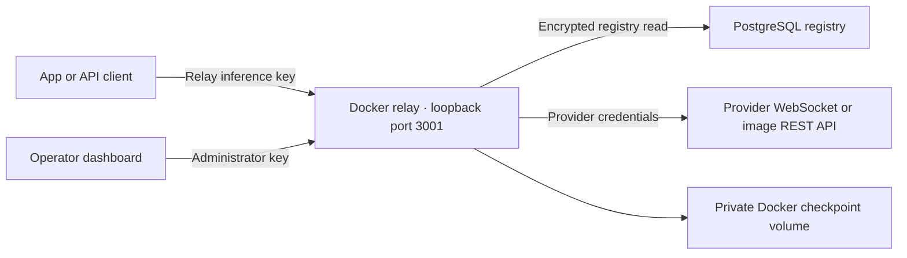

# Relay deployment and recovery runbook

Reviewed against the repository and the 2026-09-07 deployment. The current decision is [ADR 0122](adr/0122-isolated-authenticated-relay-and-bounded-recovery.md). This guide describes the standalone relay, not the hosted product API or the simulation scheduler.

## Deployed topology



The current host container is `galxai-relay`. No public tunnel or remote app deployment was verified during this rollout. A host outage, sleep, Docker outage, or lost upstream connection can interrupt inference. The repository's tunnel supervisor is an optional ingress mechanism, not an availability guarantee or an authentication substitute.

## Configuration

Use ignored `.env.local` for this workstation, with mode 0600. Use deployment secrets elsewhere. Never commit live keys or include them in documentation, URLs, screenshots, or command arguments.

| Variable | Purpose |
| --- | --- |
| `RELAY_API_KEYS` | Comma-separated inference keys; required by Compose |
| `RELAY_ADMIN_API_KEYS` | Dedicated operator keys; when omitted, first inference key is administrator |
| `VM_RELAY_API_KEY` | App-side inference key; never use a provider token or an administrator key here |
| `VM_RELAY_URL` | App-side relay origin, normally `http://localhost:3001` locally |
| `RELAY_ALLOWED_ORIGINS` | Exact authorized browser origins; same-origin access needs no entry |
| `DATABASE_URL` | Direct PostgreSQL registry connection |
| `SUPABASE_URL` / `NEXT_PUBLIC_SUPABASE_URL` | Registry Data API fallback origin |
| `SUPABASE_SECRET_KEY` / `SUPABASE_SERVICE_ROLE_KEY` | Privileged fallback access; backend only |
| `GALX_VAULT_KEY_V1`, versioned equivalents, or configured vault root | Decrypt registry records; must match their key version |
| `GALXAI_RELAY_PORT` | Published host port, default 3001 |
| `CODEX_WS_ENDPOINT` | Operator-configured upstream, never selected from request content |
| `RELAY_DISCOVER_HOST_CREDENTIALS` | Explicit development-only opt-in; Compose forces false |

A single application key represents one relay principal. Relay isolation does not distinguish multiple end users sharing that key; the application must enforce end-user authorization itself. `X-Tenant-Id` does not confer authority.

The standalone server defaults to loopback. Compose listens on `0.0.0.0` inside the container and publishes only host loopback. Do not expose the container directly without a reviewed ingress configuration and TLS.

## Build and deploy

From the repository root:

```sh
docker compose --env-file .env.local -f docker-compose.relay.yml config --quiet
node --import tsx --test scripts/test-relay-hardening.ts scripts/test-relay-adaptive-quota.ts scripts/test-relay-client-auth.ts
npx tsc --noEmit
docker compose --env-file .env.local -f docker-compose.relay.yml build
docker compose --env-file .env.local -p galxai -f docker-compose.relay.yml up -d --no-build --wait --wait-timeout 60
node --env-file=.env.local --import tsx scripts/test-relay-docker.ts
```

The tests need local socket access. The Docker check uses the running relay and can start it if absent; use a designated deployment environment. Build/deploy commands do not deploy the Next.js app or update a remote consumer's environment. Restart or redeploy those consumers separately after loading the app adapter and inference key.

For changes to a running service, build a candidate first and use a different Compose project, container name, and loopback port for the canary. Do not let candidate and production write the same checkpoint volume concurrently. Preserve the existing checkpoint securely, initialize the new volume with the correct UID/GID, and validate configuration, authentication, registry state, and one minimal provider request before cutover. Drain the candidate before reusing its checkpoint volume for production.

Do not print `docker inspect` environment output or a fully rendered Compose configuration: either can expose secrets. Use targeted inspection fields and `config --quiet`.

## Container boundary

The runtime uses UID/GID 1000, `read_only: true`, `cap_drop: [ALL]`, `no-new-privileges`, 128 PIDs, one CPU, and a 512 MiB memory ceiling. `/tmp` is a 16 MiB non-executable temporary filesystem. Only `relay-state:/app/.broccolidb` persists; with project `galxai`, the volume is `galxai_relay-state`.

The image includes the dashboard. There are no host repository, home-directory, personal Codex credential, or Docker socket mounts. Dashboard changes require an image rebuild. Writable checkpoint storage is service state, not a user workspace. These controls are not present when running the relay directly as a host Node process.

Fresh volumes receive the image directory's ownership. Existing root-owned volumes may need an explicit offline ownership repair. Replacing the old host bind mount with a named volume does not automatically migrate checkpoints. Back up and copy deliberately; do not delete the original directory as part of migration.

## Runtime budgets

Values below are source defaults, not measured provider limits. Compose forwards only the variables listed in its environment section; adding a server setting to `.env.local` alone does not necessarily pass it into the container.

| Setting | Default | Meaning |
| --- | --- | --- |
| `RELAY_MAX_CONCURRENT_REQUESTS` | 64 | Active inference/mutation HTTP admissions; chat admission releases at 202 |
| `RELAY_MAX_RSS_MB` | 384 | Process memory admission threshold below the container ceiling |
| `RELAY_SHARD_CONCURRENCY` | 4 | Concurrent requests per shard per relay process |
| `MAX_PAYLOAD_BYTES` | 2 MiB | Request body and WebSocket payload limit; size images accordingly |
| `HTTP_BODY_TIMEOUT_MS` | 10,000 | Request-body read deadline |
| Management body limit | min(16 KiB, request limit) | Quota profile/reset requests |
| `MAX_UPSTREAM_RETRIES` | 3 | Additional attempts, validated within 0–32 |
| `RETRY_BASE_DELAY_MS` / `RETRY_MAX_DELAY_MS` | 500 / 5,000 | Full-jitter exponential retry delay |
| Shared retry budget | 20 credits | Process-local, refills one credit per 10 seconds and on success |
| `WS_CONNECT_TIMEOUT_MS` | 15,000 | WebSocket handshake deadline |
| `WS_TTFT_TIMEOUT_MS` | 60,000 | Base first-output deadline; reasoning/model logic can extend it |
| `WS_INTRA_CHUNK_TIMEOUT_MS` | 45,000 | Output silence deadline |
| `CLIENT_DISCONNECT_GRACE_MS` | 15,000 | Reconnect opportunity after downstream disconnect |
| `JOB_MAX_WALL_TIME_MS` | 300,000 | Absolute job deadline across retries |
| `DRAIN_TIMEOUT_MS` | 30,000 | Service shutdown grace |
| Compose stop grace | 40 seconds | Allows application drain before forced container termination |
| `MAX_BUFFERED_TOKENS_PER_JOB` | 10,000 | Maximum retained output chunks despite the legacy variable name |
| `MAX_PENDING_FRAMES_PER_SUBSCRIBER` | 256 | Bounded pending downstream frames |
| `SUBSCRIBER_DRAIN_TIMEOUT_MS` | 5,000 | Slow-subscriber drain deadline |
| `IDEMPOTENCY_TTL_MS` | 120,000 | Local deduplication/idempotency retention |
| `JOB_TOKEN_RETENTION_MS` | 600,000 | In-memory job/output retention |
| `SNAPSHOT_INTERVAL_MS` | 60,000 | Periodic checkpoint; rejection triggers an immediate checkpoint attempt |
| `RELAY_QUOTA_WINDOW_MAX` | 0 | No default local call cap |
| `RELAY_QUOTA_WINDOW_MS` | 10,800,000 | Three-hour observation/local-cap window |

Registry refresh is coalesced and bounded by a five-second freshness interval. PostgreSQL reads have timeouts and may fall back to the privileged Data API. A failed refresh stops new credential selection; status and cancellation do not wait for it. There is no automatic provider-token refresh in the relay.

## Verify after deployment

1. `/health/live` returns process health; `/health/ready` reflects admission. Neither verifies provider access.
2. Unauthenticated `/api/dashboard/stats` returns 401. An inference-only key gets 403. An administrator key gets 200.
3. Inspect registry errors and actual eligible accounts. Disabled and expired accounts must not be selected.
4. Submit a short authenticated chat, follow the returned stream URL, and require a completion without an SSE error. A 202 alone is not success.
5. Inspect runtime user, read-only setting, capability drops, security options, and mount destinations. Test write denial outside private state if changing isolation.
6. Verify the actual external ingress and app consumer if deploying them; local checks do not prove either.

The 2026-09-07 rollout passed canary and post-cutover inference/SSE, authentication, registry, runtime isolation, TypeScript, and Docker checks. At that observation one account was eligible and two were expired. Counts and availability must be re-read; no credentials or account identities belong in the runbook.

## Recovery and rollback

`galxai-relay:rollback-pre-isolation` retains the pre-rollout image on the deployment host. Verify that tag exists before relying on it. Preserve the current image/configuration and checkpoint before any rollback. Drain and stop the current container, apply a reviewed image override, then repeat authentication and inference checks. The previous image restores previous security behavior; do not assume its key roles or isolation are equivalent.

Never use `down -v` for an image rollback. Never share one writable checkpoint volume between active replicas. Checkpoints contain no provider tokens, but can contain unfinished request content. They do not contain live sockets or the SSE replay buffer. After restart, interrupted jobs fail with `relay_restarted_start_new_request`; do not promise crash-resumable generation.

For 401/403, fix the correct credential layer. For expired/rejected provider credentials, sign in or rotate through the registry and sync the fleet; quota reset cannot repair authentication. For retry exhaustion, inspect partial output before explicitly submitting again. The relay does not settle wallets or issue refunds.

[Relay API](RELAY_API_REFERENCE.md) · [Security](relay-security.md) · [Fleet operations](maintainers/RELAY_QUOTA_AND_FLEET.md) · [Telemetry](maintainers/RELAY_TELEMETRY.md)
