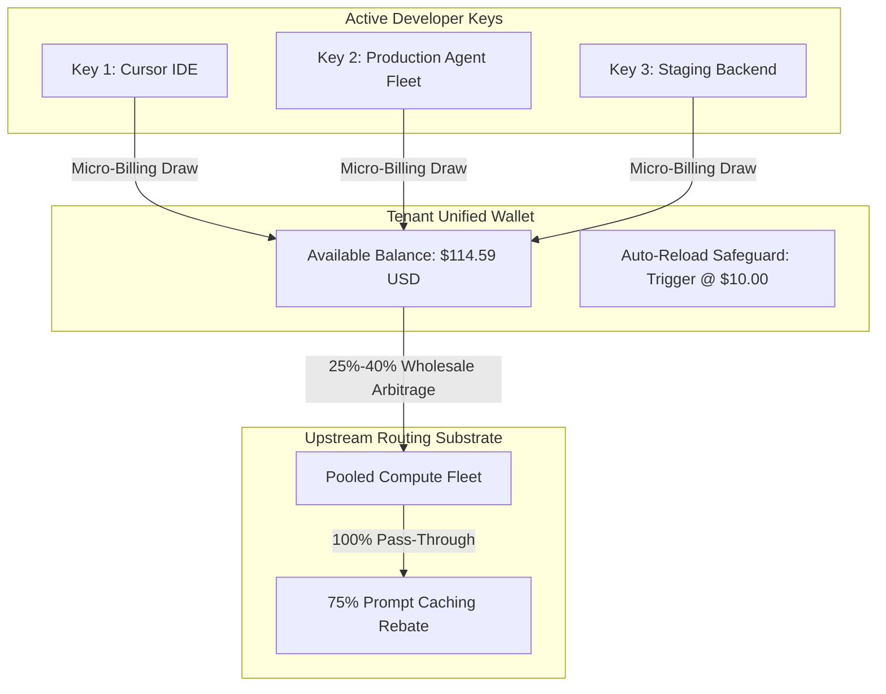

# 💳 GALXAI Developer Compute Wallet & Micro-Billing Architecture

GALXAI implements a high-precision, low-friction prepaid and auto-reload compute wallet designed for autonomous agent fleets, enterprise development teams, and independent developers.

---

## 1. Unified Wallet Economics & Token Micro-Metering

Unlike traditional SaaS subscriptions that charge static seat fees or rigid tier gates, GALXAI operates a **pure consumption-based compute ledger**:
- Every API key generated under a tenant workspace draws from the tenant's **Unified Compute Wallet**.
- Deductions occur in real-time down to $\$0.000001$ precision upon completion of each streaming chunk or HTTP response.
- **Zero Inactivity Penalties**: Deposited funds and promotional match grants never expire.

---

## 2. 50% Instant Match Compute Model & Proof-of-Deposit Security (ADR 0007)

To prevent automated Sybil scraper swarms and key-harvesting botnets from exhausting dedicated reasoning capacity, **GALXAI requires an initial refundable compute deposit of at least $10.00 USD** to activate developer API keys (`galx_live_...`).

### 50% Instant Match Value Equation
Upon making their first $10.00 deposit, developers immediately receive a **$5.00 Free Introductory Compute Grant** from the platform developer fund:
$$\text{StartingBalance} = \text{Deposit}_{\$10.00} + \text{IntroductoryGrant}_{\$5.00} = \$15.00\text{ USD Total Compute (50\% Match)}$$

> **Zero Hidden Fees**: 100% of deposited funds and bonus compute go directly toward usable tokens with **$0 platform or monthly maintenance fees**.

| Starter Pack | Your Deposit | Match / Tier Bonus | Total Credit Credited | Effective Match % | Best For |
| :--- | :--- | :--- | :--- | :--- | :--- |
| **$10 Starter Key** | **$10.00** | **+$5.00 Free Grant** | **$15.00 USD** | **+50% Match** | Prototyping & Cursor IDE activation |
| **$25 Standard Dev**| **$25.00** | **+$5.00 Free Grant** | **$30.00 USD** | **+20% Match** | Side projects & lightweight agents |
| **$50 Growth Pro**  | **$50.00** | **+$5.00 Grant + 5% Bonus** | **$57.50 USD** | **+15% Bonus** | Power users & full-time coding IDEs |
| **$100 Scale Fleet**| **$100.00**| **+$5.00 Grant + 10% Bonus**| **$115.00 USD**| **+15% Bonus** | Multi-agent swarms (*Most Popular*) |
| **$500 Enterprise** | **$500.00**| **+$5.00 Grant + 20% Bonus**| **$605.00 USD**| **+21% Bonus** | High-throughput enterprise production |

---

## 3. Real-Time Cross-App Event Synchronization

Client-side wallet balances and deposit verification status synchronize instantly across all open browser tabs without requiring manual page reloads:
- `useDepositVerification` listens for storage changes and dispatches custom `galx_wallet_update` events.
- Header navigation badges, API key generators, and billing meters reflect live balances instantaneously.

---

## 4. Automated 1-Click Refundability Protocol

Developers evaluate GALXAI with complete peace of mind:
- Any unspent balance from the initial deposit can be refunded with 1 click directly from the Billing dashboard.
- Zero lock-in and zero cancellation hurdles.

---

## 5. Auto-Reload & Zero-Downtime Protection

Production AI agents and mission-critical developer IDEs cannot tolerate unexpected `402 Payment Required` interruptions:
- **Configurable Low-Balance Thresholds**: Set trigger thresholds ($5, $10, $25, $50).
- **Automated Reload Amounts**: Top up $25, $50, $100, or $250 automatically via saved payment method.
- **Circuit Breaker Immunity**: Keys continue streaming without interruption while the reload transaction settles asynchronously.

---

## 6. Multi-Tenant Budget & Spend Governance

Organizations can enforce granular spending limits across individual projects and keys:
- **Per-Key Spend Caps**: Set daily or monthly limits per key (`galx_live_...`).
- **Real-Time Revocation**: 1-click immediate token invalidation purges active worker leases in $< 40\text{ms}$.
- **Detailed Exportable Ledger**: Download CSV / JSON audit trails with model breakdown, token metrics, wholesale discount applied, and net cost.

---

## 7. Cloudflare Edge Batch Micro-Metering (`fn_batch_draw_wallet_tokens_cf`)

To eliminate database connection thrashing during multi-agent swarm bursts, Cloudflare Workers buffer token deductions into 100-item micro-batches before executing atomic PostgreSQL ledger commits:
- **Zero-Egress Processing**: The Cloudflare Edge Mesh aggregates micro-draws across hundreds of concurrent SSE streams.
- **Single SQL Transaction**: `fn_batch_draw_wallet_tokens_cf` settles up to 100 token draw operations in one atomic database roundtrip.
- **Double-Entry Ledger Invariance**: Each draw creates an immutable row in `galx_wallet_transactions` with exact prompt, completion, and cached token quantities.

---

## 8. Multi-Tenant Budget Alerts & Automated Webhooks (ADR 0019)

Organizations configure real-time spend thresholds across workspaces and environments:
- **Threshold Policies**: Set triggers at 50%, 80%, and 100% of the monthly spend cap in `galx_budget_alerts`.
- **Automated Webhooks**: `fn_check_budget_thresholds` dispatches HMAC-SHA256 signed webhooks directly from Cloudflare Edge Workers upon crossing spend milestones.
- **Graceful Quota Soft/Hard Enforcement**: Non-critical background queues pause automatically while high-priority production endpoints remain operational.

