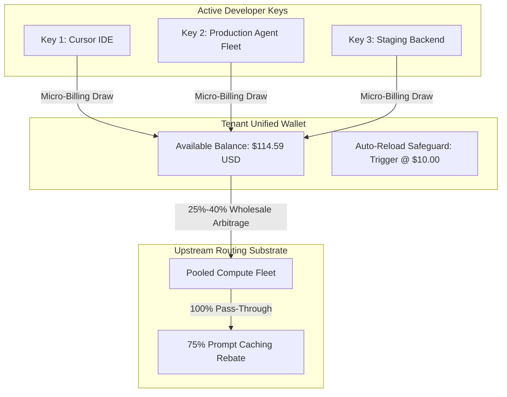

# 💳 GALXAI Developer Compute Wallet & Micro-Billing Architecture

GALXAI implements a high-precision, low-friction prepaid and auto-reload compute wallet designed for autonomous agent fleets, enterprise development teams, and independent developers.

---

## 1. Unified Wallet Economics & Token Micro-Metering

Unlike traditional SaaS subscriptions that charge static seat fees or rigid tier gates, GALXAI operates a **pure consumption-based compute ledger**:
- Every API key generated under a tenant workspace draws from the tenant's **Unified Compute Wallet**.
- Deductions occur in real-time down to $\$0.000001$ precision upon completion of each streaming chunk or HTTP response.
- **Zero Inactivity Penalties**: Deposited funds and welcome credits never expire.

---

## 2. GTM Bonus Incentive Matrix

To reward developers and growing startups who centralize their AI workloads on GALXAI, the wallet provides **progressive prepaid credit bonuses**:

| Deposit Amount | Bonus Multiplier | Net Credit Added | Effective Additional Discount | Best For |
| :--- | :--- | :--- | :--- | :--- |
| **$25.00** | $1.00\times$ | **$25.00 USD** | Base ($0\%$) | Side projects & lightweight testing |
| **$50.00** | $1.05\times$ | **$52.50 USD** | **+5% Bonus** | Individual developers & Cursor IDE power users |
| **$100.00** | $1.10\times$ | **$110.00 USD** | **+10% Bonus** | Startups & agent prototyping (*Most Popular*) |
| **$500.00** | $1.20\times$ | **$600.00 USD** | **+20% Bonus** | Production fleets & multi-agent backends |

---

## 3. Auto-Reload & Zero-Downtime Protection

Production AI agents and mission-critical developer IDEs cannot tolerate unexpected `402 Payment Required` errors during reasoning generations:
- **Configurable Low-Balance Thresholds**: Set trigger thresholds ($5, $10, $25, $50).
- **Automated Reload Amounts**: Top up $25, $50, $100, or $250 automatically via saved payment method.
- **Circuit Breaker Immunity**: Keys continue streaming without interruption while the reload transaction settles asynchronously.

---

## 4. Multi-Tenant Budget & Spend Governance

Organizations can enforce granular spending limits across individual projects and keys:
- **Per-Key Spend Caps**: Set daily or monthly limits per key (`galx_live_...`).
- **Real-Time Revocation**: 1-click immediate token invalidation purges active worker leases in $< 40\text{ms}$.
- **Detailed Exportable Ledger**: Download CSV / JSON audit trails with model breakdown, token metrics, wholesale discount applied, and net cost.
