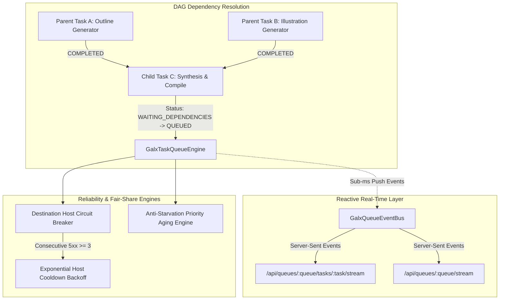

# ADR 0011: Directed Acyclic Graph (DAG) Workflows & Real-Time Event Streaming

## Status
**Accepted** (Implemented and Verified via 50-Suite Forensic Harness)

## Context
As agentic swarm workflows and multi-stage evaluation pipelines scaled on GALXAI, two critical operational constraints emerged:
1. **Multi-Agent Coordination & Fan-In Orchestration**: Complex tasks often require parallel generation (e.g. generating an outline and generating multiple image assets) followed by an aggregation step that depends on all parallel outputs. Without built-in DAG dependency resolution, clients had to coordinate orchestrations externally, multiplying roundtrip latency and client failure vulnerabilities.
2. **Polling Inefficiencies**: Polling `GET /tasks/:taskId` every 500ms created unnecessary HTTP ingress load on the gateway and delayed agent turn handoffs.
3. **Cascading Serverless Webhook Outages**: When downstream Cloud Run or external webhook destinations experienced temporary downtime, persistent queue dispatches overwhelmed the failing hosts, triggering connection resets and slow recovery.
4. **Low-Priority Workload Starvation**: In heavy burst periods with high-priority interactive chat completions (priority 80–100), low-priority batch synthesis tasks (priority 10–30) suffered indefinite wait times.

## Decision
We extended the **GALXAI Universal Asynchronous Queue Substrate** with four advanced enterprise architectural capabilities:

---

### 1. Directed Acyclic Graph (DAG) Dependencies (`dependsOn: string[]`)
Tasks declare prerequisite parent task IDs via `dependsOn`. 
- **FSM Progression**: A task created with non-empty `dependsOn` begins in `WAITING_DEPENDENCIES` status.
- **Atomic Unblocking**: When any parent task reaches `COMPLETED`, the engine inspects all waiting children, aggregates parent results into `child.parentTaskResults[parentId] = resultData`, and atomically transitions the child to `QUEUED` when all dependencies are satisfied:
  $$\forall p \in \text{dependsOn}, \quad \text{status}(p) = \text{COMPLETED} \implies \text{status}(\text{child}) \leftarrow \text{QUEUED}$$

---

### 2. Native Server-Sent Events (SSE) Real-Time Streaming
- **`GalxQueueEventBus`**: An in-memory, thread-safe pub/sub event bus supporting task-specific, queue-specific, and global subscriptions with ring-buffered telemetry caching.
- **Task Stream (`/api/queues/:queueId/tasks/:taskId/stream`)**: Pushes real-time state snapshots, lifecycle events (`TASK_QUEUED`, `TASK_DISPATCHING`, `TASK_RUNNING`, `TASK_PROGRESS`, `TASK_COMPLETED`), and execution log lines directly over persistent HTTP connections.
- **Queue Stream (`/api/queues/:queueId/stream`)**: Pushes queue-level throughput, latency, and state telemetry.

---

### 3. Destination Host Circuit Breaker for HTTP Push Webhooks
To protect serverless Cloud Run and external webhook endpoints from cascading brownouts:
- Each target host (`URL.host`) is tracked in an in-memory circuit breaker table.
- If a destination encounters $N \ge 3$ consecutive 5xx or connection timeout errors, the host transitions to `OPEN` state, applying exponential cooldown:
  $$\text{CooldownMs} = \min\left(300000, 10000 \times 2^{N-3}\right)$$
- Subsequent tasks targeting this host fail early with retryable backoff without initiating wasteful TCP connections.

---

### 4. Dynamic Anti-Starvation Priority Aging
To prevent high-priority bursts from starving low-priority background workloads, tasks waiting in the queue undergo dynamic priority escalation based on queue wait time:
$$\text{EffectivePriority} = \text{BasePriority} + \min\left(50, \left\lfloor \frac{t_{\text{now}} - t_{\text{created}}}{\text{AgingIntervalMs}} \right\rfloor \times 5\right)$$
- Default `AgingIntervalMs`: 10,000ms.
- A priority 20 batch task waiting for 60 seconds achieves an effective priority of $20 + \min(50, 6 \times 5) = 50$, ensuring fair dispatching alongside interactive workloads.

---

### 5. Content-Based Sliding Deduplication
When `contentBasedDeduplication: true` is configured and no explicit `idempotencyKey` is supplied, the engine generates a deterministic SHA-256 digest over the canonical JSON payload:
$$\text{DedupKey} = \text{SHA256}(\text{CanonicalJSON}(\text{TaskTarget}))$$
Deduplication is enforced over a sliding window (`deduplicationWindowMs`, default 24 hours).

---

## Consequences
- **Positive**: Eliminates external DAG orchestrators for multi-agent workflows.
- **Positive**: Sub-millisecond reactive push updates via SSE eliminate wasteful polling overhead.
- **Positive**: Downstream serverless endpoints are protected against cascading failures via host circuit breakers.
- **Positive**: Eliminates lower-priority queue starvation via dynamic mathematical aging.
- **Positive**: Full backwards compatibility with Google Cloud Tasks v2 and Cloud Run dispatch semantics.
