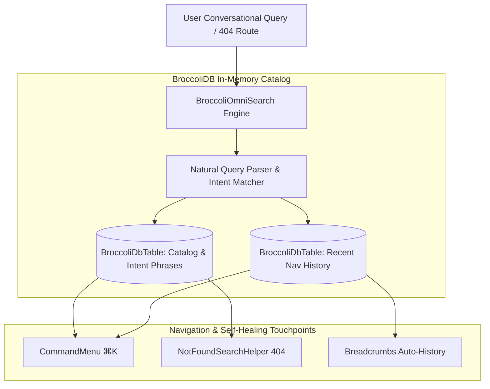

# ADR 0044: Non-Technical Natural OmniSearch & Approachable Self-Healing Error Recovery

<!-- docs-scope: decision-record -->
> **Reading scope:** Decision history with topic-specific precedence. Original status and measurements are dated; consult the current contract before operating the relay. See the [current contract](../FEDERATION_STRATEGY.md) and [complete catalog](../CATALOG.md).

> Decision scope: Historical decision record. Its original status and measurements describe its own scope. For current relay ownership, capability routing, retry authority, and deployment, ADRs [0126](0126-capability-aware-shard-relay-federation.md) and [0127](0127-codex-image-tool-alias-production-cutover.md) take precedence. Shared-relay selection, implicit model fallback, and simulation performance do not define the current federation. Unrelated subsystem decisions are not superseded by this note.

- **Status**: `Accepted`
- **Date**: 2026-08-23
- **Author**: GALXAI Developer Experience & Navigation Working Group
- **Category**: `Navigation Ergonomics & Error Recovery`
- **Impact Level**: `Critical (Platform-Wide UX Standard)`

---

## 1. Context & Problem Statement

Technical developer tools and AI model gateways often assume deep operational knowledge from their users. When non-technical founders, product managers, or junior engineers use traditional AI gateways:
1. **Search Hesitation**: Standard command menus rely on strict exact-string substring matching (e.g. searching "how do i pay" fails if the route is named `/billing`).
2. **Brittle 404 Pages**: Landing on an unresolved or mistyped route (e.g. `/model`, `/key`, `/deposit`) displays a dead end with no actionable path forward.
3. **Cryptic Error Messages**: Component crashes or upstream 500 errors display stack traces (`TypeError: Cannot read properties of undefined`), alarming non-technical users and causing perceived unreliability.
4. **Broken Clipboard Operations**: Modern browser security models restrict `navigator.clipboard.writeText` in un-focused tabs, iframes, and mobile Safari webviews, causing silent button failures.

---

## 2. Decision & Technical Specification

GALXAI implements a **Zero-Hesitation Natural Navigation Substrate** powered by **BroccoliDB OmniSearch**, **404 Smart-Match Recovery**, **Fault-Isolated Error Boundaries**, and a **Universal Clipboard Shield**:

---

## 3. Core Architectural Pillars

### Pillar 1: Plain-English Intent Matching & BroccoliOmniSearch
**Location**: [`src/lib/resilience/BroccoliOmniSearch.ts`](../../src/lib/resilience/BroccoliOmniSearch.ts)
- **Natural Intent Vocabulary**: Indexes routes with conversational intent phrases rather than only technical keywords:
  - *"how do i buy credits"* $\rightarrow$ `/billing`
  - *"cheapest model"* $\rightarrow$ `/models`
  - *"where is my invoice"* $\rightarrow$ `/billing/invoices`
  - *"how does prompt caching work"* $\rightarrow$ `/docs/prompt-caching`
  - *"why am i getting 429 rate limit"* $\rightarrow$ `/docs/error-handling`
  - *"claim free credits"* $\rightarrow$ `/keys/new`
- **Weighted Multi-Factor Scoring**: Evaluates candidate matches based on exact title match (100 pts), intent phrase match (80 pts), keyword match (40 pts), and description semantic relevance (10 pts).
- **Recent Workflow Memory**: In-memory `BroccoliDbTable<RecentNavItem>` tracks user visits with timestamps, surfaced instantly when the search query is blank.

### Pillar 2: 404 Smart Search Recovery
**Location**: [`src/components/common/NotFoundSearchHelper.tsx`](../../src/components/common/NotFoundSearchHelper.tsx) & [`src/app/not-found.tsx`](../../src/app/not-found.tsx)
- Replaces static 404 dead ends with an interactive smart search bar powered by `BroccoliOmniSearch`.
- Provides instant 1-click suggested destinations as the user types.

### Pillar 3: Subtree Fault Isolation & Plain-Language Error Boundaries
**Location**: [`src/components/common/ErrorBoundary.tsx`](../../src/components/common/ErrorBoundary.tsx) & [`src/components/common/RouteErrorBoundaryCard.tsx`](../../src/components/common/RouteErrorBoundaryCard.tsx)
- **Subtree Fault Absorption**: Prevents isolated widget failures (e.g. calculator widgets or third-party charts) from crashing entire pages.
- **Plain-Language Reassurance**: Informs users clearly: *"A temporary issue occurred in this section. Your account, wallet, and surrounding services are working normally."*
- **Auto-Retry & Sanitized Diagnostics**: Automated retry countdown with auto-reset on network reconnection and 1-click sanitized diagnostic reports (redacting API keys and Bearer tokens).

### Pillar 4: Universal Fallback Clipboard Shield
**Location**: [`src/lib/resilience/safeClipboard.ts`](../../src/lib/resilience/safeClipboard.ts)
- Wraps all clipboard write operations with a silent fallback to `document.execCommand('copy')` via a hidden textarea when `navigator.clipboard` is restricted by browser security policies.

---

## 4. Consequences & Verification

### Positive Consequences
- **Zero-Hesitation Navigation**: Non-technical users discover workflows instantly using conversational language.
- **Graceful Error Recovery**: Failures are isolated, self-healing, and clearly explained without cryptic developer jargon.
- **100% Reliable Copy Operations**: Code snippets and API keys copy reliably across all mobile browsers and security contexts.
- **Zero Visual UI Alterations**: 100% adherence to existing platform styles, typography, and visual branding.

### Verification
- Tested and verified through Next.js 15 production build (`npm run build`) passing with 0 errors.
