# 0053. Siloed Supabase OAuth Platform Authentication & Isolated Backend Substrate Sharding Mesh

Date: 2026-08-24
Status: Accepted; post-auth destination clarified by ADR 0119

> **Current scope:** The identity separation remains authoritative. ADR 0119 changes the successful authentication default to the `/models` catalog and prohibits a hosted chat or image-generation destination.

## Context
GALXAI previously merged provider credential ingestion with frontend user authentication, creating unnecessary cognitive load and architectural coupling between frontend end-users and the underlying Substrate sharding engine. Frontend users signing in to manage workspace settings, telemetry, and API keys were exposed to complex sharding concepts (`shardMode`, `pooled vs private`, raw tokens).

Furthermore, modern consumer/developer platforms (such as GitHub, Linear, Supabase, Vercel) mandate a clean separation between **Platform Identity Authentication** (OAuth/SSO/Magic Links) and **Internal Infrastructure Execution** (sharding, quotas, model routing).

## Decision
1. **Frontend Platform Identity (Standard Supabase OAuth)**:
   - Platform users authenticate exclusively using standard Supabase Auth (`@supabase/ssr` / `@supabase/supabase-js`).
   - 1-Click OAuth flows: GitHub, Google, and Email/Magic Link.
   - The Next.js SSR callback (`src/app/auth/callback/route.ts`) handles session cookies cleanly via `supabase.auth.exchangeCodeForSession(code)`.
   - The frontend is completely cleansed of all sharding terminology and mechanics.

2. **Backend Substrate Sharding Subsystem (Isolated Infrastructure Service)**:
   - The Substrate sharding engine (`GalxAuthEngine`, `GalxModelRouter`, `GalxCredentialPool`, `POST /api/auth/ingest`, BroccoliDB tables, AES-256-GCM envelope encryption) is strictly isolated in the backend.
   - External CLI clients (such as `LUMI-NEW`) and automated workers connect directly to the backend ingestion gateway without interfering with frontend Supabase Auth sessions.

## Architecture

```mermaid
flowchart TD
    subgraph FrontendPlatform ["Frontend Platform (User Experience)"]
        User["Developer / Platform User"] --> ConnectUI["/auth/connect"]
        ConnectUI -->|1-Click GitHub / Google / Magic Link| SupabaseClient["createClient() (@supabase/ssr)"]
        SupabaseClient --> CallbackRoute["/auth/callback (exchangeCodeForSession)"]
        CallbackRoute --> App["/models model catalog"]
    end

    subgraph BackendInfrastructure ["Autonomous Backend Substrate (Sharding Service)"]
        CLI["CLI Agent (LUMI-NEW)"] --> IngestRoute["POST /api/auth/ingest"]
        IngestRoute --> AuthEngine["GalxAuthEngine (AES-256-GCM Vaulting)"]
        AuthEngine --> BroccoliDB["BroccoliDB Shard Tables & Postgres"]
        BroccoliDB --> Router["GalxModelRouter & Pool Dispatch"]
    end

    style FrontendPlatform fill:#0d1117,stroke:#3b82f6,stroke-width:2px
    style BackendInfrastructure fill:#0d1117,stroke:#10b981,stroke-width:2px
```

## Consequences

### Positive
- **Familiar Developer Experience**: Non-technical and developer users encounter a standard, 1-click GitHub / Google / Email sign-in flow.
- **Architectural Modularity**: Clear boundary between platform authorization (Supabase RLS) and backend LLM provider quota management (Substrate).
- **Zero Front-End Leakage**: Shards, token pools, and provider rotation are transparent backend execution details.

### Negative / Mitigation
- **Two Separate Auth Protocols**: Platform sessions (Supabase JWTs) and Agent Bearer sessions (`galx_sess_...`) exist in their respective domains.
  - *Mitigation*: Supabase Auth handles all UI cookies and API access to `/api/wallet`, `/api/keys`, while JWE tokens handle direct agent proxy calls.
