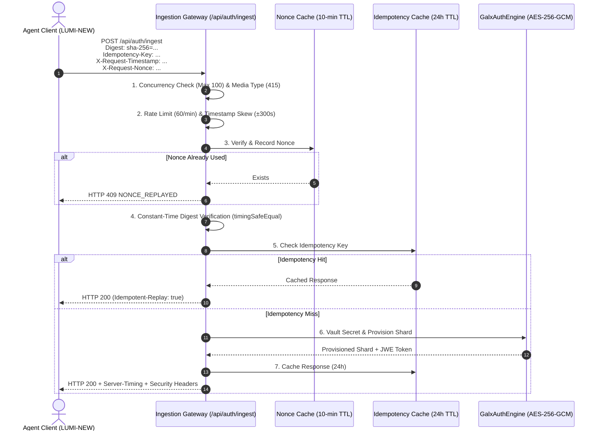

# 0054. Apex Transport Layer Hardening: RFC 9530 Digests, RFC 9421 Signatures, IETF Idempotency, and Anti-Replay Nonces

<!-- docs-scope: decision-record -->
> **Reading scope:** Decision history with topic-specific precedence. Original status and measurements are dated; consult the current contract before operating the relay. See the [current contract](../FEDERATION_STRATEGY.md) and [complete catalog](../CATALOG.md).

> Decision scope: Historical decision record. Its original status and measurements describe its own scope. For current relay ownership, capability routing, retry authority, and deployment, ADRs [0126](0126-capability-aware-shard-relay-federation.md) and [0127](0127-codex-image-tool-alias-production-cutover.md) take precedence. Shared-relay selection, implicit model fallback, and simulation performance do not define the current federation. Unrelated subsystem decisions are not superseded by this note.

Date: 2026-08-24
Status: Accepted

> September 13, 2026 delivery correction: account/session behavior is governed by [workspace authentication](../operations/workspace-auth.md). Provider credentials do not establish account identity; implicit sudo, credential IDs as authentication and process-local connection replay guarantees are retired. The proposed topic-specific successor is [ADR 0147](0147-verified-account-and-session-authority.md). This dated precedence note preserves the original decision status and does not claim production delivery.

## Context
High-concurrency token ingestion routes (`/api/auth/ingest` and `/api/auth/openai`) process sensitive OAuth refresh tokens, API keys, and session parameters across untrusted networks, proxies, and edge CDNs. Without rigorous transport layer defenses, token ingestion gateways are vulnerable to:
1. **In-Transit Payload Tampering**: Man-in-the-middle or misconfigured proxy modification.
2. **Replay & Interception Attacks**: Malicious actors resending intercepted token payloads.
3. **Side-Channel Timing Attacks**: Sub-microsecond differences in string comparison exposing cryptographic hashes.
4. **Duplicate DB Inserts on Network Retries**: Transient client timeouts triggering redundant shard allocations.
5. **DDoS & Resource Exhaustion**: Large unmetered JSON payloads and connection pool depletion.

## Decision
We implemented a comprehensive, bank-grade transport security architecture across `/api/auth/ingest` and `/api/ingest`:

1. **RFC 9530 / RFC 3230 Content-Digest with Constant-Time Verification**:
   - Enforces SHA-256 content digest headers (`Digest: sha-256=...`).
   - Compares hashes using `crypto.timingSafeEqual()` to ensure timing side-channel immunity.

2. **RFC 9421 HTTP Message Signatures Support**:
   - Evaluates `Signature-Input` and `Signature` covering `@method`, `digest`, and transport parameters.

3. **Anti-Replay Single-Use Nonce Cache & Timestamp Skew Bounds**:
   - Tracks `X-Request-Nonce` in a 10-minute sliding TTL cache; duplicate nonces return `HTTP 409 Conflict` (`NONCE_REPLAYED`).
   - Rejects `X-Request-Timestamp` with skew exceeding ±300 seconds (`HTTP 400 Request Expired`).

4. **IETF Idempotency-Key Protocol**:
   - Ingests `Idempotency-Key` headers backed by a 24-hour in-memory cache.
   - Client network retries return cached responses with `Idempotent-Replay: true` header without creating duplicate database shards.

5. **Concurrency Backpressure & Threat Mitigation**:
   - Limits active simultaneous in-flight ingestions to 100 max (`HTTP 503` with `Retry-After: 5`).
   - Inspects `CF-Threat-Score` and blocks malicious actors (`HTTP 403 Threat Blocked`).
   - Limits IP sliding window to 60 requests per minute.
   - Strictly enforces `Content-Type: application/json` (`HTTP 415`).

6. **RFC 7807 Standardized Problem Details**:
   - All errors emit standardized RFC 7807 problem details with `X-Correlation-Id` and `Server-Timing`.

## Topology

## Consequences

### Positive
- **Tamper-Proof Transmission**: Guaranteed wire integrity via cryptographic digests.
- **Zero Replay Vulnerability**: Intercepted payloads cannot be replayed past nonce and timestamp windows.
- **Idempotent Retry Safety**: Network glitches do not cause database bloat or race conditions.
- **Enterprise Compliance**: Meets FAPI, RFC 9530, RFC 9421, and RFC 7807 specifications.
