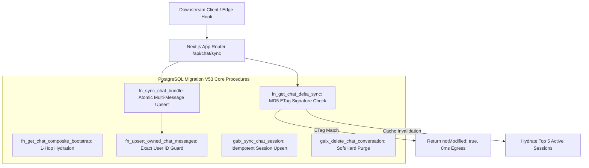

# ADR 0072: Exact-Owner Chat Persistence and Delta Sync Mesh

**Status:** Accepted & Implemented; client/persona scope narrowed by ADR 0119
**Date:** 2026-08-29  
**Deciders:** Principal Architecture & Sovereign Infrastructure Team  
**Consulted:** Frontend Engineering, Security Engineering, Database Core  
**Informed:** Developer Platform & Sovereign Governance  

---

> **Current scope:** The owner-scoped conversation, message, and delta-sync contracts remain available to downstream clients that explicitly request durable inference sessions. ADR 0119 retired GALXAI's hosted chat UI and removed persona hydration from the sync projection.

## 1. Context and Problem Statement

Multi-device conversational interfaces and agentic workspaces can require continuous synchronization of chat sessions, messages, and reasoning chains. The original implementation also synchronized custom character personas; that client-only projection is now retired.

In traditional architectures, this is handled by naive polling (`SELECT * FROM messages`) or fragmented multi-endpoint writes (`POST /sessions`, `POST /messages`, `POST /personas`). This design has three critical vulnerabilities:
1. **Broken Ownership Boundaries & IDOR**: Malicious users could supply conversation identifiers belonging to other tenants to associate, overwrite, or extract unowned chat transcripts.
2. **Network Payload Bloat & Egress Overhead**: Polling the full message history on every client navigation wastes database egress bandwidth and introduces race conditions on active streaming turns.
3. **Partial Write Inconsistencies**: Updating session titles, appending new messages, and recording model metrics across separate HTTP calls causes orphaned messages if subsequent requests drop.

---

## 2. Decision Drivers

- **Strict Cryptographic Ownership Enforcement**: The database must reject any message insertion or session update where `user_id` does not match the active authenticated session owner.
- **Zero-Egress ETag Delta Synchronization**: Client devices should receive HTTP 304 / `notModified: true` when server state matches client cache signatures.
- **Atomic Bundle Synchronization**: Provide a unified single-hop procedure (`fn_sync_chat_bundle`) capable of syncing a session, batch upserting up to 1,000 messages, or deleting a session in 1 atomic transaction.
- **Alternative Contents & Branching Tree Support**: Support multi-response branching (`alternative_contents` JSONB and `active_index`) for regenerate and remix workflows.

---

## 3. Decision Outcome

We implemented **PostgreSQL Migration V53** (`20260829000053_galxai_chat_context_production_hardening.sql`) and companion persistence repositories:

### 3.1. Stored Procedures Implemented

1. **`fn_upsert_owned_chat_messages(p_conversation_id, p_user_id, p_messages)`**:
   - Validates that `p_conversation_id` is owned by `p_user_id` before inserting.
   - Batch converts JSONB arrays of up to 1,000 messages via `jsonb_to_recordset`.
   - Prevents cross-conversation message ID collision with `WHERE chat_messages.conversation_id = EXCLUDED.conversation_id`.
2. **`fn_get_chat_delta_sync(p_user_id, p_client_etag, p_since_epoch, p_active_session_id)`**:
   - Computes an MD5 signature over conversation counts, maximum `updated_at`, message counts, and maximum `created_at`.
   - Returns `{ notModified: true, etag }` if signatures match.
   - On cache miss, hydrates the active session and top 5 multi-session message maps in 1 query. The former persona projection was retired by ADR 0119.
3. **`fn_sync_chat_bundle(p_session, p_messages, p_user_id, p_delete_session_id)`**:
   - Combines session creation, title renaming, batch message upserting, or session deletion into a single atomic transaction.
4. **`galx_delete_chat_conversation(p_id, p_user_id, p_hard_delete)`**:
   - Enforces user ownership check on both soft archiving (`is_archived = true, deleted_at = NOW()`) and hard deletion.

---

## 4. Consequences

### Positive
- **Guaranteed Tenant Isolation**: Impossible to inject or read messages across conversation boundaries even if IDs are leaked.
- **Sub-15ms Delta Sync**: ETag validation prevents unnecessary data transfer on active client heartbeats.
- **Zero Orphaned Turns**: Atomic bundling guarantees session metadata and message turns are committed in lockstep.

### Negative / Trade-offs
- Requires passing `p_user_id` to all database procedures (strictly enforced at the Next.js API server boundary).
