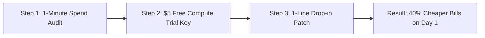

# 🎯 Playbook: Onboarding the First 10 High-Spend AI Startups

## 1. Objective & Target Profile
Onboard 10 production AI engineering teams currently spending **$2,000–$50,000/month** on OpenAI/Anthropic APIs by delivering an immediate **25%–40% net cost reduction** with zero architectural changes.

### Ideal Customer Profile (ICP)
- **Verticals**: AI SaaS, Multi-Agent Platforms (CrewAI, LangGraph), RAG document processors, Coding Assistants, Customer Support Bots.
- **Current Stack**: Direct OpenAI SDK (`openai`), Anthropic SDK, Vercel AI SDK, or LangChain.
- **Pain Point**: High monthly token burn eating runway, lack of enterprise volume discounts from OpenAI without $100k+ commitments.

---

## 2. The 3-Step Zero-Hesitation Migration Hook



### Step 1: 1-Minute Spend Audit
The developer runs their monthly token volume through the [GALXAI ROI Calculator](https://galx.ai/calculator):
- Example: 50M GPT-5.6 tokens/mo = **$375.00** on retail OpenAI.
- With GALXAI Wholesale (25% discount) + 75% prompt cache rebate: **$168.75/mo** (**55% net savings**).

### Step 2: Instant $5 Free Compute Trial
- Developers claim an instant live API key funded with a **$5.00 Free Introductory Compute Grant**.
- They choose a model in the [GALXAI model catalog](https://galx.ai/models), create a trial key, and verify latency from their terminal (`npx galxai "Hello"`) or the bounded API request inspector. The activation goal is a working external integration, not continued use of a hosted prompt surface.

### Step 3: The 1-Line Drop-In Patch
No prompt rewrites. No SDK migration. Add one line at application startup:
```typescript
import 'galxai/patch'; // Transparently redirects all OpenAI SDK calls to GALXAI Wholesale
```

---

## 3. High-Touch White-Glove Onboarding Checklist
1. **Pre-Flight Connectivity Audit**: Run `npx galxai doctor` on the customer's staging environment.
2. **Shard Vault Credential Generation**: Issue dedicated AES-256-GCM encrypted API keys.
3. **50% Deposit Match Incentive**: Customer deposits $100.00 ➔ GALXAI instantly matches with an extra $50.00 compute credit ($150.00 balance).
4. **Live Latency & Error Telemetry Check**: Measure routing and first-output latency on the actual deployment; record the workload and result.
