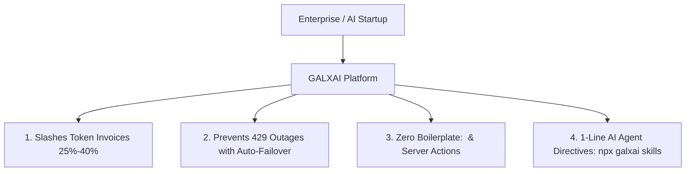

# 📑 GALXAI Investment Memorandum & Executive Summary

**Company**: GALXAI, Inc.  
**Sector**: Generative AI Infrastructure, Developer Tooling & Token Clearinghouse  
**Stage**: Seed / Series A  
**Target Raise**: $5,000,000 USD  
**Contact**: founders@galx.ai  
**URL**: https://galx.ai  

---

## Executive Summary

**GALXAI** is building the **Wholesale AI Compute Clearinghouse and Ambient Integration Substrate**—the "Costco + Stripe" for the generative AI economy.

Today, enterprise development teams and AI startups face a dual crisis:
1. **The Retail Tax**: Companies spend $2,000–$100,000+/month on foundational models (OpenAI, Anthropic, xAI), paying full retail list prices because they lack $10M+ annual volume commitments.
2. **The Integration & Reliability Tax**: Integrating AI requires dozens of lines of fragile backend proxy route boilerplate, state management plumbing, rate-limit (HTTP 429) mitigation, and complex MCP configs.

GALXAI solves both sides simultaneously:
- **Wholesale Clearinghouse**: Aggregates billions of tokens across enterprise commitments, passing through **25%–40% wholesale discounts** and **100% of prompt caching savings (75% rebate)**.
- **Ambient Declarative Substrate**: Eliminates integration friction entirely through drop-in React components (`<GalxImage />`, `<GalxChat />`), zero-route Next.js Server Actions, zero-migration auto-patchers (`import 'galxai/patch'`), and 1-line agent directives (`npx galxai skills`).

---

## 🎯 Key Metrics & Highlights

| Metric | Value | Benchmark / Significance |
| :--- | :--- | :--- |
| **Wholesale Discount** | **25%–40%** | Guaranteed below direct retail provider list prices |
| **Prompt Cache Rebate** | **75% Pass-Through** | 100% passed through to developers on prefixes > 1,024 tokens |
| **Gateway Latency Overhead** | **< 0.8ms** | Sub-15ms TTFT (Time To First Token) across Anycast edge mesh |
| **Failover RTO / RPO** | **< 1ms / 0** | Dual-slot zero-data-loss outbox and instant 4-state circuit breaker |
| **Gross Margin Target** | **42% $\to$ 68%** | Expanding via prompt cache margin capture & pooled tier arbitrage |
| **Target LTV / CAC** | **5.4x** | Blended payback period of 3.8 months via bottom-up PLG |
| **TAM (2030)** | **$1.3 Trillion** | Global enterprise AI model inference & developer infrastructure |

---

## 💎 The Value Proposition: The 4 Jobs To Be Done (JTBD)



1. **Slashing Token Bills by 25%–40%**: Developers swap their base URL or add 1 import; invoices drop immediately without model degradation or prompt changes.
2. **Eliminating 429 Rate Limit Outages**: Multi-tenant capacity pooling dynamically routes traffic across distributed shards in `<1ms`, ensuring 99.99% uptime during provider outages.
3. **Ambient Zero-Route Integration**: Frontend teams drop in `<GalxImage />` or `<GalxChat />` without building backend API route handlers or exposing API keys to clients.
4. **Deterministic AI Coding Agent Adoption**: `npx galxai skills` installs authoritative directives into `.cursorrules`, `CLAUDE.md`, and `AGENTS.md`, turning Cursor, Claude Code, and Windsurf into viral distribution channels.

---

## 📊 Financial Summary & Projections

```
Year 1 (2025): $1.2M ARR | 1,400 Active Dev Teams | 42% Gross Margin
Year 2 (2026): $6.8M ARR | 6,500 Active Dev Teams | 49% Gross Margin
Year 3 (2027): $21.5M ARR| 18,200 Active Dev Teams| 58% Gross Margin
Year 4 (2028): $48.0M ARR| 36,000 Active Dev Teams| 64% Gross Margin
Year 5 (2029): $85.0M ARR| 62,000 Active Dev Teams| 68% Gross Margin
```

---

## 🚀 Investment Opportunity & Use of Funds

We are raising **$5.0M** in Seed / Series A financing to:
- **Wholesale Liquidity & Capacity Commitments (30%)**: Pre-purchase tier-5 compute commitments with major foundation providers to widen wholesale margins.
- **Core Engineering & Edge Infrastructure (45%)**: Expand distributed Anycast edge points of presence (PoPs), harden the BroccoliDB L1 cache substrate, and scale automated multi-region failover.
- **Developer Ecosystem & PLG Growth (25%)**: Scale programmatic SEO (pSEO), developer CLI tooling (`npx galxai`), and enterprise integrations for Claude Code, Cursor, and Windsurf ecosystems.
