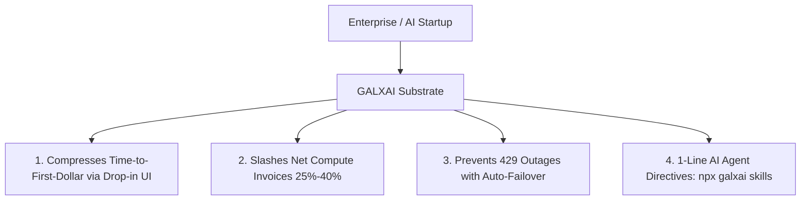

# 📑 GALXAI Investment Memorandum & Executive Summary

**Company**: GALXAI, Inc.  
**Sector**: Generative AI Infrastructure, Developer Tooling & Token Clearinghouse  
**Stage**: Seed / Series A  
**Target Raise**: $5,000,000 USD  
**Contact**: founders@galx.ai  
**URL**: https://galx.ai  

---

## Executive Summary

**GALXAI** is the **Enterprise AI Consumption & Acceleration Layer**—compressing *time-to-first-dollar* and eliminating the engineering infrastructure tax of deploying production AI.

Today, enterprise development teams and AI startups face a dual crisis:
1. **The Infrastructure & Learning Tax ("Paying the Tuition")**: Building AI features requires weeks of engineering time spent on fragile backend proxy routes, rate-limit (HTTP 429) mitigations, complex state management, and debugging multi-provider routing footguns.
2. **The Unmanaged Retail Tax**: Companies spend $2,000–$100,000+/month on OpenAI models, paying full retail prices and accidentally routing lightweight tasks to expensive frontier models.

GALXAI solves both sides simultaneously:
- **Time-to-First-Dollar Acceleration**: Drop-in React UI primitives (`<GalxImage />`, `<GalxChat />`), zero-route Next.js Server Actions, 1-line OpenAI SDK interception (`import 'galxai/patch'`), and deterministic agent directives (`npx galxai skills`).
- **Autonomous Spend Governance & Wholesale Clearinghouse**: Intercepts retail model spend, dynamic prompt caching (75% rebate pass-through), semantic model tier routing, and **25%–40% wholesale efficiency**.
- **Net Spend Interception (Procurement-Friendly)**: Eliminates the "$100k vendor invoice vs $900k savings" psychological barrier by directly replacing costly retail provider invoices with a single, lower, consolidated compute bill.

---

## 🎯 Key Metrics & Highlights

| Metric | Value | Benchmark / Significance |
| :--- | :--- | :--- |
| **Wholesale Savings** | **25%–40%** | Direct retail invoice reduction on day 1 |
| **Prompt Cache Rebate** | **75% Pass-Through** | 100% passed through to developers on prefixes > 1,024 tokens |
| **Time-to-Production** | **< 15 Minutes** | Down from 3–6 weeks of bespoke proxy and auth infrastructure |
| **Gateway Latency Overhead** | **< 0.8ms** | Sub-15ms TTFT (Time To First Token) across Anycast edge mesh |
| **Failover RTO / RPO** | **< 1ms / 0** | Dual-slot zero-data-loss outbox and instant 4-state circuit breaker |
| **Gross Margin Target** | **42% $\to$ 68%** | Expanding via prompt cache margin capture & pooled tier arbitrage |
| **Target LTV / CAC** | **5.4x** | Blended payback period of 3.8 months via bottom-up PLG |
| **TAM (2030)** | **$1.3 Trillion** | Global enterprise AI model inference & developer infrastructure |

---

## 💎 The Value Proposition: The 4 Jobs To Be Done (JTBD)



1. **Compressing Time-to-First-Dollar**: Eliminates weeks of bespoke proxy engineering. Frontend teams drop in `<GalxImage />` or `<GalxChat />` without building backend API route handlers or risking API key leakage.
2. **Autonomous Cost Governance & Net Invoice Slashes**: Intercepts retail spend with automated prompt caching, semantic routing, and 25%–40% wholesale discounts.
3. **Eliminating 429 Rate Limit Outages**: Multi-tenant capacity pooling dynamically routes traffic across distributed shards in `<1ms`, ensuring 99.99% uptime during provider outages.
4. **Deterministic AI Coding Agent Adoption**: `npx galxai skills` installs authoritative directives into `.cursorrules`, `CLAUDE.md`, and `AGENTS.md`, turning Cursor, Claude Code, and Windsurf into viral distribution channels.

---

## 📊 Financial Summary & Projections

```
Year 1 (2025): $1.2M ARR | 1,400 Active Dev Teams | 42% Gross Margin
Year 2 (2026): $6.8M ARR | 6,500 Active Dev Teams | 49% Gross Margin
Year 3 (2027): $21.5M ARR| 18,200 Active Dev Teams| 58% Gross Margin
Year 4 (2028): $48.0M ARR| 36,000 Active Dev Teams| 64% Gross Margin
Year 5 (2029): $85.0M ARR| 62,000 Active Dev Teams| 68% Gross Margin
```

---

## 🚀 Investment Opportunity & Use of Funds

We are raising **$5.0M** in Seed / Series A financing to:
- **Wholesale Liquidity & Capacity Commitments (30%)**: Pre-purchase tier-5 compute commitments with major foundation providers to widen wholesale margins.
- **Core Engineering & Edge Infrastructure (45%)**: Expand distributed Anycast edge points of presence (PoPs), harden the BroccoliDB L1 cache substrate, and scale automated multi-region failover.
- **Developer Ecosystem & PLG Growth (25%)**: Scale programmatic SEO (pSEO), developer CLI tooling (`npx galxai`), and enterprise integrations for Claude Code, Cursor, and Windsurf ecosystems.
