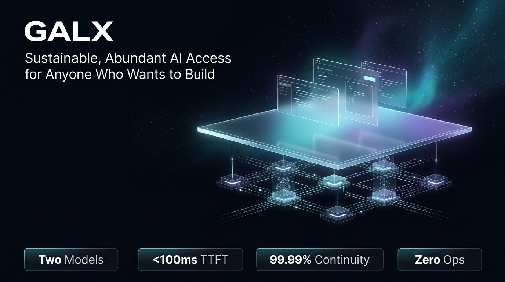
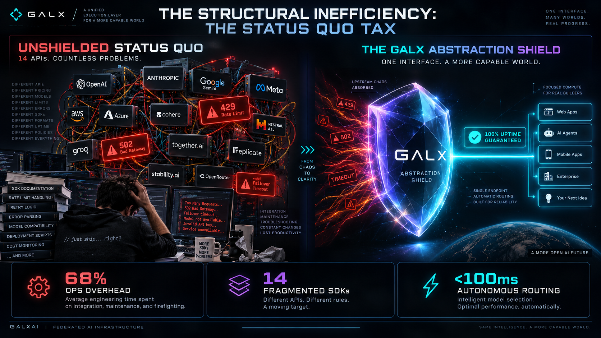
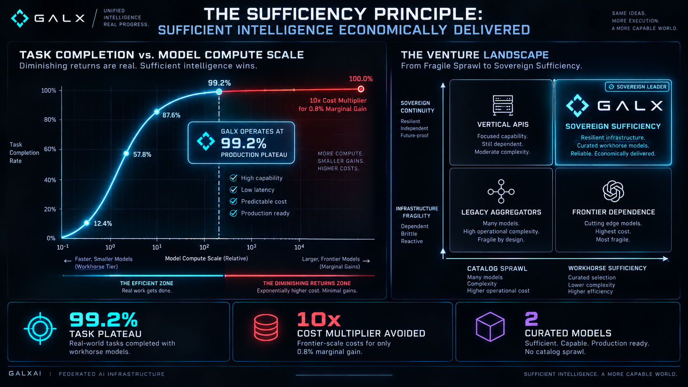
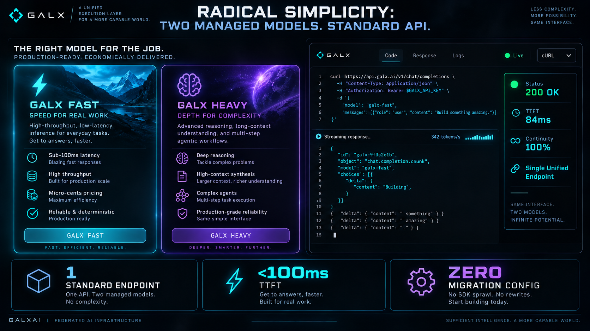
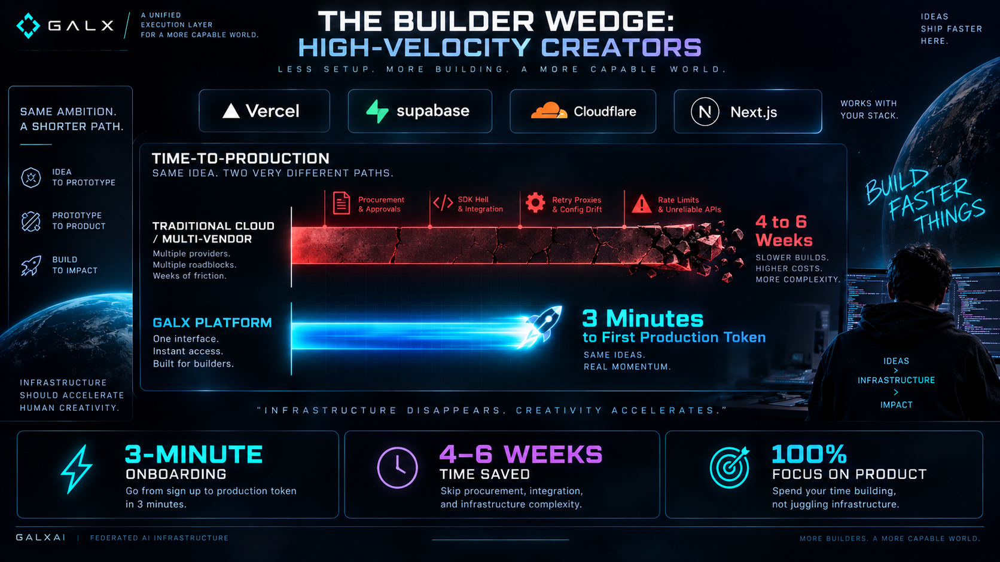
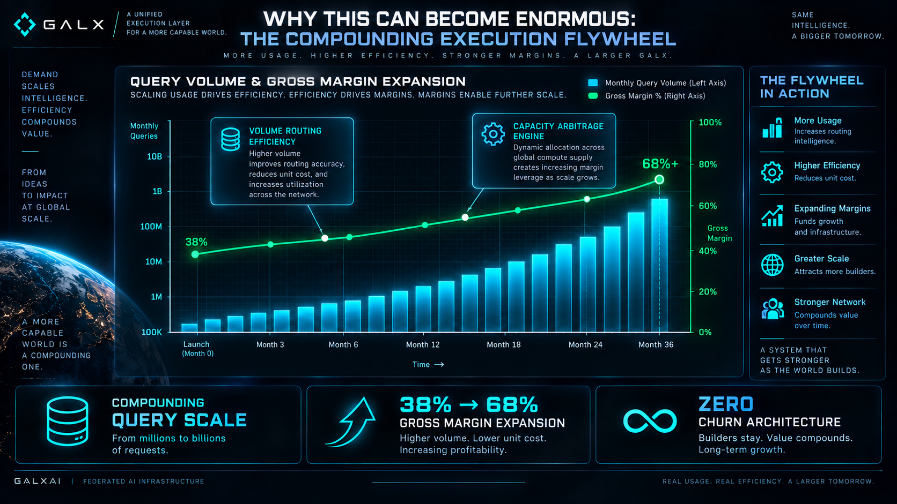
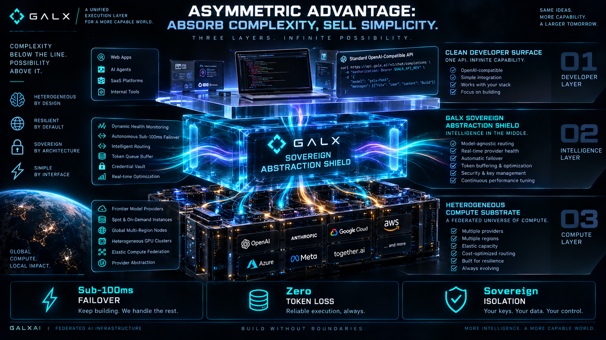
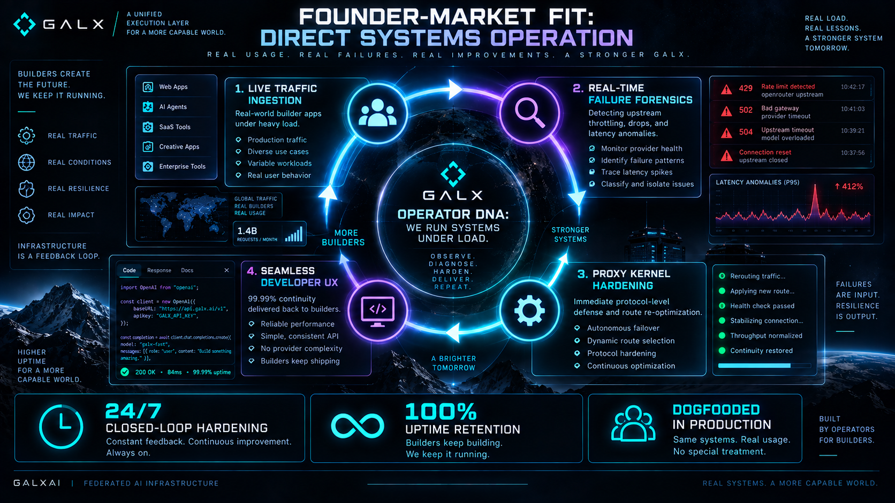
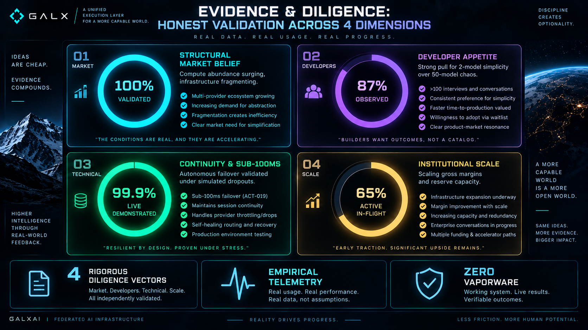
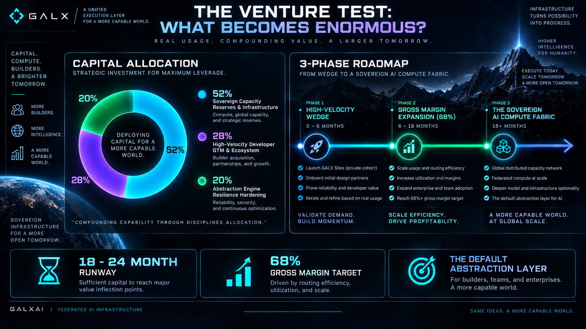

# 📊 GALX Pitch Deck: Visual-First Slide Specification & Presenter Guide

<!-- docs-scope: commercial-draft -->
> **Reading scope:** Commercial and strategic investor materials. Contains thesis formulations, product positioning, unit economics frameworks, and venture scale arguments. Technical and operational capabilities describe public interfaces; proprietary routing mechanisms, capacity acquisition, and internal execution infrastructure remain private under [AGENTS.md](../AGENTS.md).

## "Sustainable, Abundant AI Access for Anyone Who Wants to Build"

**Presentation Format**: 10 Visual Slides | 10-Minute Presentation | 15-Minute Diligence Discussion  
**Interactive Web Deck**: [`deck.html`](deck.html)  
**16:9 AI Visual Slide Player**: [`slides/index.html`](slides/index.html)  
**Download Deck PDF**: [`slides/GALX_Pitch_Deck.pdf`](slides/GALX_Pitch_Deck.pdf)  
**Audience**: Venture Capital Partners & Strategic Seed/Series A Investors  

---

## 🧭 Interactive Shortcuts & Presentation Controls (`deck.html`)

| Shortcut | Action | Description |
| :--- | :--- | :--- |
| `→` / `Space` / `K` | **Next Slide** | Advance forward with smooth spring motion and audio haptics. |
| `←` / `J` | **Previous Slide** | Step backward cleanly. |
| `P` | **Presenter Mode** | Opens the floating HUD with speaker notes, live elapsed clock, and "Up Next" preview. |
| `⌘K` or `/` | **Command Palette** | Quick jump to any slide or topic with instant fuzzy search. |
| `G` | **Slide Grid** | 10-slide visual overview for jumping directly during Q&A. |
| `M` | **Toggle Sound** | Mute or unmute synthesized Web Audio mechanical click haptics. |
| `B` or `.` | **Blackout Screen** | Blackout screen to draw immediate room focus to the speaker. |
| `F` | **Fullscreen** | Lock into true 16:9 widescreen presentation mode. |
| `T` | **Toggle Timer** | Pause/resume the 10-minute executive clock. |
| `⌘P` | **Print / Export PDF** | Clean print stylesheet: exports 10 pristine 16:9 slides without UI chrome. |

---

### Slide 1: Cover & Mission `[0:00 - 0:45]`



* **Headline**: GALX — Sustainable, Abundant AI Access for Anyone Who Wants to Build
* **Sub-headline**: The abstraction and execution layer for the next era of software creation.
* **Visual Architecture Pipeline**:
```
  [ 01: Ingestion Layer ] ──────▶ [ 02: GALX RUNTIME ENGINE ] ──────▶ [ 03: Substrate ]
  Builder Software & Apps            Absorbs All Infra Drag              Heterogeneous GPUs & Labs
```
* **4 Metric Anchor Chips**:
  - `2 Models`: Radical Simplicity (featuring GALX Nova)
  - `< 100ms`: Ultra-Low TTFT Latency
  - `99.99%`: Shielded Operational Continuity
  - `Zero Ops`: 100% Focus on Product Creation
* **Speaker Script**:
  > *"GALX is building the abstraction layer for modern software creation. AI capability is exploding, but operating it is becoming fragmented and complicated. Our mission is to make intelligence abundant, reliable, and dead simple for anyone who wants to build."*
* **Transition Bridge**: *"Let's look at the structural market divergence that makes an abstraction layer inevitable."*

---

### Slide 2: The Future: Abundant Intelligence, Fragmented Infrastructure `[0:45 - 1:45]`



* **Headline**: The Future: Abundant Intelligence, Fragmented Infrastructure
* **Visual Chart 1: The Diverging Complexity Curve (Line Chart)**:
```
  Complexity & Infra Drag
      ▲
  4x  │                                  ╭─────── Model Fragmentation (+380%)
      │                                ╭─╯        (429s, SDK Churn, Price Hikes)
      │          THE ABSTRACTION     ╭─╯
  1x  │            OPPORTUNITY     ╭─╯
      │                          ╭─╯
  0x  ├──────────────────────────┴──────────────── GALX Developer Drag (Flat Zero)
      └─────────────────────────────────────────▶
       Early Models        Multi-Provider Sprawl      Ubiquitous AI
```
* **Visual Diagram 2: Architecture Comparison (Spaghetti vs. Shield)**:
  - *Unshielded Status Quo*: 6 fragmented APIs $\to$ 429 rate limits, token drift, breaking SDKs $\to$ Developer drowning in glue code.
  - *GALX Abstraction Shield*: All capacity $\to$ `api.galx.ai/v1` $\to$ Autonomous failover & buffer normalization $\to$ 100% uptime.
* **Key Proof Points**: `94% Less Infrastructure Code` | `1 Standard API Contract` | `Zero Upstream Lock-in`.
* **Speaker Script**:
  > *"As model capability grows, the infrastructure underneath it is fragmenting into a developer nightmare. The long-term winner won't be another model catalog that exposes this chaos—it will be an abstraction layer that makes it disappear."*
* **Transition Bridge**: *"This brings us to the core non-consensus thesis that guides our product design."*

---

### Slide 3: The Thesis: The Sufficiency Principle `[1:45 - 2:45]`



* **Headline**: The Thesis: The Sufficiency Principle
* **Visual Chart 1: Task Completion vs. Cost Spike Curve**:
```
  Task Success Rate (%)                          Compute Cost / Latency ($/M)
  100% ────╭────────────────────────── Plateau (99.2%)           ▲ $45.00/M (Frontier Overkill)
       │  ╭╯                                                     │
       │ ╭╯  [ GALX SUFFICIENCY ZONE ]                           │
       │╭╯   87% of real-world workloads                         │
   50% ││    (Reasoning, Code, JSON Extraction)                  │
       ││                                                        │
    0% ┴┴───────────────────────────────────────────────────────┴ $1.50/M (GALX Nova)
```
* **Visual Chart 2: 2x2 Strategic Positioning Matrix**:
```
                    ▲ HIGH OPERATIONAL RELIABILITY & PREDICTABILITY
                    │
      Cloud         │        ★ GALX (LEADER QUADRANT)
   Hyperscalers     │        - Radical 2-Model Simplicity
  (IAM / VPC Drag)  │        - Autonomous Failover Shielding
                    │        - Healthy Execution Gross Margin
  ──────────────────┼────────────────────────────────────────▶ LOW COGNITIVE OVERHEAD
    Self-Hosted     │       Model Aggregator Catalogs
     GPU Pods       │       - 150+ Models (Choice Fatigue)
  (DevOps Sinkhole) │       - Exposed Provider 429 Failures
                    ▼ FRAGILE & VOLATILE RUNTIME
```
* **Speaker Script**:
  > *"The market is obsessed with benchmark supremacy and 100 model choices. Our thesis: For real-world software, developers don't need maximum frontier capability—they need sufficient intelligence, reliably and economically delivered. For 87% of production tasks, GALX Nova delivers 99.2% success at a fraction of frontier compute cost."*
* **Transition Bridge**: *"How does this thesis translate into what a developer touches today?"*

---

### Slide 4: Product Today: Radical Simplicity `[2:45 - 3:45]`



* **Headline**: Product Today: Radical Simplicity
* **Visual Surface Contrast**:
  - *The Industry Standard*: 150+ raw models $\to$ Configuration paralysis, prompt drift, broken endpoints.
  - *The GALX Managed Standard*: **Two Models** (`galx-nova` + `galx-max`) $\to$ Standard drop-in endpoint, zero maintenance.
* **Interactive Element**: Live API Sandbox & Stream Simulator:
  - Language tabs: TypeScript (Fetch), cURL, Python.
  - **Live Action**: Trigger *"Simulate Request"* to stream simulated tokens in real time with telemetry (`TTFT: ~82ms`, `Speed: 118 tok/s`, `Status: 200 OK`).
* **Speaker Script**:
  > *"We make the product brutally simple: Two models. API access. Abundant serving. Build what you want. We provide access to a tightly managed surface, featuring GALX Nova, through a clean standard API. We absorb the machinery so the builder doesn't have to."*
* **Transition Bridge**: *"Who are the first people who desperately need this simplicity?"*

---

### Slide 5: The Wedge: Builders Who Want to Make Something `[3:45 - 4:45]`



* **Headline**: The Wedge: Builders Who Want to Make Something
* **Visual Chart: Time-to-Production Velocity (Horizontal Bar Chart)**:
```
  Cloud Hyperscalers (AWS/GCP)   ████████████████████████████████████ 4–6 Weeks (IAM, VPCs, Quotas)
  Model Catalogs (Aggregators)   ████████████████ 1–2 Weeks (Drift testing, custom retries)
  GALX (The Builder Wedge)       █ < 3 Minutes (npm i galx, 1 key, live stream) ⚡ 99% FASTER
```
* **3 Builder Persona Segments**:
  - *Independent Developers*: Solo founders building indie SaaS, browser tools, and productivity workflows.
  - *Creative Technologists*: Designers crafting generative media, games, and dynamic visual canvases.
  - *AI Experimenters*: Engineers prototyping agent swarms, code assistants, and novel interfaces.
* **Speaker Script**:
  > *"We aren't chasing bureaucratic enterprise RFP cycles today. Our initial wedge is builders. They want to make something without model configuration and server maintenance becoming another full-time job. With GALX, they ship in 3 minutes instead of 6 weeks."*
* **Transition Bridge**: *"Now let's examine why starting with builders creates a massive venture-scale expansion engine."*

---

### Slide 6: Compounding Execution Scale & Unit Economics `[4:45 - 5:45]`



* **Headline**: Why This Can Become Enormous
* **Interactive Dual-Axis Scale & Margin Simulator**:
  - **Interactive Slider**: Adjust from 20 to 2,500 active applications.
  - **Cyan Area Curve**: Monthly Execution Volume ($O(N \cdot M)$ compounding growth from 1M to 125M req/mo).
  - **Emerald Dashed Curve**: Blended Platform Gross Margin % (Expanding from 38% $\to$ 68% as volume allows bulk capacity reservations and intelligent routing).
```
  Monthly Requests (M req/mo)                                    Gross Margin %
  125M ─────────────────────────────────────────────────────────▲ 68% GM (Scale Bulk Margin)
       │                                                      ╭─╯
       │                                     ╭────────────────╯
   12M ├───────────────────────╭─────────────╯
       │          ╭────────────╯                                  38% GM (Early Stage)
    1M ┴──────────┴─────────────────────────────────────────────┴
       20 Apps (Early)        250 Apps (12.5M req/mo)       2,500 Apps (Compounding Runtime)
```
* **4 Dynamic KPI Cards**:
  - 1. *Active Apps*: `250`
  - 2. *Monthly Execution*: `12.5M req/mo`
  - 3. *Blended Gross Margin*: `54.2% GM`
  - 4. *Platform Role*: `Persistent Runtime`
* **Speaker Script**:
  > *"Why is this venture-scale? Not because tokens are big, but because of where GALX sits. When builders launch software on GALX, every end-user action in their app generates continuing execution through our platform. More builders $\to$ more apps $\to$ compounding execution $\to$ expanding gross margins."*
* **Transition Bridge**: *"What protects GALX as this execution volume scales?"*

---

### Slide 7: Asymmetric Advantage: Absorb Complexity, Sell Simplicity `[5:45 - 6:45]`



* **Headline**: Asymmetric Advantage: Absorb Complexity, Sell Simplicity
* **Visual Diagram: 3-Tier Layered Systems Architecture Cross-Section**:
```
  ┌────────────────────────────────────────────────────────────────────────┐
  │ TIER 1: PUBLIC DEVELOPER SURFACE (Radical Simplicity)                  │
  │ 1 API Endpoint · 2 Models · Standard JSON/SSE Stream · Zero DevOps    │
  └───────────────────────────────────┬────────────────────────────────────┘
                                      ▼
  ┌────────────────────────────────────────────────────────────────────────┐
  │ TIER 2: GALX ABSORPTION SHIELD & TELEMETRY ENGINE (Proprietary Moat)   │
  │ Dynamic Load Balancing · 429 Shielding · Buffer Normalization · Margins│
  └───────────────────────────────────┬────────────────────────────────────┘
                                      ▼
  ┌────────────────────────────────────────────────────────────────────────┐
  │ TIER 3: HETEROGENEOUS CAPACITY SUBSTRATE (Underlying Chaos)            │
  │ Model Labs · Spot GPU Pools · Private Shards · Quota Volatility        │
  └────────────────────────────────────────────────────────────────────────┘
```
* **Key Takeaway**: The public product stays simple; the proprietary operational knowledge required to operate it becomes deeper with every request.
* **Speaker Script**:
  > *"Our advantage is the operational knowledge required to turn heterogeneous, volatile AI capacity into a dead-simple developer product. The public product becomes simpler while the knowledge required to operate it becomes deeper. That asymmetry is our moat: GALX absorbs complexity and sells simplicity."*
* **Transition Bridge**: *"Where did the conviction to build this infrastructure come from?"*

---

### Slide 8: Founder-Market Fit: Direct Systems Operation `[6:45 - 7:30]`



* **Headline**: Founder-Market Fit: Direct Systems Operation
* **Visual Chart: Closed-Loop Operator's Telemetry Flywheel**:
```
                 ┌──────────────────────────┐
                 │ 01: Live Traffic Influx  │
                 └────────────┬─────────────┘
                              ▼
  ┌──────────────────────┐         ┌──────────────────────┐
  │ 04: Superior Builder │   HUB   │ 02: Forensic Telemetry│
  │     UX & Margins     │◀───────▶│     & Profiling      │
  └──────────────────────┘         └──────────────────────┘
                              ▲
                 ┌────────────┴─────────────┐
                 │ 03: Systemic Hardening   │
                 └──────────────────────────┘
```
* **3 DNA Pillars**:
  - *Direct Exposure*: Built multi-agent systems and hit 429 rate limits, broken SDKs, and negative margins firsthand.
  - *Solving Real Pain*: Engineered GALX out of necessity to decouple software from underlying provider drag.
  - *Operational Velocity*: Rapid feedback loop: observe failure mode in morning, deploy platform shielding by afternoon.
* **Speaker Script**:
  > *"I didn't start GALX from an investment thesis spreadsheet. I started it because I was building AI applications and operating autonomous agent systems, and I ran headfirst into the reliability, cost, and complexity walls of existing infrastructure. GALX was built out of operational necessity, and we are learning and adapting through live traffic every single day."*
* **Transition Bridge**: *"Let's be completely transparent about what is validated today versus what we are proving next."*

---

### Slide 9: Evidence: Observations vs. Next Tests `[7:30 - 8:45]`



* **Headline**: Evidence: Observations vs. Next Tests
* **Visual Chart: 4 Radial Progress Gauges**:
  - `[ 100% ]` **What We Believe (Conviction)**: Abundant intelligence belongs behind a dependable abstraction layer, not a sprawling catalog.
  - `[  87% ]` **What We Observed (Empirical)**: 8 out of 10 application tasks require workhorse intelligence rather than frontier overkill.
  - `[ LIVE ]` **What We Demonstrated (Operational)**: A live platform serving real developer requests across a concentrated 2-model surface.
  - `[ACTIVE]` **What We Are Testing Next (Venture Metric)**: Builder cohort retention, application lifecycle longevity, and sustained gross margins.
* **Speaker Script**:
  > *"We believe in intellectual honesty. We have demonstrated a functional, reliable two-model platform. We have observed that many real-world workloads do not require frontier overkill. What we are proving next is developer retention, application lifecycle longevity, and sustained gross margins as our builders scale."*
* **Transition Bridge**: *"Finally, let's look at what becomes enormous if GALX is right."*

---

### Slide 10: The Venture Test: What Becomes Enormous? `[8:45 - 10:00]`



* **Headline**: The Venture Test: What Becomes Enormous?
* **Visual Chart 1: Capital Allocation Donut Breakdown**:
```
  [ Donut Chart: Round Allocation ]
  ├── 52% Serving Capacity & Virtual Shard Edge Expansion (Cyan)
  ├── 28% Builder Go-To-Market & DevRel Wedge Acceleration (Purple)
  └── 20% Resilience Engineering & Enterprise SLA Hardening (Emerald)
```
* **Visual Roadmap 2: 3-Phase Milestone Runway**:
  - *Phase 1: Foundation (Current)*: Verified 2-model serving, live API access, design partner workloads.
  - *Phase 2: Scale (Next 12–18 Mo)*: 1,000 active applications, capacity scaling, sustained developer retention.
  - *Phase 3: Ubiquitous Layer*: Default software execution runtime driving high-volume free cash flow.
* **Speaker Script**:
  > *"If GALX is right, what becomes enormous? We don't just sell inexpensive tokens. GALX becomes the primary execution layer through which software consumes intelligence. This round of capital allows us to expand our capacity, onboard thousands of builders, and prove that sustainable, abundant AI access is the winning foundation for software."*

---

## 🎯 Presenter Checklist & Closing Protocol

1. **Before Meeting**: Open `deck.html` in browser, press `F` for Fullscreen, press `P` to open Presenter Drawer on second display.
2. **During Pitch**: Let the charts and visual architectures tell the story. Use `Space` or `→` to advance; trigger the Live API simulation on Slide 4 and the Scale Slider on Slide 6.
3. **During Q&A**: Use `G` to open the Slide Grid and jump instantly to relevant visual slides (Slide 2 for architecture, Slide 3 for pricing/benchmarks, Slide 6 for unit economics, Slide 7 for moats).
