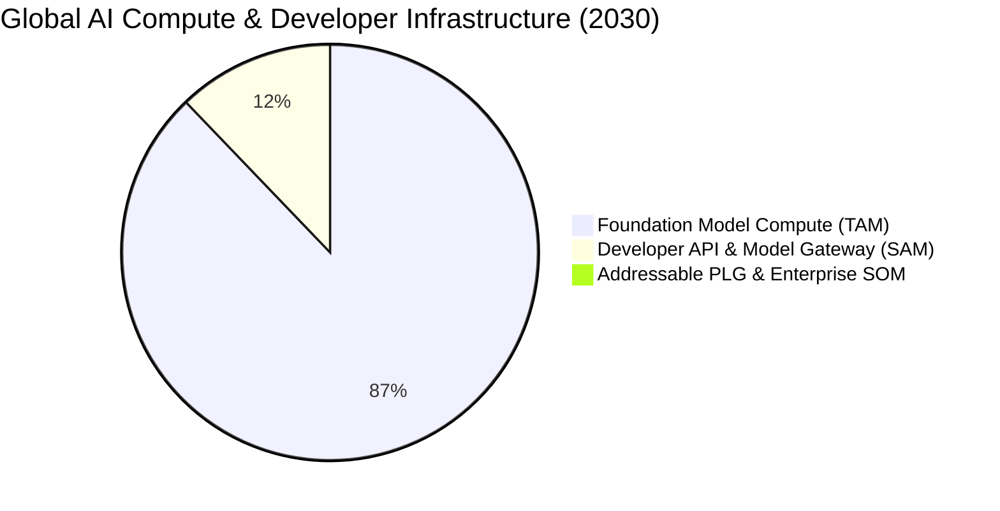

# 📈 GALXAI Market Sizing: TAM, SAM & SOM Analysis

An econometrically backed, top-down and bottom-up market sizing for GALXAI across the global AI compute, inference routing, and developer infrastructure landscape.

---

## 🌐 1. Top-Down Market Sizing (Macro Landscape)

### Total Addressable Market (TAM): **$1.30 Trillion by 2030**
- **Definition**: The total global market for generative AI software, foundation model inference, enterprise compute clearing, and developer API tooling.
- **Source Benchmarks**: Gartner, IDC, McKinsey, Goldman Sachs Research (Global Generative AI Infrastructure & Inference Market 2024–2030).
- **Compound Annual Growth Rate (CAGR)**: **38.2% (2024–2030)**.
- **Underlying Driver**: Inference compute is exponentially decoupling from training compute. Over 85% of long-term AI compute spend will be spent serving token completions, autonomous agents, and real-time visual synthesis in production applications.

---

### Serviceable Addressable Market (SAM): **$180 Billion by 2030**
- **Definition**: The aggregate spend specifically dedicated to:
  1. API-based model consumption (OpenAI, Anthropic, xAI, Google Vertex, AWS Bedrock).
  2. Enterprise API gateway management, routing substrates, and token caching networks.
  3. Frontend and full-stack generative AI UI SDKs and middleware.
- **Methodology**: 13.8% of global generative AI software spend flows through external API gateways, multi-provider routers, and compute clearinghouses.

---

### Serviceable Obtainable Market (SOM): **$14.2 Billion by 2030**
- **Definition**: The realistic market share captured by GALXAI targeting:
  - High-velocity AI startups, scale-ups, and indie developers building on Next.js, React, Node, and Python.
  - Development teams using AI coding assistants (Cursor, Windsurf, Claude Code, Devin).
  - Mid-market and enterprise accounts seeking 25%–40% wholesale cost reductions and 99.99% active failover SLAs.
- **Market Penetration Assumption**: ~7.8% of the developer gateway and clearinghouse market within 5 years.

---

## 🔬 2. Bottom-Up Market Validation (Micro Landscape)

To rigorously validate the top-down TAM/SAM/SOM, we calculate bottom-up revenue potential based on developer counts, token velocity, and average contract values (ACV).

### Segment 1: Self-Serve & Pro Developers (PLG)
- **Global Population**: 32.5M professional software developers worldwide (SlashData / GitHub Octoverse).
- **AI-Active Developers**: ~40% (13.0M developers building or integrating AI features by 2026).
- **Target Reachable PLG User Base**: 5% of AI developers = **650,000 active accounts**.
- **Average Spend**: $85/month ($1,020/year).
- **Segment Revenue**: 650,000 $\times$ $1,020 = **$663 Million / Year**.

### Segment 2: AI Startups & Scale-ups (Growth Tier)
- **Target Companies**: 120,000 venture-backed and bootstrapped tech startups adding generative AI capabilities.
- **Target Conversion**: 8% market share = **9,600 companies**.
- **Average Monthly Spend**: $3,500/month ($42,000/year).
- **Segment Revenue**: 9,600 $\times$ $42,000 = **$403.2 Million / Year**.

### Segment 3: Enterprise & Mid-Market Accounts
- **Target Enterprises**: 45,000 Global Mid-Market and Enterprise engineering organizations.
- **Target Conversion**: 3% market share = **1,350 enterprise accounts**.
- **Average Annual Contract Value (ACV)**: $180,000/year (Dedicated routing shards, SLA, SSO, team seats).
- **Segment Revenue**: 1,350 $\times$ $180,000 = **$243.0 Million / Year**.

### **Total Bottom-Up Projected Annual Revenue Potential**: **$1.31 Billion ARR** (Near-Term Horizon).

---

## 📊 3. Market Growth Drivers & Structural Tailwinds

| Market Catalyst | Impact on GALXAI |
| :--- | :--- |
| **Shift from Chatbots to Autonomous Agent Swarms** | Agent loops invoke 50x–200x more tokens per task than human chat, intensifying the need for wholesale rate arbitration and 429 rate limit prevention. |
| **Proliferation of AI Coding IDEs (Cursor, Windsurf, Claude Code)** | Over 60% of modern software is written with AI assistants. `npx galxai skills` acts as an ambient installer that embeds GALXAI into every generated codebase. |
| **Specialization of Frontier AI Workloads** | As OpenAI releases differentiated tier models (GPT-5.6 Sol for deep reasoning, Terra for balanced coding, Luna for high-velocity completions), developers demand an intelligent routing and clearinghouse layer rather than paying frontier flagship rates for basic tasks. |
