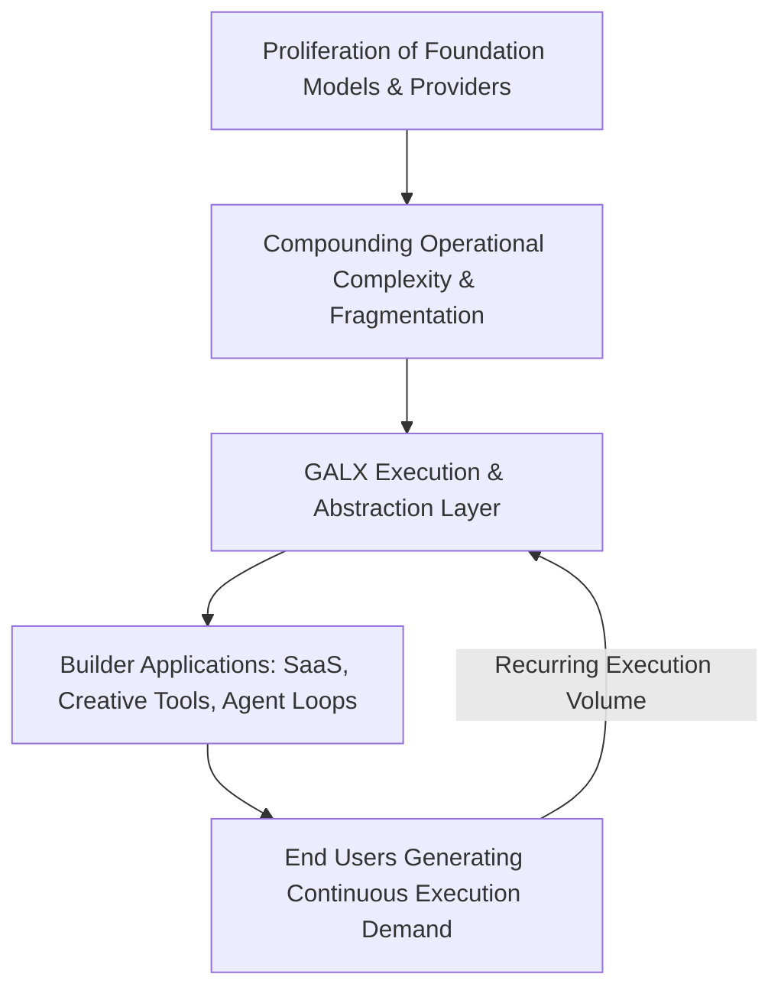

# 📈 GALX Market Architecture & Scale Potential

<!-- docs-scope: commercial-draft -->
> **Reading scope:** Commercial and strategic investor materials. Contains thesis formulations, product positioning, unit economics frameworks, and venture scale arguments. Technical and operational capabilities describe public interfaces; proprietary routing mechanisms, capacity acquisition, and internal execution infrastructure remain private under [AGENTS.md](../AGENTS.md).

## Scaling With the Software Creation Lifecycle

A grounded structural analysis examining why GALX’s market scale is defined by the ongoing execution demand of applications built on AI, rather than cosmetic top-down inference estimates.

---

## 1. The Flaw in Traditional Inference Sizing

Traditional venture pitch decks routinely open with a generic top-down TAM calculation:
$$\text{"The global AI inference market will reach \$1 Trillion by 2030, so capturing 1\% is a \$10B business."}$$

This framing is fundamentally incomplete. It treats AI compute as a raw bulk commodity sold in undifferentiated bytes, obscuring three critical market dynamics:
1. **Commoditization of Raw Model Endpoints**: Raw access to commoditized models experiences continuous downward price pressure as providers compete on per-token prices.
2. **Value Migration to the Application Layer**: The true economic value is created and captured where software solves end-user problems.
3. **The Intermediary Value Paradox**: An infrastructure provider only builds a durable, compounding business if it embeds itself directly into the ongoing execution lifecycle of the application.

**GALX is not sized merely as an inference reseller.**  
The scale of GALX is determined by its role as the **persistent execution layer beneath software built on AI.**

---

## 2. The Structural Shift: Intelligence as Software Infrastructure

We identify three distinct structural waves driving execution demand toward an abstraction layer:

### Wave 1: The Transition from Experimentation to Application
In the initial wave of generative AI, developers evaluated raw API keys, played with prompt sandboxes, and built standalone demo chatbots. Today, developers are embedding AI into persistent application loops: background processing, creative generation, agentic reasoning, code transformation, and structured data pipelines.

Every feature built this way requires **ongoing execution**. When an end user clicks a button, saves an asset, or triggers an automated task, the application executes a request.

### Wave 2: Ecosystem Fragmentation
As more foundation models, hardware architectures, open-weight alternatives, and hosting providers enter the market, developers face an overwhelming matrix of trade-offs:
- Which provider offers sufficient reliability right now?
- How do we handle provider-specific outages or rate limits?
- Why pay for a frontier reasoning model when a streamlined model delivers 99% of the required utility?

Developers do not have the time or operational desire to build an internal infrastructure team just to balance these variables.

### Wave 3: The Compounding Flywheel
When an independent builder launches an application on GALX:
- In Month 1, they may run only 10,000 requests during development.
- When their application acquires 500 active users, execution scales to 500,000 requests.
- When the product scales to 50,000 users, execution scales to 50,000,000 requests.

GALX scales revenue directly with the success of the applications running on top of it.

---

## 3. Structural Scale Drivers

Rather than assigning arbitrary financial projections, we assess the addressable scale through four observable structural vectors:

| Structural Vector | Market Reality | How GALX Participates |
| :--- | :--- | :--- |
| **Builder Explosion** | Millions of developers and non-traditional builders are creating software powered by AI coding tools and high-level frameworks. | Radical simplicity (two models, API access) removes the setup barrier, making GALX the easiest place to start. |
| **Execution Density** | Modern AI applications execute multi-step requests, background tasks, and interactive generation rather than single one-off prompts. | Execution volume per application grows faster than raw user count. |
| **Abstraction Stickiness** | Once an application is wired to a dependable API that handles reliability and economics, switching away to manage raw providers introduces high operational friction. | High developer retention and expanding net volume over time. |
| **Sufficient Intelligence Wedge** | Over 80% of application execution tasks can be handled by well-managed, efficient models rather than expensive frontier behemoths. | GALX captures high gross margin by optimizing delivery while providing developers with abundant, cost-effective serving. |

---

## 4. The Scale Hypothesis

**The Core Question**: What determines whether GALX becomes a multi-billion dollar platform?

1. **Breadth of Builders**: Can GALX become the default starting point for tens of thousands of independent developers and creative technologists?
2. **Application Longevity**: Do applications built on GALX achieve product-market fit and generate recurring, long-term traffic?
3. **Execution Monopoly**: Does the simplicity and reliability of GALX create enough stickiness that scaling applications stay on GALX rather than building custom in-house infrastructure?

If those hypotheses hold, GALX becomes the **essential execution layer** for the next generation of software—participating in the compounding economic value of every application built on AI.
