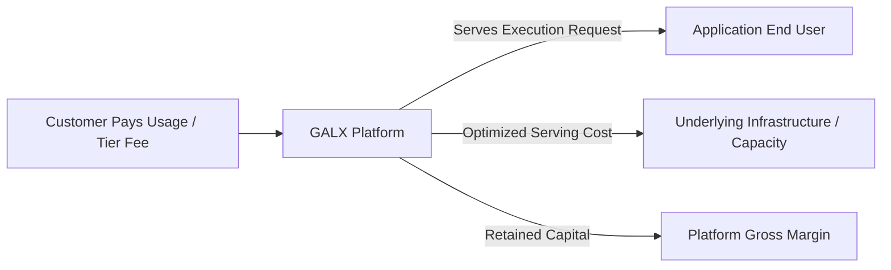

# 💰 GALX Business Model & Unit Economics Framework

<!-- docs-scope: commercial-draft -->
> **Reading scope:** Commercial and strategic investor materials. Contains thesis formulations, product positioning, unit economics frameworks, and venture scale arguments. Technical and operational capabilities describe public interfaces; proprietary routing mechanisms, capacity acquisition, and internal execution infrastructure remain private under [AGENTS.md](../AGENTS.md).

## An Honest Economic Engine: Consumption, Serving & Margin

A disciplined examination of how GALX generates revenue, incurs serving costs, preserves gross margin, and expands economically as customer applications grow.

---

## 1. The Core Economic Engine

GALX operates on a clear, legible business model:

$$\text{Customer Pays GALX} \longrightarrow \text{Customer Uses GALX} \longrightarrow \text{GALX Incurs Serving Cost} \longrightarrow \text{GALX Retains Gross Margin}$$



### 1. Customer Revenue
Developers purchase compute access through developer tiers and usage-based billing. They receive abundant, predictable execution without paying punitive retail surcharges or dealing with arbitrary provider rate limits.

### 2. Serving Cost
GALX fulfills execution requests through proprietary operational knowledge, managing capacity across heterogeneous infrastructure sources, local runtimes, and optimized serving topologies.

### 3. Gross Margin Retention
Because GALX provides a focused two-model managed surface rather than passing through unmanaged retail calls, the platform captures healthy gross margins by delivering sufficient intelligence efficiently.

---

## 2. Compounding Expansion: The Application Lifecycle

Traditional developer tools hit revenue ceilings because they charge per seat. GALX’s economics expand with the execution volume of the applications built on the platform:

```
    [Phase 1: Prototype]           [Phase 2: Launch]              [Phase 3: Scale]
      Builder Experiments           Initial Users Adopt             High-Traffic Production
    -------------------------     -------------------------     -----------------------------
    • Low initial spend           • Daily active usage          • Compounding execution volume
    • Fast iteration & test       • Predictable execution       • Deep platform stickiness
    • Low cost to acquire         • Organic revenue growth      • High gross margin retention
```

1. **Low Acquisition Friction**: Builders start quickly because GALX provides an immediate API without multi-week enterprise negotiations or confusing setup steps.
2. **Organic Account Expansion**: As an application attracts more end users, its requests per day compound. GALX participates directly in that upside without needing additional sales effort.
3. **High Switching Friction**: Once an application’s backend and client-facing workflows depend on GALX's reliability and low operational overhead, switching back to managing raw infrastructure represents a substantial engineering regression.

---

## 3. The Sufficient Intelligence Margin Advantage

The conventional approach to AI developer tooling assumes that every call must be forwarded to the most expensive foundation model available. This destroys application margins and makes developer pricing volatile.

GALX’s non-consensus thesis creates an asymmetric economic advantage:

| Dimension | Conventional Model Reseller | GALX Abstraction Layer |
| :--- | :--- | :--- |
| **Model Scope** | Sells 100+ unmanaged third-party models | Deliberately manages two focused models (e.g. GALX Nova) |
| **Operational Control** | Passive byte-pipe forwarding | Active management of capacity, resilience, and serving |
| **Gross Margin Profile** | Thin, fragile spread on top of retail rates | Healthy platform margin enabled by operational delivery |
| **Developer Experience** | High decision friction; developer manages complexity | Radical simplicity; developer builds software |

By delivering **sufficient intelligence** reliably and economically, GALX provides developers with cost certainty while protecting platform unit economics.

---

## 4. What We Are Proving in Current Cohorts

Intellectual honesty requires measuring what is known today versus what is being validated:

### 1. Developer Payment Willingness
- **Observation**: Builders are willing to pay for friction-free access that saves them days of infrastructure setup.
- **Ongoing Test**: Evaluating optimal initial credit structures and usage thresholds to balance rapid onboarding with immediate margin contribution.

### 2. Execution Volume Durability
- **Observation**: Early builders exhibit steady request activity during active development.
- **Ongoing Test**: Tracking long-term retention as developer prototypes transition into publicly distributed products.

### 3. Serving Cost Predictability
- **Observation**: Concentrated model surfaces allow far greater operational control than broad, uncurated catalogs.
- **Ongoing Test**: Validating that serving margins remain stable across fluctuating traffic patterns and multi-tenant spikes.
