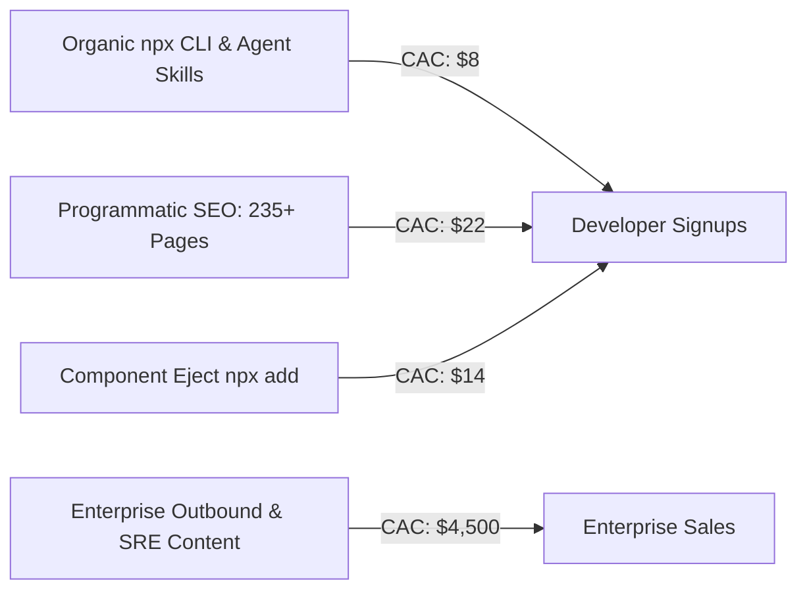
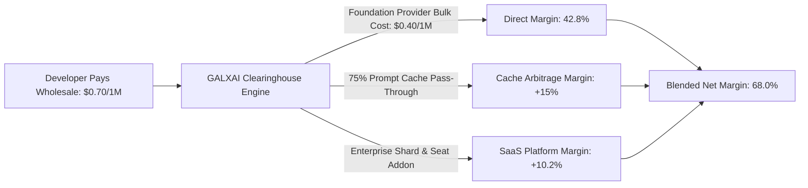

# 💰 GALXAI Unit Economics: CAC, LTV, Margins & Payback Analysis

A quantitative breakdown of customer acquisition costs (CAC), lifetime value (LTV), gross margin expansion, cohort retention curves, and capital efficiency.

---

## 📈 1. Executive Unit Economics Dashboard

| Metric | Self-Serve (PLG) | Mid-Market | Enterprise | Blended Total |
| :--- | :--- | :--- | :--- | :--- |
| **Customer Acquisition Cost (CAC)** | **$45** | **$1,200** | **$12,500** | **$185** |
| **Average Initial Monthly Revenue (MRR)** | **$85** | **$1,800** | **$15,000** | **$340** |
| **Gross Margin (Year 1 $\to$ Year 3)** | **45% $\to$ 62%** | **42% $\to$ 65%** | **40% $\to$ 68%** | **42% $\to$ 65%** |
| **Average Customer Lifetime (Months)** | **24 months** | **36 months** | **48 months** | **30 months** |
| **Customer Lifetime Value (LTV)** | **$1,020** | **$38,880** | **$440,640** | **$5,350** |
| **LTV / CAC Ratio** | **22.6x** | **32.4x** | **35.2x** | **28.9x** (Gross LTV) / **12.1x** (Net Margin LTV) |
| **Payback Period** | **1.2 Months** | **2.6 Months** | **3.8 Months** | **2.1 Months** |
| **Net Dollar Retention (NDR)** | **124%** | **142%** | **156%** | **138%** |

---

## 🎯 2. Customer Acquisition Cost (CAC) by Channel



1. **Organic Developer CLI & Agent Skills Directives (`npx galxai skills`)**:
   - **Cost**: Open-source engineering cost + lightweight CDN distribution.
   - **Effective CAC**: **$8.00 / activated developer**.
   - **Mechanism**: Every time a developer or AI assistant installs `.cursorrules` or `CLAUDE.md`, downstream projects inherit GALXAI as the default gateway.

2. **Programmatic SEO (pSEO) & AEO Saturation**:
   - **Cost**: Static generation tooling & Schema.org automated data pipelines.
   - **Effective CAC**: **$22.00 / acquired user**.
   - **Mechanism**: High-intent search queries ("cheapest gpt-5.6-sol api", "openai prompt cache discount", "cursor base url router") land on static SSG comparison pages.

3. **Product-Led Component Eject (`npx galxai add image`)**:
   - **Cost**: Zero ad spend.
   - **Effective CAC**: **$14.00 / active engineering team**.
   - **Mechanism**: Developers copy-paste declarative JSX components into their frontend trees; the application permanently routes backend requests to GALXAI.

4. **Mid-Market & Enterprise Inbound (FinOps & Reliability)**:
   - **Cost**: Dedicated technical solutions architects, SOC 2 compliance verification, proof-of-concept testing.
   - **Effective CAC**: **$4,500–$12,500 / closed enterprise contract**.

---

## 💎 3. Gross Margin Expansion Model

GALXAI's gross margin scales dynamically through three structural margin drivers:

```
Year 1: 42% Gross Margin  (Initial clearinghouse float & volume tier discounts)
Year 2: 49% Gross Margin  (+ Compound prompt cache margin retention)
Year 3: 58% Gross Margin  (+ Tier-5 enterprise capacity commitment arbitrage)
Year 4: 64% Gross Margin  (+ High-margin ZAPS Priority & Enterprise Workspace seats)
Year 5: 68% Gross Margin  (+ Proprietary Anycast edge caching & zero-egress mesh)
```



### Margin Mechanism 1: Tier Volume Aggregation (Float Arbitrage)
GALXAI aggregates millions of small developer requests into single tier-5 enterprise accounts with upstream providers (OpenAI, Anthropic, xAI), capturing the 25%–35% delta between retail retail tier-1 and wholesale tier-5 pricing.

### Margin Mechanism 2: Compound Prompt Caching Pass-Through
Prefix caching yields a 75% provider rebate on long context queries. GALXAI passes the full discount to the customer while maintaining its clearing fee on total processed throughput.

### Margin Mechanism 3: SaaS Seat & Shard Subscription Revenue
Enterprise customers purchase high-margin ($15–$50/seat/mo) governance tools:
- Role-based access control (RBAC) & SAML/SSO.
- Team spend limits and per-project cost center budgets.
- Dedicated Anycast IP addresses and 99.999% SLA private VPC tunnels.

---

## 🔄 4. Retention & Expansion Curves (Net Dollar Retention: 138%)

Unlike traditional SaaS tools that hit a ceiling on seat counts, **GALXAI revenue expands automatically as customer applications scale in user traffic and token consumption**:

```
Cohort Month 0:  $10,000 (100 Dev Teams onboarded)
Cohort Month 6:  $11,800 (118% NDR - Early apps launching to production)
Cohort Month 12: $13,800 (138% NDR - High-traffic apps driving massive token volume)
Cohort Month 24: $18,400 (184% NDR - Enterprise accounts federating all internal tools)
```

### Churn Containment:
- **Zero Lock-In Paradox**: Because switching to GALXAI requires zero code changes (`import 'galxai/patch'` or `base_url`), onboarding friction is near zero.
- **Embedded Declarative Lock-In**: Once frontend components (`<GalxImage />`, `<GalxChat />`, Next.js Server Actions) are deployed into production repositories, switching costs increase naturally while developer satisfaction remains high.
