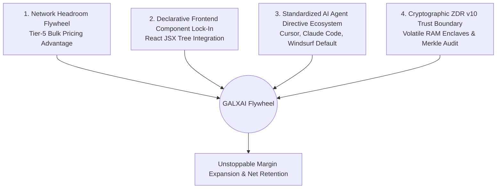

# 🛡️ GALXAI Competitive Landscape & Strategic Defensibility

<!-- docs-scope: commercial-draft -->
> **Reading scope:** Commercial or product planning material. Claims, prices, forecasts, and examples require separate dated validation; they are not deployment guarantees, certifications, or SLAs. See the [current contract](../FEDERATION_STRATEGY.md) and [complete catalog](../CATALOG.md).

## Unfair Advantages, Deep Moats & Competitor Teardown

**Audience**: Institutional Due Diligence Teams, Partner CTOs & Venture Partners  
**Location**: `/Users/bozoegg/Desktop/GALXAI/docs/investors/05_COMPETITIVE_LANDSCAPE_AND_MOATS.md`

---

## 🧭 1. The Competitive Landscape Overview

The market for AI developer infrastructure is divided into two distinct failure modes: **expensive full-retail developer wrappers** that lack wholesale clearinghouse economics, and **barebones API proxies** that lack frontend ergonomics, payload compaction, and enterprise governance.

```
                                  HIGH DEVELOPER ERGONOMICS
                                               ▲
                                               │     ★ GALXAI
                                               │     (Wholesale + Drop-In UI + BroccoliDB + Agent Directives)
                                               │
                       Vercel AI Gateway       │     Cursor / Windsurf Native
                                               │
   RETAIL PRICING / SURCHARGES ───────────────┼──────────────────────── WHOLESALE PRICING (-25% to -40%)
                                               │
                       Portkey / Helicone      │     OpenRouter
                       (SaaS Tooling Only)     │     (Raw Model Router, No UI / Governance)
                                               │
                       Cloudflare AI Gateway   │     Self-Hosted LiteLLM
                       (Edge Proxy Only)       │     (Heavy Maintenance / Infra Tax)
                                               │
                                               ▼
                                   LOW DEVELOPER ERGONOMICS /
                                   MANUAL PROXY COMPLEXITY
```

---

## 📊 2. Feature & Architectural Comparison Matrix

| Capability / Metric | **GALXAI** | **OpenRouter** | **Cloudflare AI Gateway** | **Portkey / Helicone** | **LiteLLM (Self-Hosted)** | **Direct OpenAI Retail** |
| :--- | :--- | :--- | :--- | :--- | :--- | :--- |
| **Wholesale Token Discount** | **25%–40% Instant** | Retail + Platform Spread | Retail Pass-Through | Retail + SaaS Fee | No (Direct Billing) | 0% (Full List Price) |
| **BroccoliDB Payload Compaction** | **Yes (61%–95% input reduction)** | No | No | No | No | No |
| **Prompt Cache Pass-Through** | **100% (75% Rebate)** | Partial | Inconsistent | Metadata Tracking Only | Manual Configuration | 50%–75% (Conditional) |
| **OpenAI-Compatible Inference Gateway** | **Yes** | Yes | Yes | Yes | Yes | Varies |
| **Zero-Route Server Actions** | **Yes (`galxai/actions`)** | No | No | No | No | No |
| **AI Agent Directives (`npx skills`)**| **Yes (.cursorrules, CLAUDE.md)** | No | No | No | No | No |
| **Zero-Migration Auto-Patcher** | **Yes (`import 'galxai/patch'`)** | No (Requires Base URL Refactor)| No | No | No | No |
| **Failover RTO / SLA Guarantee** | **< 1ms / 99.99% SLA** | Best-Effort | Regional Edge Only | Cloud-Dependent | Single-Server SPOF | Single-Origin Stalls (429) |
| **Zero Data Retention (ZDR)** | **Cryptographic RAM Zeroization**| Provider-Dependent | Edge Logging Enabled | Full Request Logging | Storage-Dependent | 30-Day Storage Default |
| **Wire Gateway Latency Overhead**| **< 0.8ms (BroccoliDB L1 Mirror)** | ~180ms–450ms | ~45ms–120ms | ~120ms–300ms | ~40ms–150ms | ~250ms–800ms (Cold) |
| **Net Spend Interception Invoicing**| **Yes (Consolidated Compute Bill)**| No (Extra Line Item) | No (Cloudflare Bill) | No (Separate SaaS) | No (Self-Managed) | Full Retail Invoice |

---

## 🏰 3. The 4 Defensible Moats



### Moat 1: Network Headroom Aggregation (The Volume Flywheel)
* **Economic Scale Advantage**: As token volume through GALXAI grows, our tier commitments with foundation model labs scale from Tier-3 to Tier-5+.
* **Price Elasticity**: Higher volume unlocks lower upstream clearing costs, enabling GALXAI to widen its gross margin while simultaneously lowering prices for developers. A single AI startup spending $20k/month cannot negotiate Tier-5 bulk commitments independently.

### Moat 2: Declarative Frontend Component Lock-In
* **Product Stickiness**: GALXAI combines routing, spend governance, caching, failover, and telemetry behind one OpenAI-compatible endpoint.
* **High Switching Cost**: Replacing GALXAI requires rewriting frontend UI state management, loading skeletons, streaming handlers, aspect ratio adapters, and backend RPC endpoints.

### Moat 3: Standardized AI Agent Directives Ecosystem
* **Distribution Monopolization**: Over 60% of modern software is scaffolded by AI coding assistants. By establishing `npx galxai skills` as the standard for `.cursorrules`, `CLAUDE.md`, and `AGENTS.md`, AI assistants autonomously choose and generate GALXAI code in new customer projects by default.

### Moat 4: Cryptographic Zero Data Retention (ZDR v10) & SOC 2 Trust
* **Enterprise Defensibility**: Enterprise legal and compliance teams prohibit routing sensitive healthcare or financial data through gateways that store prompts in persistent logs. GALXAI's volatile RAM-only buffer architecture with SHA-256 Merkle audit chains provides a compliance moat that developer-centric proxies cannot match.

---

## 🛠️ 4. Why In-House AI Gateways Fail

Many enterprise engineering teams initially consider building an internal gateway. Within 6 months, 90% abandon the project due to the **Internal Gateway Failure Cycle**:

```
┌────────────────────────────────────────────────────────────────────────────────────────┐
│                        THE INTERNAL GATEWAY FAILURE CYCLE                              │
├────────────────────────────────────────────────────────────────────────────────────────┤
│ Month 1: 2 Senior Engineers spend 6 weeks writing a basic FastAPI/Node proxy.          │
│ Month 3: Upstream OpenAI API updates break streaming endpoints; team handles on-call.  │
│ Month 4: Engineering experiences 429 rate limit outages during high-traffic launch.    │
│ Month 6: Total in-house spend: $350,000+ in engineering payroll + full retail tokens.   │
│ Outcome: CTO deploys GALXAI in 15 minutes to eliminate maintenance and recover margin. │
└────────────────────────────────────────────────────────────────────────────────────────┘
```

**GALXAI delivers day-one enterprise infrastructure without the $350k+ engineering payroll tax.**
