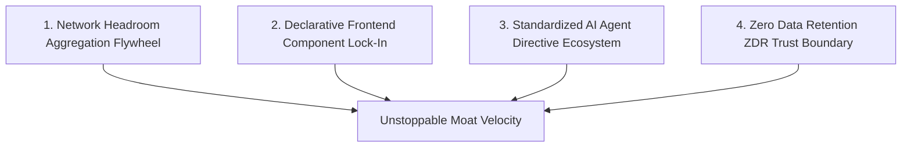

# 🛡️ GALXAI Competitive Landscape & Strategic Defensibility

A comprehensive competitive analysis evaluating GALXAI against direct and indirect market alternatives across cost, ergonomics, reliability, and security.

---

## 🧭 1. The Competitive Landscape Overview

```
                                  HIGH DEVELOPER ERGONOMICS
                                              ▲
                                              │     ★ GALXAI
                                              │     (Wholesale + Drop-In UI + Agent Skills)
                                              │
                      Vercel AI Gateway       │     Cursor / Windsurf Native
                                              │
  RETAIL PRICING / SURCHARGES ───────────────┼──────────────────────── WHOLESALE PRICING (-25% to -40%)
                                              │
                      Portkey / Helicone      │     OpenRouter
                                              │     (Raw Model Router, No UI Components)
                      Cloudflare AI Gateway   │
                                              │
                                              ▼
                                  LOW DEVELOPER ERGONOMICS /
                                  MANUAL PROXY COMPLEXITY
```

---

## 📊 2. Feature & Architectural Comparison Matrix

| Capability / Metric | **GALXAI** | **OpenRouter** | **Cloudflare AI Gateway** | **Portkey / Helicone** | **Direct OpenAI / Anthropic** |
| :--- | :--- | :--- | :--- | :--- | :--- |
| **Pricing Model** | **25%–40% Wholesale Discount** | Retail + Platform Spread | Retail Pass-Through | Retail + SaaS Subscription | Full Retail List Price |
| **Prompt Caching Pass-Through** | **100% (75% Rebate)** | Partial | Inconsistent | Metadata Tracking Only | 50%–75% (Conditional) |
| **Declarative React UI Components** | **Yes (`<GalxImage />`, `<GalxChat />`)** | No (API Only) | No (Edge Worker Only) | No (SDK Wrapper Only) | No |
| **Zero-Route Server Actions** | **Yes (`galxai/actions`)** | No | No | No | No |
| **AI Agent Directives (`npx skills`)**| **Yes (.cursorrules, CLAUDE.md)** | No | No | No | No |
| **Zero-Migration Auto-Patcher** | **Yes (`import 'galxai/patch'`)** | No (Requires Base URL Refactor)| No | No | No |
| **Failover RTO / SLA** | **< 1ms / 99.99%** | Best-Effort | Regional | Cloud-Dependent | Single-Origin Stalls (429) |
| **Zero Data Retention (ZDR)** | **Cryptographic RAM Zeroization**| Provider-Dependent | Edge Logging Enabled | Full Request Logging | 30-Day Storage Default |
| **Sub-15ms TTFT Wire Latency** | **Yes (BroccoliDB L1 Mirror)** | ~180ms–450ms | ~45ms–120ms | ~120ms–300ms | ~250ms–800ms |

---

## 🏰 3. The 4 Defensible Moats



### Moat 1: Network Headroom Aggregation (The Volume Flywheel)
- **Economic Scale Advantage**: As token volume through GALXAI grows, our tier commitments with foundation model labs scale from tier-3 to tier-5+.
- **Price Elasticity**: Higher volume unlocks lower upstream clearing costs, enabling GALXAI to widen its gross margin while simultaneously lowering prices for developers. A single AI startup cannot negotiate these bulk commitments independently.

### Moat 2: Declarative Frontend Component Lock-In
- **Product Stickiness**: Traditional gateways are easily swapped by changing an environment variable. GALXAI embeds declarative JSX components (`<GalxImage />`, `<GalxChat />`, Next.js Server Actions) directly into the customer's React component tree.
- **Switching Friction**: Replacing GALXAI requires rewriting UI state management, loading skeletons, aspect ratio handlers, and server-side RPC logic.

### Moat 3: Standardized AI Agent Directives Ecosystem
- **Distribution Monopolization**: Over 60% of modern software is scaffolded by AI coding assistants. By establishing `npx galxai skills` as the standard for `.cursorrules`, `CLAUDE.md`, and `AGENTS.md`, AI agents autonomously choose and generate GALXAI code in new customer projects by default.

### Moat 4: Cryptographic Zero Data Retention (ZDR v10) & SOC 2 Trust
- **Enterprise Defensibility**: Enterprise legal and compliance teams prohibit routing sensitive data through gateways that store prompts in persistent logs. GALXAI's volatile RAM-only buffer architecture with SHA-256 Merkle audit chains provides a compliance moat that developer-centric proxies cannot match.
