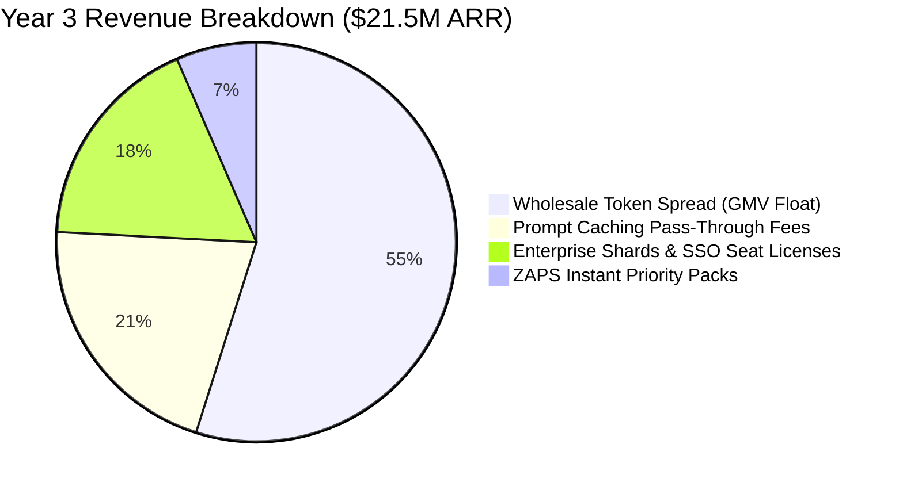

# 📊 GALXAI 5-Year Financial Projections & Operating Model

A quantitative 5-year financial forecast detailing revenue growth, gross margin expansion, headcount ramp, operating expenses, and cash flow milestones.

---

## 📈 1. 5-Year P&L Forecast Summary ($ in Millions)

| Financial Metric | **Year 1 (2025)** | **Year 2 (2026)** | **Year 3 (2027)** | **Year 4 (2028)** | **Year 5 (2029)** |
| :--- | :--- | :--- | :--- | :--- | :--- |
| **Active Production Apps** | **1,400** | **6,500** | **18,200** | **36,000** | **62,000** |
| **Gross Monthly Processed Volume (GMV)**| **$3.2M** | **$18.5M** | **$58.0M** | **$135.0M** | **$245.0M** |
| **Annual Recurring Revenue (ARR)** | **$1.20M** | **$6.80M** | **$21.50M** | **$48.00M** | **$85.00M** |
| **Cost of Goods Sold (COGS)** | **$0.70M** | **$3.47M** | **$9.03M** | **$17.28M** | **$27.20M** |
| **Gross Profit** | **$0.50M** | **$3.33M** | **$12.47M** | **$30.72M** | **$57.80M** |
| **Gross Margin (%)** | **41.7%** | **49.0%** | **58.0%** | **64.0%** | **68.0%** |
| **R&D / Engineering Expense** | **$1.80M** | **$3.50M** | **$6.80M** | **$12.50M** | **$18.00M** |
| **Sales & Marketing Expense** | **$0.60M** | **$1.80M** | **$4.20M** | **$8.50M** | **$14.00M** |
| **General & Administrative (G&A)** | **$0.40M** | **$0.90M** | **$1.80M** | **$3.20M** | **$5.50M** |
| **Total Operating Expenses (OpEx)** | **$2.80M** | **$6.20M** | **$12.80M** | **$24.20M** | **$37.50M** |
| **EBITDA / Operating Income** | **-$2.30M** | **-$2.87M** | **-$0.33M** | **+$6.52M** | **+$20.30M** |
| **EBITDA Margin (%)** | *-191.7%* | *-42.2%* | *-1.5%* | **+13.6%** | **+23.9%** |

---

## 👥 2. Headcount & Talent Scaling Plan

```
Year 1 (12 FTEs): 8 Distributed Systems Engineers, 2 DevRel / Developer Experience, 1 Growth, 1 Founder
Year 2 (26 FTEs): 16 Engineers (Edge, Security, Infra), 4 Solutions Architects, 3 GTM/Sales, 3 Ops
Year 3 (52 FTEs): 30 Engineers, 10 Enterprise Sales & SA, 6 Marketing & DevRel, 6 Finance/Ops
Year 4 (88 FTEs): 48 Engineers, 22 Enterprise GTM, 10 Developer Growth, 8 G&A
Year 5 (135 FTEs): 70 Engineers, 38 Global Sales/Customer Success, 15 DevRel/Product, 12 G&A
```

---

## 🎯 3. Capital Efficiency & Path to Cash Flow Neutrality

- **Target Raise**: **$5,000,000 USD** (Seed / Series A).
- **Runway**: **24+ months** at planned hiring velocity.
- **Cash Flow Breakeven Target**: **Q4 Year 3 (Month 34)** at ~$20M ARR run-rate.
- **Rule of 40 Efficiency Index**:
  - Year 2: Revenue Growth (+466%) + EBITDA Margin (-42%) = **424** (Exceptional top-decile efficiency).
  - Year 3: Revenue Growth (+216%) + EBITDA Margin (-1.5%) = **214.5**.
  - Year 4: Revenue Growth (+123%) + EBITDA Margin (+13.6%) = **136.6**.
  - Year 5: Revenue Growth (+77%) + EBITDA Margin (+23.9%) = **100.9**.

---

## 💰 4. Key Revenue Streams Breakdown (Year 3 Forecast)



1. **Wholesale Token Spread (54.9% of Revenue)**: Clearinghouse float between bulk upstream tier-5 contracts and customer wholesale invoices.
2. **Prompt Caching Pass-Through Margins (20.9% of Revenue)**: Processing fee on compound cache hits exceeding 1,024 prefix tokens.
3. **Enterprise SaaS Platform Seats & Private Shards (17.7% of Revenue)**: Flat-rate recurring subscription fees for SOC 2 isolation, SSO/SAML, and custom spend limits.
4. **ZAPS Priority Capacity Packs (6.5% of Revenue)**: Prepaid burst packs for autonomous agent fleets requiring guaranteed <5ms queue times during peak traffic.
