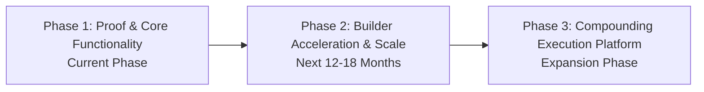
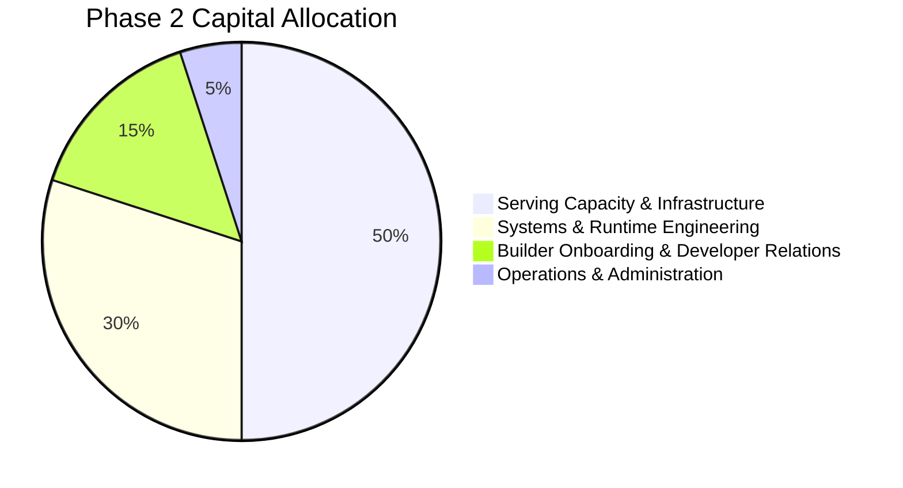

# 📊 GALX Financial Architecture & Capital Milestones

<!-- docs-scope: commercial-draft -->
> **Reading scope:** Commercial and strategic investor materials. Contains thesis formulations, product positioning, unit economics frameworks, and venture scale arguments. Technical and operational capabilities describe public interfaces; proprietary routing mechanisms, capacity acquisition, and internal execution infrastructure remain private under [AGENTS.md](../AGENTS.md).

## Capital Formation, Phase Milestones & Operating Discipline

A grounded financial framework detailing how capital is deployed across development phases, what each round of funding enables GALX to prove, and how the business scales towards cash flow durability.

---

## 1. Operating Philosophy: Intellectual Honesty Over Fantasy Models

Early-stage venture pitches frequently present elaborate 5-year spreadsheets projecting hundreds of millions in revenue with artificial decimal precision.

GALX takes a disciplined, intellectually honest approach:
- We do not manufacture fictitious enterprise ARR forecasts for a product currently in active developer onboarding.
- We structure our financial roadmap around **clear operational phases**, where each phase validates critical thesis assumptions before capital is expanded.
- Capital is deployed to expand capacity, deepen operational resilience, and accelerate builder onboarding—not to fund vanity burn.

---

## 2. Phase-Based Capital & Operating Roadmap

### Phase 1: Platform Foundation & Core Operational Verification (Current)
* **Core Objective**: Verify that the two-model managed platform delivers dependable, abundant execution to early builders with zero infrastructure friction.
* **Key Activities**:
  - Live operation of developer endpoints (including **GALX Nova**).
  - Validating sufficient intelligence delivery on representative application workloads.
  - Observing initial builder usage patterns, request latencies, and platform stability.
* **Capital Focus**: Core engineering, local serving infrastructure, operational monitoring, and initial developer access programs.

### Phase 2: Builder Onboarding & Compounding Usage Validation (Next 12–18 Months)
* **Core Objective**: Prove the expansion engine—demonstrating that applications built on GALX generate compounding, recurring execution volume as they acquire end users.
* **What Capital Enables**:
  - **Serving Capacity Expansion**: Scaling capacity to support high-concurrency developer applications without degradation.
  - **Operational Instrumentation**: Deepening automated capacity balancing, resilience tooling, and serving optimizations.
  - **Developer Onboarding & Community**: Direct developer relations, hackathons, and builder grants to seed the next 1,000 applications.
* **Key Metrics to Prove**:
  - 30-day and 90-day builder retention.
  - Ratio of development traffic vs. production end-user traffic.
  - Sustained platform gross margin across multi-tenant workloads.

### Phase 3: The Persistent Execution Layer (Expansion Horizon)
* **Core Objective**: Establish GALX as the default execution layer beneath an expanding ecosystem of software applications.
* **Key Activities**:
  - Supporting high-volume production scale for breakaway applications built on GALX.
  - Deepening proprietary operational infrastructure to further expand gross margins.
  - Transitioning from early venture funding to cash flow neutrality powered by recurring execution volume.

---

## 3. Resource Allocation & Capital Efficiency

1. **Infrastructure & Serving Capacity (50%)**: Securing dependable capacity and server resources to guarantee abundant, low-latency execution for scaling applications.
2. **Systems Engineering (30%)**: Advancing proprietary operational tooling, resilience mechanisms, and runtime management that preserve high platform gross margins.
3. **Builder Onboarding & DevRel (15%)**: Providing hands-on onboarding support, documentation, and tooling for independent builders and creative technologists.
4. **Operations & Governance (5%)**: Maintaining lean administrative, legal, and operational compliance.

---

## 4. The Long-Term Economic Outcome

**What does the mature business look like?**

As thousands of applications run their production workloads through GALX:
- **Revenue compounds with software usage**: Rather than renegotiating software contracts annually, revenue expands automatically with the growth of every application on the platform.
- **High gross margin profile**: Operational knowledge and capacity optimization enable software-like margins on top of managed execution.
- **Durable infrastructure moat**: Switching costs remain exceptionally high, creating a defensible, high-retention infrastructure business.
